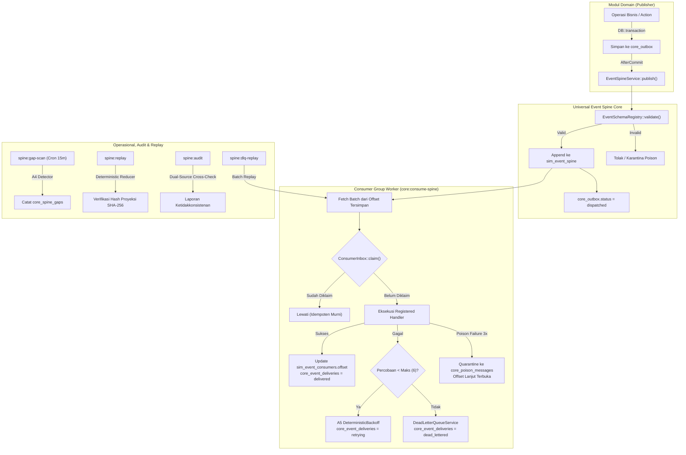
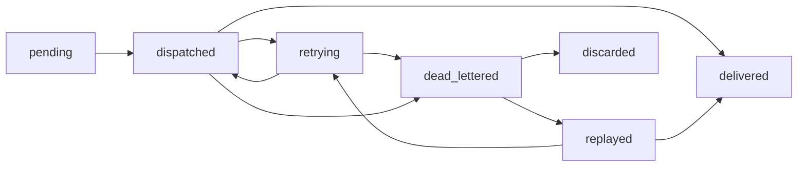

# Dokumen Desain Teknis — Fase R8: Universal Event Spine, Idempotent Consumer Inbox, Outbox Migration, DLQ & Dual-Source Audit

## 1. Ringkasan Eksekutif & Sasaran Desain

Fase R8 menghadirkan fondasi pesan terdistribusi enterprise (**Universal Event Spine**) yang menggabungkan:
1. **Outbox Transaksional & Append-Only Spine Log**: Menjembatani model domain yang memancarkan event saat `DB::transaction` commit (`core_outbox`) dengan append-only message log ber-partisi topik (`sim_event_spine`).
2. **State Machine EventDelivery 7 Status**: Siklus hidup pengiriman event yang terlindungi guard transisi (`pending` -> `dispatched` -> `delivered` / `retrying` -> `dead_lettered` -> `replayed` / `discarded`).
3. **Idempotensi Konsumen Tahan-Restart (`ConsumerInbox`)**: Penyimpanan status klaim idempoten persisten di tabel `core_consumer_inbox` yang dieksekusi dalam transaksi yang sama dengan side-effect handler, menggantikan cache statis in-memory `SpineConsumerRegistry::$processedEvents`.
4. **Karantina Poison Message & Dead-Letter Queue (DLQ)**: Pemisahan poison message yang gagal validasi skema atau handler berturut-turut ke dalam `core_poison_messages`, sehingga tidak menahan kemajuan offset konsumen untuk pesan lain.
5. **Algoritma Bersertifikat**:
   - **A4 (`AggregateSequenceGapDetector`)**: Deteksi celah urutan event ($O(n \log n)$) dan duplikasi nomor urut per aggregate stream.
   - **A5 (`DeterministicBackoff`)**: Algoritma integer exponential backoff deterministik berbasis MINSTD LCG generator tanpa fungsi acak `rand()` atau panggilan `sleep()`.
   - **A6 (`SchemaAdditiveCompatibilityChecker`)**: Validator backward-compatibility skema event JSON untuk mencegah breaking change saat evolusi skema.
6. **Replay Deterministik**: Fasilitas replay event stream berdasarkan rentang offset `(--from= --to=)` dengan verifikasi kanonikal SHA-256 projection hash.
7. **Audit Dua Sumber (`spine:audit`)**: Verifikasi matematis konsistensi antara outbox, log spine, pengiriman konsumen, gap sequence, dan poison quarantine.

---

## 2. Diagram Alur Arsitektur Event Spine

---

## 3. Spesifikasi State Machine `EventDelivery` (DR8-1)

Siklus hidup pengiriman pesan direpresentasikan oleh model `CoreEventDelivery` dengan status berikut:
1. `pending`: Pesan siap dikirimkan ke consumer group target.
2. `dispatched`: Pesan telah diambil oleh worker konsumen dan mulai diproses.
3. `delivered`: Handler konsumen berhasil mengeksekusi pesan dan claim inbox tercatat secara permanen.
4. `retrying`: Handler gagal sementara; jeda percobaan dihitung secara deterministik oleh Algoritma A5.
5. `dead_lettered`: Batas percobaan maksimum (6 kali) tercapai, atau kegagalan fatal yang memerlukan intervensi operasional.
6. `replayed`: Pesan dari DLQ atau stream lama dijadwalkan untuk diproses ulang oleh `spine_operator`.
7. `discarded`: Pesan DLQ diabaikan secara permanen dengan alasan audit yang tercatat (batch > 20 memerlukan persetujuan `ApprovalEngine`).

---

## 4. Spesifikasi Algoritma A4, A5, dan A6

### A. Algoritma A4: `AggregateSequenceGapDetector`
- **Tujuan**: Memastikan integritas urutan pesan per aggregate ID dalam event sourcing/outbox.
- **Kompleksitas**: $O(n \log n)$ berbasis sorting sequence integer.
- **Masukan**: Daftar integer sequence $[s_1, s_2, \dots, s_n]$.
- **Keluaran**:
  - `gaps`: Daftar pasangan rentang tuple `(awal, akhir)` yang hilang.
  - `duplicates`: Daftar integer sequence yang muncul lebih dari satu kali.

### B. Algoritma A5: `DeterministicBackoff`
- **Tujuan**: Memberikan jeda backoff eksponensial deterministik dengan jitter teratur tanpa memanggil fungsi acak sistem (`rand()`, `mt_rand()`) atau `sleep()`.
- **Parameter**:
  - Dasar = 30 detik, Batas = 3.600 detik, Modulus $m = 2^{31} - 1 = 2.147.483.647$, Multiplier $a = 48.271$.
- **Rumus**:
  $$\text{mentah} = \min(\text{batas}, \text{dasar} \times 2^{n - 1})$$
  $$\text{seed} = ((\text{idPesan} \bmod m) \times (n + 1)) \bmod m \quad (\text{jika } 0 \to 1)$$
  $$x = (\text{seed} \times 48.271) \bmod m$$
  $$\text{jitter} = x \bmod \left(\lfloor \text{mentah} / 4 \rfloor + 1\right)$$
  $$\text{jeda} = \text{mentah} + \text{jitter}$$

### C. Algoritma A6: `SchemaAdditiveCompatibilityChecker`
- **Tujuan**: Menganalisis kompatibilitas ke belakang (backward compatibility) skema JSON event.
- **Aturan Kompatibilitas Aditif**:
  - Menambah field properti baru bersifat opsional $\to$ **DIPERBOLEHKAN**.
  - Menambah elemen nilai baru pada `enum` $\to$ **DIPERBOLEHKAN**.
  - Menghapus properti yang ada $\to$ **PELANGGARAN** (`PROPERTY_REMOVED`).
  - Mengubah tipe data properti $\to$ **PELANGGARAN** (`TYPE_CHANGED`).
  - Menambah properti baru ke dalam daftar `required` $\to$ **PELANGGARAN** (`REQUIRED_ADDED`).
  - Menghapus nilai dari daftar `enum` $\to$ **PELANGGARAN** (`ENUM_VALUE_REMOVED`).
  - Mempersempit batasan nilai `minimum` (menaikkan) atau `maximum` (menurunkan) $\to$ **PELANGGARAN** (`RANGE_NARROWED`).

---

## 5. Audit Dua Sumber (`spine:audit`)

Command `spine:audit` memvalidasi integritas ekosistem event melalui 6 pos pemeriksaan silang:
1. **Outbox vs Spine Completeness**: Memastikan setiap outbox bertipe spine memiliki padanan pada `sim_event_spine`.
2. **Delivery vs Inbox Consistency**: Memastikan status `delivered` pada `core_event_deliveries` memiliki rekaman yang sah pada `core_consumer_inbox`.
3. **Unresolved Sequence Gaps**: Memeriksa celah urutan yang belum ditutup pada `core_spine_gaps`.
4. **Orphan Dead-Letter Entries**: Memeriksa pesan di DLQ yang tidak memiliki alasan kegagalan (`last_error` / `failure_reason`).
5. **Schema Registry Breaking Drift**: Memverifikasi seluruh versi skema event aktif mematuhi aturan aditif A6 terhadap versi sebelumnya.
6. **Consumer Offset Validity**: Memastikan offset yang disimpan pada `sim_event_consumers` tidak melebihi ID pesan terbesar pada `sim_event_spine`.

