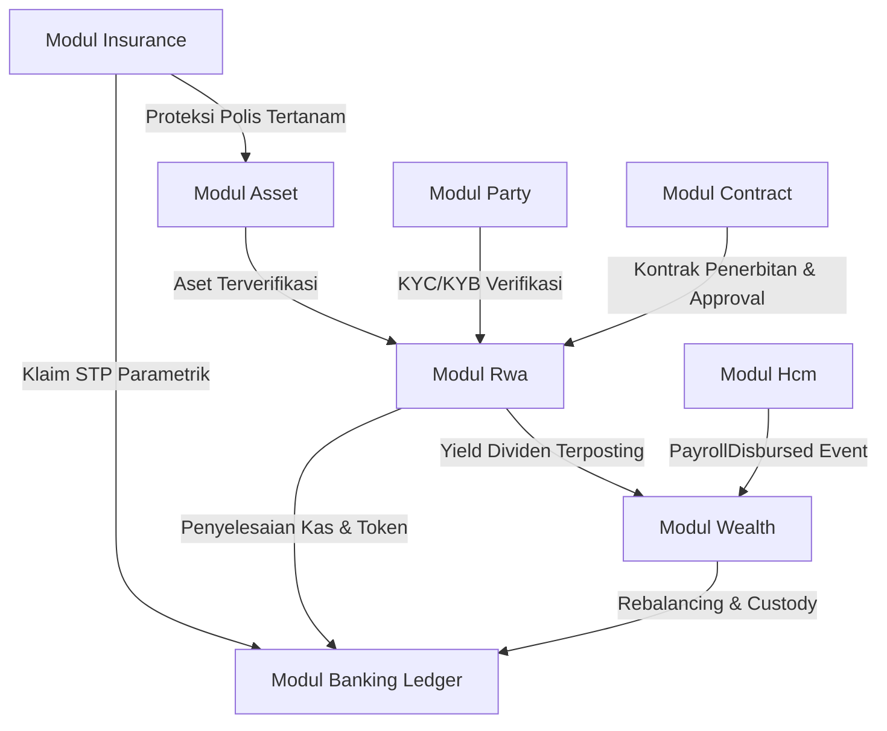

# Desain Arsitektur & Spesifikasi Teknis: LINI 4 Keuangan Aset (Rwa → Insurance → Wealth)

## 1. Arsitektur Domain & Modul

Modul LINI 4 mengintegrasikan siklus keuangan aset digital, proteksi risiko, dan akumulasi kekayaan:
- **Rwa (Real World Assets)**: Tokenisasi aset fisik (properti Mall, logistik, mesin), penawaran perdana (IPO token) dengan escrow hold & alokasi Hamilton, dividen proporsional dari pendapatan riil ledger, dan pasar sekunder dengan transfer log append-only.
- **Insurance**: Asuransi mikro tertanam, penomoran polis gapless, pengakuan pendapatan premi harian berbasis pembulatan kumulatif B0′.2, pemicu klaim parametrik straight-through processing (STP), dan penyelesaian indemnity ledger.
- **Wealth**: Robo-advisor profil risiko berbasis survei tertimbang (bps), portofolio multi-aset (Pasar Uang, Obligasi, RWA), cash sweep otomatis dari payroll HCM & yield RWA, MTM harian, dan rebalancing berbasis band B0′.8.

---

## 2. State Machine Eksplisit

### 2.1 RwaAsset
- `draft`: Baru didaftarkan oleh issuer; menautkan asset_id, underlying contract, dan dokumen appraisal.
- `approved`: Telah disetujui melalui four-eyes approval (approver $\ne$ creator via `ApprovalEngineInterface`).
- `issued`: Token berhasil dicetak ke inventori penerbitan.
- `paused`: Perdagangan/distribusi ditangguhkan sementara karena audit atau insiden.
- `retired`: Masa berlaku aset habis atau dibeli kembali (buyback).

### 2.2 RwaOffering
- `upcoming`: Penawaran dijadwalkan, belum menerima pesanan.
- `open`: Masa pemesanan aktif; dana pemesanan di-hold via PaymentGateway.
- `closed`: Masa pemesanan berakhir; alokasi pro-rata dihitung menggunakan `HamiltonApportionment`.
- `settled`: Dana dialokasikan di-capture, sisa hold di-release, token didistribusikan ke holding investor.
- `cancelled`: Penawaran dibatalkan; seluruh hold dana di-release.

### 2.3 InsurancePolicy
- `draft`: Data polis disiapkan di checkout/transaksi.
- `active`: Premi didebit dari kas pengguna dan dikredit ke Unearned Premium Liability; nomor polis gapless ditetapkan.
- `claimed`: Klaim disetujui atau dibayarkan.
- `expired`: Masa pertanggungan habis; seluruh sisa unearned premium telah diakui ke pendapatan.
- `cancelled`: Polis dibatalkan sebelum masa pertanggungan berjalan.

### 2.4 InsuranceClaim
- `submitted`: Klaim diajukan oleh pengguna atau dipicu oleh oracle parametrik.
- `evaluating`: Pengecekan fraud score dan validitas polis.
- `approved`: Lulus evaluasi (STP jika fraud score $< 3000$ bps, atau manual review jika $\ge 3000$ bps).
- `settled`: Pembayaran indemnity selesai diposting ke ledger kas dan akun kewajiban klaim.
- `rejected`: Klaim ditolak karena bukti tidak valid atau fraud score tinggi.

### 2.5 WmProfile & WmOrder
- WmProfile: `survey_pending` $\rightarrow$ `active`.
- WmOrder: `PENDING` $\rightarrow$ `EXECUTED` | `CANCELLED`.

---

## 3. Aturan Jurnal Ledger (Double-Entry Accounting)

Setiap transaksi mematuhi saldo normal (§A2.1) dan saldo non-negatif (U-3) kecuali akun escrow/clearing:

| No | Peristiwa Bisnis | Debit (D) | Kredit (K) | Idempotency Key Pattern |
| :--- | :--- | :--- | :--- | :--- |
| **R-1** | Hold Pesanan IPO RWA | *PaymentGateway::hold* (kas off-ledger hold) | - | `rwa:offering:hold:{offering_id}:{user_id}` |
| **R-2** | Settlement Alokasi IPO RWA | Kas Investor (`wallet:IDR:{user_id}`) | RWA Escrow Clearing (`rwa:offering_escrow:{id}:IDR`) | `rwa:offering:capture:{offering_id}:{user_id}` |
| **R-3** | Penyerahan Hasil IPO ke Penerbit | RWA Escrow Clearing (`rwa:offering_escrow:{id}:IDR`) | Kas Penerbit / Hasil Penjualan (`rwa:sale_proceeds:{asset_id}:IDR`) | `rwa:offering:settle:{offering_id}` |
| **R-4** | Deklarasi & Payout Dividen RWA | Akun Pendapatan Sumber (`rwa:pool:{asset}:IDR`) | Kas Dompet Investor (`wallet:IDR:{user_id}`) | `rwa:dividend:payout:{asset_id}:{period}:{user_id}` |
| **R-5** | Perdagangan Sekunder RWA (Kas) | Kas Pembeli (`wallet:IDR:{buyer_id}`) | Kas Penjual (`wallet:IDR:{seller_id}`) | `rwa:trade:settle:{order_id}` |
| **R-6** | Fee Perdagangan Sekunder RWA | Kas Penjual (`wallet:IDR:{seller_id}`) | Fee Platform RWA (`rwa:platform_fees:IDR`) | `rwa:trade:fee:{order_id}` |
| **I-1** | Penerbitan Polis (Premi Diterima) | Kas Pemegang Polis (`wallet:IDR:{user_id}`) | Premi Belum Diakui (`ins:unearned_premium:IDR`) | `ins:policy:issue:{product_id}:{user_id}:{seq}` |
| **I-2** | Pengakuan Premi Harian (B0′.2) | Premi Belum Diakui (`ins:unearned_premium:IDR`) | Pendapatan Premi Diakui (`ins:earned_premium_revenue:IDR`) | `ins:premium:earn:{policy_id}:{date}` |
| **I-3** | Akrual Beban Klaim Disetujui | Beban Klaim Asuransi (`ins:claim_expense:IDR`) | Hutang Klaim (`claimant:payable:default:IDR`) | `ins:claim:accrue:{claim_id}` |
| **I-4** | Pencairan Klaim ke Nasabah | Hutang Klaim (`claimant:payable:default:IDR`) | Kas Pemegang Polis (`wallet:IDR:{user_id}`) | `ins:claim:payout:{claim_id}` |
| **W-1** | Cash Sweep / Auto-Invest | Kas Operasional Nasabah (`wallet:IDR:{user_id}`) | Kliring Sweep Kas (`wm:cash_sweep_clearing:IDR`) | `wm:sweep:exec:{user_id}:{tx_id}` |
| **W-2** | Pembelian Aset Portofolio (NAV) | Kliring Sweep Kas (`wm:cash_sweep_clearing:IDR`) | Rekening Efek/Kustodi (`wm:portfolio_custody:{profile_id}:IDR`) | `wm:portfolio:buy:{profile_id}:{asset}:{lot}` |
| **W-3** | Penjualan Aset Rebalancing | Rekening Efek/Kustodi (`wm:portfolio_custody:{profile_id}:IDR`) | Kliring Sweep Kas (`wm:cash_sweep_clearing:IDR`) | `wm:portfolio:sell:{profile_id}:{asset}:{lot}` |
| **W-4** | Fee Pengelolaan Portofolio | Rekening Efek/Kustodi (`wm:portfolio_custody:{profile_id}:IDR`) | Pendapatan Fee Wealth (`wm:management_fee:IDR`) | `wm:fee:charge:{profile_id}:{period}` |

---

## 4. Format Idempotency-Key & Header

Setiap request mutasi uang/stok/status menerima header `Idempotency-Key` dari pemanggil (U-4). Jika tidak ada $\rightarrow$ respon HTTP 422 Unprocessable Entity.
Format internal key pada ledger:
- RWA: `rwa:{action}:{business_id}[:{sub}]`
- Insurance: `ins:{action}:{business_id}[:{sub}]`
- Wealth: `wm:{action}:{business_id}[:{sub}]`

Deteksi konflik: jika key sama dikirim dengan payload berbeda $\rightarrow$ lempar `IdempotencyConflictException` (HTTP 409).

---

## 5. Kontrak Antar-Modul & Interfaces (Z9)

Untuk menjaga modular monolith decoupled tanpa dependensi langsung ke implementasi modul lain:
1. `Modules\Party\Contracts\InvestorKycLookupInterface`:
   - `public function getKycVerificationStatus(int $userId): array;`
   - Memeriksa apakah investor memiliki dokumen KYC berstatus `VERIFIED` dan belum kadaluarsa.
2. `Modules\Asset\Contracts\AssetRegistryLookupInterface`:
   - `public function getAssetDetails(string $assetType, string $assetId): ?array;`
   - Memastikan aset dasar (misal unit mall atau armada truk) terdaftar dan berstatus aktif.
3. `Modules\Contract\Contracts\ContractLookupInterface`:
   - `public function getContract(string $contractNumber): ?array;`
   - Memvalidasi legalitas kontrak penerbitan sekuritas digital RWA.
4. `Modules\Core\Contracts\ApprovalEngineInterface`:
   - Menjalankan alur four-eyes approval (`draft` $\rightarrow$ `approved`) dengan validasi eksplisit `approver_id !== creator_id`.

---

## 6. Katalog Event Domain (Emitted & Consumed)

### Emitted Events (via Outbox Pattern)
- `RwaAssetTokenized`: Dipancarkan saat aset RWA disetujui dan diterbitkan.
- `RwaOfferingSettled`: Dipancarkan saat penutupan IPO dan alokasi token selesai.
- `RwaTokenTransferred`: Dipancarkan pada setiap perpindahan kepemilikan token.
- `RwaDividendDistributed`: Dipancarkan setelah dividen terposting ke kas pemegang token.
- `InsurancePolicyIssued`: Dipancarkan saat polis asuransi aktif.
- `ParametricInsuranceClaimTriggered`: Dipancarkan saat event cuaca/keterlambatan terdeteksi oracle.
- `InsuranceClaimSettled`: Dipancarkan setelah pembayaran santunan klaim selesai di ledger.
- `WealthRiskProfileUpdated`: Dipancarkan saat profil risiko dan bobot target nasabah diperbarui.
- `WealthPortfolioRebalanced`: Dipancarkan setelah eksekusi order rebalancing portofolio.
- `CorporateIdleCashSwept`: Dipancarkan saat kelebihan likuiditas dipindahkan ke instrumen pasar uang.

### Consumed Events
- `Modules\Hcm\Domain\Events\PayrollDisbursed`:
  - Didengar oleh `AutoInvestPayrollConsumer` di modul Wealth.
  - Memeriksa konfigurasi sweep nasabah dan memicu sweep otomatis sebesar persentase yang ditentukan (default 1000 bps = 10%).
- `Modules\Rwa\Domain\Events\RwaDividendDistributed`:
  - Didengar oleh `AutoReinvestDividendConsumer` di modul Wealth untuk nasabah yang mengaktifkan auto-reinvest.

---

## 7. Skema Database Tambahan

### 7.1 Modul Rwa
- `rwa_investor_verifications`:
  - `id`, `user_id`, `kyc_document_id`, `approval_id`, `verified_at`, `expires_at`, `status`, `timestamps`.
- `rwa_offering_orders`:
  - `id`, `offering_id`, `user_id`, `quantity_requested`, `quantity_allocated`, `hold_reference_id`, `amount_held_idr`, `amount_captured_idr`, `status` (`HELD`, `ALLOCATED`, `SETTLED`, `CANCELLED`), `idempotency_key`, `timestamps`.
- `rwa_token_transfers` (Append-only facts):
  - `id`, `rwa_asset_id`, `from_user_id` (nullable untuk minting), `to_user_id`, `quantity`, `price_per_token_idr`, `transfer_type` (`PRIMARY_ISSUANCE`, `SECONDARY_TRADE`, `ESCROW_RELEASE`), `reference_id`, `idempotency_key`, `created_at`.

### 7.2 Modul Insurance
- `ins_policy_sequences`:
  - `id`, `product_id`, `year`, `last_sequence`, `updated_at`.
  - Unique constraint pada `['product_id', 'year']`. Digunakan dengan `lockForUpdate` pesimistik.
- `ins_policy_earnings` (Append-only facts):
  - `id`, `policy_id`, `earning_date`, `daily_amount_idr`, `cumulative_earned_idr`, `idempotency_key`, `created_at`.
- `ins_parametric_oracles`:
  - `id`, `oracle_code`, `name`, `source_type` (`BMKG_WEATHER`, `FLIGHT_RADAR`, `IOT_TELEMATICS`), `is_active`, `api_endpoint_config`, `timestamps`.

### 7.3 Modul Wealth
- `wm_portfolio_holdings`:
  - `id`, `profile_id`, `asset_code`, `units`, `average_cost_nav`, `current_nav`, `current_market_value_idr`, `last_mtm_at`, `timestamps`.
  - Unique constraint pada `['profile_id', 'asset_code']`.
- `wm_nav_history` (Append-only facts):
  - `id`, `asset_code`, `nav_date`, `nav_scale_4` (skala 1e4), `source`, `created_at`.
- `wm_sweep_configs`:
  - `id`, `user_id`, `threshold_cash_idr`, `sweep_percentage_bps`, `is_active`, `timestamps`.

---

## 8. Matriks RBAC & Hak Akses

Didaftarkan melalui `RbacService` secara idempoten:
1. `rwa_issuer`: Akses pendaftaran draft aset, pengajuan penawaran, dan peninjauan dividen.
2. `rwa_compliance_officer`: Persetujuan four-eyes pada tokenisasi aset dan verifikasi investor.
3. `rwa_investor`: Pemesanan penawaran perdana, perdagangan sekunder, dan penarikan dividen.
4. `insurance_underwriter`: Konfigurasi produk asuransi mikro, manajemen oracle, dan peninjauan limit.
5. `insurance_claims_officer`: Investigasi klaim berisiko tinggi dan otorisasi disbursement.
6. `wealth_advisor`: Peninjauan model alokasi MPT dan konfigurasi profil risiko.
7. `wealth_investor`: Pengisian survei risiko, penyusunan portofolio, dan konfigurasi auto-invest cash sweep.

---

## 9. Formulasi Audit Dua-Sumber & Fixture Korupsi

Setiap modul dilengkapi perintah audit CLI dua-sumber:
1. `php artisan rwa:audit`:
   - Sumber A: Rekonsiliasi `rwa_token_transfers` per investor vs saldo `rwa_holdings`.
   - Sumber B: Rekonsiliasi akumulasi `amount_captured_idr` di `rwa_offering_orders` vs saldo akun kas penerbit di ledger.
   - Fixture: `RwaCorruptionFixture` (mensimulasikan manipulasi saldo holding tanpa log transfer).
2. `php artisan insurance:audit`:
   - Sumber A: Rekonsiliasi $\Sigma(\text{daily\_amount\_idr})$ di `ins_policy_earnings` vs saldo akun `ins:earned_premium_revenue:IDR` di ledger.
   - Sumber B: Rekonsiliasi sisa liabilitas polis aktif vs saldo akun `ins:unearned_premium:IDR`.
   - Fixture: `InsuranceCorruptionFixture` (mensimulasikan selisih pengakuan pendapatan premi).
3. `php artisan wealth:audit`:
   - Sumber A: Nilai total portofolio dihitung dari $\Sigma(\text{units} \times \text{current\_nav} / 10^4)$ di `wm_portfolio_holdings`.
   - Sumber B: Saldo aset investasi nasabah di akun ledger `wm:portfolio_custody:{id}:IDR`.
   - Fixture: `WealthCorruptionFixture` (mensimulasikan revaluasi MTM tanpa posting jurnal).
