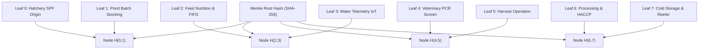

# Spesifikasi Desain G7-D46: Standar Ketelusuran Kriptografis Merkle Tree Rantai Pasok Seafood Ekspor

## 1. Status Keputusan & Konteks Regulasi

- **ID Keputusan:** `G7-D46`
- **Kategori:** Arsitektur Kriptografi, Ketelusuran Pangan & Kepatuhan Ekspor
- **Modul Pemilik:** `Marine` (`Modules\Marine`) & `Shared` (`Modules\Shared\Domain\Algorithms\Marine`)
- **Regulasi Terkait:**
  - US FDA Food Safety Modernization Act (FSMA) Rule 204 — *Food Traceability List for Seafood*
  - EU Regulation (EU) No 1379/2013 on the Common Organisation of the Markets in Fishery and Aquaculture Products
  - ASC Chain of Custody Standard (CoC v5.1)
  - Marine Stewardship Council (MSC) CoC Standard Default v5.0
  - EUDR (EU Deforestation Regulation) Article 9 — *Due Diligence Statement and Geolocation Requirements*

---

## 2. Masalah Arsitektural & Persyaratan Bisnis

Pada sistem rantai pasok perikanan konvensional, ketelusuran komoditas ekspor bergantung pada dokumen fisik kertas atau basis data tersentralisasi rentan manipulasi:
1. **Risiko Pencampuran Liar (*Unauthorized Blending*):** Ikan atau udang hasil tangkapan ilegal (*Illegal, Unreported, and Unregulated / IUU Fishing*) atau udang dari tambak non-sertifikasi sering dicampur ke dalam lot bersertifikat ASC/MSC di tingkat pengepul (*middlemen*) atau pabrik pengolahan.
2. **Keterbatasan Privasi Tambak Plasma (*Farmer Privacy & Biosecurity*):** Importir dan regulator menuntut bukti geolokasi asal tambak, namun mempublikasikan koordinat lintang-bujur presisi petak tambak secara terbuka mengancam biosekuriti (risiko sabotase biologis patogen) dan keamanan petambak plasma rakyat.
3. **Efisiensi Verifikasi Skala Global (*Lightweight Auditing*):** Petugas karantina pelabuhan tujuan (e.g. Los Angeles, Rotterdam, Tokyo) memerlukan metode instan untuk membuktikan bahwa sebuah karton udang beku benar-benar berasal dari batch tambak tertentu tanpa harus mengunduh seluruh rekaman basis data peternakan yang berukuran gigabytes.

---

## 3. Desain Solusi: Pohon Merkle Kanonikal 8-Tahap

Solusi arsitektur G7-D46 mengadopsi struktur data Pohon Merkle (*Merkle Tree*) kriptografis berpasangan kanonikal (*canonical sorted-pair binary tree*). Setiap lot ekspor yang diproduksi wajib memiliki silsilah 8 simpul daun (*leaf nodes*) yang mewakili delapan peristiwa kritis rantai pasok:



### 3.1. Struktur & Payload Masing-Masing Daun (Leaves)

Setiap daun dikonstruksi dari payload JSON kanonikal (kunci terurut abjad, tanpa spasi tidak perlu) sebelum di-hash menggunakan algoritma SHA-256:

#### Daun 0: Asal-Usul Pembenihan & Indukan SPF (`01_HATCHERY_ORIGIN`)
```json
{
  "broodstock_origin": "Kona Bay Hawaii (Specific Pathogen Free)",
  "facility_code": "HAT-BIM-01",
  "license": "KKP-HATCH-BWI-044",
  "spf_certificate": "SPF-CERT-ID-2026-9901",
  "stage": "01_HATCHERY_ORIGIN"
}
```
$$Leaf_0 = \text{SHA256}(\text{CanonicalJson}(Payload_0))$$

#### Daun 1: Penebaran Petak Tambak & EUDR (`02_POND_STOCKING`)
```json
{
  "batch_code": "BATCH-VNM-2026-01",
  "eudr_compliance_ref": "DDS-EUDR-2026-TRK-001",
  "pond_identifier": "POND-TRK-01",
  "redacted_geo_grid": "GRID-10KM-3.3N-117.5E-RED",
  "stage": "02_POND_STOCKING",
  "stocking_date": "2026-08-15",
  "stocking_density_per_m2": 30.0
}
```

#### Daun 2: Nutrisi Pakan & Rasio FIFO (`03_FEED_AND_NUTRITION`)
```json
{
  "asc_feed_standard_compliant": true,
  "batch_code": "BATCH-VNM-2026-01",
  "cumulative_feed_kg": 4125.0,
  "fifo_marine_protein_ratio": 0.75,
  "stage": "03_FEED_AND_NUTRITION"
}
```

#### Daun 3: Rata-Rata Kualitas Air IoT (`04_WATER_QUALITY_TELEMETRY`)
```json
{
  "batch_code": "BATCH-VNM-2026-01",
  "mean_dissolved_oxygen_mg_l": 5.8,
  "mean_ph_level": 7.85,
  "mean_water_temp_celsius": 29.2,
  "stage": "04_WATER_QUALITY_TELEMETRY"
}
```

#### Daun 4: Pemeriksaan Laboratorium Patogen (`05_DISEASE_AND_HEALTH_SCREENING`)
```json
{
  "batch_code": "BATCH-VNM-2026-01",
  "screening_agency": "BKIPM Karantina Perikanan",
  "stage": "05_DISEASE_AND_HEALTH_SCREENING",
  "test_verdict": "ALL_NEGATIVE_WSSV_EHP_IMNV_AHPND"
}
```

#### Daun 5: Operasi Panen & Slurry Es (`06_HARVEST_OPERATION`)
```json
{
  "gross_biomass_kg": 3300.0,
  "harvest_code": "HRV-2026-A1-001",
  "harvest_date": "2026-11-06",
  "ice_slurry_temp_celsius": -1.5,
  "stage": "06_HARVEST_OPERATION"
}
```

#### Daun 6: Pemrosesan Pabrik & HACCP (`07_PROCESSING_AND_PACKAGING`)
```json
{
  "glaze_water_percentage": 8.0,
  "haccp_plan_approval": "ID-PLANT-042",
  "lot_tracking_number": "LOT-EXP-2026-USA-001",
  "mass_balance_yield_pct": 66.0,
  "net_weight_kg": 2178.0,
  "product_form": "HEADLESS_SHELL_ON",
  "stage": "07_PROCESSING_AND_PACKAGING"
}
```

#### Daun 7: Rantai Dingin & Kontainer Reefer (`08_STORAGE_AND_COLD_CHAIN`)
```json
{
  "container_iso_number": "MSKU9021882",
  "lot_tracking_number": "LOT-EXP-2026-USA-001",
  "ocean_bill_of_lading": "MAEU192837465",
  "setpoint_temperature_celsius": -22.0,
  "stage": "08_STORAGE_AND_COLD_CHAIN"
}
```

---

## 4. Algoritma Pembangunan Pohon & Pembuktian Ringan

### 4.1. Hashing Pasangan Kanonikal (Canonical Sorted-Pair Hashing)
Untuk mencegah kerentanan manipulasi urutan (*second preimage attack*), setiap penggabungan dua simpul saudara dilakukan secara kanonikal:
```php
$combined = $leftHash <= $rightHash
    ? $leftHash . $rightHash
    : $rightHash . $leftHash;

$parentHash = hash('sha256', $combined);
```

### 4.2. Pembangkitan Bukti Kriptografis (Cryptographic Audit Proof Path)
Untuk sebuah daun pada indeks $k$ ($0 \le k < N$), algoritma menghasilkan daftar saudara (*siblings*) pada setiap tingkat pohon:
$$\text{Proof}(k) = [ (H_1, \text{pos}_1), (H_2, \text{pos}_2), \dots, (H_d, \text{pos}_d) ]$$
Di mana $d = \lceil \log_2 N \rceil = 3$ untuk pohon 8 daun.

Ukuran bukti hanya $3 \times 64\text{ byte} = 192\text{ byte}$, memungkinkan verifikasi instan di browser klien, aplikasi pemindai QR pelabuhan, atau smart contract.

### 4.3. Algoritma Verifikasi Pembuktian Klien (Client-Side Verification)
Diberikan hash daun $H_{leaf}$, bukti audit $\text{Proof}$, dan akar yang diharapkan $Root_{expected}$:
```php
$current = $leafHash;
foreach ($proof as $step) {
    $sibling = $step['hash'];
    $combined = $step['position'] === 'left'
        ? ($sibling <= $current ? $sibling . $current : $current . $sibling)
        : ($current <= $sibling ? $current . $sibling : $sibling . $current);
    $current = hash('sha256', $combined);
}
return hash_equals($expectedRoot, $current);
```

---

## 5. Perlindungan Privasi: Skema Redaksi Grid 10-Kilometer

Sesuai ketentuan EUDR Article 9, eksportir wajib mendokumentasikan koordinat geolokasi poligon batas lahan tambak secara lengkap. Namun, untuk konsumsi publik paspor digital seafood, koordinat lintang/bujur presisi disamarkan (*redacted*) menggunakan sistem grid koordinat 10-kilometer (*10km centroid hashing*):

$$\text{GridId} = \text{Floor}(\text{Lat} \times 10) / 10 \parallel \text{Floor}(\text{Lng} \times 10) / 10$$

Format keluaran publik: `GRID-10KM-3.3N-117.5E-RED`.
Poligon presisi lengkap tersimpan aman di tabel `mar_eudr_deforestation_certifications` yang hanya dapat diakses oleh auditor independen tersumpah dan otoritas kepabeanan Uni Eropa via secure credential access.

---

## 6. Integrasi dengan QR Code Karton Ekspor

Setiap karton udang ekspor ditempeli label tahan beku (*freeze-resistant cryogenic adhesive label*) yang memuat QR Code berformat:
`https://trace.samudera.id/scan/{base64_url_safe_token}`

Token base64 memuat data kanonikal terkompresi dan segel digital anti-rusak (*tamper-evident seal*):

$$\text{Seal} = \text{SHA256}(\text{PassportUuid} \parallel \text{LotTrackingNumber} \parallel \text{MerkleRoot})$$

Jika label dipalsukan atau diubah di pelabuhan transit, pemindai QR akan mendeteksi inkonsistensi segel secara instan dan mengunci status lot menjadi `QUARANTINE_DETAINED`.

