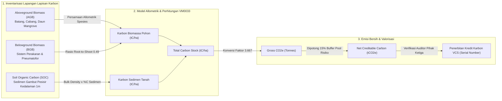

# Spesifikasi Desain G7-D47: Standar Penilaian Stok Karbon Biru & Valorisasi Silvofishery (Verra VM0033)

## 1. Status Keputusan & Landasan Kebijakan ESG

- **ID Keputusan:** `G7-D47`
- **Kategori:** Blue Carbon, Silvofishery Restorasi Mangrove, Verra VM0033 Methodology
- **Modul Pemilik:** `Marine` (`Modules\Marine`) berkolaborasi dengan `Esg`
- **Metodologi Acuan:**
  - Verra VCS Methodology VM0033 — *Methodology for Tidal Wetland and Seagrass Restoration (v2.1)*
  - IPCC 2013 Supplement to the 2006 IPCC Guidelines for National Greenhouse Gas Inventories: Wetlands (Chapter 4: Coastal Wetlands)
  - Standar Nilai Ekonomi Karbon (NEK) Peraturan Presiden No. 98 Tahun 2021 & Permen LHK No. 21 Tahun 2022
  - Sertifikasi ASC Mangrove Protection Criterion (ASC Shrimp Standard v1.2)

---

## 2. Prinsip Silvofishery & Solusi Berbasis Alam (Nature-Based Solutions)

Silvofishery adalah model integrasi terpadu antara budidaya perikanan payau (udang vaname, bandeng, kepiting bakau) dengan pelestarian dan restorasi hutan mangrove pesisir. Konsep ini membagi bentang lahan pesisir menjadi dua zona komplementer:
1. **Zona Produksi Tambak (30–40% Luas Lahan):** Petak kolam budidaya intensif/semi-intensif dengan kincir aerasi, biosekuriti ketat, dan pemberian pakan ramah lingkungan.
2. **Zona Sabuk Hijau & Restorasi Mangrove (*Greenbelt Buffer*, 60–70% Luas Lahan):** Penanaman dan pemeliharaan tegakan mangrove alami dari genus *Rhizophora* (bakau kurap), *Avicennia* (api-api), dan *Sonneratia* (pedada).

Ekosistem mangrove tropis Indonesia memiliki kapasitas serapan dan penyimpanan karbon (*Blue Carbon*) hingga 3–5 kali lipat lebih padat per hektar dibandingkan hutan hujan dataran rendah daratan (*terrestrial rainforests*), karena sedimen tanah lumpur pesisir bersifat anaerobik (kedap udara) sehingga laju dekomposisi bahan organik berjalan sangat lambat selama ribuan tahun.

---

## 3. Persamaan Allometrik Biomassa & Parameter Parameter Spesies

### 3.1. Estimasi Biomassa Pohon Tunggal (W_top)
Biomassa atas tanah per pohon ($W_{top}$ dalam kg berat kering) dihitung menggunakan persamaan allometrik baku allometrik Chave et al. dan Komiyama et al. berdasarkan parameter Diameter at Breast Height (DBH, dalam cm) pada ketinggian $1.3\text{ meter}$:

| Spesies Mangrove | Persamaan Allometrik ($W_{top}$) | Rujukan Ilmiah |
|---|---|---|
| *Rhizophora mucronata* / *apiculata* | $W_{top} = 0.128 \times (\text{DBH})^{2.45}$ | Komiyama et al. (2005) Indo-Pacific |
| *Avicennia marina* / *alba* | $W_{top} = 0.184 \times (\text{DBH})^{2.35}$ | Dharmawan & Siregar (2008) |
| *Sonneratia alba* | $W_{top} = 0.168 \times (\text{DBH})^{2.38}$ | Kauffman & Donato (CIFOR 2012) |
| Campuran / Spesies Lain (*Mixed*) | $W_{top} = 0.150 \times (\text{DBH})^{2.40}$ | IPCC Wetlands Supplement (2013) |

### 3.2. Biomassa Atas Tanah per Hektar (AGB)
Diberikan kerapatan tegakan pohon hidup ($D$ pohon/hektar) dan rerata DBH tegakan ($\overline{\text{DBH}}$):

$$\text{AGB (ton/ha)} = \frac{W_{top}(\overline{\text{DBH}}) \times D}{1000.0}$$

### 3.3. Biomassa Bawah Tanah (BGB - Perakaran)
Mangrove memiliki sistem perakaran napas (*pneumatophores, stilt roots, knee roots*) yang masif. Mengikuti standar IPCC Wetlands Supplement (2013) dan Komiyama et al. untuk mangrove tropis Indo-Pasifik, rasio akar terhadap tajuk (*Root-to-Shoot Ratio*) ditetapkan:

$$\text{Rasio Root-to-Shoot} = 0.49$$

$$\text{BGB (ton/ha)} = \text{AGB} \times 0.49$$

### 3.4. Stok Karbon Biomassa Vegetasi (C_veg)
Fraksi karbon dalam biomassa kering vegetasi mangrove tropis ditetapkan sebesar $47.0\%$ ($CF = 0.47$) sesuai standar IPCC:

$$C_{veg}\text{ (tC/ha)} = (\text{AGB} + \text{BGB}) \times 0.47$$

---

## 4. Karbon Organik Tanah Sedimen Pesisir (Soil Organic Carbon - SOC)

Lapisan sedimen mangrove menyimpan mayoritas stok karbon pesisir. Protokol sampling menetapkan pengambilan sampel inti sedimen (*soil sediment core*) hingga kedalaman standar $100\text{ cm}$ ($1.0\text{ meter}$).

### 4.1. Rumus Perhitungan SOC per Hektar
$$\text{SOC (tC/ha)} = \text{Depth (cm)} \times \text{Bulk Density (g/cm}^3\text{)} \times \left(\frac{\%C_{org}}{100.0}\right) \times 100.0$$

Di mana:
- $\text{Depth}$: Kedalaman lapisan sampel ($100.0\text{ cm}$).
- $\text{Bulk Density}$: Kerapatan lindak tanah sedimen kering ($0.80\text{ s.d. }0.95\text{ g/cm}^3$, rerata Kalimantan $0.85\text{ g/cm}^3$).
- $\%C_{org}$: Konsentrasi karbon organik sedimen hasil uji laboratorium *Walkley-Black* atau *Loss on Ignition (LOI)* ($2.5\%\text{ s.d. }4.5\%$, nilai nominal $3.0\%$).
- Faktor pengali $100.0$: Konversi satuan dari $\text{g/cm}^2$ ke $\text{ton/ha}$.

*Contoh Perhitungan Nominal:*
$$\text{SOC} = 100 \times 0.85 \times 0.03 \times 100 = 255.0\text{ tC/ha}$$

---

## 5. Konversi Stoikiometri & Cadangan Risiko Non-Permanen (Buffer Pool)

### 5.1. Total Stok Karbon Ekosistem & Ekuivalen CO2
Total stok karbon gabungan vegetasi dan sedimen:
$$C_{total}\text{ (tC/ha)} = C_{veg} + \text{SOC}$$

Konversi dari karbon elemental ($C$, bobot atom 12) ke molekul karbon dioksida ($CO_2$, bobot molekul 44):
$$\text{Faktor Konversi } CO_2/C = \frac{44}{12} \approx 3.667$$

Total potensi serapan kotor seluruh kawasan restorasi seluas $A$ hektar:
$$\text{Gross } CO_2e\text{ (tonnes)} = C_{total} \times A \times 3.667$$

### 5.2. Potongan Cadangan Risiko Ketidaktetapan (Buffer Risk Pool)
Sesuai instrumen metodologi Verra VM0033 dan AFOLU Non-Permanence Risk Tool, setiap proyek restorasi lahan basah pesisir wajib menyisihkan cadangan risiko (*buffer pool*) untuk mengantisipasi potensi kerugian akibat kenaikan permukaan air laut (*sea-level rise*), abrasi badai tropis, atau kebakaran hutan mangrove:
- Potongan cadangan baku: $15.0\%$ ($0.15$).
- Kredit karbon bersih yang dapat diterbitkan (*Net Marketable Carbon Credits*):

$$\text{Net Credits (tCO}_2e\text{)} = \text{Gross } CO_2e \times (1.0 - 0.15)$$

---

## 6. Penerbitan Serial Number Kredit Karbon Biru (VCS Standard)

Setiap unit kredit karbon biru yang diterbitkan wajib memiliki nomor seri kanonikal unik (*Verified Carbon Standard Serial Number*) yang tercatat di tabel `mar_blue_carbon_credit_issuances`:

Format Serial Number:
`VCS-{VintageYear}-MNG-{ProjectCode}-{DeterministicHash16}`

*Contoh:*
`VCS-2026-MNG-TRK-9901-A1F8C49E0281D5E7`

### 6.1. Mekanisme Insetting vs Offsetting
Kredit karbon biru yang dihasilkan dapat dimanfaatkan melalui dua mekanisme resmi:
1. **Insetting Rantai Pasok Internal (Supply Chain Insetting):** Kredit karbon dipensiunkan secara permanen (*permanently retired*) untuk menetralkan jejak karbon Scope 1–3 lot ekspor udang tambak mitra, menghasilkan sertifikat *"Net-Zero Carbon Certified Export Lot"*.
2. **Perdagangan Pasar Karbon Terbuka (Voluntary Carbon Offsetting):** Kredit karbon dijual kepada pembeli internasional melalui bursa karbon resmi (IDXCarbon / Verra Registry) dengan pencatatan mutasi kredit di ledger platform.

