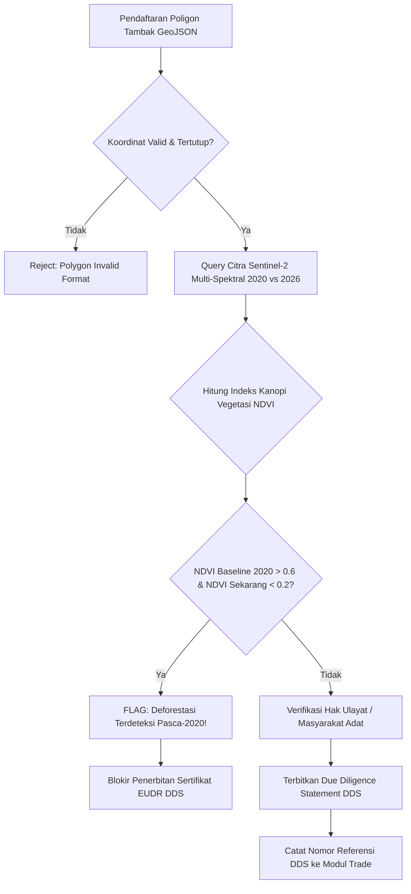

# Desain Teknis Arsitektur: Silvofishery Mangrove Carbon Insetting & EUDR Deforestation Verification (G7-D50)

Dokumen desain ini menetapkan spesifikasi algoritma dan perancangan arsitektur modul `Marine` dalam mengintegrasikan sistem budidaya ramah lingkungan tambak tumpangsari mangrove (*silvofishery*), pemodelan serapan karbon biru (*blue carbon insetting*), dan verifikasi uji tuntas regulasi anti-deforestasi Uni Eropa (*EU Deforestation Regulation* / EUDR 2023/1115).

---

## 1. Landasan Konseptual & Model Silvofishery Berkelanjutan

Model budidaya tambak silvofishery menggabungkan konservasi ekosistem hutan bakau dengan tambak budidaya perikanan udang dan bandeng. Rasio luasan tutupan vegetasi mangrove terhadap badan air tambak diatur minimal 60:40 hingga 70:30 guna menjamin daya dukung lingkungan alami (*carrying capacity*).

```
   ┌─────────────────────────────────────────────────────────────────┐
   │                  TAMBAK SILVOFISHERY BERKELANJUTAN              │
   │                                                                 │
   │  ┌─────────────────────────┐       ┌─────────────────────────┐  │
   │  │   Zona Konservasi       │       │   Saluran Air & Kolam   │  │
   │  │   Mangrove (60-70%)     │       │   Budidaya Udang (30%)  │  │
   │  │                         │       │                         │  │
   │  │  - Rhizophora mucronata │◄─────►│  - Pakan Pelet Organik  │  │
   │  │  - Avicennia marina     │       │  - Zero Antibiotic     │  │
   │  │  - Serapan Karbon Biru  │       │  - Pompa Aerasi Surya   │  │
   │  └─────────────────────────┘       └─────────────────────────┘  │
   │               │                                   │             │
   └───────────────┼───────────────────────────────────┼─────────────┘
                   ▼                                   ▼
        [Verra VM0033 Blue Carbon]            [ASC Certified Harvest]
```

### 1.1 Keuntungan Ganda (*Dual Dividend*) Silvofishery
1. **Penyaringan Limbah Alami (*Bio-filtration*)**: Akar napas (*pneumatophore*) mangrove mengendapkan bahan organik tersuspensi dan menyerap surplus nitrogen/amonia dari sisa metabolisme udang.
2. **Kredit Karbon Insetting (*Scope 3 Decarbonization*)**: Emisi gas rumah kaca dari pakan dan listrik aerator tambak dikompensasi secara langsung (*insetting*) oleh biomassa tegakan mangrove di tapak yang sama sebelum sisa surplus karbon ditawarkan ke bursa karbon sukarela (*voluntary carbon market*).

---

## 2. Metodologi Allometrik & Model Serapan Karbon (Verra VM0033)

Penghitungan biomassa dan stok karbon tegakan mangrove didasarkan pada standar metodologi Verra VM0033 (*Tidal Wetland and Seagrass Restoration*).

### 2.1 Persamaan Allometrik Biomassa Atas Tanah (*Above-Ground Biomass* / AGB)
Formula allometrik berbasis diameter setinggi dada (*Diameter at Breast Height* / DBH dalam cm):

1. **Spesies *Rhizophora mucronata*** (Komiyama et al., 2005):
   $$\text{AGB} = 0.128 \times (\text{DBH})^{2.58}\quad[\text{kg berat kering/pohon}]$$
2. **Spesies *Avicennia marina***:
   $$\text{AGB} = 0.184 \times (\text{DBH})^{2.35}\quad[\text{kg berat kering/pohon}]$$
3. **Spesies *Sonneratia alba***:
   $$\text{AGB} = 0.168 \times (\text{DBH})^{2.42}\quad[\text{kg berat kering/pohon}]$$

### 2.2 Biomassa Bawah Tanah (*Below-Ground Biomass* / BGB) & Karbon Tanah (*SOC*)
- **Rasio Akar terhadap Tajuk (*Root-to-Shoot Ratio*)**:
  $$\text{BGB} = 0.49 \times \text{AGB}\quad[\text{kg berat kering/pohon}]$$
- **Kandungan Karbon Organik dalam Biomassa**:
  $$\text{Karbon Pohon} = 0.47 \times (\text{AGB} + \text{BGB})$$
- **Stok Karbon Organik Tanah (*Soil Organic Carbon* / SOC)**:
  $$\text{SOC} = \text{Kedalaman Sedimen (100 cm)} \times \text{Bulk Density } (0.85\text{ g/cm}^3) \times \%C_{\text{organik}} (2.8\%)$$
  Rata-rata estimasi konservatif SOC pesisir Indonesia adalah $238.0\text{ t C/ha}$.

### 2.3 Konversi ke Ekivalen Karbon Dioksida ($t\text{CO}_2\text{e}$)
Faktor rasio massa molekul $\text{CO}_2$ terhadap atom $\text{C}$:
$$\text{Faktor Konversi} = \frac{44}{12} \approx 3.6667$$

---

## 3. Arsitektur Verifikasi Uji Tuntas Anti-Deforestasi EUDR

Regulasi EUDR (Peraturan Uni Eropa 2023/1115) mewajibkan seluruh komoditas yang diekspor ke pasar Eropa membuktikan bahwa lahan budidaya tidak berasal dari kawasan hutan yang ditebang atau mengalami degradasi setelah tanggal batas patokan (*cut-off date*) **31 Desember 2020**.

### 3.1 Validasi Poligon Koordinat Tambak (GeoJSON Polygon Checks)
Setiap petak tambak wajib melampirkan poligon batas batas geografis dengan spesifikasi:
- Sistem Koordinat: WGS 84 (EPSG:4326).
- Format: GeoJSON berpresisi minimum 6 angka di belakang koma (akurasi $\approx 0.1\text{ meter}$).
- Resolusi Sensor Satelit: Minimum 10 meter (Sentinel-2 MSI / Landsat 8/9).



### 3.2 Formula Indeks Spektral Satelit (Sentinel-2 Multi-Spectral Instrument)
Pemantauan tutupan kanopi mangrove menggunakan 3 indeks spektral utama:

1. **Normalized Difference Vegetation Index (NDVI)**:
   $$\text{NDVI} = \frac{\text{NIR (Band 8)} - \text{Red (Band 4)}}{\text{NIR (Band 8)} + \text{Red (Band 4)}}$$
   - Nilai $\text{NDVI} \ge 0.60$: Kanopi mangrove lebat sehat.
   - Nilai $\text{NDVI} \in [0.30, 0.59]$: Vegetasi mangrove sedang atau tambak silvofishery campuran.
   - Nilai $\text{NDVI} < 0.20$: Badan air terbuka atau lahan terbuka gundul.

2. **Normalized Difference Water Index (NDWI)**:
   $$\text{NDWI} = \frac{\text{Green (Band 3)} - \text{NIR (Band 8)}}{\text{Green (Band 3)} + \text{NIR (Band 8)}}$$
   - Memisahkan badan air tambak dari pematang tanah dan vegetasi bakau tepi kolam.

3. **Enhanced Vegetation Index (EVI)**:
   $$\text{EVI} = 2.5 \times \frac{\text{NIR} - \text{Red}}{\text{NIR} + 6.0 \times \text{Red} - 7.5 \times \text{Blue} + 1.0}$$
   - Mengoreksi gangguan pantulan atmosfer dan latar belakang tanah sedimen basah.

---

## 4. Rekonsiliasi Buku Besar & Penerbitan Kredit Karbon

Penerbitan unit kredit karbon biru dikelola melalui koordinasi modular antara `Modules\Marine` dan `Modules\Esg`:
- Modul `Marine` bertindak sebagai penyedia bukti lapangan (*field measurement & satellite ground truth*).
- Modul `Esg` melalui antarmuka `CarbonCreditIssuer` menerbitkan serial nomor kredit karbon internasional terdaftar (Verra Registry / IDX Carbon).
- Pencatatan akuntansi ganda memisahkan antara kredit yang dipensiunkan untuk offset internal (*Scope 1/2 reduction*) dan kredit yang dapat diperdagangkan (*tradable offsets*).

---

## 5. Matriks Verifikasi Kepatuhan & Persyaratan Bukti Audit

| Kategori Evaluasi | Instrumen Verifikasi | Bukti Minimum yang Diwajibkan | Parameter Toleransi |
|---|---|---|---|
| Legalitas Lahan Tambak | Poligon GeoJSON (EPSG:4326) | Titik koordinat poligon tertutup $\ge 4$ titik | Presisi $\ge 6$ desimal |
| Garis Batas Deforestasi | Time-series Sentinel-2 (2020 vs 2026) | Citra optik bebas awan ($< 10\%$ tutupan awan) | Tidak ada penurunan NDVI $> 0.35$ pasca 31-12-2020 |
| Hak Masyarakat Adat | Dokumen Persetujuan Bebas (FPIC) | Surat kesepakatan pemangku adat pesisir bertandatangan | Wajib terlampir dalam berkas DDS |
| Estimasi Biomassa | Sampling Plot Permanen ($10\text{m} \times 10\text{m}$) | Pengukuran DBH pohon bakau $\ge 5\text{ cm}$ | Tingkat keyakinan statistik $\ge 90\%$ |
| Cadangan Ketidaktetapan | Pemotongan Buffer Pool | Alokasi otomatis $15\%$ dari total kredit kotor | Saldo akun buffer terkunci di DB |

