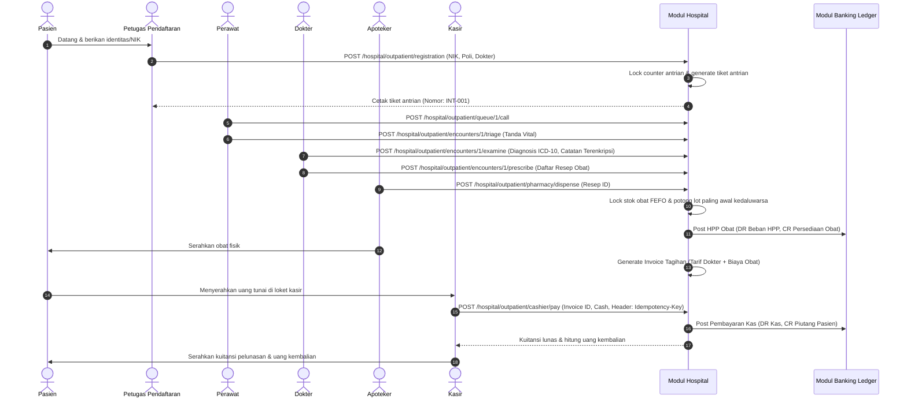
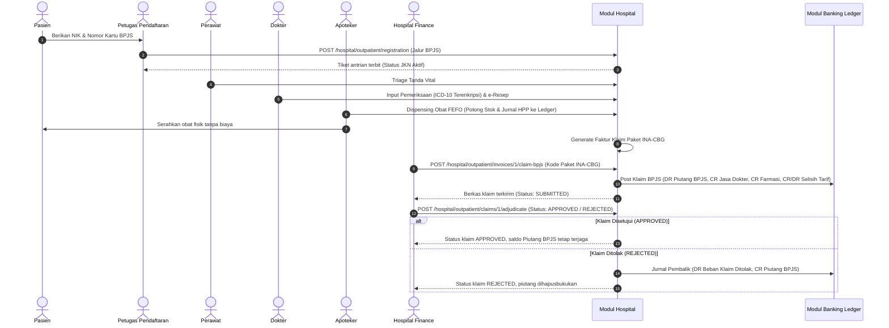

# Desain Teknis — Vertical Slice Rawat Jalan (Outpatient) Modul Hospital

Dokumen desain arsitektur teknis ini menguraikan spesifikasi database, perancangan kelas action, DTO, policy otorisasi, interaksi transaksi DB & lock, strategi idempotensi, diagram urutan transaksi (Mermaid), serta wireframe antarmuka teks.

---

## 1. Skema Database & Tabel Baru (Prefiks `hsp_`)

Semua tabel menggunakan prefiks resmi `hsp_` yang terdaftar pada `config/modules.php`. Seluruh nama indeks dan identifier tidak melebihi 64 karakter. Tipe data moneter menggunakan integer penuh rupiah (tanpa float/decimal).

### 1.1 `hsp_polyclinics` (Master Poliklinik)
Menyimpan data unit layanan poliklinik rawat jalan.
- `id` (bigint, PK, auto-increment)
- `code` (varchar(16), unique): Kode unik poli, misal `POLI_INT` (Penyakit Dalam), `POLI_PED` (Anak), `POLI_GEN` (Umum).
- `name` (varchar(128)): Nama lengkap poliklinik.
- `is_active` (boolean, default true): Status operasional poli.
- `timestamps`

### 1.2 `hsp_doctors` (Master Tenaga Medis / Dokter)
- `id` (bigint, PK, auto-increment)
- `user_id` (bigint, FK -> `users.id`, cascade): Relasi ke akun user aplikasi dengan role `doctor`.
- `polyclinic_id` (bigint, FK -> `hsp_polyclinics.id`, restrict): Poliklinik utama penugasan dokter.
- `doctor_code` (varchar(32), unique): Kode identitas staf medis (NIP/ID).
- `sip_number` (varchar(64)): Nomor Surat Izin Praktik dokter.
- `specialization` (varchar(128)): Spesialisasi klinis dokter.
- `is_active` (boolean, default true)
- `timestamps`

### 1.3 `hsp_tariff_versions` (Master Tarif Berversi)
Menerapkan keputusan D-3 mengenai tarif berversi tanpa float.
- `id` (bigint, PK, auto-increment)
- `service_code` (varchar(32)): Kode layanan/tindakan, misal `SRV-DOC-GENERAL`, `SRV-DOC-SPECIALIST`.
- `name` (varchar(128)): Nama layanan medis.
- `category` (varchar(32)): Kategori biaya (`DOCTOR_FEE`, `NURSING_FEE`, `ADMIN_FEE`).
- `amount_idr` (bigint): Tarif layanan dalam satuan Rupiah penuh.
- `effective_from` (date): Tanggal mulai berlaku tarif versi ini.
- `is_active` (boolean, default true)
- `timestamps`
- *Index*: `idx_hsp_tariffs_service_date` (`service_code`, `effective_from`)

### 1.4 `hsp_queues` (Antrian Harian Poliklinik)
Menerapkan keputusan D-7 (nomor antrian per poli per hari, tidak lompat, anti-ganda).
- `id` (bigint, PK, auto-increment)
- `polyclinic_id` (bigint, FK -> `hsp_polyclinics.id`, cascade)
- `doctor_id` (bigint, nullable, FK -> `hsp_doctors.id`, nullOnDelete)
- `queue_date` (date): Tanggal operasional layanan.
- `queue_number` (integer): Nomor urut antrian harian (1, 2, 3, ...).
- `queue_code` (varchar(32), unique): Kode tiket antrian, misal `INT-20261030-001`.
- `status` (varchar(32)): Status antrian (`WAITING`, `CALLED`, `SERVED`, `CANCELLED`).
- `timestamps`
- *Unique Constraint*: `uniq_hsp_queue_poli_date_num` (`polyclinic_id`, `queue_date`, `queue_number`)
- *Index*: `idx_hsp_queue_date_status` (`queue_date`, `status`)

### 1.5 `hsp_outpatient_encounters` (Kunjungan Pasien Rawat Jalan)
- `id` (bigint, PK, auto-increment)
- `encounter_code` (varchar(32), unique): Kode unik kunjungan, misal `ENC-20261030-ABCDEF`.
- `patient_id` (bigint, FK -> `hsp_patients.id`, restrict)
- `queue_id` (bigint, FK -> `hsp_queues.id`, restrict)
- `polyclinic_id` (bigint, FK -> `hsp_polyclinics.id`, restrict)
- `doctor_id` (bigint, FK -> `hsp_doctors.id`, restrict)
- `payment_method` (varchar(16)): Metode pembiayaan (`CASH`, `BPJS`).
- `bpjs_card_number` (varchar(32), nullable): Nomor kartu kepesertaan jika penjamin BPJS.
- `status` (varchar(32)): State machine status (`REGISTERED`, `CALLED`, `EXAMINED`, `PRESCRIBED`, `DISPENSED`, `INVOICED`, `SETTLED`, `CANCELLED`).
- `systolic_bp` (integer, nullable): Tekanan darah sistolik (mmHg).
- `diastolic_bp` (integer, nullable): Tekanan darah diastolik (mmHg).
- `pulse_rate` (integer, nullable): Frekuensi nadi per menit.
- `respiratory_rate` (integer, nullable): Laju pernapasan per menit.
- `body_temp_c` (decimal(4,1), nullable): Suhu tubuh derajat Celsius.
- `encrypted_doctor_notes` (text, nullable): Catatan anamnesis & rencana penanganan dokter (AES-256 cast encrypted).
- `encrypted_icd10_code` (text, nullable): Kode diagnosis ICD-10 terenkripsi (AES-256 cast encrypted).
- `examined_at` (dateTime, nullable): Waktu pemeriksaan dokter.
- `timestamps`
- *Index*: `idx_hsp_enc_patient_status` (`patient_id`, `status`)

### 1.6 `hsp_outpatient_prescriptions` (Resep Elektronik Rawat Jalan)
- `id` (bigint, PK, auto-increment)
- `prescription_code` (varchar(32), unique): Kode e-resep, misal `RX-20261030-XYZ`.
- `encounter_id` (bigint, FK -> `hsp_outpatient_encounters.id`, cascade)
- `doctor_id` (bigint, FK -> `hsp_doctors.id`, restrict)
- `drug_code` (varchar(32)): Kode obat terdaftar.
- `drug_name` (varchar(128)): Nama komersial/generik obat.
- `quantity` (integer): Jumlah tablet/botol yang diresepkan.
- `dosage_instructions` (varchar(128)): Petunjuk penggunaan obat.
- `status` (varchar(32), default 'PRESCRIBED'): `PRESCRIBED`, `DISPENSED`.
- `timestamps`

### 1.7 `hsp_outpatient_dispensings` (Penyerahan Obat & Pencatatan HPP FEFO)
- `id` (bigint, PK, auto-increment)
- `dispensing_code` (varchar(32), unique): Kode bukti dispensing.
- `prescription_id` (bigint, FK -> `hsp_outpatient_prescriptions.id`, cascade)
- `lot_id` (bigint, FK -> `hsp_branch_inventory_lots.id`, restrict): Batch lot obat yang dialokasikan FEFO.
- `quantity` (integer): Jumlah unit yang diserahkan dari batch tersebut.
- `unit_cost_idr` (bigint): Harga pokok pembelian (HPP) per unit.
- `total_cogs_idr` (bigint): Total HPP obat yang dipotong.
- `dispensed_by_user_id` (bigint, FK -> `users.id`, restrict): Petugas apoteker yang menyerahkan obat.
- `dispensed_at` (dateTime): Waktu penyerahan obat fisik.
- `timestamps`

### 1.8 `hsp_outpatient_invoices` (Faktur Tagihan Rawat Jalan)
- `id` (bigint, PK, auto-increment)
- `invoice_code` (varchar(32), unique): Kode invoice tagihan.
- `encounter_id` (bigint, FK -> `hsp_outpatient_encounters.id`, cascade)
- `doctor_fee_idr` (bigint): Komponen biaya jasa dokter.
- `medication_fee_idr` (bigint): Komponen biaya obat farmasi.
- `total_amount_idr` (bigint): Total tagihan sebelum penjamin.
- `payment_method` (varchar(16)): `CASH`, `BPJS`.
- `ina_cbg_package_code` (varchar(32), nullable): Kode tarif paket INA-CBG (khusus BPJS).
- `ina_cbg_tariff_idr` (bigint, nullable): Nilai nominal klaim INA-CBG.
- `status` (varchar(32), default 'PENDING'): `PENDING`, `PAID`, `CLAIMED`, `REJECTED`.
- `timestamps`

### 1.9 `hsp_outpatient_payments` (Penerimaan Kas Kasir Tunai)
- `id` (bigint, PK, auto-increment)
- `payment_code` (varchar(32), unique): Kode kuitansi pembayaran.
- `invoice_id` (bigint, FK -> `hsp_outpatient_invoices.id`, restrict)
- `amount_idr` (bigint): Jumlah uang yang harus dilunasi.
- `cash_received_idr` (bigint): Uang fisik tunai yang diserahkan pasien.
- `change_given_idr` (bigint): Uang kembalian yang diserahkan kasir ke pasien.
- `payment_method` (varchar(16)): `CASH`.
- `idempotency_key` (varchar(64), unique): Kunci idempotensi unik transaksi pembayaran dari header HTTP.
- `cashier_user_id` (bigint, FK -> `users.id`, restrict): Kasir penerima pembayaran.
- `paid_at` (dateTime): Waktu transaksi pelunasan.
- `timestamps`

### 1.10 `hsp_bpjs_claims` (Berkas Klaim & Adjudikasi Penjamin BPJS)
- `id` (bigint, PK, auto-increment)
- `claim_code` (varchar(32), unique): Nomor berkas klaim JKN.
- `invoice_id` (bigint, FK -> `hsp_outpatient_invoices.id`, restrict)
- `ina_cbg_code` (varchar(32)): Kode kelompok penyakit INA-CBG.
- `ina_cbg_tariff_idr` (bigint): Tarif klaim paket yang ditagihkan ke BPJS.
- `hospital_tariff_idr` (bigint): Nilai tarif riil layanan rumah sakit.
- `variance_amount_idr` (bigint): Selisih tarif klaim terhadap tarif RS.
- `status` (varchar(32), default 'SUBMITTED'): `SUBMITTED`, `APPROVED`, `REJECTED`.
- `adjudicated_at` (dateTime, nullable): Waktu persetujuan/penolakan oleh verifikator BPJS.
- `rejection_reason` (varchar(255), nullable): Alasan penolakan berkas klaim.
- `timestamps`

---

## 2. Kelas Action (Single Responsibility Principle)

Setiap langkah dalam vertical slice dikapsulasi ke dalam satu kelas Action mandiri pada namespace `Modules\Hospital\Application\Actions\`:

1. `RegisterPatientAndIssueQueueAction`:
   - Validasi data identitas pasien dan NIK.
   - Enkripsi NIK + pembuatan blind index unik menggunakan `hash_hmac('sha256', $nik, config('app.blind_index_pepper'))`.
   - Atomic database locking pada generator nomor antrian harian per poliklinik (`lockForUpdate`).
   - Pembuatan record tiket antrian `hsp_queues` dan kunjungan awal `hsp_outpatient_encounters`.
2. `RecordVitalSignsAction`:
   - Validasi hak otorisasi role `nurse`.
   - Update tanda-tanda vital (tensi, nadi, pernapasan, suhu tubuh) pada kunjungan rawat jalan.
3. `ExaminePatientAndDiagnoseAction`:
   - Validasi bahwa user yang login adalah dokter penanggung jawab kunjungan tersebut.
   - Enkripsi catatan rekam medis dan kode ICD-10.
   - Transisi status kunjungan ke `EXAMINED`.
4. `CreateOutpatientPrescriptionAction`:
   - Dokter membuat daftar item resep elektronik obat rawat jalan.
   - Status kunjungan bertransisi ke `PRESCRIBED` (stok obat belum dipotong).
5. `DispensePrescriptionFefoAction`:
   - Apoteker (`pharmacist`) mengeksekusi penyerahan obat fisik.
   - Query batch lot persediaan farmasi (`hsp_branch_inventory_lots`) yang belum kedaluwarsa (`expiry_date >= today`) dan tidak dikarantina (`is_quarantined = false`), diurutkan ascending berdasarkan `expiry_date` (FEFO).
   - Atomic lock `lockForUpdate` pada baris stok inventaris.
   - Validasi kecukupan stok total; jika kurang, lempar exception dan batalkan transaksi secara aman.
   - Mengurangi kolom `quantity` pada lot terpilih dan mencatat riwayat ke `hsp_outpatient_dispensings`.
   - Memposting jurnal akuntansi: **DEBIT `hsp:cogs_pharmacy:IDR`** dan **KREDIT `hsp:inventory_pharmacy:IDR`**.
6. `GenerateOutpatientInvoiceAction`:
   - Menghitung tarif konsultasi dokter berdasarkan versi tarif aktif (`hsp_tariff_versions`) saat tanggal kunjungan.
   - Menghitung total harga obat dari resep yang telah diserahkan.
   - Menghasilkan record faktur tagihan `hsp_outpatient_invoices` berstatus `PENDING`.
7. `ProcessCashPaymentAction`:
   - Memeriksa header wajib `Idempotency-Key` (jika tidak ada -> HTTP 422).
   - Validasi kunci idempotensi terhadap pembayaran sebelumnya.
   - Validasi kecukupan uang tunai (`cash_received_idr >= total_amount_idr`) dan perhitungan nilai kembalian (`change_given_idr`).
   - Update status invoice ke `PAID` dan encounter ke `SETTLED`.
   - Memposting jurnal akuntansi: **DEBIT `bank:cash:IDR`** dan **KREDIT `hsp:patient_receivable:IDR`**.
8. `SubmitBpjsClaimAction`:
   - Memetakan diagnosis ICD-10 ke kode paket INA-CBG dan nominal tarif klaim paket.
   - Menghitung selisih tarif (*variance*).
   - Menerbitkan berkas klaim `hsp_bpjs_claims` berstatus `SUBMITTED`.
   - Memposting jurnal akuntansi: **DEBIT `hsp:bpjs_receivable:IDR`**, **KREDIT `hsp:doctor_fee_revenue:IDR`**, **KREDIT `hsp:pharmacy_revenue:IDR`**, dan **KREDIT/DEBIT `hsp:bpjs_claim_variance:IDR`**.
9. `AdjudicateBpjsClaimAction`:
   - Simulasi verifikasi klaim BPJS (Status: `APPROVED` atau `REJECTED`).
   - Bila klaim ditolak (`REJECTED`), memposting jurnal pembalik: **DEBIT `hsp:bpjs_rejected_claim:IDR`** dan **KREDIT `hsp:bpjs_receivable:IDR`**.
10. `GenerateDailyPolyclinicReportAction`:
    - Mengumpulkan agregat jumlah kunjungan pasien per poliklinik.
    - Menghitung total perolehan pendapatan tunai dan klaim BPJS.
    - Mencocokkan saldo terhadap mutasi ledger Banking pada tanggal yang diminta.

---

## 3. Data Transfer Objects (DTO)

1. `RegisterPatientDTO`:
   - `string $nik`
   - `string $fullName`
   - `Carbon $dateOfBirth`
   - `string $bloodType`
   - `int $polyclinicId`
   - `int $doctorId`
   - `string $paymentMethod`
   - `?string $bpjsCardNumber`
2. `VitalSignsDTO`:
   - `int $systolic`
   - `int $diastolic`
   - `int $pulse`
   - `int $respiratory`
   - `float $temperature`
3. `DoctorExaminationDTO`:
   - `string $doctorNotes`
   - `string $icd10DiagnosisCode`
4. `CashPaymentDTO`:
   - `int $invoiceId`
   - `int $cashReceivedIdr`
   - `string $idempotencyKey`
   - `int $cashierUserId`
5. `DispenseFefoItemDTO`:
   - `int $prescriptionId`
   - `int $pharmacistUserId`

---

## 4. Kebijakan Otorisasi (Policies)

1. `OutpatientEncounterPolicy`:
   - `view(User $user, OutpatientEncounter $encounter)`:
     - Diizinkan untuk `admin`, `auditor`, dokter yang ditugaskan (`$encounter->doctor->user_id === $user->id`), perawat poli, atau pasien pemilik rekam medis (`$encounter->patient->user_id === $user->id`).
   - `triage(User $user, OutpatientEncounter $encounter)`:
     - Hanya role `nurse` dan `admin`.
   - `examine(User $user, OutpatientEncounter $encounter)`:
     - Hanya dokter yang ditugaskan pada encounter tersebut (`$encounter->doctor->user_id === $user->id`) dan `admin`. Dokter lain ditolak (403).
   - `cancel(User $user, OutpatientEncounter $encounter)`:
     - Hanya diizinkan jika status kunjungan masih `REGISTERED` oleh `hospital_registration` atau `admin`.
2. `OutpatientInvoicePolicy`:
   - `pay(User $user, OutpatientInvoice $invoice)`:
     - Hanya role `cashier` dan `admin`.
   - `viewMedicalDetails(User $user, OutpatientInvoice $invoice)`:
     - Role `cashier` ditolak melihat isi diagnosis dan catatan medis (prinsip *data minimization* UU PDP).

---

## 5. Kontrak Lintas Modul & Strategi Transaksi

### 5.1 Integrasi Ledger Modul Banking
Pencatatan akuntansi mematuhi arsitektur Core Ledger Banking melalui `PostingDTO` dan helper `Posting::lines()`. Modul Hospital tidak mengubah tabel ledger secara langsung, melainkan memanggil layanan `Modules\Banking\Application\Services\LedgerService::post(PostingDTO $dto)`.

Akun-akun resmi di `modules/Hospital/Ledger/HospitalAccounts.php`:
- `hsp:doctor_fee_revenue:IDR` (Kind: REVENUE)
- `hsp:pharmacy_revenue:IDR` (Kind: REVENUE)
- `hsp:cogs_pharmacy:IDR` (Kind: EXPENSE)
- `hsp:inventory_pharmacy:IDR` (Kind: ASSET)
- `hsp:patient_receivable:IDR` (Kind: ASSET)
- `hsp:bpjs_receivable:IDR` (Kind: ASSET)
- `hsp:bpjs_claim_variance:IDR` (Kind: REVENUE)
- `hsp:bpjs_rejected_claim:IDR` (Kind: EXPENSE)
- `bank:cash:IDR` (Kind: ASSET)

### 5.2 Urutan Transaksi DB & Atomic Lock

```mermaid
flowchart TD
    subgraph Antrian ["1. Atomic Queue Allocation"]
        Q1["Mulai Transaksi DB"] --> Q2["DB::table('hsp_queues')->where('polyclinic_id', $poliId)->where('queue_date', $today)->lockForUpdate()->max('queue_number')"]
        Q2 --> Q3["$nextQueue = $max + 1"]
        Q3 --> Q4["Insert hsp_queues & hsp_outpatient_encounters"]
        Q4 --> Q5["Commit DB"]
    end

    subgraph FEFO ["2. FEFO Stock Lot Deduction"]
        F1["Mulai Transaksi DB"] --> F2["Query hsp_branch_inventory_lots for drug_code, unexpired, unquarantined, lockForUpdate() ORDER BY expiry_date ASC"]
        F2 --> F3{"Total Stok Cukup?"}
        F3 -- Tidak --> F4["Rollback DB & Lempar Exception InsufficientStockException"]
        F3 -- Ya --> F5["Kurangi quantity lot & Insert hsp_outpatient_dispensings"]
        F5 --> F6["Posting Ledger HPP Obat via LedgerService"]
        F6 --> F7["Commit DB"]
    end

    subgraph Pembayaran ["3. Idempotent Cash Payment"]
        P1["Validasi Header Idempotency-Key"] --> P2{"Key Sudah Ada di DB?"}
        P2 -- Ya --> P3["Kembalikan Record Pembayaran Eksisting (200 OK)"]
        P2 -- Tidak --> P4["Mulai Transaksi DB & lockForUpdate Invoice"]
        P4 --> P5{"Uang Fisik Cukup?"}
        P5 -- Kurang --> P6["Rollback DB & Lempar ValidationException (Uang Kurang)"]
        P5 -- Cukup --> P7["Hitung Kembalian, Insert hsp_outpatient_payments"]
        P7 --> P8["Posting Ledger Kas vs Piutang Pasien"]
        P8 --> P9["Update Invoice ke PAID & Encounter ke SETTLED"]
        P9 --> P10["Commit DB"]
    end
```



---

## 6. Sequence Diagram (Mermaid)

### 6.1 Alur Pasien Rawat Jalan Umum (Pembayaran Tunai)



### 6.2 Alur Pasien Rawat Jalan JKN / Penjamin BPJS



---

## 7. Wireframe Teks Antarmuka Pengguna (Blade Views)

### 7.1 Layar Pendaftaran Pasien (`registration/index.blade.php`)
```
+----------------------------------------------------------------------------------+
| HOSPITAL OUTPATIENT - PENDAFTARAN RAWAT JALAN UMUM & JKN                         |
+----------------------------------------------------------------------------------+
| [Cari Pasien Lama: NIK [________________] [Cari (Blind Index)] ]                 |
+----------------------------------------------------------------------------------+
| FORMULIR PENDAFTARAN KUNJUNGAN:                                                  |
| NIK Pasien (16 digit) : [ 3171012345670001                                     ] |
| Nama Lengkap Pasien   : [ Budi Santoso                                         ] |
| Tanggal Lahir (Y-M-D) : [ 1985-05-12                                           ] |
| Golongan Darah        : [ O   |v]                                                |
| Poliklinik Tujuan     : [ Poli Penyakit Dalam                               |v] |
| Dokter Spesialis      : [ dr. Bambang, Sp.PD                                |v] |
| Metode Pembayaran     : (*) Tunai / Mandiri (CASH)   ( ) Penjamin JKN (BPJS)     |
| Nomor Kartu BPJS      : [ 0001234567890 (Wajib jika memilih BPJS)              ] |
|                                                                                  |
| [ BATAL ]                                          [ DAFTARKAN & CETAK TIKET ]  |
+----------------------------------------------------------------------------------+
```

### 7.2 Layar Antrian & Pemeriksaan Dokter (`encounters/examine.blade.php`)
```
+----------------------------------------------------------------------------------+
| RUANG PEMERIKSAAN DOKTER - POLI PENYAKIT DALAM                                   |
+----------------------------------------------------------------------------------+
| Pasien: Budi Santoso (MRN: HSP-2026-0001) | Antrian: #INT-001 | Umur: 41 th      |
| Triage Perawat: TD: 120/80 mmHg | Nadi: 82 bpm | Suhu: 36.6 C | Resp: 18 /min   |
+----------------------------------------------------------------------------------+
| PEMERIKSAAN KLINIS:                                                              |
| Catatan Dokter (Enkripsi):                                                       |
| [ Keluhan demam intermiten 3 hari, nyeri ulu hati, mual.                       ] |
| [ Abdomen supel, epigastrium tenderness (+), hepar-lien tidak teraba.          ] |
|                                                                                  |
| Diagnosis ICD-10 (Enkripsi):                                                     |
| Kode ICD-10 : [ K30 - Dyspepsia                                              ]   |
|                                                                                  |
| INSTRUKSI RESEP OBAT (e-Prescription):                                           |
| Obat           : [ Paracetamol 500mg Tab            |v]  Jumlah: [ 10 ]          |
| Aturan Pakai   : [ 3 x 1 tablet sesudah makan                               ]   |
|                                                                                  |
| [ SIMPAN HASIL PEMERIKSAAN & TERBITKAN RESEP ]                                   |
+----------------------------------------------------------------------------------+
```

### 7.3 Layar Kasir Pembayaran (`cashier/index.blade.php`)
```
+----------------------------------------------------------------------------------+
| KASIR RAWAT JALAN - PELUNASAN TAGIHAN                                            |
+----------------------------------------------------------------------------------+
| Tagihan #INV-20261030-001 | Pasien: Budi Santoso | Poli Penyakit Dalam            |
+----------------------------------------------------------------------------------+
| RINCIAN BIAYA PELAYANAN:                                                         |
| 1. Jasa Konsultasi Dokter Spesialis (Versi Tarif 2026-01-01)   : Rp 150.000      |
| 2. Obat Paracetamol 500mg 10 tab @ Rp 2.000                    : Rp  20.000      |
| -------------------------------------------------------------------------------- |
| TOTAL TAGIHAN BERSIH                                           : Rp 170.000      |
+----------------------------------------------------------------------------------+
| PEMBAYARAN KAS:                                                                  |
| Uang Diterima Pasien : Rp [ 200000       ]                                       |
| Uang Kembalian       : Rp   30.000                                               |
| Header Idempotensi   : [ IDEMP-PAY-20261030-001                                ] |
|                                                                                  |
| [ CETAK KUITANSI & CATAT KAS (POSTING LEDGER) ]                                  |
+----------------------------------------------------------------------------------+
```

### 7.4 Layar Laporan Harian Rekonsiliasi Kasir & Ledger (`reports/daily.blade.php`)
```
+----------------------------------------------------------------------------------+
| LAPORAN REKAPITULASI RAWAT JALAN & REKONSILIASI BUKU BESAR                       |
| Tanggal Laporan: 2026-10-30                                                      |
+----------------------------------------------------------------------------------+
| RINGKASAN KUNJUNGAN PER POLIKLINIK:                                              |
| Poliklinik       | Pasien Tunai | Pasien BPJS | Total Pasien | Total Pendapatan  |
| Poli Dalam       |     12       |     18      |     30       | Rp 5.100.000      |
| Poli Anak        |      8       |     14      |     22       | Rp 3.740.000      |
| Poli Gigi        |      5       |      7      |     12       | Rp 2.040.000      |
| TOTAL            |     25       |     39      |     64       | Rp 10.880.000     |
+----------------------------------------------------------------------------------+
| REKONSILIASI DUA-SUMBER BUKU BESAR (BANKING LEDGER):                             |
| Akun Buku Besar                    | Mutasi Transaksi RS | Mutasi Saldo Ledger   |
| bank:cash:IDR                      | Rp  4.250.000       | Rp  4.250.000  (KLOP) |
| hsp:bpjs_receivable:IDR            | Rp  6.630.000       | Rp  6.630.000  (KLOP) |
| hsp:doctor_fee_revenue:IDR         | Rp  9.600.000       | Rp  9.600.000  (KLOP) |
| hsp:pharmacy_revenue:IDR           | Rp  1.280.000       | Rp  1.280.000  (KLOP) |
| hsp:cogs_pharmacy:IDR              | Rp    768.000       | Rp    768.000  (KLOP) |
| -------------------------------------------------------------------------------- |
| STATUS REKONSILIASI: 100% BALANCE & VERIFIED (0 DISKREPANSI)                     |
+----------------------------------------------------------------------------------+
```
