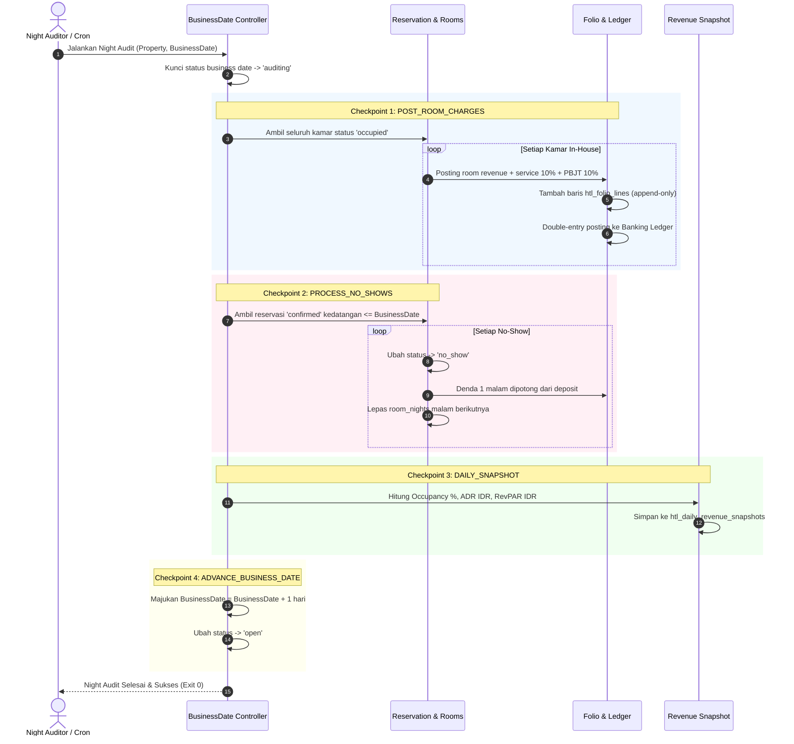
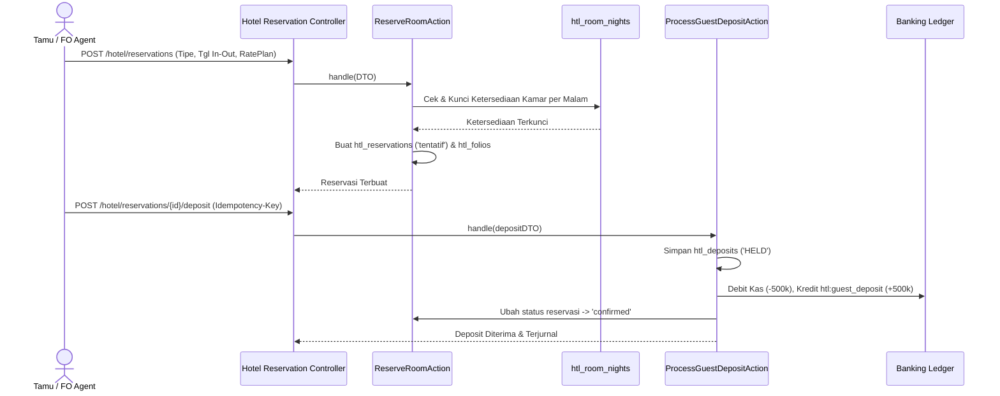
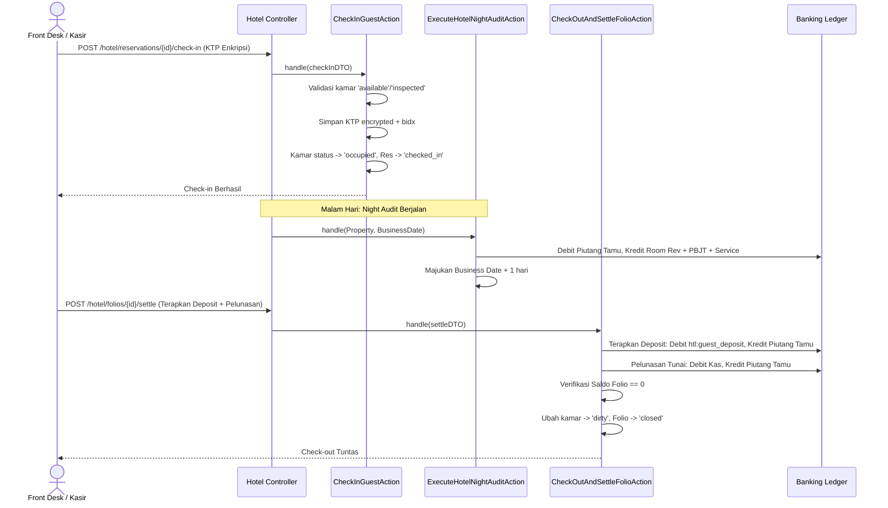
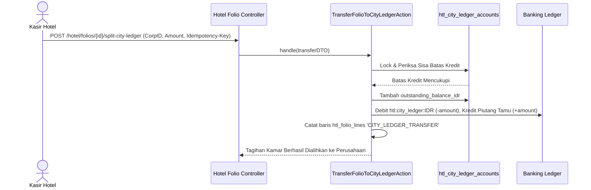
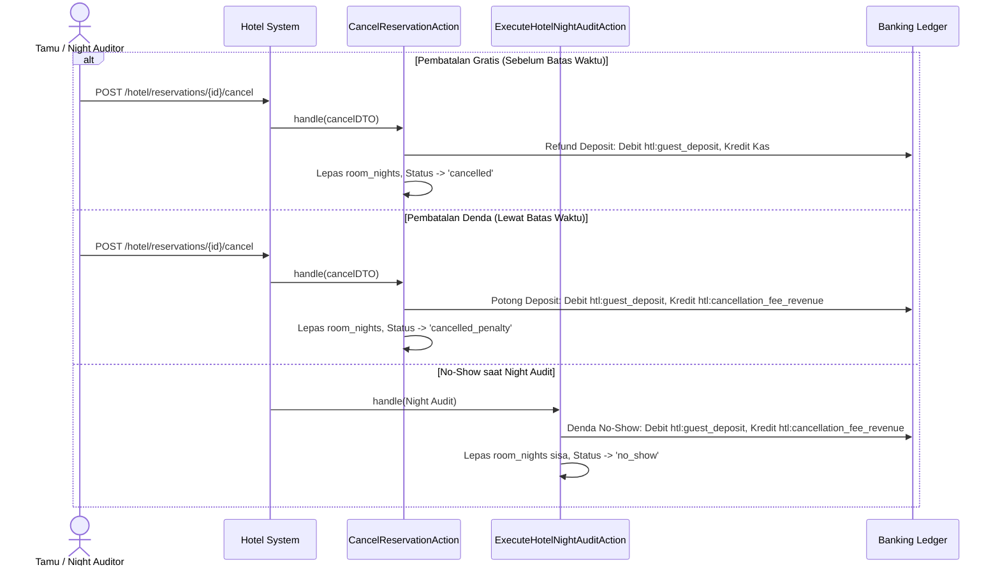

# Desain Teknis — Vertical Slice Siklus Tamu Perhotelan (Hotel Guest Lifecycle)

Dokumen ini menguraikan arsitektur teknis, skema basis data, spesifikasi action, penanganan konkurensi inventaris per malam, alur night audit ber-checkpoint, diagram sekuens transaksi (Mermaid), dan wireframe antarmuka teks.

---

## 1. Skema Database & Tabel Baru (Prefiks `htl_`)

Semua tabel menggunakan prefiks resmi `htl_`, identifier <= 64 karakter, nilai moneter menggunakan `unsignedBigInteger` atau `bigInteger` tanpa float, dan setiap relasi intra-modul memiliki foreign key constraint nyata.

### 1.1 `htl_business_dates`
Menyimpan dan mengunci tanggal bisnis operasional per properti (H-2).
- `id` (uuid, PK)
- `property_id` (uuid, FK -> `htl_properties.id`, cascade, unique)
- `current_business_date` (date)
- `status` (varchar(32), default 'open') — `open`, `auditing`, `closed`
- `last_checkpoint` (varchar(64), nullable) — checkpoint audit pemulihan
- `audited_at` (timestamp, nullable)
- `timestamps`

### 1.2 `htl_room_types`
Master tipe kamar beserta batas maksimum overbooking (H-1, H-8).
- `id` (uuid, PK)
- `property_id` (uuid, FK -> `htl_properties.id`, cascade)
- `code` (varchar(32)) — `DELUXE`, `SUITE`, `VILLA`, `STANDARD`
- `name` (varchar(128))
- `base_capacity` (unsignedInteger, default 2)
- `overbooking_max_percent` (unsignedInteger, default 0)
- `timestamps`
- *Unique*: `uniq_htl_rt_prop_code` (`property_id`, `code`)

### 1.3 `htl_rate_plans` & `htl_rate_calendar`
Paket tarif dan kalender harga dinamis per malam (H-1, H-7).
- `htl_rate_plans`:
  - `id` (uuid, PK)
  - `property_id` (uuid, FK -> `htl_properties.id`, cascade)
  - `code` (varchar(32)) — `BAR`, `CORP_SPECIAL`, `NON_REFUNDABLE`
  - `name` (varchar(128))
  - `free_cancellation_hours` (unsignedInteger, default 24)
  - `penalty_nights` (unsignedInteger, default 1)
  - `requires_deposit` (boolean, default false)
  - `timestamps`
  - *Unique*: `uniq_htl_rp_prop_code` (`property_id`, `code`)
- `htl_rate_calendar`:
  - `id` (uuid, PK)
  - `property_id` (uuid, FK -> `htl_properties.id`, cascade)
  - `room_type_id` (uuid, FK -> `htl_room_types.id`, cascade)
  - `rate_plan_id` (uuid, FK -> `htl_rate_plans.id`, cascade)
  - `calendar_date` (date)
  - `rate_idr` (unsignedBigInteger)
  - `timestamps`
  - *Unique*: `uniq_htl_rate_cal` (`property_id`, `room_type_id`, `rate_plan_id`, `calendar_date`)

### 1.4 `htl_room_nights` (Inventaris Kamar per Malam)
Mengunci alokasi per malam untuk mencegah double booking / oversell (H-1, H-8).
- `id` (uuid, PK)
- `property_id` (uuid, FK -> `htl_properties.id`, cascade)
- `room_type_id` (uuid, FK -> `htl_room_types.id`, cascade)
- `room_id` (uuid, nullable, FK -> `htl_rooms.id`, cascade)
- `night_date` (date)
- `reservation_id` (uuid, nullable, FK -> `htl_reservations.id`, nullOnDelete)
- `status` (varchar(32), default 'sold') — `held`, `sold`, `out_of_order`
- `timestamps`
- *Index*: `idx_htl_rn_search` (`property_id`, `room_type_id`, `night_date`, `status`)

### 1.5 `htl_guest_identities` (Identitas Terenkripsi & Blind Index)
Menyimpan identitas tamu terlindungi (H-11).
- `id` (uuid, PK)
- `user_id` (unsignedBigInteger, FK -> `users.id`, cascade)
- `identity_type` (varchar(16)) — `KTP`, `PASSPORT`
- `identity_number_encrypted` (text)
- `identity_number_bidx` (varchar(64), index) — HMAC-SHA256 (`BLIND_INDEX_PEPPER`)
- `full_name` (varchar(128))
- `phone` (varchar(32))
- `timestamps`

### 1.6 `htl_folio_lines` (Baris Tagihan Append-Only)
Baris audit trail rekening folio tamu tanpa edit/hapus (H-3, H-6).
- `id` (uuid, PK)
- `folio_id` (uuid, FK -> `htl_folios.id`, cascade)
- `business_date` (date)
- `line_type` (varchar(32)) — `ROOM_CHARGE`, `TAX_PBJT`, `SERVICE_CHARGE`, `FNB_OUTLET`, `PAYMENT_CASH`, `PAYMENT_CARD`, `DEPOSIT_APPLIED`, `CITY_LEDGER_TRANSFER`, `REVERSAL`
- `description` (varchar(255))
- `amount_idr` (bigInteger) — Positif untuk beban tagihan, Negatif untuk pembayaran/kredit/reversal
- `base_amount_idr` (unsignedBigInteger, default 0)
- `service_charge_idr` (unsignedBigInteger, default 0)
- `tax_pbjt_idr` (unsignedBigInteger, default 0)
- `reversal_of_id` (uuid, nullable, FK -> `htl_folio_lines.id`, nullOnDelete)
- `idempotency_key` (varchar(64), nullable)
- `timestamps`
- *Index*: `idx_htl_fl_folio_date` (`folio_id`, `business_date`)

### 1.7 `htl_deposits` (Kewajiban Titipan Deposit Tamu)
Mencatat uang muka tamu dengan status kewajiban (H-4).
- `id` (uuid, PK)
- `property_id` (uuid, FK -> `htl_properties.id`, cascade)
- `reservation_id` (uuid, FK -> `htl_reservations.id`, cascade)
- `guest_user_id` (unsignedBigInteger, FK -> `users.id`, cascade)
- `amount_idr` (unsignedBigInteger)
- `applied_amount_idr` (unsignedBigInteger, default 0)
- `refunded_amount_idr` (unsignedBigInteger, default 0)
- `payment_method` (varchar(32)) — `CASH`, `CARD`, `TRANSFER`
- `status` (varchar(32), default 'HELD') — `HELD`, `APPLIED`, `REFUNDED`, `PARTIALLY_REFUNDED`
- `idempotency_key` (varchar(64), unique)
- `timestamps`

### 1.8 `htl_city_ledger_accounts` & `htl_city_ledger_transfers`
Piutang korporat dan pembatasan batas kredit (H-6).
- `htl_city_ledger_accounts`:
  - `id` (uuid, PK)
  - `property_id` (uuid, FK -> `htl_properties.id`, cascade)
  - `company_name` (varchar(128))
  - `company_code` (varchar(32), unique)
  - `credit_limit_idr` (unsignedBigInteger)
  - `outstanding_balance_idr` (unsignedBigInteger, default 0)
  - `is_active` (boolean, default true)
  - `timestamps`
- `htl_city_ledger_transfers`:
  - `id` (uuid, PK)
  - `city_ledger_account_id` (uuid, FK -> `htl_city_ledger_accounts.id`, cascade)
  - `folio_id` (uuid, FK -> `htl_folios.id`, cascade)
  - `transferred_amount_idr` (unsignedBigInteger)
  - `notes` (varchar(255), nullable)
  - `idempotency_key` (varchar(64), unique)
  - `timestamps`

### 1.9 `htl_housekeeping_logs`
Audit pergantian status fisik kamar (H-9).
- `id` (uuid, PK)
- `room_id` (uuid, FK -> `htl_rooms.id`, cascade)
- `from_status` (varchar(32))
- `to_status` (varchar(32))
- `changed_by_user_id` (unsignedBigInteger, FK -> `users.id`, cascade)
- `notes` (varchar(255), nullable)
- `timestamps`

### 1.10 `htl_daily_revenue_snapshots`
Hasil rekonsiliasi metrik harian night audit (H-2, H-5).
- `id` (uuid, PK)
- `property_id` (uuid, FK -> `htl_properties.id`, cascade)
- `business_date` (date)
- `total_rooms` (unsignedInteger)
- `occupied_rooms` (unsignedInteger)
- `out_of_order_rooms` (unsignedInteger)
- `occupancy_rate_bps` (unsignedInteger) — Misal 7500 = 75.00%
- `total_room_revenue_idr` (unsignedBigInteger)
- `total_fnb_revenue_idr` (unsignedBigInteger)
- `total_tax_pbjt_idr` (unsignedBigInteger)
- `total_service_charge_idr` (unsignedBigInteger)
- `adr_idr` (unsignedBigInteger)
- `revpar_idr` (unsignedBigInteger)
- `timestamps`
- *Unique*: `uniq_htl_snapshot_prop_date` (`property_id`, `business_date`)

---

## 2. Ketersediaan Kamar & Strategi Penguncian Konkurensi

### 2.1 Rumus Ketersediaan Jual (Formula)
Untuk setiap tanggal \( d \) dan tipe kamar \( T \):
\[
\text{Ketersediaan Jual} = \text{Kamar Fisik Aktif} - \text{Out of Order} - \text{Terjual} + \lfloor \text{Kamar Fisik Aktif} \times \frac{\text{Overbooking \%}}{100} \rfloor
\]
Di mana:
- `Kamar Fisik Aktif`: Jumlah record di `htl_rooms` untuk `room_type = T` dengan flag bukan `maintenance/out_of_order`.
- `Out of Order`: Kamar berstatus `out_of_order` pada tanggal \( d \).
- `Terjual`: Jumlah baris di `htl_room_nights` pada tanggal \( d \) untuk tipe \( T \) yang terikat ke reservasi aktif (`confirmed`, `checked_in`).

### 2.2 Strategi Atomic Locking (SQLite vs MySQL)
- Pada MySQL/Postgres: `DB::transaction()` dengan `HotelRoomType::where('id', $typeId)->lockForUpdate()->first()` mengunci baris tipe kamar, kemudian menghitung inventaris `htl_room_nights` dan melakukan insert.
- Pada SQLite: Transaksi database membungkus seluruh operasi secara atomik. Jika kuota ketersediaan terlampaui saat dieksekusi, Action melempar `RuntimeException("Inventory exhausted")` sehingga transaksi di-rollback secara penuh. Multi-night booking mengunci SEMUA malam yang diminta atau batal sama sekali (*all-or-nothing*).

---

## 3. Desain Action & Arsitektur Kelas

Setiap aksi bisnis dipisahkan menjadi satu Action class (Single Responsibility Principle):
1. `ReserveRoomAction`: Menerima DTO reservasi, validasi anti-overlap per malam, mengunci `htl_room_nights`, membuat `htl_reservations` & `htl_folios` awal.
2. `ProcessGuestDepositAction`: Menerima deposit ber-`Idempotency-Key`, mencatat ke `htl_deposits`, memposting kewajiban ke `PostingEntryDTO::forCode('htl:guest_deposit:IDR', ...)` di Banking Ledger.
3. `CheckInGuestAction`: Memvalidasi kamar berstatus `available` atau `inspected`, mencatat identitas tamu terenkripsi + blind index, mengalokasikan kamar fisik, mengubah status kamar menjadi `occupied`.
4. `ChargeFolioOutletAction`: Membebankan konsumsi F&B / outlet ke folio tamu in-house, menghitung service charge & pajak PBJT berjenjang, mencatat baris `htl_folio_lines`, memposting ke Banking Ledger.
5. `ExecuteHotelNightAuditAction`: Mengunci business date, memposting tagihan kamar + pajak + service untuk seluruh kamar `occupied`, menandai reservasi `no_show` dan mendenda satu malam, membuat snapshot metrik harian, memajukan business date properti.
6. `CheckOutAndSettleFolioAction`: Menerapkan deposit ke tagihan folio, menerima pelunasan kasir (tunai/kartu), memverifikasi sisa saldo folio = 0, mengubah status kamar menjadi `dirty`, menutup folio.
7. `TransferFolioToCityLedgerAction`: Membagi tagihan (split), memeriksa batas kredit korporat di `htl_city_ledger_accounts`, mengalihkan piutang ke `htl:city_ledger:IDR` di Banking Ledger.
8. `RefundGuestDepositAction`: Mengembalikan sisa kelebihan deposit ber-`Idempotency-Key` baru, membalik kewajiban deposit dan kas.
9. `CancelReservationAction`: Memeriksa batas waktu pembatalan gratis; bila lewat, memotong denda 1 malam ke `htl:cancellation_fee_revenue:IDR`; melepaskan inventaris `htl_room_nights`.
10. `ExecuteWalkCompensationAction`: Menandai reservasi `relocated_walk`, memposting kompensasi ke beban operasional `htl:overbooking_expense:IDR` dan kas/utang.

---

## 4. Alur & Urutan Night Audit (Checkpoint & Pemulihan)

Night audit dijalankan secara bertahap dengan mekanisme status checkpoint:


Jika terjadi interupsi sistem di tengah proses, proses audit dapat diulang secara aman karena setiap transaksi room night diberi penanda idempotent unik `(property_id, business_date, room_night_id)` sehingga tidak terjadi duplikasi pembebanan.

---

## 5. Perhitungan Pajak PBJT & Service Charge (Aturan H-3)

- **Basis Poin**: Disimpan sebagai integer (1000 = 10.00%, 500 = 5.00%).
- **Tarif Dasar**: \( R \)
- **Service Charge**:
  \[
  S = \operatorname{round}\left(R \times \frac{\text{ServiceBps}}{10000}, 0, \text{PHP\_ROUND\_HALF\_UP}\right)
  \]
- **Pajak Hotel (PBJT)**:
  \[
  T = \operatorname{round}\left((R + S) \times \frac{\text{TaxBps}}{10000}, 0, \text{PHP\_ROUND\_HALF\_UP}\right)
  \]
- **Total Beban Tamu**:
  \[
  \text{Total} = R + S + T
  \]

### Contoh Angka Persis:
- Misal Kamar = Rp 1.000.000, Service = 10%, Pajak = 10%:
  - \( S = 1.000.000 \times 10\% = 100.000 \)
  - \( T = (1.000.000 + 100.000) \times 10\% = 110.000 \)
  - \( \text{Total} = 1.210.000 \)
- Misal F&B Room Service = Rp 250.000, Service = 10%, Pajak = 10%:
  - \( S = 250.000 \times 10\% = 25.000 \)
  - \( T = (250.000 + 25.000) \times 10\% = 27.500 \)
  - \( \text{Total} = 302.500 \)

---

## 6. Diagram Sekuens Mermaid

### 6.1 Reservasi & Deposit


### 6.2 Check-in → Night Audit → Check-out Tunai


### 6.3 Check-out Split Tagihan ke Corporate City Ledger


### 6.4 Pembatalan & No-Show


---

## 7. Wireframe Teks Antarmuka (Text-Based UI)

### 7.1 Kalender Ketersediaan & Reservasi (`GET /hotel/reservations`)
```
+-----------------------------------------------------------------------------------------+
| [GRAND NUSANTARA HOTEL] Tanggal Bisnis: 2026-11-01 (Status: OPEN)           [Logout]    |
+-----------------------------------------------------------------------------------------+
| KALENDER KETERSEDIAAN KAMAR (30 HARI KEDEPAN)                                           |
| Tipe Kamar    | Total | OOO | 01 Nov | 02 Nov | 03 Nov | 04 Nov | 05 Nov | Overbook Max   |
| Deluxe Room   |   50  |  2  | 12 Sisa| 10 Sisa|  0 Pnh |  5 Sisa| 20 Sisa|   5% (2 kmr)   |
| Suite Room    |   20  |  0  |  8 Sisa|  8 Sisa|  4 Sisa|  2 Sisa| 10 Sisa|   0% (0 kmr)   |
| Villa         |   10  |  1  |  1 Sisa|  1 Sisa|  0 Pnh |  2 Sisa|  5 Sisa|   0% (0 kmr)   |
+-----------------------------------------------------------------------------------------+
| [+ BUAT RESERVASI BARU]                                                                 |
| Tamu: [Bpk. Handoko           ]  Tipe: [Deluxe Room v]  Rate Plan: [BAR Breakfast v]    |
| Check-in: [2026-11-01]  Check-out: [2026-11-03] (2 Malam)  Tarif/Malam: Rp 1.000.000   |
| Total Kamar: Rp 2.000.000  Wajib Deposit: [Rp 500.000     ]  [SIMPAN RESERVASI]         |
+-----------------------------------------------------------------------------------------+
```

### 7.2 Papan Front Desk & Check-in (`GET /hotel`)
```
+-----------------------------------------------------------------------------------------+
| DAFTAR KEDATANGAN HARI INI (ARRIVALS - 2026-11-01)                                      |
| No. Res        | Nama Tamu      | Tipe Kamar | Kamar Fisik | Deposit Status | Aksi      |
| RSV-202611-001 | Budi Santoso   | Deluxe     | DLX-204     | LUNAS (500k)   | [CHECK-IN]|
| RSV-202611-002 | PT Maju Mundur | Suite      | SUI-301     | CORP GUARANTEE | [CHECK-IN]|
+-----------------------------------------------------------------------------------------+
| FORM CHECK-IN: Identitas Tamu (KTP/Paspor)                                              |
| Jenis Identitas: [KTP v]  Nomor: [3171029384720001        ]  (Terenkripsi otomatis)     |
| Alokasi Kamar: [DLX-204 (Status: INSPECTED) v]  Status: [PROSES CHECK-IN]               |
+-----------------------------------------------------------------------------------------+
```

### 7.3 Papan Housekeeping (`GET /hotel/housekeeping`)
```
+-----------------------------------------------------------------------------------------+
| PAPAN KONTROL HOUSEKEEPING & STATUS FISIK KAMAR                                         |
| No. Kamar | Tipe   | Status Terkini | Terakhir Diperbarui | Ubah Status           | Aksi|
| DLX-101   | Deluxe | DIRTY          | 2026-11-01 12:05    | [-> CLEANING  v]      | [OK]|
| DLX-102   | Deluxe | CLEANING       | 2026-11-01 12:30    | [-> INSPECTED v]      | [OK]|
| DLX-103   | Deluxe | INSPECTED      | 2026-11-01 13:10    | [-> AVAILABLE v]      | [OK]|
| SUI-201   | Suite  | OCCUPIED       | 2026-11-01 14:00    | In-House Tamu         | --- |
| VIL-501   | Villa  | OUT_OF_ORDER   | 2026-11-01 09:00    | Perbaikan AC          | [OK]|
+-----------------------------------------------------------------------------------------+
```

### 7.4 Rekening Folio & Kasir (`GET /hotel/folios/{id}`)
```
+-----------------------------------------------------------------------------------------+
| FOLIO TAGIHAN TAMU: FOL-202611-089 (Tamu: Budi Santoso / Kamar DLX-204)                 |
| Status Folio: OPEN                                        Business Date: 2026-11-01     |
+-----------------------------------------------------------------------------------------+
| Tanggal    | Deskripsi Transaksi                  | Beban (Rp)  | Kredit (Rp) | Saldo   |
| 2026-11-01 | Deposit Tamu (Kas Masuk)             |             |     500.000 | -500.000|
| 2026-11-01 | Room Night Charge - Deluxe (Night 1) |   1.000.000 |             |  500.000|
| 2026-11-01 | Service Charge 10%                   |     100.000 |             |  600.000|
| 2026-11-01 | Pajak Hotel PBJT 10%                 |     110.000 |             |  710.000|
| 2026-11-01 | Resto Nusantara Room Service         |     302.500 |             |1.012.500|
+-----------------------------------------------------------------------------------------+
| TOTAL SALDO TERUTANG: Rp 1.012.500                                                      |
| PELUNASAN KASIR:                                                                        |
| Cara Bayar: [KARTU DEBIT/KREDIT v]  Nominal: [1.012.500]  Ref: [TRX-CARD-991]           |
| Idempotency-Key: [f8a9e2c1...                       ]                                   |
| [LUNASI & CHECK-OUT]  [SPLIT KE CITY LEDGER PERUSAHAAN]                                 |
+-----------------------------------------------------------------------------------------+
```

### 7.5 Kontrol Night Audit (`GET /hotel/night-audit`)
```
+-----------------------------------------------------------------------------------------+
| KONTROL OPERASIONAL NIGHT AUDIT (TUTUP HARI BUKU)                                       |
| Properti: Grand Nusantara Hotel Jakarta         Tanggal Bisnis Aktif: 2026-11-01        |
| Status Audit: OPEN                                                                      |
+-----------------------------------------------------------------------------------------+
| PRASYARAT PENUTUPAN HARI:                                                               |
| [V] Kamar In-House Terverifikasi (42 Kamar Aktif)                                       |
| [V] Transaksi F&B Outlet Hari Ini Telah Terposting                                      |
| [!] 2 Tamu Belum Datang (Check-in Pending) -> Akan Diproses No-Show                     |
+-----------------------------------------------------------------------------------------+
| [>>> JALANKAN TUTUP HARI & MAJUKAN TANGGAL BISNIS KE 2026-11-02 <<<]                     |
+-----------------------------------------------------------------------------------------+
```

### 7.6 Laporan Harian Okupansi, ADR & RevPAR (`GET /hotel/reports/daily`)
```
+-----------------------------------------------------------------------------------------+
| LAPORAN HARIAN KINERJA PERHOTELAN (DAILY REVENUE REPORT)                                |
| Tanggal: 2026-11-01                                                                     |
+-----------------------------------------------------------------------------------------+
| Total Kamar Fisik: 100 Kamar        Kamar Out-of-Order: 2 Kamar                         |
| Kamar Tersedia Dijual: 98 Kamar     Kamar Terjual (Occupied): 74 Kamar                  |
| Tingkat Okupansi (Occupancy): 75.51%                                                    |
+-----------------------------------------------------------------------------------------+
| Total Pendapatan Kamar (Room Revenue):  Rp 74.000.000                                   |
| Total Pendapatan F&B Outlet:            Rp 18.500.000                                   |
| Total Service Charge Terkumpul:         Rp  9.250.000                                   |
| Total Pajak PBJT Hotel Terutang:        Rp 10.175.000                                   |
+-----------------------------------------------------------------------------------------+
| Average Daily Rate (ADR):               Rp  1.000.000 (Room Revenue / Kamar Terjual)    |
| RevPAR (Revenue Per Available Room):    Rp    755.102 (Room Revenue / Kamar Tersedia)   |
| Status Rekonsiliasi Ledger Perbankan:   MATCH & BALANCED (Rp 111.925.000)               |
+-----------------------------------------------------------------------------------------+
```

### 7.7 Portal Tamu (`GET /hotel/portal/guest`) & Portal Korporat (`GET /hotel/portal/corporate`)
- **Portal Tamu**: Menampilkan ringkasan kartu reservasi aktif, jam check-in/out, nomor kamar, saldo deposit, serta tagihan folio pribadi tamu yang sedang login. Tamu dilarang melihat data tamu lain.
- **Portal Korporat**: Menampilkan ringkasan kontrak korporat, batas kredit (*credit limit*), sisa plafon piutang, daftar karyawan yang menginap, serta riwayat invoice tagihan *city ledger* yang dialihkan ke perusahaan tersebut.
