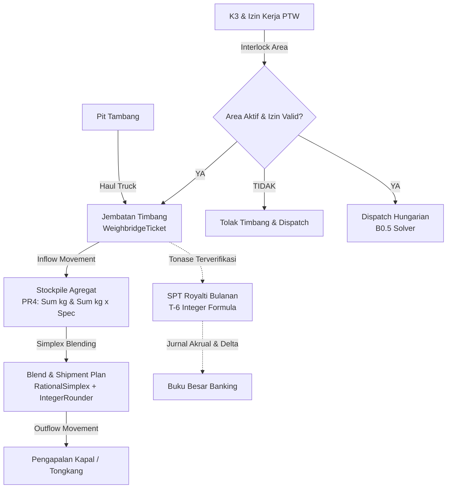

# Dokumen Desain Teknis — Lini 2: Pertambangan (Mining MVP Vertical Slice)

## 1. Ikhtisar & Arsitektur Sistem

Modul `Mining` menyediakan fondasi operasional terintegrasi untuk operasi penambangan terbuka (open-pit mining) dan pengapalan komoditas (batubara, nikel, tembaga, emas). Implementasi vertical slice MVP ini menggabungkan alur fisik material dari pit tambang, jembatan timbang (weighbridge), penimbunan (stockpile), pencampuran bijih (blending), hingga pengapalan ke kapal/tongkang, yang seluruhnya tercatat dalam buku besar keuangan double-entry secara otomatis dan diaudit secara dua-sumber.

---

## 2. Model Data & ERD Hubungan Entitas

### 2.1 Skema Tabel Database

1. **`min_sites`**
   - Konsesi atau unit bisnis tambang.
   - Kolom: `id` (UUID PK), `site_code` (unique), `name`, `commodity` (NICKEL, COAL, dll.), `timezone` (`Asia/Makassar` untuk WITA, `Asia/Jakarta` untuk WIB, `Asia/Jayapura` untuk WIT), `location`, `status`, `created_at`, `updated_at`.
2. **`min_pits`**
   - Lokasi galian pit dalam site.
   - Kolom: `id` (UUID PK), `site_id` (FK), `pit_code` (unique), `name`, `target_production_ton`, `status`, timestamps.
3. **`min_areas`**
   - Blok/zona operasional spesifik dalam pit atau stockpile.
   - Kolom: `id` (UUID PK), `site_id` (FK), `pit_id` (FK nullable), `area_code` (unique), `name`, `status` (`ACTIVE`, `STOPPED`), `stop_reason` (nullable), `stopped_at` (nullable), timestamps.
4. **`min_equipment`**
   - Registri alat berat (dump truck, excavator/shovel).
   - Kolom: `id` (UUID PK), `site_id` (FK), `equipment_code` (unique), `type` (`HAUL_TRUCK`, `EXCAVATOR`, `DRILL`), `model`, `tare_weight_kg` (bigint), `capacity_kg` (bigint), `status` (`AVAILABLE`, `DISPATCHED`, `GROUNDED`, `MAINTENANCE`), `engine_hours`, timestamps.
5. **`min_shovel_slots`**
   - Kapasitas penanganan shovel per jam.
   - Kolom: `id` (UUID PK), `equipment_id` (FK), `slot_code` (unique), `hour_window` (unsigned integer 0-23), `capacity_trucks_per_hour` (unsigned integer), timestamps.
6. **`min_stockpiles`**
   - Timbunan material dengan grade tersimpan sebagai akumulasi (PR4).
   - Kolom: `id` (UUID PK), `site_id` (FK), `stockpile_code` (unique), `name`, `total_kg` (bigint), `sum_kg_calories` (bigint), `sum_kg_ash_bps` (bigint), `sum_kg_sulfur_bps` (bigint), `sum_kg_moisture_bps` (bigint), `sum_kg_metal_bps` (bigint), timestamps.
7. **`min_weighbridge_tickets`** (APPEND-ONLY PR5)
   - Tiket timbangan fisik muatan truk.
   - Kolom: `id` (UUID PK), `ticket_uuid` (string unique), `ticket_number` (string unique gapless), `site_id` (FK), `pit_id` (FK), `area_id` (FK), `truck_id` (FK), `driver_party_id` (string), `gross_weight_kg` (bigint), `tare_weight_kg` (bigint), `net_weight_kg` (bigint), `is_overload` (boolean), `destination_stockpile_id` (FK), `ticket_hash` (string 64), `prev_hash` (string 64 nullable), `weighed_at` (timestamp), timestamps.
8. **`min_stockpile_movements`** (APPEND-ONLY PR5)
   - Mutasi fisik masuk/keluar timbunan.
   - Kolom: `id` (UUID PK), `movement_uuid` (string unique), `site_id` (FK), `stockpile_id` (FK), `movement_type` (`INFLOW_HAUL`, `OUTFLOW_BLEND`), `direction` (`IN`, `OUT`), `weight_kg` (bigint), `reference_type`, `reference_id`, `created_at`.
9. **`min_dispatch_plans`** & **`min_dispatch_assignments`**
   - Rencana penugasan armada truk ke shovel berbasis Hungarian Solver.
   - Menyimpan matriks biaya detik siklus dan sertifikat dual kelayakan.
10. **`min_blend_plans`** & **`min_blend_allocations`**
    - Rencana pencampuran multi-stockpile berbasis Rational Simplex + Integer Rounder.
11. **`min_reconciliation_runs`** & **`min_reconciliation_investigations`**
    - Audit tiga titik produksi-stockpile-pengapalan dan pencatatan investigasi deviasi.
12. **`min_royalty_returns`**
    - Pelaporan royalti statuter bulanan dengan posting delta saat finalisasi.
13. **`min_work_permits`** & **`min_safety_incidents`**
    - K3, izin kerja berisiko, dan interlock penutupan area.
14. **`min_contractor_evaluations`**
    - Evaluasi performa vendor dan penalti konsumsi BBM anomali (Robust Statistics).

---

## 3. Alur Operasional & Logika Bisnis

### 3.1 Jembatan Timbang & Mutasi Stockpile (T-1, T-2, PR4, PR5)
1. **Validasi Tara Truk:**
   Truk harus terdaftar di `min_equipment`. Tara timbang aktual ($W_{\text{tare}}$) dibandingkan dengan tara terdaftar ($W_{\text{reg}}$):
   $$|W_{\text{tare}} - W_{\text{reg}}| \times 10\,000 \le \text{tare\_tolerance\_bps} \times W_{\text{reg}}$$
   Default toleransi adalah 100 bps (1.00%). Bila melebihi toleransi, timbangan ditolak dengan galat bisnis.
2. **Perhitungan Neto:**
   $$W_{\text{net}} = W_{\text{gross}} - W_{\text{tare}}$$
   $W_{\text{net}} \le 0$ langsung ditolak.
3. **Pendeteksian Overload:**
   Bila $W_{\text{net}} > W_{\text{capacity}}$, tiket tetap dicatat tetapi kolom `is_overload` bernilai `true` (tidak membatalkan transaksi, namun masuk ke laporan pelanggaran kontraktor).
4. **Anti-Duplikasi Siklus Truk:**
   Truk yang sama tidak boleh menimbang kembali pada site yang sama dalam rentang waktu kurang dari `min_cycle_seconds` (default 600 detik). Pelanggaran ditolak sebagai upaya duplikasi.
5. **Kriptografi Rantai Hash (Canonical Hash Chain):**
   Setiap tiket memuat hash sha256 kanonikal yang mengikat `prev_hash` tiket sebelumnya pada site tersebut.
6. **Atomisitas Mutasi Stockpile:**
   Penerbitan tiket timbang secara atomik menambah stok masuk pada `min_stockpiles` ($\Sigma\text{kg}$ bertambah $W_{\text{net}}$, serta akumulasi parameter bertambah $W_{\text{net}} \times \text{kadar}$) dan mencatat baris append-only di `min_stockpile_movements`.
7. **Append-Only Fact (PR5):**
   Model `WeighbridgeTicket` dan `StockpileMovement` menolak update atau delete pada lifecycle event Eloquent.

### 3.2 Penugasan Armada Deterministik (Hungarian Solver T-3, PR2, B0.5)
1. Shovel dimodelkan memiliki sejumlah slot penugasan per jendela waktu kerja (kapasitas truk per jam).
2. Matriks biaya dihitung dalam satuan integer detik:
   $$C_{i,j} = \text{Waktu Muat Shovel}_j + \text{Waktu Angkut}(d_{i,j}, v_i) + \text{Estimasi Antrean}_j$$
3. Truk grounded, operator tanpa izin kerja aktif, atau shovel pada area dihentikan (STOPPED) dieliminasi dengan memberikan biaya penalti tak hingga ($C_{i,j} = \infty$).
4. Solusi penugasan optimal dipecahkan menggunakan `HungarianSolver` (B0.5).
5. Hasil alokasi memuat **Sertifikat Dual Potensial** $(u, v)$ yang membuktikan bahwa $u_i + v_j \le C_{i,j}$ dan total biaya primal sama dengan total nilai dual.
6. Hasil diverifikasi oleh `AssignmentCertificateVerifier` sebelum disimpan ke database.
7. Dispatcher manusia dapat melakukan override manual hanya dengan mengisi `override_reason` yang wajib tercatat dalam log audit.

### 3.3 Pencampuran Bijih Eksak (Rational Simplex & Integer Rounder T-4, PR2, B0.7, B0.8)
1. Mengoptimalkan alokasi tonase dari beberapa stockpile yang tersedia agar memenuhi kriteria kapal:
   - Batasan tonase: $\text{Target Min Kg} \le \sum x_k \le \text{Target Max Kg}$.
   - Batasan kualitas (misal kalori $\ge K_{\min}$, sulfur $\le S_{\max}$):
     $$\sum x_k \times \text{spec}_k \ge \text{Target Min} \times \sum x_k$$
2. Dipecahkan secara eksak menggunakan `RationalSimplex` dengan sertifikat dual/Farkas.
3. Solusi kontinu dibulatkan ke integer kilogram terdekat menggunakan `IntegerBlendRounder` tanpa melanggar batasan manapun.
4. Sertifikat LP diverifikasi oleh `LpCertificateVerifier`.
5. Eksekusi pengapalan secara atomik mencatat mutasi keluar (`min_stockpile_movements` direction OUT) dan mengurangi akumulasi di stockpile.

### 3.4 Rekonsiliasi Tiga Titik & Investigasi (T-5)
1. Membandingkan:
   $$\Sigma \text{Tiket Timbang Neto} \quad \text{vs} \quad \Sigma \text{Mutasi Masuk Stockpile} \quad \text{vs} \quad \Sigma \text{Pengapalan}$$
2. Variansi dalam batas $\text{recon\_tolerance\_bps}$ (default 50 bps = 0.50%) dianggap wajar.
3. Jika variansi melebihi batas, sistem secara otomatis menerbitkan entitas `min_reconciliation_investigations` dengan status `OPEN`.

### 3.5 Perhitungan Royalti Statuter Bulanan & Delta Finalisasi (T-6, U-1, U-2)
1. Dihitung per `(site_id, commodity, period_local)`. Periode bisnis ditentukan oleh zona waktu lokasi (`min_sites.timezone`).
2. Tonase dihitung eksklusif dari $\Sigma W_{\text{net}}$ tiket timbang terverifikasi di database (tidak menerima angka bebas dari pemanggil).
3. Rumus integer rupiah eksak:
   $$\text{Royalti} = \text{round\_half\_up}\left( \frac{\text{tonase\_kg} \times \text{harga\_usd\_sen} \times \text{kurs\_idr\_1e6} \times \text{tarif\_bps}}{1000 \times 100 \times 1\,000\,000 \times 10\,000} \right)$$
4. Jurnal akrual provisional diposting ke ledger:
   - Debit: `expense:min:royalty:IDR`
   - Kredit: `min:royalty_payable:IDR`
5. Saat harga atau kurs final diterbitkan, finalisasi menghitung selisih ($\Delta$):
   $$\Delta = \text{Royalti Final} - \text{Royalti Provisional}$$
   Posting delta dilakukan sebagai jurnal terpisah tanpa pernah mengubah posting lama.

### 3.6 Keselamatan K3, Izin Kerja & Interlock Area (T-7)
1. Izin kerja berisiko tinggi (Hot Work, Confined Space, Blast Clearance) diterbitkan melalui `ApprovalEngineInterface` dengan masa berlaku `valid_from` hingga `valid_until`.
2. Insiden berkategori tinggi atau fatality memicu interlock otomatis pada area terkait (`status = STOPPED`).
3. Seluruh aktivitas penimbangan truk yang berasal dari area dihentikan atau dispatch ke area dihentikan ditolak oleh sistem.

### 3.7 Penalti Kontraktor & Anomali BBM Robust Statistics (T-8, B0.3)
1. Konsumsi bahan bakar truk dievaluasi per 100 ton-km:
   $$\text{SFC} = \frac{\text{Liter BBM} \times 100}{\text{Tonase} \times \text{Jarak Km}}$$
2. Baseline konsumsi dihitung menggunakan median dan Median Absolute Deviation (MAD) dari armada sejenis melalui `RobustStatistics` (B0.3).
3. Konsumsi di atas ambang deteksi $\text{median} + k \times 1.4826 \times \text{MAD}$ ditandai sebagai anomali pencurian/kebocoran BBM.
4. Anomali BBM memicu pembekuan pembayaran invoice kontraktor (`payment_held = true`) dan penerbitan denda penalti.

---

## 4. Antarmuka Pengguna & Command Baris Perintah

1. **Jembatan Timbang Operator UI (`/mining/weighbridge`):**
   - Layar responsive yang dioptimasi untuk viewport mobile 375 px (layar tablet / handheld operator timbangan).
   - Menampilkan input plat nomor truk, berat bruto, berat tara, visualisasi selisih tara, peringatan overload, dan tombol simpan tiket.
   - Dilindungi middleware `role:weighbridge_operator`.
2. **Command Audit Dua Sumber (`min:audit`):**
   - Menjalankan verifikasi komprehensif dua-sumber:
     - Keseimbangan timbang vs mutasi stockpile (0 selisih kg).
     - Keseimbangan mutasi keluar vs pengapalan $\pm$ toleransi.
     - Perhitungan royalti vs akrual buku besar.
     - Integritas rantai hash tiket timbang per site.
     - Verifikasi ulang seluruh sertifikat Hungarian dan Simplex tersimpan.
     - Keseimbangan debit-kredit buku besar per transaksi mining.
   - Exit code: 0 bila sehat sempurna, 1 bila terdeteksi anomali.
