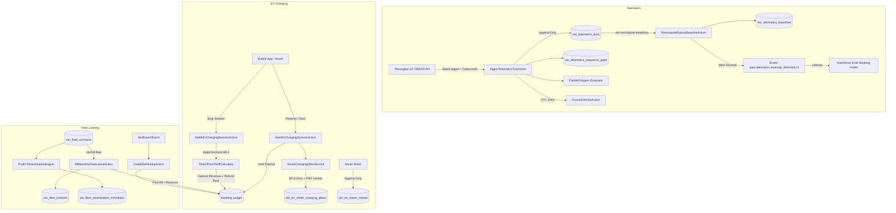

# Desain Teknis — Lini 3: Mobility (Telematics, EV & Fleet MVP)

## 1. Arsitektur Komponen & Aliran Data

Modul **Mobility** mengintegrasikan tiga pilar mobilitas di bawah satu prefiks `oto_`:
1. **Telematics Pipeline:** Aliran streaming data telemetri IoT OBD2/CAN append-only, deteksi gap urutan, deteksi anomali non-parametrik MAD 7 hari lokal, penegakan grounding kendaraan, dan pembuatan draf servis ke AutoServe.
2. **EV Smart Charging Hub:** Pengelolaan sesi SPKLU, alokasi daya 15 menit via Dinic Max-Flow dengan sertifikat dual min-cut, pembacaan meteran kWh append-only, penagihan multi-tarif Time-Of-Use (termasuk lintas tengah malam) ber-hold/capture ledger.
3. **B2B Fleet Leasing & Amortisasi:** Penagihan sewa bulanan ber-idempotency deterministik, perhitungan penalti dan kredit SLA per kejadian, verifikasi amortisasi PSAK 73 tanpa kebocoran integer, serta penegakan batas geofence depot/zona.

---

## 2. Model Data & Skema Database

### 2.1 Prefiks Tabel & Kolom Kunci (`oto_*`)
Seluruh tabel menggunakan prefiks `oto_`:
- `oto_telematics_devices`: master perangkat (id, device_id UNIQUE, vehicle_id FK core_vehicles, serial_number UNIQUE, token_hash, protocol, status, last_heartbeat_at).
- `oto_telematics_ticks`: rekaman tick (id, device_id, vehicle_id, sequence, recorded_at, latitude_e6, longitude_e6, rpm, speed_kmh, coolant_temp_deci_c, battery_mv, fuel_permil, odometer_meters, dtc_codes_json, idempotency_key UNIQUE) — APPEND-ONLY (Exception di `updating`/`deleting`).
- `oto_telematics_sequence_gaps`: celah sequence stream (id, device_id, expected_sequence, received_sequence, detected_at).
- `oto_telematics_baselines`: statistik performa robust (id, vehicle_id, metric, median_value, mad_value, sample_count, calculated_at, window_days).
- `oto_geofence_zones`: poligon zona depot (id, zone_code UNIQUE, name, polygon_json, min_lat_e6, max_lat_e6, min_lon_e6, max_lon_e6, is_active).
- `oto_ev_stations`: master SPKLU (id, station_code UNIQUE, name, timezone, max_grid_power_kw, location_type).
- `oto_ev_chargers`: master charger (id, station_id, charger_code UNIQUE, charger_type, max_power_kw, status).
- `oto_ev_tariff_windows`: jendela tarif TOU (id, station_id, name, start_time, end_time, rate_per_kwh_idr, is_cross_midnight).
- `oto_ev_sessions`: sesi pengisian (id, session_code UNIQUE, charger_id, vehicle_id, user_id, status, started_at, completed_at, deposit_held_idr, total_cost_idr, refund_idr, final_soh_bps).
- `oto_ev_meter_values`: tick meteran energi (id, session_id, read_at, energy_wh, power_w, idempotency_key UNIQUE) — APPEND-ONLY.
- `oto_ev_smart_charging_plans`: rencana pengisian Dinic (id, plan_uuid UNIQUE, station_id, time_slot, allocated_power_kw, certificate_json, status).
- `oto_fleet_contracts`: kontrak sewa B2B (id, contract_number UNIQUE, party_id, monthly_rental_idr, total_lease_value_idr, duration_months, start_date, end_date, max_downtime_hours_per_month, status).
- `oto_fleet_contract_units`: armada kontrak (id, contract_id, vehicle_id, status, assigned_at).
- `oto_fleet_invoices`: invoice sewa bulanan (id, invoice_number UNIQUE, contract_id, billing_period, rental_fee_idr, penalty_credit_idr, total_billed_idr, idempotency_key UNIQUE, status).
- `oto_fleet_sla_breaches`: pencatatan pelanggaran SLA (id, breach_uuid UNIQUE, contract_id, unit_id, incident_date, downtime_hours, breach_type, penalty_bps, penalty_amount_idr, status).
- `oto_fleet_amortization_schedules`: tabel jadwal PSAK 73 (id, contract_id, period_month, principal_idr, interest_idr, payment_idr, ending_liability_idr, is_posted).

---

## 3. Algoritma & Formula Bisnis

### 3.1 Telematika: Ingest Append-Only, Sensor Integer, & Deteksi Anomali Robust (O-1, O-2, O-3)
1. **Sensor Integer Murni (O-1):**
   - Suhu: $0.1\ ^\circ\text{C}$ (deci-celsius, e.g. $88.5\ ^\circ\text{C} = 885$).
   - Tegangan baterai: millivolt ($12.6\text{ V} = 12600\text{ mV}$).
   - Bahan bakar: per-mil ($80.5\% = 805$).
   - Odometer: meter integer ($145.2\text{ km} = 145200\text{ m}$).
   - **PR5 & X25:** Kolom yang tidak terkirim sensor disimpan sebagai `NULL` (DILARANG memberikan default siluman 90 °C, 12.6 V, atau 100% BBM).
2. **Deteksi Celah Sequence:**
   - Dihitung per perangkat. Jika `sequence > last_sequence + 1`, dicatat baris celah di `oto_telematics_sequence_gaps`.
3. **Robust Baseline 7 Hari & Anomali MAD (O-2):**
   - Diambil dari data tick 7 hari lokal terakhir (`ClockInterface`).
   - $\text{median} = \text{Median}(X)$, $\text{MAD} = \text{Median}(|X - \text{median}|)$.
   - Kriteria anomali integer murni:
     $$|x - \text{median}| \times 100\,000\,000 > k\_bps \times 14\,826 \times \text{MAD}$$
     dengan $k\_bps = 35\,000$ (ekuivalen $3.5 \times 1.4826 \times \text{MAD}$).
   - Bila $\text{MAD} = 0$, gunakan ambang batas aman absolut dari config (misal $\Delta \text{temp} = 150$ deci-°C, $\Delta \text{volt} = 1500$ mV), tanpa pembagian nol.
4. **Grounding & AutoServe Intake (O-3, O-4):**
   - DTC Kritis (misal `P0117`, `P0300`, `P0562`) menyebabkan unit ditandai `GROUNDED`.
   - Event `auto.telematics.anomaly_detected.v1` dipancarkan unik per `(vehicle_id, metric, local_date)`.
   - AutoServe listener membuat satu draf booking per hari untuk anomali yang sama.
   - Unit berstatus `GROUNDED` ditolak oleh Dispatching Logistik / Fleet.

### 3.2 Geofence Integer Murni (O-8)
- Koordinat dikonversi ke mikroderajat ($10^{-6}$ derajat, integer).
- Poligon depot dievaluasi dengan `PointInPolygon` (B0.4) menggunakan perkalian silang 64-bit integer.
- Titik yang tepat berada di batas tepi (*boundary*) dianggap berada di dalam (**INSIDE**).

### 3.3 EV Charging: Dinic Max-Flow Smart Charging (O-6) & Time-Of-Use Apportionment (O-5)
1. **Dinic Max-Flow Allocation (B0.6 + PR2 Verifier):**
   - Pemodelan graf aliran:
     - Sumber $S \to$ Stasiun ($C_{\text{site}} = \text{Batas Trafo kW} \times 250\text{ Wh/15-min}$).
     - Stasiun $\to$ Charger ($C_{\text{chg}} = \text{Batas Charger kW} \times 250\text{ Wh/15-min}$).
     - Charger $\to$ Sesi Aktif ($C_{\text{req}} = \text{Permintaan Kendaraan Wh}$).
     - Sesi Aktif $\to$ Muara $T$.
   - Output: Rencana alokasi Wh per sesi beserta sertifikat min-cut ($S$-cut dan $T$-cut).
   - Verifikasi melalui `FlowCutCertificateVerifier`: $\text{Aliran Maksimal} = \text{Kapasitas Irisan Minimal}$.
2. **Apportionment Meteran Time-Of-Use (O-5):**
   - Vektor Uji:
     - Interval meteran 16:52 (0 Wh) s.d. 17:07 (5.000 Wh). Batas puncak: 17:00.
     - Durasi luar-puncak: 8 menit. Durasi puncak: 7 menit. Total: 15 menit.
     - Pembagian kuantitas:
       $$\text{Luar Puncak} = \text{floor}\left(5000 \times \frac{8}{15}\right) = 2666$$
       $$\text{Puncak} = \text{floor}\left(5000 \times \frac{7}{15}\right) = 2333$$
       $$\text{Remainder} = 5000 - (2666 + 2333) = 1 \implies \text{diberikan ke luar-puncak (sisa terbesar)} \to 2667\text{ Wh}.$$
   - Total tarif: Sesi 16:30–18:00 (20 kW konstan, 30 kW total energi = 30 kWh):
     - 10 kWh $\times$ 2.000 = 20.000 IDR.
     - 20 kWh $\times$ 3.500 = 70.000 IDR.
     - Total = 90.000 IDR. Hold 150.000 IDR $\to$ Capture 90.000 IDR, Release 60.000 IDR.

### 3.4 B2B Fleet Leasing & Amortisasi PSAK 73 (O-7)
1. **Jadwal Amortisasi Eksak:**
   - Untuk setiap periode bulanan $t = 1 \dots N$:
     - Bunga bulanan: $\text{Interest}_t = \text{round}(\text{Liability}_{t-1} \times r)$.
     - Pokok: $\text{Principal}_t = \text{Payment}_t - \text{Interest}_t$.
     - $\text{Liability}_t = \text{Liability}_{t-1} - \text{Principal}_t$.
   - Pada bulan terakhir $N$: $\text{Principal}_N = \text{Liability}_{N-1}$, $\text{Interest}_N = \text{Payment}_N - \text{Principal}_N$, sehingga $\text{Liability}_N = 0$ persis.
   - Total kontrol: $\sum \text{Principal} + \sum \text{Interest} = \sum \text{Payment}$ persis rupiah.
2. **Tagihan & Kredit SLA Idempoten:**
   - Tagihan bulanan: `oto:fleet:bill:{contract}:{periode}`.
   - Pelanggaran SLA: Fee unit $\times$ `sla_credit_bps` integer basis poin. Idempotency key: `oto:fleet:sla:{breach_id}`.

---

## 4. Pola Buku Besar & Akun Kontrol (KONSEP §1F, §A2)

| Kejadian Bisnis | Debit (−) | Kredit (+) | Keterangan & Idempotency Key |
|---|---|---|---|
| **Hold Sesi EV** | `wallet:user:{id}:IDR` | `escrow:payment:IDR` | `oto:ev_hold:{session_code}` |
| **Capture Sesi EV** | `escrow:payment:IDR` | `oto:ev_charging_revenue:IDR` | `oto:ev_capture:{session_code}` (biaya sesi) |
| **Refund Sisa Deposit**| `escrow:payment:IDR` | `wallet:user:{id}:IDR` | `oto:ev_release:{session_code}` (sisa hold) |
| **Tagihan Sewa Armada**| `ar:oto:fleet:{party}:IDR` | `oto:fleet_lease_revenue:IDR` | `oto:fleet_bill:{contract}:{periode}` |
| **Kredit Pelanggaran SLA**| `expense:oto:fleet_sla_credit:IDR` | `ar:oto:fleet:{party}:IDR` | `oto:fleet_sla:{breach_uuid}` |

---

## 5. Rencana Penguatan Audit Dua Sumber

Perintah audit `auto:audit` (dan shortcut `mob:audit`, `tlm:audit`, `ev:audit`, `flt:audit`):
1. **Audit Telematika (`tlm:audit`):**
   - Memastikan tidak ada duplikasi `(device_id, sequence)`.
   - Seluruh celah sequence teridentifikasi dan tercatat di `oto_telematics_sequence_gaps`.
   - Baseline pada `oto_telematics_baselines` dihitung ulang secara independen dari 7 hari tick nyata dan dibandingkan dengan deviasi 0.
2. **Audit EV Charging (`ev:audit`):**
   - $\sum (\text{kWh} \times \text{tarif})$ sesi `COMPLETED` = $\sum \text{capture}$ pada `oto:ev_charging_revenue:IDR`.
   - Nilai pembacaan `oto_ev_meter_values` per sesi selalu monoton non-menurun.
   - Seluruh rencana pengisian Dinic memiliki sertifikat min-cut yang valid.
3. **Audit Fleet Leasing (`flt:audit`):**
   - Total invoice sewa `oto_fleet_invoices` = saldo posting piutang `ar:oto:fleet:*`.
   - Total kredit SLA = $\sum (\text{fee unit} \times \text{penalty\_bps})$.
   - Rekonsiliasi jadwal amortisasi PSAK 73: $\sum \text{pokok} + \sum \text{bunga} = \sum \text{pembayaran}$ dan liabilitas akhir = 0.
