# Architecture & Detailed Design - G6-P2.2 Fase 82 (VMI & C2M)

**Item:** P2.2 Fase 82 (Vendor-Managed Inventory / VMI & Consumer-to-Manufacturer / C2M)  
**Dokumen Desain:** `docs/design/p2-2-fase-82.md`  
**Keputusan Terkait:** D82-1, D82-2 (tercantum di `docs/DECISIONS.md`)  

---

## 1. Arsitektur Komponen

```mermaid
flowchart TD
    subgraph VMI["Vendor-Managed Inventory (VMI)"]
        Supp["Supplier Portal (/portal/vmi)"] -->|"Cek SKU & Stok"| StockPort["StoreProductStockPort / WMS"]
        ScanCmd["Console Command (vmi:scan-reorder)"] --> ReorderPolicy["Inventory\\ReorderPolicy"]
        ReorderPolicy -->|"Sertifikat & Vektor"| CertVerifier["ReorderPolicyCertificateVerifier"]
        ReorderPolicy --> PlafondCheck{"Nilai <= Plafon Kontrak?"}
        PlafondCheck -->|Ya| AutoPO["mfg_vmi_replenishments (AUTO_ORDERED)"]
        PlafondCheck -->|Tidak| PendPO["mfg_vmi_replenishments (PENDING_APPROVAL)"]
        PendPO -->|"Approve oleh procurement_manager"| ApprPO["mfg_vmi_replenishments (APPROVED)"]
        AutoPO --> LedgerCommit["Ledger Commitment (VMI_PURCHASE_COMMITMENT)"]
        ApprPO --> LedgerCommit
    end

    subgraph C2M["Consumer-to-Manufacturer (C2M)"]
        Cust["Customer (/store/c2m)"] --> ConfigReq["Input Pilihan (W, D, M, L)"]
        ConfigReq --> AC3["Csp\\ArcConsistency (AC-3)"]
        AC3 --> CheckCons{"Konsisten?"}
        CheckCons -->|Tidak| QuickXplain["Csp\\QuickXplain (MUC Minimal)"]
        QuickXplain --> HTTP422["HTTP 422 (Pilihan Tidak Konsisten + Alasan Minimal)"]
        CheckCons -->|Ya| BomGen["Generate C2M BOM & Routing"]
        BomGen --> PriceCalc["Hitung Biaya Live * Faktor Kompleksitas"]
        PriceCalc --> Locker["PriceLocker (pric_frozen_quotes)"]
        Locker --> CustomOrder["mfg_c2m_custom_orders"]
        CustomOrder --> Planner["Planner (/manufacturing/c2m)"]
        Planner --> SPK["Terbitkan SPK Pabrik (SPK_ISSUED)"]
    end
```

---

## 2. Model & Skema Data
1. `mfg_vmi_replenishments`:
   - `id`, `vmi_code` (unique), `supplier_id`, `sku`, `current_shelf_stock`, `reorder_point`, `suggested_reorder_qty`, `total_estimated_idr`, `contract_plafond_idr`, `status` (`AUTO_ORDERED`, `PENDING_APPROVAL`, `APPROVED`), `idempotency_key` (unique), `timestamps`.
2. `prc_vmi_agreements`:
   - `id`, `agreement_code` (unique), `supplier_id`, `sku`, `reorder_point`, `reorder_qty`, `unit_cost_idr`, `contract_plafond_idr`, `status` (`ACTIVE`, `INACTIVE`), `valid_until`, `timestamps`.
3. `mfg_c2m_custom_orders`:
   - `id`, `c2m_code` (unique), `user_id`, `base_model`, `parameters` (json), `complexity_factor`, `rolled_up_bom_cost_idr`, `final_price_idr`, `status` (`DESIGN_VALIDATED`, `SPK_ISSUED`, `IN_PRODUCTION`, `CANCELLED`), `spk_number`, `estimated_lead_days`, `timestamps`.
4. `mfg_c2m_bom_nodes`:
   - `id`, `c2m_custom_order_id` (FK), `node_code`, `parent_node_code`, `part_name`, `material`, `quantity`, `unit_cost_idr`, `subtotal_cost_idr`, `timestamps`.

---

## 3. Algoritma & Pustaka Bersama
- `Modules\Shared\Domain\Algorithms\Inventory\ReorderPolicy`:
  - Perhitungan $(s, S)$ deterministik dengan presisi integer rupiah dan unit terkecil.
  - Vektor uji prompt diverifikasi dengan `ReorderPolicyCertificateVerifier`.
- `Modules\Shared\Domain\Algorithms\Csp\ArcConsistency`:
  - Algoritma AC-3 untuk pemangkasan domain pilihan produk modular.
- `Modules\Shared\Domain\Algorithms\Csp\QuickXplain`:
  - Ekstraksi Minimal Unsatisfiable Core (MUC) untuk menghasilkan respons error 422 minimal saat pilihan bertentangan dengan batasan desain.

---

## 4. Dua Sumber Audit
- `vmi:audit` (`Modules\Manufacturing\Console\Commands\AuditVmiCommand`):
  - Membandingkan baris VMI auto-PO terhadap batas plafon kontrak dan status approval.
  - Memvalidasi pembukuan komitmen anggaran di ledger.
  - Memverifikasi konsistensi margin C2M (final price >= rolled up BOM cost).
  - Fixture korupsi: `App\Quality\Audit\Fixtures\VmiAuditCorruptionFixture`.
