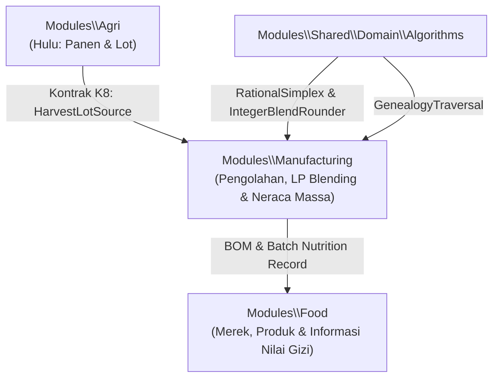

# Architecture & Design - G6-P2.3 Fase 168 (Agri-Processing & Food Lini 21)

## 1. Arsitektur Domain & Kontrak Lintas Modul

### 1.1 Kontrak K8: HarvestLotSource
Didefinisikan di `Modules\Agri\Contracts\HarvestLotSource`:
- `describe(string|int $collectionBatchId): ?array`
- `availableGrams(string|int $collectionBatchId): int`
- `consume(string|int $collectionBatchId, int $grams, string $idempotencyKey): void`

Tabel aditif `agri_collection_consumptions`:
- Mencatat setiap konsumsi lot bahan baku oleh pabrik pengolahan.
- Sisa tersedia = $(\text{gross\_weight\_kg} \times 1000) - \sum \text{grams\_consumed}$.
- Idempotency key unik mencegah konsumsi ganda.

### 1.2 Skema Tabel Modul Food (`food_`)
1. `food_brands`:
   - `id`: bigIncrements
   - `name`: string
   - `code`: string unique
   - `description`: text nullable
   - `timestamps`
2. `food_products`:
   - `id`: bigIncrements
   - `brand_id`: unsignedBigInteger FK
   - `sku`: string unique
   - `name`: string
   - `category`: string
   - `standard_package_grams`: integer
   - `timestamps`
3. `food_batch_nutrition`:
   - `id`: bigIncrements
   - `batch_id`: unsignedBigInteger FK ke batch pengolahan manufaktur
   - `food_product_id`: unsignedBigInteger FK ke `food_products`
   - `calories_kcal`: integer
   - `protein_grams`: decimal:1
   - `fat_grams`: decimal:1
   - `carbs_grams`: decimal:1
   - `sodium_mg`: integer
   - `serving_size_grams`: integer
   - `timestamps`

### 1.3 Skema Tabel Manufaktur Pengolahan (`mfg_agri_`)
1. `mfg_agri_batches`:
   - `id`: bigIncrements
   - `batch_code`: string unique
   - `target_product_sku`: string
   - `planned_input_grams`: integer
   - `actual_output_grams`: integer
   - `waste_grams`: integer
   - `status`: string (`PLANNED`, `OPTIMIZED`, `IN_PRODUCTION`, `COMPLETED`, `EXPORT_CERTIFIED`)
   - `protein_bps`: integer
   - `moisture_bps`: integer
   - `export_grade`: string nullable
   - `timestamps`
2. `mfg_agri_batch_inputs`:
   - `id`: bigIncrements
   - `agri_batch_id`: unsignedBigInteger FK
   - `agri_collection_batch_id`: string
   - `allocated_grams`: integer
   - `cost_idr`: integer
   - `timestamps`
3. `mfg_agri_genealogy_edges`:
   - `id`: bigIncrements
   - `parent_entity_type`: string (`AGRI_LOT`, `MFG_BATCH`)
   - `parent_entity_id`: string
   - `child_entity_type`: string (`MFG_BATCH`, `FOOD_PRODUCT_PACK`)
   - `child_entity_id`: string
   - `quantity_grams`: integer
   - `timestamps`

---

## 2. Algoritma Inti

### 2.1 Blending Optimization (RationalSimplex & IntegerBlendRounder)
- Menggunakan `RationalSimplex` (Two-Phase Simplex dengan aturan Bland & BigRational) untuk formulasi minimum biaya:
  $$\min \sum_{i} c_i x_i$$
  dengan kendala:
  $$\sum x_i = W_{\text{target}}$$
  $$\sum p_i x_i \ge P_{\text{target}} W_{\text{target}}$$
  $$\sum m_i x_i \le M_{\text{target}} W_{\text{target}}$$
  $$0 \le x_i \le \text{Kapasitas}_i$$
- Bila kendala kontradiktif $\to$ Farkas certificate generated.

### 2.2 Genealogy Traversal Graph (BFS + DFS Oracle Verification)
- Algoritma `GenealogyTraversal`:
  - `traverseForward(string $rootType, string $rootId): GenealogyTraversalResult`
  - `traverseBackward(string $rootType, string $rootId): GenealogyTraversalResult`
  - Menghasilkan simpul yang terjangkau secara deterministik beserta sertifikat penutupan (hash of sorted traversed nodes).
  - Verifikasi sertifikat dilakukan dengan membandingkan traversal BFS terhadap oracle DFS.

---

## 3. Audit Dua Sumber (`food:audit`)
Pengecekan konsistensi:
1. Neraca massa setiap batch komoditas: $\text{planned\_input\_grams} = \text{actual\_output\_grams} + \text{waste\_grams}$.
2. Konsumsi panen tidak melebihi stok lot awal: $\sum \text{grams\_consumed} \le \text{gross\_weight\_kg} \times 1000$.
3. Sertifikasi ekspor: batch berstatus `EXPORT_CERTIFIED` harus memiliki protein $\ge 1000$ bps dan moisture $\le 1400$ bps.
