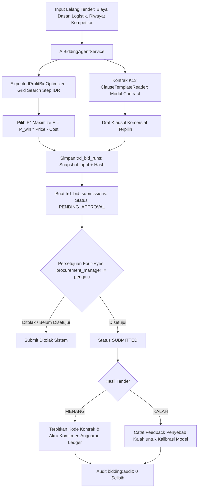

# Dokumen Desain — Fase 84: Asisten Penawaran Tender (P3.2)

## 1. Arsitektur & Diagram Alur

## 2. Struktur Data & Integrasi Modul

1. **`trd_bidding_agents`**:
   - Konfigurasi parameter entitas bisnis: batas harga bawah (`min_price_floor_idr`), batas harga atas (`max_price_ceiling_idr`), target margin (`target_margin_pct`), batas risiko mitra maks (`max_risk_score`).
2. **`trd_bid_runs`**:
   - Snapshot input evaluasi: feed harga komoditas, estimasi biaya logistik, skor risiko pembeli, histori harga penawaran lawan, harga optimal hasil optimasi, draf klausul komersial dinamis JSON, dan evaluasi hash kanonik.
3. **`trd_bid_submissions`**:
   - Penawaran diajukan: kode penawaran, foreign key ke run evaluasi, harga final yang diajukan, flag four-eyes mandatori, user ID approver, waktu persetujuan, status lelang, kode kontrak pasca-menang, dan feedback alasan pasca-kalah.
4. **Kontrak K13 `ClauseTemplateReader`**:
   - Menyediakan klausul template teruji dari modul Contract (`ctr_clause_templates`) yang difilter berdasarkan tipe komersial (`COMMERCIAL_DEFAULT`, `PAYMENT_TERMS`, `INCOTERM`, `FORCE_MAJEURE`).

## 3. Algoritma Optimasi Penawaran (`ExpectedProfitBidOptimizer`)
- Model probabilitas empiris:
  $$P(\text{menang} \mid p) = \frac{\sum_{i=1}^N \mathbf{1}(p \le \text{competitor\_bids}_i)}{N}$$
- Fungsi ekspektasi keuntungan diskrit integer IDR:
  $$\mathbb{E}(p) = (p - c) \times P(\text{menang} \mid p)$$
- Grid search diskrit:
  Menguji $p \in [c + \text{step}, \text{ceiling}]$ dengan langkah diskrit $\text{step}$.
- Penegakan kendala:
  1. $P(\text{menang} \mid p) \ge \text{min\_win\_probability\_bps}$ (default 3.000 bps = 30%).
  2. Margin penawaran $\ge \text{min\_margin\_bps}$.
  3. Rentang harga berada di dalam $[\text{floor}, \text{ceiling}]$.
- Verifier sertifikat deterministik:
  Menghasilkan hash SHA-256 kanonik dari kombinasi biaya, penawaran kompetitor, harga optimal, expected profit, dan probabilitas menang.

## 4. Four-Eyes Approval & Ledger Posting
- Setiap pengajuan tender diawali dengan status `PENDING_APPROVAL`.
- `procurement_manager` atau `admin` (yang ID-nya berbeda dari pembuat draft) menandatangani persetujuan secara eksplisit.
- Saat hasil diumumkan `WON`:
  - Kode kontrak deterministik diterbitkan (`CTR-TND-...`).
  - Posting anggaran komitmen lelang dibukukan ke subledger:
    - Debit: `trd:tender_contract_ar:IDR`
    - Kredit: `trd:tender_revenue_unearned:IDR`
    - Idempotency key: `TRD-TND-{contract_code}`.

## 5. Pemeriksaan Audit Dua Sumber (`bidding:audit`)
- Verifikasi determinisme rekonstruksi: evaluasi hash dihitung ulang dari data input snapshot dan dibandingkan byte-per-byte.
- Ketiadaan penawaran ilegal: verifikasi bahwa tidak ada penawaran `SUBMITTED` atau `WON` tanpa catatan approver manusia (`approved_by_user_id` dan `approved_at` wajib ada).
- Kepatuhan batas batas harga: verifikasi tidak ada penawaran di luar batas floor dan ceiling agen.
- Integritas status menang: verifikasi setiap penawaran `WON` memiliki kode kontrak yang sah.

