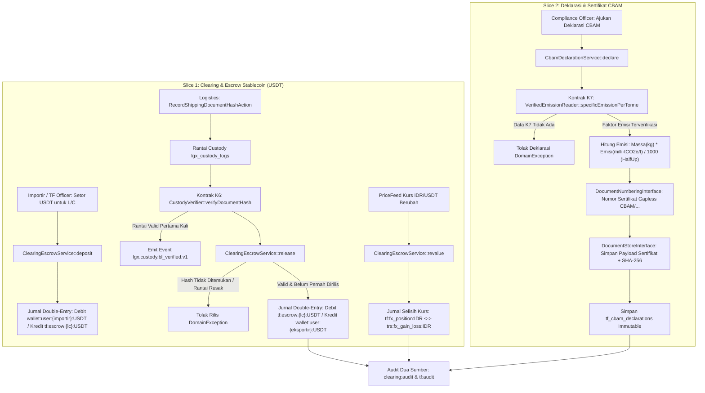

# Dokumen Desain — Fase 83: Clearing House Stablecoin & Sertifikasi CBAM (P3.3)

## 1. Arsitektur & Diagram Alur

## 2. Kontrak Lintas Modul (K6 & K7)

1. **K6 — `Modules\Logistics\Contracts\CustodyVerifier`**:
   - Method: `verifyDocumentHash(string $documentType, string $sha256Hex): ?array`.
   - Implementasi `CustodyVerifierService` mencari entri `lgx_custody_logs` dengan `event_type = 'DOC_' . strtoupper($documentType)` dan `payload_json->document_sha256 = strtolower($sha256Hex)`, lalu memverifikasi ulang seluruh rantai hash `(shipment_id, sequence_no)` dari urutan 1 hingga log terakhir menggunakan `HashChain::compute`.
   - Bila valid dan merupakan verifikasi pertama untuk kombinasi `(shipment_id, document_type, document_sha256)`, memancarkan event `lgx.custody.bl_verified.v1` melalui `EventSpineInterface`.
2. **K7 — `Modules\Esg\Contracts\VerifiedEmissionReader`**:
   - Method: `specificEmissionPerTonne(string $productCode, string $originCountry, CarbonImmutable $at): ?array`.
   - Implementasi `VerifiedEmissionReaderService` membaca tabel `esg_verified_product_emissions` untuk pasangan `(product_code, origin_country)` yang aktif pada timestamp `$at` (`effective_from <= $at` dan `effective_to IS NULL OR effective_to >= $at`), mengembalikan `milli_tco2e_per_tonne`, `verifier_accreditation`, dan `methodology_code`.

## 3. Struktur Tabel & Akun Buku Besar

### 3.1 Tabel Baru
- **`esg_verified_product_emissions`** (`Modules\Esg`):
  - Menyimpan faktor emisi spesifik produk per ton dalam satuan integer `milli_tco2e_per_tonne` ($1,850\text{ tCO2e/t} = 1.850\text{ milli-tCO2e/t}$).
- **`tf_clearing_escrows`** (`Modules\TradeFinance`):
  - Menyimpan kontrak escrow L/C berbasis USDT (`amount_micro_usdt`, `deposit_rate_idr_per_usdt`, `last_revalued_rate_idr_per_usdt`, `cumulative_fx_delta_idr`, `status`, `verified_document_type`, `verified_document_sha256`, `idempotency_key`, `release_idempotency_key`).
  - Indeks unik `(lc_id, verified_document_sha256)` menjamin satu dokumen pengapalan hanya dapat merilis satu escrow pada L/C tersebut.
- **`tf_cbam_parameters`** & **`tf_cbam_declarations`** (`Modules\TradeFinance`):
  - `tf_cbam_parameters` menyimpan parameter harga karbon Uni Eropa dan faktor pengurang benchmark (`eu_ets_price_eur_cents_per_t`, `default_markup_bps`).
  - `tf_cbam_declarations` bersifat *immutable* (menolak `updating` dan `deleting` pada level model) dan menyimpan `net_mass_kg`, `specific_emission_milli_tco2e_per_tonne`, `total_embedded_milli_tco2e`, `certificate_number`, `document_store_path`, serta `certificate_sha256`.

### 3.2 Akun Ledger Double-Entry
- Setoran Escrow USDT (`CLEARING_USDT_DEPOSIT`):
  - Debit: `wallet:user:{importer_user_id}:USDT`
  - Kredit: `tf:escrow:{lc_number}:USDT`
- Rilis Escrow USDT (`CLEARING_USDT_RELEASE`):
  - Debit: `tf:escrow:{lc_number}:USDT`
  - Kredit: `wallet:user:{exporter_user_id}:USDT`
- Revaluasi Selisih Kurs IDR/USDT (`CLEARING_FX_REVAL`):
  - Nilai IDR dihitung sebagai $\text{round\_half\_up}\left(\frac{\text{amount\_micro\_usdt} \times \text{rate\_idr}}{10^6}\right)$.
  - Bila kurs naik ($\Delta > 0$): Debit `tf:fx_position:IDR`, Kredit `trs:fx_gain_loss:IDR`.
  - Bila kurs turun ($\Delta < 0$): Debit `trs:fx_gain_loss:IDR`, Kredit `tf:fx_position:IDR`.

## 4. Perhitungan Eksak CBAM & Vektor Uji

- Rumus emisi tertanam (dalam milli-tCO2e, yaitu $10^{-3}\text{ tCO2e}$):
  $$\text{total\_embedded\_milli\_tco2e} = \text{RoundHalfUp}\left(\frac{\text{net\_mass\_kg} \times \text{specific\_emission\_milli\_tco2e\_per\_tonne}}{1.000}\right)$$
- **Vektor Uji Wajib:**
  - $\text{net\_mass\_kg} = 20.000\text{ kg}$ ($20\text{ ton}$)
  - $\text{specific\_emission} = 1,85\text{ tCO2e/t} = 1.850\text{ milli-tCO2e/t}$
  - $\text{total\_embedded\_milli\_tco2e} = \frac{20.000 \times 1.850}{1.000} = 37.000\text{ milli-tCO2e} = 37,000\text{ tCO2e}$.

## 5. Pemeriksaan Audit Dua Sumber (`clearing:audit` & `tf:audit`)

1. **Rekonsiliasi Saldo Escrow Per L/C:**
   - Untuk setiap `lc_id` pada `tf_clearing_escrows`, total `amount_micro_usdt` berstatus `FUNDED` wajib sama persis dengan saldo buku besar akun `tf:escrow:{lc_number}:USDT`.
2. **Verifikasi Bukti Custody K6 pada Escrow `RELEASED`:**
   - Setiap baris `tf_clearing_escrows` berstatus `RELEASED` wajib memiliki `verified_document_sha256` yang tetap terverifikasi `chain_valid = true` melalui `CustodyVerifier::verifyDocumentHash`.
3. **Verifikasi Ulang Perhitungan & Hash Sertifikat CBAM:**
   - Setiap baris `tf_cbam_declarations` dihitung ulang emisi tertanamnya terhadap rumus `BigRational` (`HalfUp`) dan diverifikasi ulang hash SHA-256 sertifikatnya.
