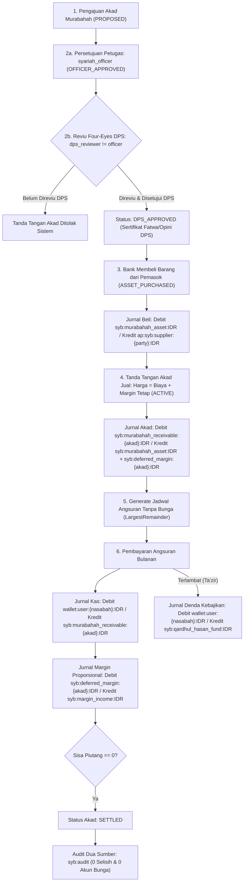

# Dokumen Desain — Fase 161: Lini 19 Keuangan Syariah Murabahah (P3.4)

## 1. Arsitektur & Diagram Siklus Hidup Akad Murabahah

## 2. Struktur Tabel Modul `Syariah` (`syb_`)

1. **`syb_murabahah_contracts`**:
   - `contract_code` (unik, mis. `MRB-2026-0001`), `customer_user_id` (FK ke `users`), `supplier_party_id` (rujukan pemasok), `asset_description`, `cost_price_idr` (integer biaya perolehan), `margin_amount_idr` (integer margin tetap), `total_selling_price_idr` ($\text{cost} + \text{margin}$), `tenor_months`, `status` (`PROPOSED`, `OFFICER_APPROVED`, `DPS_APPROVED`, `ASSET_PURCHASED`, `ACTIVE`, `SETTLED`), `proposed_by_user_id`, `officer_approved_by_user_id`, `officer_approved_at`, `dps_reviewer_user_id`, `dps_reviewed_at`, `dps_opinion_note`, `purchased_at`, `signed_at`, `settled_at`, `total_paid_idr`, `recognized_margin_idr`, `total_tazir_idr`, `contract_hash`, `idempotency_key`.
2. **`syb_murabahah_schedules`**:
   - `contract_id` (FK ke `syb_murabahah_contracts`), `installment_no` ($1\dots N$), `due_date`, `principal_component_idr`, `margin_component_idr`, `installment_amount_idr` ($\text{principal} + \text{margin}$), `paid_amount_idr`, `status` (`UNPAID`, `PAID`), `paid_at`, `payment_idempotency_key`.
3. **`syb_tazir_penalties`**:
   - `contract_id` (FK ke `syb_murabahah_contracts`), `schedule_id` (nullable FK ke `syb_murabahah_schedules`), `customer_user_id` (FK ke `users`), `amount_idr`, `reason`, `idempotency_key`, `collected_at`.

## 3. Algoritma Pembentukan Jadwal Angsuran (`LargestRemainder`)

- Untuk biaya perolehan $C$, margin tetap $M$, dan tenor $N$ bulan:
  - Komponen pokok per angsuran dihitung dengan `LargestRemainder::apportion($C, $equalWeights)` dengan kunci berurut `'01'..'N'`.
  - Komponen margin per angsuran dihitung dengan `LargestRemainder::apportion($M, $equalWeights)` dengan kunci berurut `'01'..'N'`.
  - Total angsuran ke-$i$:
    $$A_i = P_i + M_i$$
- **Vektor Uji Wajib:**
  - $C = 100.000.000$, $M = 18.000.000$, $N = 12$:
    - $P_i$: $\lfloor 100.000.000 / 12 \rfloor = 8.333.333$ sisa $4 \implies P_1\dots P_4 = 8.333.334$, $P_5\dots P_{12} = 8.333.333$ ($\Sigma P_i = 100.000.000$).
    - $M_i$: $18.000.000 / 12 = 1.500.000$ tepat untuk seluruh $i = 1\dots 12$ ($\Sigma M_i = 18.000.000$).
    - $A_i = P_i + M_i$: $A_1\dots A_4 = 9.833.334$, $A_5\dots A_{12} = 9.833.333$ ($\Sigma A_i = 118.000.000$).

## 4. Bagan Akun & Larangan Riba (D19-1 & D19-3)

- **Akun Statis (`SyariahAccounts`)**:
  - `syb:murabahah_asset:IDR` (`ASSET`) — Persediaan barang murabahah sebelum diserahkan ke akad jual.
  - `syb:margin_income:IDR` (`REVENUE`) — Pendapatan margin murabahah yang telah terealisasi proporsional kas.
  - `syb:qardhul_hasan_fund:IDR` (`LIABILITY`) — Dana kebajikan (*Qardhul Hasan*) penampung denda *ta'zir*.
  - `syb:wadiah_liquidity_source:IDR` (`CLEARING`) — Sumber likuiditas simulasi untuk top-up awal dompet nasabah pada pengujian/seeder.
- **Akun Per-Subjek (`SyariahSubjectAccounts`)**:
  - `ap:syb:supplier:{party_id}:IDR` (`AP`) — Utang pembelian barang murabahah kepada pemasok.
  - `syb:murabahah_receivable:{contract_id}:IDR` (`LOAN_RECEIVABLE`) — Piutang murabahah per akad.
  - `syb:deferred_margin:{contract_id}:IDR` (`LIABILITY`) — Margin murabahah ditangguhkan per akad.
- **Guardrail Anti-Bunga:**
  - `MurabahahService` memeriksa setiap kode akun pada posting dan menolak keras bila ditemukan substring `interest` atau `bunga`.

## 5. Pemeriksaan Audit Dua Sumber (`syb:audit`)

1. **Invarian Piutang vs Sisa Jadwal:**
   - Untuk setiap akad aktif/lunas, $\Sigma \text{installment\_amount\_idr}$ yang berstatus `UNPAID` wajib sama dengan `abs(cached_balance)` akun `syb:murabahah_receivable:{contract_id}:IDR`.
2. **Invarian Margin Ditangguhkan & Margin Diakui:**
   - Untuk setiap akad aktif/lunas, saldo akun `syb:deferred_margin:{contract_id}:IDR` wajib sama dengan $\text{margin\_amount\_idr} - \text{recognized\_margin\_idr}$.
   - Total $\Sigma \text{recognized\_margin\_idr}$ seluruh akad wajib sama dengan saldo akun `syb:margin_income:IDR`.
3. **Invarian Dana Kebajikan (*Qardhul Hasan*):**
   - Saldo akun `syb:qardhul_hasan_fund:IDR` wajib sama dengan $\Sigma \text{amount\_idr}$ pada `syb_tazir_penalties`.
4. **Invarian Anti-Riba (0 Akun Bunga):**
   - Memeriksa seluruh transaksi ledger bertipe `SYB_*` dan memastikan 0 entri yang menyentuh akun dengan kode/nama mengandung `interest` atau `bunga`.
