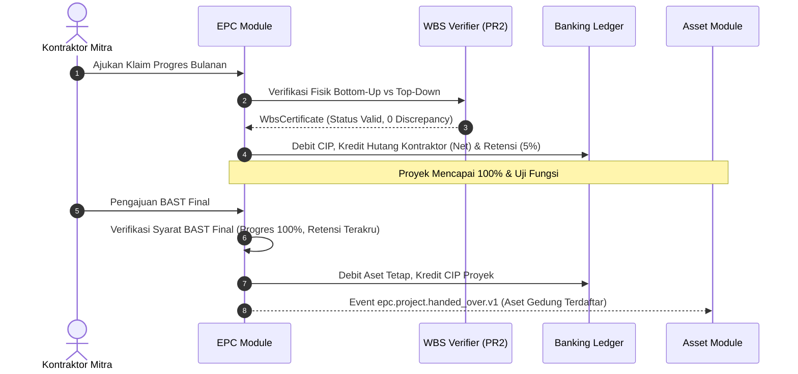
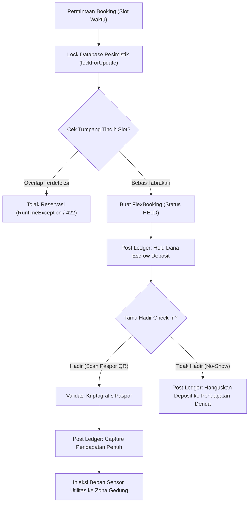

# Architecture & Technical Design — LINI 6: Properti (Proptech & EPC/Asset MVP)

## 1. Ringkasan Eksekutif & Batasan Arsitektur

LINI 6 mengimplementasikan pilar Properti Komersial, Smart Building IoT, Flex-Space, dan Konstruksi EPC terkapitalisasi menjadi Aset Tetap, merujuk langsung pada **docs/KONSEP.md §4F (baris 711-736)** dan Prinsip Rekayasa **PR1–PR6**.

Desain ini menjamin:
1. **Zero Estimasi Utilitas:** Penagihan utilitas dihitung strictly dari selisih pembacaan sensor register meter fisik, dengan pembagian porsi fraksional multi-tenant menggunakan algoritma Pembulatan Kumulatif (B0′.2) bersertifikat.
2. **Anti-Overlap Concurrency:** Pemesanan ruang flex (`prp_flex_spaces`) menggunakan penguncian baris DB pesimistik (`lockForUpdate`) dan hold/capture escrow ledger terintegrasi.
3. **Sertifikat Prestasi Konstruksi WBS Terverifikasi (PR2):** Setiap penerbitan Monthly Certificate (MC) EPC memverifikasi kemajuan fisik secara independen dengan perhitungan ganda: *bottom-up* dari node daun WBS dan *top-down* dari bobot proyek.
4. **Gerbang BAST Final Sebelum Kapitalisasi:** Kapitalisasi CIP (*Construction in Progress*) menjadi Aset Tetap (*Fixed Asset*) hanya dapat diproses setelah BAST Final disetujui, menjamin saldo CIP proyek kembali tepat Rp 0.
5. **Two-Source Verification:** Perintah audit `prp:audit` / `pro:audit` dan `epc:audit` memvalidasi konsistensi operasional versus buku besar berpasangan.

---

## 2. Struktur Modul & Skema Database

```
modules/
├── Proptech/
│   ├── Application/
│   │   ├── Services/
│   │   │   ├── ProptechService.php (READ-ONLY per Z4)
│   │   │   ├── UtilityBillingService.php (Canonical B0′.2 cumulative billing)
│   │   │   └── FlexSpaceService.php (Anti-overlap & escrow lifecycle)
│   │   └── Actions/
│   ├── Domain/
│   │   ├── Models/
│   │   │   ├── BuildingZone.php
│   │   │   ├── BuildingSensor.php (Append-only readings)
│   │   │   ├── ZoneUtilityBilling.php (Append-only billings)
│   │   │   ├── Flex/FlexSpace.php
│   │   │   └── Flex/FlexBooking.php (Append-only booking states)
│   │   └── Verifiers/
│   ├── Ledger/
│   │   ├── ProptechAccounts.php
│   │   └── ProptechTransactionTypes.php
│   └── Console/Commands/
│       └── AuditProptechCommand.php (`prp:audit` / `pro:audit`)
└── Epc/
    ├── Application/
    │   ├── Services/
    │   │   ├── EpcService.php
    │   │   └── MonthlyCertificateService.php (MC & retention)
    │   └── Actions/
    ├── Domain/
    │   ├── Models/
    │   │   ├── EpcProject.php
    │   │   ├── EpcWbsNode.php
    │   │   ├── EpcProgressCertificate.php (Append-only facts)
    │   │   ├── EpcBastRecord.php (BAST-1 & BAST-Final)
    │   │   └── EpcCipCapitalization.php
    │   └── Verifiers/
    │       └── WbsProgressCertificateVerifier.php (PR2 Bottom-Up / Top-Down)
    ├── Ledger/
    │   ├── EpcAccounts.php
    │   └── EpcTransactionTypes.php
    └── Console/Commands/
        └── AuditEpcCommand.php (`epc:audit`)
```

---

## 3. Matriks Double-Entry Ledger (Single-Sign: Debit −, Kredit +)

Sesuai **docs/KONSEP.md §4F baris 721-726**:

| Kejadian Bisnis | Debit (−) | Kredit (+) | Tipe Transaksi |
|---|---|---|---|
| Penagihan Utilitas Tenant | `ar:mall:tenant:{id}:IDR` (atau `prp:utility_ar:IDR`) | `mall:utility_revenue:IDR` (atau `prp:utility_rev:IDR`) | `PROPTECH_UTILITY_BILLING` |
| Flex-Space Booking (Hold) | `escrow:payment:IDR` (atau `prp:flex_escrow:IDR`) | `prp:flex_revenue_unearned:IDR` | `FLEX_DEPOSIT_HOLD` |
| Flex-Space Check-in (Capture) | `prp:flex_revenue_unearned:IDR` + `escrow:payment:IDR` (sisa) | `prp:flex_revenue:IDR` | `FLEX_CAPTURE_REVENUE` |
| Flex-Space No-Show (Forfeit) | `prp:flex_revenue_unearned:IDR` | `prp:flex_penalty_rev:IDR` | `FLEX_NO_SHOW_FEE` |
| EPC Monthly Certificate (MC) | `ast:cip:{project}:IDR` | `ap:epc:contractor:{party}:IDR` (netto 95%) + `epc:retention_payable:{project}:IDR` (retensi 5%) | `EPC_PROGRESS_CERTIFICATE` |
| Kapitalisasi Aset (BAST Final) | `ast:fixed_assets:IDR` | `ast:cip:{project}:IDR` | `EPC_CIP_CAPITALIZATION` |
| Pelepasan Retensi Pemeliharaan | `epc:retention_payable:{project}:IDR` | `ap:epc:contractor:{party}:IDR` | `EPC_RETENTION_RELEASE` |

---

## 4. Alur Proses & Diagram Arsitektur

### 4.1. EPC Konstruksi Menuju Kapitalisasi Aset Tetap



### 4.2. Siklus Reservasi Flex-Space dengan Anti-Overlap



---

## 5. Algoritma Pembulatan Kumulatif Utilitas (B0′.2)

Untuk mendistribusikan total tagihan utilitas $T$ pada $N$ tenant berdasarkan porsi konsumsi $p_i = \frac{kwh_i}{\sum kwh}$:
1. Hitung alokasi kumulatif teoritis: $C_k = \text{round}\left( T \times \sum_{j=1}^k p_j \right)$.
2. Tetapkan bagian tenant ke-$k$: $a_k = C_k - C_{k-1}$ (dengan $C_0 = 0$).
3. Invariant:
   - $\sum_{i=1}^N a_i = T$ (tidak ada sisa rupiah tercecer).
   - $|a_i - T \cdot p_i| \le 1$ IDR.
4. Sertifikat diverifikasi oleh `CumulativeRoundingCertificateVerifier`.

---

## 6. Verifikasi Progres WBS Bottom-Up / Top-Down (PR2)

Setiap penerbitan sertifikat prestasi konstruksi:
1. **Bottom-Up:** Hitung progres aktual agregat:
   $$P_{\text{bottom-up}} = \sum_{i \in \text{WBS Leaves}} \left( \frac{\text{bobot}_i}{100} \times \text{progres}_i \right)$$
2. **Top-Down:** Cocokkan terhadap klaim kumulatif pengawas konsultan $P_{\text{claim}}$.
3. Selisih toleransi $\Delta = |P_{\text{bottom-up}} - P_{\text{claim}}| \le 0.001\%$.
4. Jika $\Delta > 0.001\%$, terbitkan `InvalidWbsCertificateException` dan batalkan transaksi.

---

## 7. Penegakan Batasan Khusus

- **Z3 (Route Matrix):** Rute `/proptech`, `/epc`, dan `/flex` didaftarkan pada `tests/Architecture/route-roles.php` dengan peran terotorisasi (`facility_manager`, `property_manager`, `epc_manager`, `site_supervisor`, `asset_manager`, `customer`).
- **Z4 (ProptechService):** `modules/Proptech/Application/Services/ProptechService.php` TIDAK DIUBAH karena memuat `idempotencyKey ??`. Layanan ekstensi baru diimplementasikan pada kelas pendamping terpisah.
- **Z7 (Audit Commands):** Perintah `prp:audit` / `pro:audit` dan `epc:audit` tersedia dan lolos contract audit dengan exit code 0.
