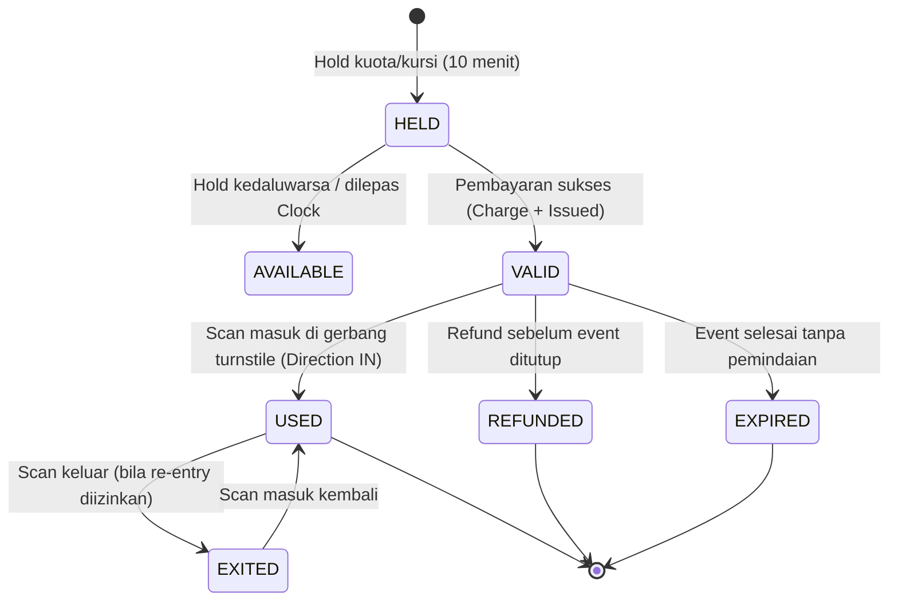
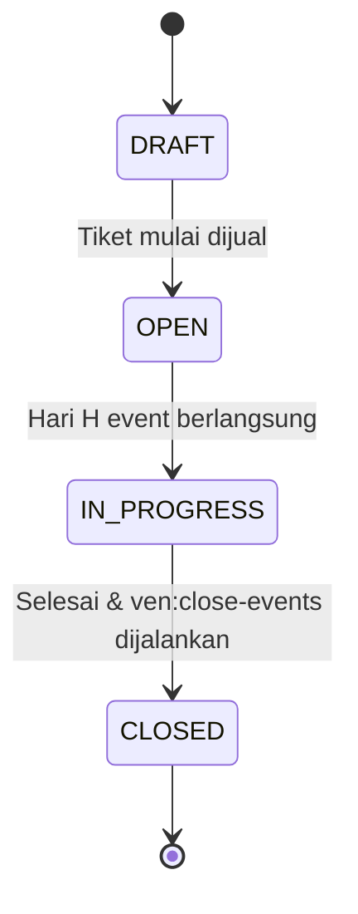
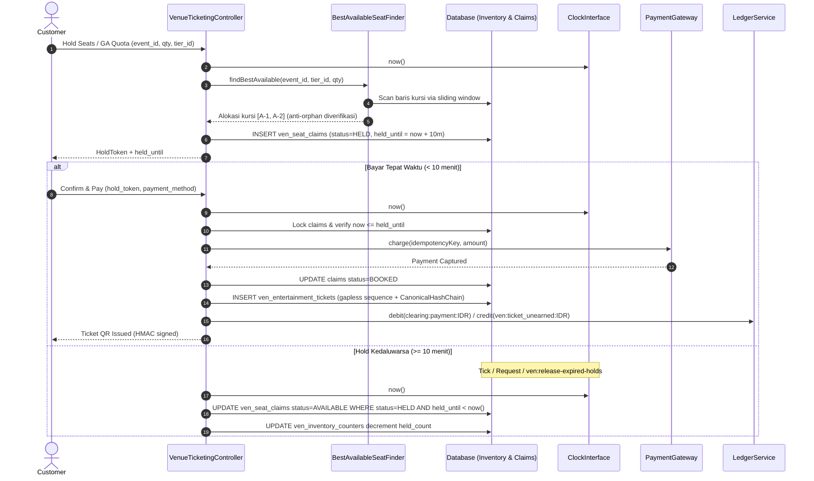

# Dokumen Desain Teknis — Lini 1: Venue Entertainment (MVP)

## 1. Arsitektur & State Machine

### 1.1 State Machine Tiket


### 1.2 State Machine Event & Alur Finansial


---

## 2. Alur Hold 10 Menit & Pelepasan Berbasis Clock



---

## 3. Skema Data & Anti-Double-Sell Constraints

### 3.1 Skema `ven_inventory_counters` (Kuota General Admission)
Mencegah overselling pada kuota zona/tier tanpa nomor kursi:
```sql
CREATE TABLE ven_inventory_counters (
    id INTEGER PRIMARY KEY AUTOINCREMENT,
    event_id INTEGER NOT NULL,
    tier_id INTEGER NOT NULL,
    total_quota INTEGER NOT NULL,
    held_count INTEGER NOT NULL DEFAULT 0,
    sold_count INTEGER NOT NULL DEFAULT 0,
    created_at TIMESTAMP NULL,
    updated_at TIMESTAMP NULL,
    CONSTRAINT uq_ven_inv_event_tier UNIQUE (event_id, tier_id),
    CONSTRAINT chk_ven_inv_quota CHECK (held_count + sold_count <= total_quota),
    CONSTRAINT chk_ven_inv_nonneg CHECK (held_count >= 0 AND sold_count >= 0),
    FOREIGN KEY (event_id) REFERENCES ven_entertainment_events(id) ON DELETE CASCADE
);
```

### 3.2 Skema `ven_seat_claims` (Kursi Bernomor per Event)
Mencegah double booking kursi dengan database-level constraint:
```sql
CREATE TABLE ven_seat_claims (
    id INTEGER PRIMARY KEY AUTOINCREMENT,
    event_id INTEGER NOT NULL,
    section_code VARCHAR(32) NOT NULL,
    row_label VARCHAR(8) NOT NULL,
    seat_number INTEGER NOT NULL,
    status VARCHAR(32) NOT NULL DEFAULT 'AVAILABLE', -- AVAILABLE, HELD, BOOKED
    held_until TIMESTAMP NULL,
    hold_token VARCHAR(64) NULL,
    buyer_user_id INTEGER NULL,
    created_at TIMESTAMP NULL,
    updated_at TIMESTAMP NULL,
    CONSTRAINT uq_ven_seat_per_event UNIQUE (event_id, section_code, row_label, seat_number),
    FOREIGN KEY (event_id) REFERENCES ven_entertainment_events(id) ON DELETE CASCADE
);
CREATE INDEX idx_ven_seat_lookup ON ven_seat_claims(event_id, section_code, row_label, seat_number);
CREATE INDEX idx_ven_seat_hold_expiry ON ven_seat_claims(event_id, status, held_until);
```

---

## 4. Algoritma `BestAvailableSeatFinder`

### 4.1 Persyaratan & Invarian
1. **Deterministik (PR3):** Urutan pencarian baris dan kolom berurutan secara konsisten (Section terdepan, Row abjad menaik, Seat number menaik).
2. **Sliding Window:** Menemukan blok kursi berdampingan (kontigu) sebanyak `k` kursi dalam satu baris.
3. **Pencegahan Orphan Seats (Anti-Orphan):**
   - Bila pemesanan grup $k \ge 2$, alokasi tidak boleh meninggalkan tepat 1 kursi kosong yang terisolasi di sisi kiri atau sisi kanan blok alokasi (mis. di antara kursi yang sudah terisi atau di ujung baris). Kursi single orphan sulit terjual di acara konser/festival.
   - Bila seluruh baris tidak memungkinkan alokasi tanpa orphan, pilih baris berikutnya.
4. **Verifikasi Sertifikat Dual / Validitas Sertifikat Alokasi:**
   Mengembalikan `SeatAllocationResult` berisi daftar kursi dan sertifikat validitas (bahwa semua kursi berstatus AVAILABLE, berada pada baris yang sama, dan tidak menyisakan orphan).

---

## 5. Skema Posting Ledger & Akuntansi

Semua transaksi uang menggunakan integer rupiah (U-1), tanpa float, dengan helper posting akuntansi double-entry yang mematuhi sisi normal (PR1, U-3).

### 5.1 Penjualan Tiket Awal
Pendapatan tiket TIDAK diakui saat penjualan, melainkan mengendap sebagai kewajiban (Unearned Revenue):
- **Debit:** `clearing:payment:IDR` sebesar `pricePaidIdr`
- **Kredit:** `ven:ticket_unearned:IDR` sebesar `pricePaidIdr`

### 5.2 Pembatalan / Refund Tiket
Sebelum event ditutup, tiket dapat direfund (bila tier mengizinkan):
- **Debit:** `ven:ticket_unearned:IDR` sebesar `pricePaidIdr`
- **Kredit:** `clearing:payment:IDR` sebesar `pricePaidIdr`
- Kursi / kuota dikembalikan ke status AVAILABLE.

### 5.3 Penutupan Event (`ven:close-events`)
Setelah acara selesai, kewajiban diakui menjadi pendapatan dengan alokasi LargestRemainder proporsional:
- **Debit:** `ven:ticket_unearned:IDR` (seluruh sisa tiket non-refund)
- **Kredit:** `ven:ticket_revenue:IDR` (pendapatan bersih promotor venue)
- **Kredit:** `ven:platform_fee_revenue:IDR` (fee platform jika ada, mis. 500 bps)
- **Kredit:** `ven:tax_ticket_payable:IDR` (kewajiban pajak hiburan / PPh jika ada)
- **Kredit:** `ven:organizer_payable:IDR` (hak bayar promotor luar)

### 5.4 Meja VIP & Bottle Service Minimum Spend
1. **Hold Reservasi:**
   `PaymentGateway::authorize` untuk deposit minimum spend (mis. Rp 2.000.000).
2. **Tamu Hadir & Selesai (Check-in / Seated):**
   `PaymentGateway::capture` deposit:
   - **Debit:** `clearing:payment:IDR`
   - **Kredit:** `ven:vip_escrow:IDR`
   Saat checkout & billing:
   - **Debit:** `ven:vip_escrow:IDR`
   - **Kredit:** `ven:table_revenue:IDR`
3. **No-Show / Forfeiture:**
   Bila tamu tidak hadir hingga batas jam toleransi:
   - **Debit:** `clearing:payment:IDR`
   - **Kredit:** `ven:vip_noshow_rev:IDR`

### 5.5 Settlement Kontrak Artis
- Formula: $GrossShare = TotalDoorSales \times \frac{DoorShareBps}{10000}$
- Pajak PPh 23: $WhtTax = GrossShare \times \frac{200}{10000}$ (2.00%)
- Net Payout: $\max(0, GrossShare - WhtTax - AdvanceDeducted)$
- **Debit:** `expense:venue_artist_fee:IDR` (GrossShare)
- **Kredit:** `tax:wht23_payable:IDR` (WhtTax)
- **Kredit:** `artist:payable:default:IDR` (Net Payout)

---

## 6. Hash-Chain Tiket & Scan Gerbang Turnstile

### 6.1 Cryptographic Hash-Chain per Event (PR5, B0.1)
Setiap tiket yang terbit dihubungkan dalam hash-chain kanonikal per event:
$$H_0 = \text{Genesis Hash} = \text{SHA256}(\text{"GENESIS:EVENT:"} \parallel event\_id)$$
$$H_k = \text{CanonicalHashChain::link}(H_{k-1}, [buyer\_user\_id, event\_id, price\_paid, ticket\_number, ticket\_uuid])$$
Integritas tiket dapat diverifikasi sewaktu-waktu menggunakan `CanonicalHashChain::verifyChain`.

### 6.2 QR Code Payload & HMAC Signature (V-4)
String QR yang dicetak pada tiket fisik/digital:
$$\text{QR} = \{ticket\_uuid\}.\{key\_id\}.\{hmac\}$$
- Kunci turunan: $K = \text{HMAC-SHA256}(\text{"ven-ticket-v1"}, \text{app.key})$
- HMAC Signature: $\text{HMAC-SHA256}(ticket\_uuid \parallel "." \parallel key\_id, K)$
- Verifikasi menggunakan `hash_equals` tahan timing-attack.

### 6.3 Scan Gerbang Turnstile & Anti-Passback
- Pintu masuk turnstile memindai string QR.
- Verifikasi signature HMAC.
- Verifikasi usia minimum event dari KYC tanggal lahir Party (V-6, Z9).
- Anti-passback: Jika tiket sudah berstatus `USED` dan tidak memiliki riwayat keluar (`EXITED`), pemindaian ditolak seketika (`DENIED`).
- Setiap event scan dicatat append-only pada tabel `ven_gate_scans` (PR5).

---

## 7. Penguatan Audit Dua-Sumber (`ven:audit`)

Command `ven:audit` diperkuat untuk memeriksa invarian konsistensi dua arah (KONSEP §A15.6, §10F baris 1095):
1. **Rekonsiliasi Tiket Fisik vs Pemindaian:**
   $$\Sigma \text{Tiket Terbit} = \Sigma \text{Tiket Belum Dipindai} + \Sigma \text{Tiket Terpakai (Scanned)} + \Sigma \text{Tiket Refund}$$
2. **Rekonsiliasi Keuangan Ledger vs Subledger:**
   Saldo akun `ven:ticket_unearned:IDR` pada Buku Besar harus tepat sama dengan $\Sigma$ nominal tiket berstatus `VALID` pada event yang masih `OPEN` / `IN_PROGRESS`.
3. **Rekonsiliasi Kapasitas Zona:**
   Okupansi aktual di setiap zona tidak boleh melebihi `capacity_limit`.
4. Command mengembalikan exit code 0 bila selisih 0, dan exit code 1 bila terdeteksi anomali.

