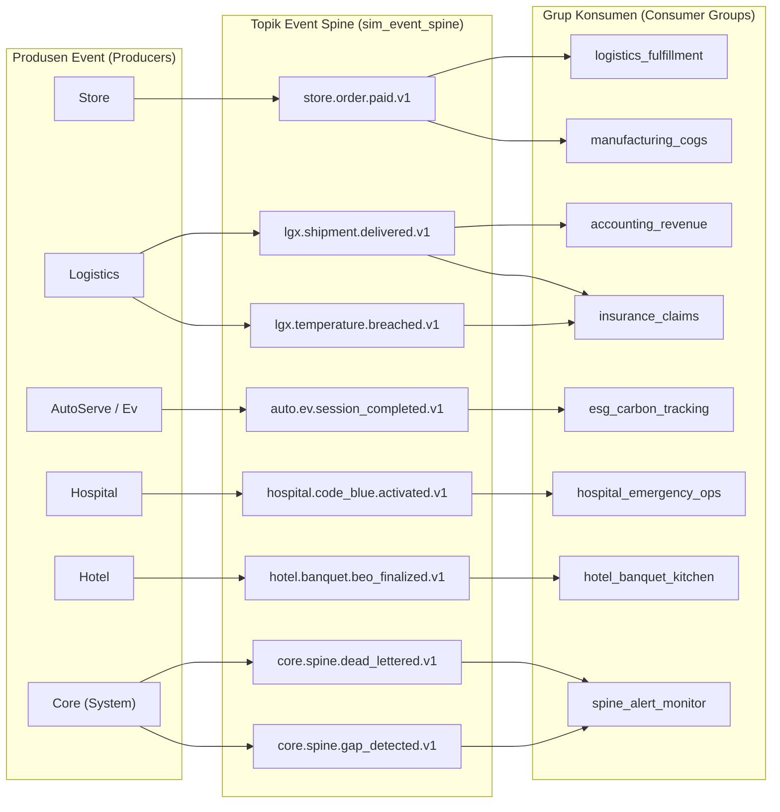

# Peta Arsitektur Event Spine & Topik Lintas Modul

Peta hubungan produsen, topik, skema event, dan grup konsumen aktif pada Universal Event Spine SuperWeb.

---

## Matriks Peta Topik, Skema & Konsumen

| Nama Event | Versi | Modul Produsen | Modul & Grup Konsumen | Tujuan Bisnis | Status Kompatibilitas |
| :--- | :---: | :--- | :--- | :--- | :---: |
| `store.order.paid.v1` | 1 | Store | Logistics, Manufacturing, Pricing | Pemenuhan order, hitung HPP/COGS, kunci harga | Aktif (A6 Valid) |
| `lgx.shipment.delivered.v1` | 1 | Logistics | Logistics, Core, Insurance | Pengakuan pendapatan kargo, penutupan polis transit | Aktif (A6 Valid) |
| `lgx.temperature.breached.v1` | 1 | Logistics | Payment, Insurance | Penahanan pembayaran armada, klaim asuransi otomatis | Aktif (A6 Valid) |
| `auto.telematics.anomaly_detected.v1` | 1 | Telematics | AutoServe, Logistics | Booking draft service armada preventif | Aktif (A6 Valid) |
| `auto.ev.session_completed.v1` | 1 | Ev | Core, Esg | Update SoH baterai kendaraan, hitung emisi Scope 2 | Aktif (A6 Valid) |
| `mall.footfall.recorded.v1` | 1 | Mall | Resto, CloudKitchen | Rekap beban dapur bersama & omset tenant | Aktif (A6 Valid) |
| `hospital.code_blue.activated.v1` | 1 | Hospital | Hospital, Nursing | Aktivasi tim tanggap darurat resusitasi | Aktif (A6 Valid) |
| `hotel.banquet.beo_finalized.v1` | 1 | Hotel | Hotel, F&B Kitchen | Sinkronisasi persiapan pesanan banquet & MICE | Aktif (A6 Valid) |
| `core.spine.dead_lettered.v1` | 1 | Core | SpineMonitor, TaskInbox | Notifikasi insiden DLQ & tugas operator | Aktif (A6 Valid) |
| `core.spine.gap_detected.v1` | 1 | Core | SpineMonitor, AuditOps | Deteksi celah nomor urut stream aggregate | Aktif (A6 Valid) |

