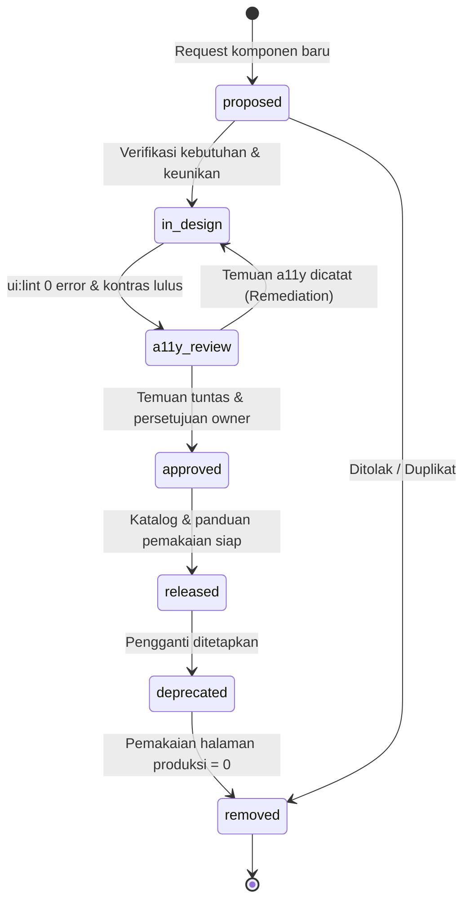

# Definition of Ready (DoR) — Fase 240: Experience Design System & Accessibility

**Fase:** Fase 240 (Gelombang 8, Prompt W8-P2.1)  
**Status DoR:** Disetujui (Memenuhi Standar W8 & Protokol PU 40)  
**Sha Awal Fase:** `3bd1e38e31528ebe52f35c723418632d53e81685`  
**Modul Pemilik:** `Core` (Database skema & persistensi) & `Shared` (Domain algorithms, UI components, view models, CLI)  

---

## 1. Rencana Anggaran Baris (RAB) — Fase 240 (Target Ambang: B1 $\ge$ 6.000, B2 $\ge$ 2.400, B3 $\ge$ 1.500)

| Lapisan Kode / Komponen | Target Baris B1 | Target Baris B2 | Keterangan & Rincian Arsitektur |
|---|---|---|---|
| **Algoritma Bersertifikat & Value Objects** | 1.150–1.350 | - | A1 `WcagContrastCalculator`, A2 `ThemeTokenResolver`, A3 `A11yHtmlLinter`, sertifikat matematis & verifier SHA-256. |
| **State Machine & Tata Kelola Status** | 650–850 | - | `ComponentReleaseStateMachine` (7 status kanonikal), guards transisi, enum status, exceptions domain, event riwayat. |
| **Lapisan Aplikasi (Actions & Services)** | 2.100–2.400 | - | Action pengajuan komponen, approval review, transisi status, resolver tema, build token CSS, scan pemakaian komponen, sinkronisasi riset UX. |
| **Integrasi Lintas Modul & Adapter** | 550–750 | - | Integrasi `ApprovalEngine` Core untuk rilis komponen, `RbacService` Core, adapter kompatibilitas komponen Shared/Enterprise lama. |
| **Lapisan HTTP (Controllers, Policies, Requests, ViewModels)** | 850–1.100 | - | Controller katalog `/design-system`, manajemen rilis, papan riset UX; ViewModels (`TableQueryState`, `SvgChartGeometry`, `SparklinePath`, `IdFormatter`, `StatusBadgeRegistry`). |
| **Console Commands & Laporan Export** | 750–950 | - | `ui:lint` (pemindai a11y & token), `ds:tokens-build`, `ds:usage-scan`, `ds:audit` (dua sumber) & eksportir CSV data tata kelola. |
| **Model Eloquent & Domain Entities** | 350–450 | - | `DsToken`, `DsComponent`, `DsComponentHistory`, `DsA11yFinding`, `DsComponentUsage`, `DsUserPref`, `UxFinding`, `UxIteration`. |
| **Komponen Blade & Aset UI (`x-ds.*`)** | - | 2.500–3.000 | $\ge 25$ komponen kanonikal `x-ds.*`, pecahan modular `x-ds.shell`, `x-ds.sidebar`, `x-ds.topbar`, `x-ds.command-palette`, CSS token, migrasi 10 halaman. |
| **Dokumentasi Teknis Tulis-Tangan (B3)** | - | - | $\ge 1.700$ baris markdown di `docs/` (konsep, design, algoritma, panduan, runbook, galat, ADR). |
| **TOTAL ESTIMASI** | **6.400–7.850** | **2.500–3.000** | **Memenuhi ambang keras B1 $\ge$ 6.000, B2 $\ge$ 2.400, B3 $\ge$ 1.500.** |

---

## 2. Skema Tabel Database (Modul `Core`, Prefiks `core_`)

Semua tabel dibangun di modul `Core` dengan foreign key nyata, indeks performa, dan integritas relasional:

1. `core_ds_tokens`:
   - `id`: bigint unsigned auto-increment primary key.
   - `theme`: string (20) enum (`light`, `dark`, `hc`).
   - `token_name`: string (100).
   - `token_value`: string (255) — nilai warna hex (`#1D4ED8`) atau alias token (`{bg}`).
   - `version`: integer default 1.
   - `label`: string (50) enum (`regulasi`, `asumsi_simulasi`, `fixture`).
   - `created_at`, `updated_at`: timestamps.
   - *Constraint:* UNIQUE(`theme`, `token_name`, `version`).

2. `core_ds_components`:
   - `id`: bigint unsigned auto-increment primary key.
   - `component_name`: string (100) unique — kode komponen kanonikal (misal: `button`, `table`, `modal-confirm`).
   - `status`: string (50) enum (`proposed`, `in_design`, `a11y_review`, `approved`, `released`, `deprecated`, `removed`).
   - `requested_by_module`: string (50) — modul pengusul (misal: `Logistics`, `Hospital`, `Platform`).
   - `reason`: text — justifikasi bisnis dan rancangan penggunaan.
   - `replacement_component`: string (100) nullable — penunjuk komponen pengganti bila status `deprecated` / `removed`.
   - `documentation_url`: string (255) nullable — rujukan panduan desain/pemakaian.
   - `created_at`, `updated_at`: timestamps.

3. `core_ds_component_history`:
   - `id`: bigint unsigned auto-increment primary key.
   - `component_id`: bigint unsigned foreign key merujuk `core_ds_components.id` on delete cascade.
   - `from_status`: string (50) nullable.
   - `to_status`: string (50).
   - `actor_id`: bigint unsigned nullable foreign key merujuk `users.id` on delete set null.
   - `actor_role`: string (50).
   - `reason`: text.
   - `metadata`: json nullable — memuat rekaman sertifikat audit atau snapshot metrik terkait.
   - `created_at`: timestamp.

4. `core_ds_a11y_findings`:
   - `id`: bigint unsigned auto-increment primary key.
   - `component_id`: bigint unsigned foreign key merujuk `core_ds_components.id` on delete cascade.
   - `rule_violated`: string (100) — misal: `CONTRAST_BELOW_AA`, `IMG_ALT_MISSING`, `INPUT_WITHOUT_LABEL`.
   - `severity`: string (20) enum (`low`, `medium`, `high`, `critical`).
   - `description`: text.
   - `is_remediated`: boolean default false.
   - `remediated_at`: timestamp nullable.
   - `created_at`, `updated_at`: timestamps.

5. `core_ds_component_usage`:
   - `id`: bigint unsigned auto-increment primary key.
   - `component_name`: string (100).
   - `view_path`: string (255) — path file view Blade pemanggil.
   - `usage_count`: integer default 1.
   - `last_scanned_at`: timestamp.
   - *Constraint:* UNIQUE(`component_name`, `view_path`).

6. `core_ds_user_prefs`:
   - `id`: bigint unsigned auto-increment primary key.
   - `user_id`: bigint unsigned foreign key merujuk `users.id` on delete cascade unique.
   - `theme`: string (20) default `light` enum (`light`, `dark`, `hc`).
   - `created_at`, `updated_at`: timestamps.

7. `core_ux_findings`:
   - `id`: bigint unsigned auto-increment primary key.
   - `finding_code`: string (50) unique.
   - `module_code`: string (50).
   - `severity`: string (20) enum (`low`, `medium`, `high`, `critical`).
   - `description`: text.
   - `status`: string (50) default `OPEN` enum (`OPEN`, `BACKLOG`, `REMEDIATED`).
   - `component_id`: bigint unsigned nullable foreign key merujuk `core_ds_components.id` on delete set null.
   - `created_at`, `updated_at`: timestamps.

8. `core_ux_iterations`:
   - `id`: bigint unsigned auto-increment primary key.
   - `iteration_name`: string (100).
   - `task_count`: integer.
   - `success_count`: integer.
   - `task_success_rate_bps`: integer — persentase keberhasilan dalam basis points ($0 \dots 10.000$).
   - `conducted_at`: timestamp.
   - `created_at`, `updated_at`: timestamps.

---

## 2.1. Rincian Indeks Basis Data & Aturan Foreign Key

Seluruh tabel modul `Core` yang dibangun untuk Fase 240 dirancang dengan indeks strategis guna mendukung query berkecepatan tinggi:
1. `core_ds_tokens`:
   - Indeks unik majemuk `UNIQUE(theme, token_name, version)` menjamin satu token hanya memiliki satu nilai definitif per tema pada versi tertentu.
   - Indeks `INDEX(category)` mempercepat pembacaan token terfilter per kelompok gaya (COLOR, TYPOGRAPHY, SPACING).
2. `core_ds_components`:
   - Indeks unik tunggal `UNIQUE(component_name)` menjamin tidak ada duplikasi nama komponen kanonikal.
   - Indeks `INDEX(status)` mempercepat penyaringan komponen aktif di katalog publik dan antrean rilis admin.
3. `core_ds_component_history`:
   - Indeks `INDEX(component_id, created_at)` mendukung penarikan linimasa kronologis instan pada kartu riwayat komponen.
   - Foreign key cascading `ON DELETE CASCADE` dari `core_ds_components.id`.
4. `core_ds_a11y_findings`:
   - Indeks `INDEX(component_id, is_remediated)` mempercepat pengecekan guard rilis komponen (memastikan temuan aktif = 0).
5. `core_ds_component_usage`:
   - Indeks unik majemuk `UNIQUE(component_name, view_path)` mendukung eksekusi pembaruan idempoten `updateOrInsert` pada perintah `ds:usage-scan`.
   - Indeks `INDEX(component_name)` mempercepat kalkulasi agregat total pemanggilan komponen di seluruh aplikasi.
6. `core_ds_user_prefs`:
   - Indeks unik `UNIQUE(user_id)` memastikan integritas satu baris preferensi per pengguna.
7. `core_ux_findings`:
   - Indeks unik `UNIQUE(finding_code)` untuk pengidentifikasi unik temuan uji keterpakaian lapangan.
   - Indeks `INDEX(status)` dan `INDEX(module_code)` untuk penyaringan dashboard riset.
8. `core_ux_iterations`:
   - Indeks `INDEX(conducted_at)` untuk pengurutan linier diagram tren keberhasilan tugas (Task Success Rate).

---

## 3. Algoritma Bersertifikat Fase 240

### A1: `Modules\Shared\Domain\Algorithms\Ui\WcagContrastCalculator`
- **Tujuan:** Menghitung luminansi relatif sRGB dan rasio kontras warna presisi tinggi WCAG 2.1 tanpa komputasi floating point di luar fungsi kurva daya gamma sRGB.
- **Formulasi:**
  - Konversi hex `#RRGGBB` ke nilai kanal normalisasi $c \in [0, 255]$.
  - Linearisasi kanal sRGB: bila $c/255 \le 0.04045$, $C_{lin} = (c/255) / 12.92$; bila tidak, $C_{lin} = ((c/255 + 0.055) / 1.055)^{2.4}$. Dibulatkan HalfUp ke per sejuta (ppm, integer $0 \dots 1.000.000$).
  - Luminansi relatif: $L = \lfloor (2126 \times R_{ppm} + 7152 \times G_{ppm} + 722 \times B_{ppm} + 5000) / 10000 \rfloor$ (ppm).
  - Rasio kontras: $R_{bps} = \lfloor (L_{terang} + 50.000) \times 10.000 / (L_{gelap} + 50.000) \rfloor$ (basis points, $10.000 \dots 210.000$).
- **Kompleksitas:** $O(1)$.
- **Ambang Batas:**
  - Teks Normal Level AA: $R_{bps} \ge 45.000$ (rasio 4.5:1).
  - Teks Besar / Headline Level AA: $R_{bps} \ge 30.000$ (rasio 3.0:1).
  - Komponen UI & Batas Grafis: $R_{bps} \ge 30.000$ (rasio 3.0:1).
  - Teks Normal Level AAA: $R_{bps} \ge 70.000$ (rasio 7.0:1).
- **Vektor Uji Mandatori (terhadap latar #FFFFFF):**
  - `#000000` $\implies L = 0$, rasio 210.000.
  - `#777777` $\implies L = 184.475$, rasio 44.780 (GAGAL AA).
  - `#767676` $\implies L = 181.164$, rasio 45.422 (LULUS AA).
  - `#1D4ED8` $\implies L = 106.678$, rasio 67.016 (LULUS AA).
  - `#6B7280` $\implies L = 167.189$, rasio 48.344 (LULUS AA).
  - `#9CA3AF` $\implies L = 363.575$, rasio 25.388 (GAGAL AA).
  - `#FF0000` $\implies L = 212.600$, rasio 39.984 (GAGAL AA).
  - `#FFFFFF` di atas `#FFFFFF` $\implies$ rasio 10.000.

### A2: `Modules\Shared\Domain\Algorithms\Ui\ThemeTokenResolver`
- **Tujuan:** Menyelesaikan pohon hierarki token tema (`hc` $\leftarrow$ `dark` $\leftarrow$ `light`) dan alias sintaks `{token_name}` di konteks tema peminta.
- **Aturan Penyelesaian:**
  - Menelusuri rantai warisan dari tema yang diminta ke tema dasar (`light`).
  - Bila nilai berupa alias `{nama}`, alias dievaluasi ulang di **tema peminta** (bukan di tema pendefinisi).
  - Siklus alias terdeteksi (misal: $a = \{b\}, b = \{a\}$) $\implies$ menghasilkan status `TOKEN_CYCLE`.
  - Nama token yang tidak terdaftar $\implies$ menghasilkan status `TOKEN_UNDEFINED`.
  - Pasangan kontras standar (`text` vs `bg`, `onPrimary` vs `primary`, `muted` vs `bg`) diverifikasi via A1 terhadap ambang AA (45.000 bps).
- **Kompleksitas:** $O(T \times D)$ di mana $T$ jumlah token dan $D$ kedalaman warisan ($D \le 3$).

### A3: `Modules\Shared\Domain\Algorithms\Ui\A11yHtmlLinter`
- **Tujuan:** Melakukan analisis statis dokumen HTML / Blade yang dirender untuk memverifikasi kepatuhan atribut aksesibilitas.
- **Aturan Deteksi:**
  - `IMG_ALT`: Tag `` tanpa atribut `alt` (atribut kosong `alt=""` diizinkan sebagai elemen dekoratif).
  - `INPUT_LABEL`: Elemen input form (`<input>`, `<select>`, `<textarea>`) tanpa `aria-label`, tanpa `aria-labelledby`, dan tanpa pasangan `<label for="id">` yang cocok di DOM. Dikecualikan: type `hidden`, `submit`, `button`, `reset`, `image`.
  - `BUTTON_NAME`: Tag `<button>` tanpa teks konten dan tanpa `aria-label` / `aria-labelledby`.
  - `LINK_NAME`: Tag `<a href="...">` tanpa teks konten dan tanpa `aria-label`.
  - `TABINDEX_POSITIVE`: Elemen dengan atribut `tabindex` bernilai bilangan bulat positif ($> 0$), yang merusak urutan penjelajahan fokus keyboard.
- **Kompleksitas:** $O(N)$ terhadap jumlah node DOM.

---

## 4. State Machine: `ComponentReleaseStateMachine` (7 Status Kanonikal)

### Guard Ketat Per Transisi:
1. `proposed` $\rightarrow$ `in_design`: Data pemohon valid (`requested_by_module`, `reason`), nama komponen belum pernah terdaftar.
2. `in_design` $\rightarrow$ `a11y_review`: Kode view komponen ada, hasil `ui:lint` 0 pelanggaran, semua pasangan token lolos verifikasi A1 di 3 tema.
3. `a11y_review` $\rightarrow$ `in_design`: Ditolak karena ada temuan a11y yang belum terselesaikan (`core_ds_a11y_findings`).
4. `a11y_review` $\rightarrow$ `approved`: Seluruh temuan a11y berstatus `is_remediated = true`, persetujuan eksplisit dari role `design_system_owner` melalui `ApprovalEngine`.
5. `approved` $\rightarrow$ `released`: Entri katalog `/design-system` terbit, dokumentasi pemakaian `docs/design/design-system-pemakaian.md` tersedia.
6. `released` $\rightarrow$ `deprecated`: Komponen pengganti wajib didefinisikan (`replacement_component` tidak null).
7. `deprecated` $\rightarrow$ `removed`: Pemindaian pemakaian `ds:usage-scan` membuktikan komponen memiliki `0` pemanggilan di seluruh view produksi aplikasi.
8. `proposed` $\rightarrow$ `removed`: Alasan penolakan / duplikasi dicatat lengkap.

---

## 5. Tata Kelola Rute & Otorisasi RBAC

| Rute URL | HTTP Method | Handler Controller | Middleware / Role | Keterangan |
|---|---|---|---|---|
| `/design-system` | GET | `DesignSystemCatalogController@index` | `auth` (Semua Role) | Katalog komponen hidup, preview token tema, status rilis. |
| `/design-system/components/{name}` | GET | `DesignSystemCatalogController@show` | `auth` (Semua Role) | Detail spesifikasi komponen, props, slot, tes kontras per tema. |
| `/design-system/releases` | GET, POST | `DesignSystemReleaseController` | `auth`, `role:design_system_owner` | Daftar rilis komponen, formulir permohonan & aksi transisi status SM. |
| `/design-system/releases/{id}/transition` | POST | `DesignSystemReleaseController@transition` | `auth`, `role:design_system_owner` | Eksekusi transisi status dengan guard ketat & audit trail. |
| `/design-system/research` | GET, POST | `UxResearchDashboardController` | `auth`, `role:design_system_owner` | Papan temuan UX research, tren task success rate (SVG) & export CSV. |
| `/design-system/preferences/theme` | POST | `ThemePreferenceController@update` | `auth` (Semua Role) | Pengalih tema pengguna (`light`, `dark`, `hc`) tersimpan persisten. |

---

## 6. Daftar 25+ Komponen Kanonikal `x-ds.*`

1. `x-ds.button` — Varian primary, secondary, danger, ghost, loading state, aria-busy.
2. `x-ds.input` — Input teks dengan label otomatis, pesan error, hint text, focus ring.
3. `x-ds.select` — Dropdown pemilihan opsi standar dengan aksesibilitas keyboard.
4. `x-ds.combobox` — Pilihan kombinasi teks filterable berbasis Alpine.js.
5. `x-ds.date` — Pemilih tanggal dengan format lokalisasi Indonesia `dd/mm/yyyy`.
6. `x-ds.money-input` — Input moneter rupiah integer dengan pemisah ribuan otomatis.
7. `x-ds.table` — Tabel enterprise (§5.3): sortir kolom, filter query string, pagination, angka `tabular-nums`, header lengket, pemilihan kolom, aksi baris, dan responsive card transformation di lebar 375 px.
8. `x-ds.card` — Kartu container modular dengan header, body, footer, dan token shadow/border.
9. `x-ds.stat` — Kartu metrik KPI dengan indikator delta (persentase naik/turun berwarna semantik).
10. `x-ds.sparkline` — Grafik garis mikro SVG server-side tanpa pustaka eksternal.
11. `x-ds.chart-line` — Visualisasi tren data bergaris SVG tergenerasi murni PHP.
12. `x-ds.chart-bar` — Visualisasi komparasi batang SVG server-side.
13. `x-ds.badge-status` — Lencana status otomatis terintegrasi dari registry status State Machine.
14. `x-ds.timeline` — Linimasa riwayat status dan audit log (siapa, kapan, alasan).
15. `x-ds.modal-confirm` — Dialog modal dua langkah konfirmasi aksi berisiko dengan jebakan fokus.
16. `x-ds.toast` — Notifikasi melayang dengan container `role="alert"` dan `aria-live="polite"`.
17. `x-ds.empty` — Tampilan state kosong (*empty state*) terstruktur dengan aksi primer.
18. `x-ds.skeleton` — Efek pemuatan berdenyut (*pulse loading*) untuk state asinkron.
19. `x-ds.error` — Banner visual penanganan galat aplikasi dengan tautan pemulihan.
20. `x-ds.breadcrumb` — Penunjuk hierarki navigasi terstruktur dengan penanda aria `aria-current="page"`.
21. `x-ds.tabs` — Penjelajah tab dengan dukungan panah keyboard kiri/kanan.
22. `x-ds.stepper` — Penunjuk progres langkah proses bisnis multi-tahap.
23. `x-ds.upload` — Area unggah file interaktif dengan dropzone dan pratinjau.
24. `x-ds.filter-bar` — Toolbar bilah filter terintegrasi query string.
25. `x-ds.export-toolbar` — Bilah alat ekspor data CSV / PDF terpadu.
26. `x-ds.theme-switch` — Pengalih tema 3 mode (`light`, `dark`, `hc`) terintegrasi sesi/preferensi pengguna.
27. `x-ds.contrast-badge` — Lencana kalkulasi rasio kontras warna aktual berlabel WCAG AA/AAA.
28. `x-ds.shell`, `x-ds.sidebar`, `x-ds.topbar`, `x-ds.command-palette` — Fondasi layout modular pemecah monolit `app.blade.php`.

---

## 7. Pemilihan 10 Halaman Lama untuk Migrasi Komponen (P-UI-12)

Berdasarkan inspeksi urutan menu dan indeks modul pada aplikasi:
1. `resources/views/dashboard.blade.php` (Dashboard Utama)
2. `modules/Core/resources/views/partner-portal/index.blade.php` (Portal Mitra)
3. `modules/Logistics/resources/views/shipments/index.blade.php` (Pengiriman Logistik)
4. `modules/Hospital/resources/views/patients/index.blade.php` (Data Pasien RS)
5. `modules/Contract/resources/views/contracts/index.blade.php` (Manajemen Kontrak)
6. `modules/Inventory/resources/views/stock/index.blade.php` (Persediaan Gudang)
7. `modules/Asset/resources/views/assets/index.blade.php` (Aset Tetap & Sertifikasi)
8. `modules/Marine/resources/views/voyages/index.blade.php` (Pelayaran Armada Kapal)
9. `modules/Governance/resources/views/compliance/index.blade.php` (Kepatuhan Regulasi)
10. `modules/Food/resources/views/recipes/index.blade.php` (Resep & Produksi Makanan)

*Prinsip Migrasi:* Hanya mengubah template Blade ke komponen `x-ds.*`; nama rute, parameter input, nama field form, dan handler controller dipertahankan persis tanpa perubahan perilaku.
