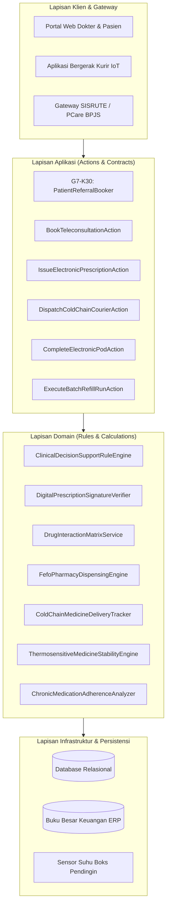
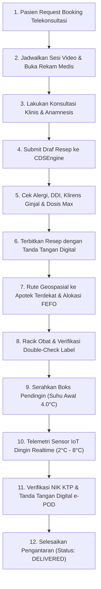
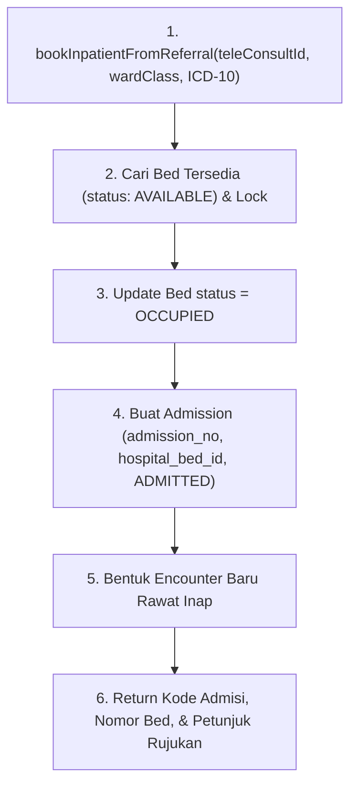

# Arsitektur Integrasi Sistem & Diagram Urutan Layanan Terpadu

Dokumen ini memvisualisasikan arsitektur integrasi lintas modul dan alur interaksi antarkomponen perangkat lunak pada implementasi Telemedicine, E-Pharmacy, dan Jaringan Apotek Fase 104.

---

## 1. Diagram Arsitektur Komponen

Arsitektur sistem dibangun di atas arsitektur berlapis (Clean Architecture / Domain-Driven Design) dengan pemisahan tanggung jawab yang terstruktur:

---

## 2. Diagram Urutan Alur Konsultasi, Peresepan & Pengiriman Obat

Alur interaksi berurutan saat pasien melakukan telekonsultasi hingga obat diserahkan:

---

## 3. Diagram Alur Rujukan Rawat Inap Darurat dari Telemedis

Ketika kondisi pasien memburuk selama telekonsultasi dan memerlukan rawat inap:

