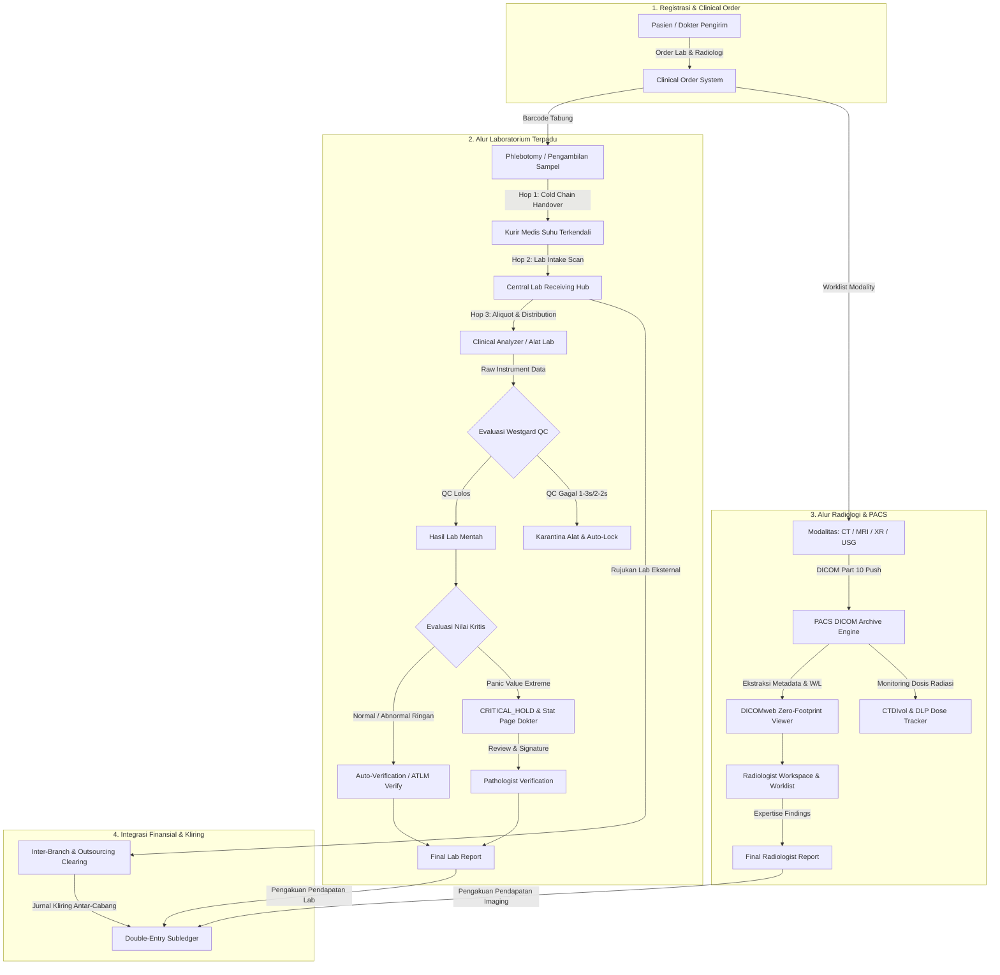

# Arsitektur Domain Laboratorium & Diagnostic Imaging (Fase 105)

## 1. Pendahuluan & Latar Belakang

Modul Hospital Fase 105 mengintegrasikan dua pilar vital penunjang medis rumah sakit modern: **Jaringan Laboratorium Klinik Terpadu** dan **Diagnostic Imaging / Picture Archiving and Communication System (PACS)** berbasis standar internasional DICOM (*Digital Imaging and Communications in Medicine*) dan LOINC (*Logical Observation Identifiers Names and Codes*).

Dalam operasional rumah sakit rujukan tipe A/B dan jaringan klinik satelit, layanan laboratorium dan radiologi menghadapi tantangan struktural yang berdampak langsung pada keselamatan nyawa pasien (*patient safety*):
1. **Risiko Tertukarnya Spesimen**: Spesimen darah, urin, cairan serebrospinal, atau jaringan biopsi berpindah tangan melalui beberapa titik (*phlebotomist*, kurir berpendingin, petugas triase lab pusat, analis laboratorium). Ketiadaan rantai kustodi kriptografis membuka celah malapraktik tertukarnya sampel.
2. **Keterlambatan Penanganan Nilai Kritis (*Panic Values*)**: Hasil lab dengan nilai yang mengancam nyawa (seperti Kalium < 2.5 mEq/L atau Troponin I > 0.04 ng/mL) sering kali tertahan dalam antrean verifikasi rutin atau lambat dilaporkan ke dokter jaga Instalasi Gawat Darurat (IGD).
3. **Silo Arsip Radiologi & Fragmentasi Citra**: Berkas rontgen, CT-Scan, dan MRI berukuran gigabyte tersimpan di workstation modalitas terisolasi, menghambat telaah cepat (*second opinion*) oleh radiolog konsultan dan dokter spesialis di meja poliklinik.
4. **Disparitas Mutu Alat & Fluktuasi Reagen**: Ketiadaan evaluasi kendali mutu analitik (*Quality Control*) otomatis membuka risiko hasil pemeriksaan melenceng (*analytical bias / drift*) akibat reagen kedaluwarsa atau alat belum terkalibrasi.
5. **Kompleksitas Kliring Finansial Lintas Cabang**: Pemeriksaan laboratorium canggih yang dirujuk ke laboratorium rekanan (*outsourced reference lab*) atau laboratorium cabang memerlukan rekonsiliasi biaya, bagi hasil, dan penjurnalan buku besar yang transparan tanpa kebocoran pendapatan.

## 2. Batasan Ruang Lingkup Arsitektural (Fase 105)

Ruang lingkup arsitektur domain pada Fase 105 mencakup:
1. **Master Katalog LOINC 10.000 Parameter**:
   - Struktur metadata multi-aksial lengkap (*Component*, *Property*, *Time Aspect*, *System/Specimen*, *Scale Type*, *Method Type*).
   - Nilai rujukan fisiologis bergradasi (*Reference Min/Max*) dan ambang batas nilai panik (*Panic Low/High*).
   - Indeks pencarian performa tinggi dan kategorisasi klinis (Hematologi, Kimia Darik, Imunoserologi, Mikrobiologi, Urinalisis, Toksikologi, Patologi Anatomi).
2. **Rantai Kustodi Spesimen 3-Hop Kriptografis (SHA-256)**:
   - Pelacakan perpindahan fisik tabung sampel dari titik pengambilan (*Hop 1: Clinic -> Courier*), perpindahan logistik (*Hop 2: Courier -> Core Lab*), dan serah terima analitik (*Hop 3: Core Lab -> Workstation/Pathologist*).
   - Sensor suhu terpasang dan deteksi pelanggaran rantai dingin (*cold-chain breach* jika suhu > 10°C untuk darah atau > -20°C untuk plasma beku).
   - Penolakan otomatis (*automatic rejection*) jika integritas rantai hash terputus atau rusak.
3. **Protokol Penanganan Nilai Kritis & Hold Patolog**:
   - Deteksi instan nilai laboratorium yang melewati batas kritis.
   - Penahanan otomatis (*CRITICAL_HOLD*) agar hasil tidak bocor ke portal pasien sebelum dokter terkonfirmasi.
   - Panggilan darurat (*STAT Page*) dengan SLA konfirmasi tertutup (*read-back verification*) dalam 15 menit.
   - Penandatanganan digital kriptografis oleh dokter spesialis patologi klinik (*Pathologist Digital Signature*).
   - Penundaan pengakuan pendapatan finansial sampai verifikasi medis dinyatakan tuntas.
4. **Integrasi DICOM PACS & Zero-Footprint Viewer**:
   - Parsing struktur DICOM Part 10 (SOP Instance UID, Study UID, Series UID, Modality, Pixel Spacing, Window Width/Center).
   - Layanan metadata WADO-RS / QIDO-RS untuk rendering citra radiologi diagnostik pada peramban web modern tanpa instalasi aplikasi klien tambahan.
   - Monitoring ambang batas dosis radiasi pasien (*Radiation Dosimetry Tracking*) sesuai standar BAPETEN / IAEA.
   - Pengawalan SLA turnaround time pemeriksaan (STAT ≤ 30 menit, Cito ≤ 60 menit, Rutin ≤ 24 jam).
5. **Jaringan Laboratorium Mitra & Kliring Antar-Cabang**:
   - Pertukaran data pesanan dan hasil uji rujukan via standar antarmuka HL7 v2.5 / FHIR DiagnosticReport.
   - Pencatatan surat jalan manifest rujukan spesimen berpenutup segel digital.
   - Penjurnalan akuntansi kliring antar-entitas cabang (*inter-branch clearing suspense*) berprinsip debit-kredit seimbang.
6. **Sistem Kendali Mutu Analitik Westgard Multirules**:
   - Evaluasi harian hasil kontrol kualitas (Level 1 Normal, Level 2 Patologis).
   - Penerapan algoritma Westgard (aturan 1-2s peringatan, 1-3s, 2-2s, R-4s, 4-1s, 10-x penolakan).
   - Penguncian instrumen otomatis saat terjadi *out-of-control condition* untuk mencegah pelaporan hasil salah.

