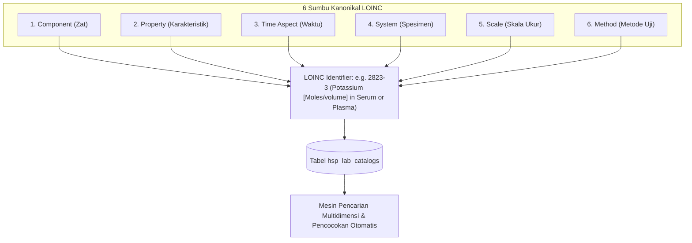
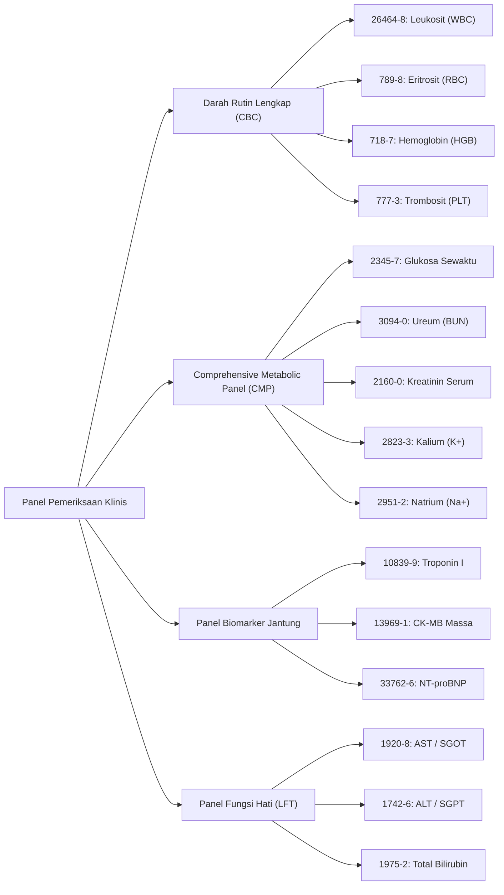

# Standar LOINC 10.000 Parameter Katalog Klinis (Fase 105)

## 1. Definisi & Struktur Standar LOINC

LOINC (*Logical Observation Identifiers Names and Codes*) adalah standar interoperabilitas internasional yang dikembangkan oleh Regenstrief Institute untuk mengidentifikasi observasi laboratorium medis dan hasil pemeriksaan diagnostik secara universal.

Dalam arsitektur Hospital Fase 105, katalog laboratorium dimodelkan dengan struktur relasional 6-sumbu kanonikal LOINC yang mencakup:

| Sumbu LOINC | Definisi Medis | Contoh Penerapan |
|---|---|---|
| **Component / Analyte** | Zat, molekul, sel, atau mikroorganisme yang diukur | Glukosa, Hemoglobin, Kalium, Troponin I |
| **Property** | Karakteristik fisis/kimiawi yang diobservasi | Konsentrasi massa (`MCnc`), Konsentrasi substansi (`SCnc`), Fraksi volume (`VFr`) |
| **Time Aspect** | Interval waktu saat observasi dilakukan | Titik waktu sesaat (`Pt`), Akumulasi 24 jam (`24H`) |
| **System / Specimen** | Matriks atau jenis spesimen biologis | Darah lengkap (`Bld`), Serum/Plasma (`Ser/Plas`), Urin (`Urn`), Cairan Serebrospinal (`CSF`) |
| **Scale Type** | Skala pengukuran hasil | Kuantitatif (`Qn`), Kualitatif/Nominal (`Nom`), Ordinal (`Ord`) |
| **Method Type** | Metode analitik spesifik (bila mempengaruhi interpretasi) | Spektrofotometri, Elektroforesis, ELISA, Real-Time PCR, Flow Cytometry |



## 2. Struktur Data Tabel `hsp_lab_catalogs`

Tabel `hsp_lab_catalogs` menyimpan kamus parameter pengujian laboratorium dengan definisi kolom teknis sebagai berikut:

```sql
CREATE TABLE hsp_lab_catalogs (
    id BIGINT UNSIGNED AUTO_INCREMENT PRIMARY KEY,
    loinc_num VARCHAR(32) NOT NULL UNIQUE,
    component VARCHAR(128) NOT NULL,
    property VARCHAR(32) NOT NULL,
    time_aspect VARCHAR(16) NOT NULL DEFAULT 'Pt',
    system_specimen VARCHAR(64) NOT NULL,
    scale_type VARCHAR(16) NOT NULL DEFAULT 'Qn',
    method_type VARCHAR(64) NULL,
    class_name VARCHAR(64) NOT NULL, -- CHEM, HEM/BC, COAG, MICRO, SERO, TOX
    reference_min DECIMAL(12, 4) NULL,
    reference_max DECIMAL(12, 4) NULL,
    unit VARCHAR(32) NULL,
    panic_low DECIMAL(12, 4) NULL,
    panic_high DECIMAL(12, 4) NULL,
    price_idr BIGINT NOT NULL DEFAULT 0,
    is_orderable BOOLEAN NOT NULL DEFAULT TRUE,
    is_active BOOLEAN NOT NULL DEFAULT TRUE,
    created_at TIMESTAMP NULL,
    updated_at TIMESTAMP NULL,
    INDEX idx_loinc_class_order (class_name, is_orderable),
    INDEX idx_loinc_component (component)
);
```

## 3. Matriks Panel Pemeriksaan Klinis Utama

Hospital Fase 105 mengelompokkan 10.000 parameter pengujian ke dalam paket/panel klinis standar:



## 4. Algoritma Pencarian & Pencocokan Otomatis LOINC

Untuk memudahkan tenaga medis dan integrasi sistem eksternal, `LoincCatalogSearchService` menyediakan algoritma pencocokan multi-kriteria:
1. **Exact Code Match**: Pencarian langsung berbasis `loinc_num` (kompleksitas $O(1)$).
2. **Normalized Prefix & Token Match**: Pemecahan kata kunci pencarian menjadi token leksikal (misal: "kalium darah" atau "potassium serum") dicocokkan terhadap `component` dan `system_specimen`.
3. **Category Filtering**: Penyaringan instan berdasarkan kelas uji medis (`CHEM`, `HEM`, `COAG`, `MICRO`).
4. **Orderable Guard**: Hanya parameter bertanda `is_orderable = true` yang dapat dimasukkan ke dalam keranjang pesanan dokter.

