# Rantai Kustodi Spesimen 3-Hop Berbasis Cryptographic Hash-Chain (Fase 105)

## 1. Prinsip Integritas Rantai Kustodi Spesimen

Spesimen biologis pasien (darah vena, serum, plasma, urin porsi tengah, cairan serebrospinal, biopsi jaringan) merupakan bukti diagnostik kritis yang rentan terhadap:
- **Tertukarnya identitas tabung**: Pasien A didiagnosis dengan sampel pasien B.
- **Kerusakan analitik akibat deviasi suhu**: Sampel darah lisis atau enzim terdenaturasi akibat suhu penyimpanan melampaui batas rantai dingin (*cold-chain breach*).
- **Pemalsuan data serah terima**: Catatan log manual diubah setelah hasil lab bermasalah terbit.

Untuk memastikan keterlacakan mutlak dan ketahanan bukti hukum, Fase 105 mengimplementasikan **Cryptographic Hash-Chain 3-Hop** dengan formula matematis deterministik berbasis SHA-256:

$$\text{HopHash}_n = \text{SHA256}\left(\text{HopHash}_{n-1} \parallel \text{SpecimenBarcode} \parallel \text{HopNumber} \parallel \text{FromHandler} \parallel \text{ToHandler} \parallel \text{TempCelsius} \parallel \text{Timestamp}\right)$$

Di mana:
- $\text{HopHash}_0 = \text{GenesisHash} = \text{SHA256}(\text{SpecimenBarcode} \parallel \text{PatientMRN} \parallel \text{CollectedAt})$
- Karakter $\parallel$ adalah konkatenasi string biner terkanonisasi (*canonical concatenation*).

```mermaid
flowchart LR
    subgraph Hop0["Hop 0: Sampling"]
        S0[Pengambilan Sampel Darah] --> GEN[Genesis Hash: SHA-256 Barcode + MRN]
    end

    subgraph Hop1["Hop 1: Klinik -> Kurir"]
        GEN --> H1[Serah Terima Phlebotomist ke Kurir Pendingin]
        H1 --> HASH1["Hash 1 = SHA-256(Genesis + Data H1 + Suhu)"]
    end

    subgraph Hop2["Hop 2: Kurir -> Core Lab"]
        HASH1 --> H2[Penerimaan di Triase Lab Rujukan Pusat]
        H2 --> HASH2["Hash 2 = SHA-256(Hash 1 + Data H2 + Suhu)"]
    end

    subgraph Hop3["Hop 3: Core Lab -> Analisis"]
        HASH2 --> H3[Penyerahan ke Workstation Analis / Patolog]
        H3 --> HASH3["Hash 3 = SHA-256(Hash 2 + Data H3 + Workstation)"]
    end

    HASH3 --> VRF{Verifikasi Rantai Kriptografis Utuh 100%?}
    VRF -->|Valid| RUN[Lanjut Pemrosesan Analitik Alat]
    VRF -->|Tampered / Putus| REJ[Tolak Spesimen: CHAIN_TAMPERED_REJECT]
```



## 2. Struktur Data Tabel `hsp_lab_custody_transfers` & `hsp_specimen_custody_chain_logs`

Pelacakan kustodi spesimen dicatat pada tabel terdedikasi `hsp_specimen_custody_chain_logs` (dan kompatibel dengan `hsp_lab_custody_transfers`):

```sql
CREATE TABLE hsp_specimen_custody_chain_logs (
    id BIGINT UNSIGNED AUTO_INCREMENT PRIMARY KEY,
    specimen_id BIGINT UNSIGNED NOT NULL,
    hop_number INT NOT NULL,
    from_handler VARCHAR(64) NOT NULL,
    to_handler VARCHAR(64) NOT NULL,
    transport_temp_celsius DECIMAL(5, 2) NULL,
    gps_coordinates VARCHAR(64) NULL,
    storage_container_barcode VARCHAR(64) NULL,
    prev_hash VARCHAR(64) NOT NULL,
    custody_hash VARCHAR(64) NOT NULL,
    notes VARCHAR(255) NULL,
    transferred_at TIMESTAMP NOT NULL,
    created_at TIMESTAMP NULL,
    updated_at TIMESTAMP NULL,
    FOREIGN KEY (specimen_id) REFERENCES hsp_lab_specimens(id) ON DELETE CASCADE,
    INDEX idx_specimen_hop (specimen_id, hop_number),
    INDEX idx_custody_hash (custody_hash)
);
```

## 3. Protokol Penolakan Suhu Dingin (*Cold-Chain Breach Protocol*)

Setiap perpindahan sampel wajib disertai pencatatan suhu sensor logger:
1. **Whole Blood / Serum Rutin**: Rentang aman $2.0^\circ\text{C} \le T \le 8.0^\circ\text{C}$.
   - Toleransi batas atas transien: $\le 10.0^\circ\text{C}$.
   - Jika suhu terukur $> 10.0^\circ\text{C}$, sistem seketika melempar pengecualian `RuntimeException: Specimen rejected due to cold-chain temperature breach` dan mengubah status spesimen menjadi `REJECTED`.
2. **Plasma Beku / Faktor Koagulasi**: Rentang aman $T \le -20.0^\circ\text{C}$.
3. **Spesimen Ditolak Terkunci**: Spesimen berstatus `REJECTED` dilarang keras diproses oleh alat analis (`recordLabResult` wajib menolak eksekusi dengan pesan `Specimen chain-of-custody broken or rejected`).

## 4. Deteksi Sabotase & Verifikasi Integritas Dua-Arah

Metode `SpecimenCustodyHashChainTracker::verifyChainIntegrity(LabSpecimen $specimen): bool` melakukan verifikasi rekursif dari Hop 1 hingga Hop terakhir:
1. Memuat seluruh riwayat transfer secara urut berdasarkan `hop_number` asc.
2. Memverifikasi bahwa `hop_number` berurutan tanpa celah ($1, 2, 3$).
3. Menghitung ulang hash kanonikal pada setiap simpul menggunakan data mentah di database.
4. Membandingkan hash kalkulasi dengan nilai `custody_hash` yang tersimpan.
5. Memverifikasi bahwa `prev_hash` simpul $n$ identik dengan `custody_hash` simpul $n-1$.
6. Jika ditemukan ketidaksesuaian sekecil 1 bit karakter (misal akibat modifikasi langsung via SQL injection atau DBA tampering), fungsi mengembalikan `false` dan command `php artisan hsp:audit` mencatat pelanggaran integritas forensik.

