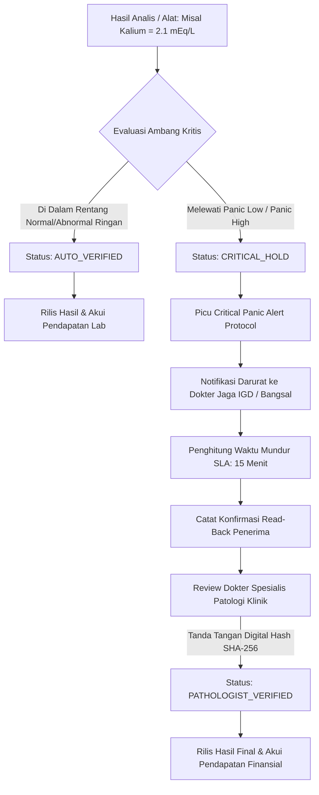

# Protokol Kegawatan Nilai Kritis & Hold Patolog (Fase 105)

## 1. Definisi Nilai Kritis Medis (*Critical / Panic Values*)

Nilai Kritis (*Panic Value*) adalah hasil pemeriksaan laboratorium atau pencitraan diagnostik yang mengindikasikan kondisi patofisiologis abnormal ekstrem yang secara langsung mengancam kelangsungan hidup pasien (*life-threatening*) bila tidak segera ditangani secara medis dalam hitungan menit hingga jam.

Dalam praktik akreditasi Joint Commission International (JCI) dan KARS (*Komisi Akreditasi Rumah Sakit*), pelaporan nilai kritis mewajibkan:
1. **Identifikasi Otomatis**: Sistem laboratorium mendeteksi nilai yang melampaui ambang batas panik secara instan begitu alat analisa mentransmisikan data mentah.
2. **Karantina Rilis (*Critical Hold*)**: Hasil ditahan agar tidak muncul di portal pasien mandiri untuk mencegah kepanikan keluarga sebelum dokter jaga bertindak.
3. **Pemberitahuan Segera (*STAT Notification*)**: Panggilan otomatis ke perawat jaga bangsal atau dokter IGD penanggung jawab pasien.
4. **Konfirmasi Tutup-Putaran (*Closed-Loop Read-Back*)**: Penerima pesan wajib membaca ulang nilai hasil, nama pasien, dan nomor rekam medis.
5. **Verifikasi Patolog Klinik**: Dokter spesialis patologi klinik memvalidasi hasil dengan tanda tangan digital terotentikasi.



## 2. Tabel Ambang Batas Nilai Kritis Standar Hospital

Modul Hospital mengonfigurasi batas kritis baku untuk pemeriksaan esensial:

| Kode Tes LOINC | Nama Pemeriksaan | Rentang Normal | Panic Low | Panic High | Satuan | Protokol Notifikasi |
|---|---|---|---|---|---|---|
| `POTASSIUM` (2823-3) | Kalium Serum | 3.50 – 5.10 | 2.50 | 6.50 | mEq/L | `CRITICAL_HOLD_AND_PAGE` |
| `SODIUM` (2951-2) | Natrium Serum | 135.0 – 145.0 | 120.0 | 160.0 | mEq/L | `CRITICAL_HOLD_AND_PAGE` |
| `GLUCOSE` (2345-7) | Glukosa Darah | 70.0 – 140.0 | 45.0 | 500.0 | mg/dL | `STAT_GLUCOSE_HYPO_PAGE` |
| `TROPONIN_I` (10839-9) | Troponin I Kuantitatif | 0.00 – 0.04 | — | 0.04 | ng/mL | `STAT_CODE_HEART_PAGE` |
| `PLATELETS` (777-3) | Trombosit Darah Lengkap | 150 – 450 | 20.0 | 1000.0 | 10^3/uL | `STAT_BLEEDING_ALERT` |
| `HEMOGLOBIN` (718-7) | Hemoglobin Dewasa | 12.0 – 17.5 | 6.0 | 20.0 | g/dL | `STAT_TRANSFUSION_PAGE` |
| `PH_BLOOD` (2744-1) | Analisis Gas Darah (pH) | 7.35 – 7.45 | 7.20 | 7.60 | — | `STAT_ICU_INTUBATION_PAGE` |

## 3. Struktur Data Tabel `hsp_critical_notifications`

```sql
CREATE TABLE hsp_critical_notifications (
    id BIGINT UNSIGNED AUTO_INCREMENT PRIMARY KEY,
    notification_uid VARCHAR(64) NOT NULL UNIQUE,
    specimen_id BIGINT UNSIGNED NOT NULL,
    patient_id BIGINT UNSIGNED NOT NULL,
    test_code VARCHAR(32) NOT NULL,
    analyte_name VARCHAR(128) NOT NULL,
    measured_value DECIMAL(12, 4) NOT NULL,
    panic_threshold DECIMAL(12, 4) NOT NULL,
    panic_type VARCHAR(16) NOT NULL, -- LOW, HIGH
    notification_protocol VARCHAR(64) NOT NULL,
    doctor_id BIGINT UNSIGNED NULL,
    doctor_phone VARCHAR(32) NULL,
    notified_at TIMESTAMP NULL,
    acknowledged_at TIMESTAMP NULL,
    read_back_confirmed BOOLEAN NOT NULL DEFAULT FALSE,
    read_back_recipient_name VARCHAR(128) NULL,
    pathologist_verified_at TIMESTAMP NULL,
    pathologist_signature_hash VARCHAR(64) NULL,
    status VARCHAR(32) NOT NULL DEFAULT 'CRITICAL_HOLD', -- CRITICAL_HOLD, NOTIFIED, READ_BACK_VERIFIED, PATHOLOGIST_VERIFIED, ESCALATED
    created_at TIMESTAMP NULL,
    updated_at TIMESTAMP NULL,
    FOREIGN KEY (specimen_id) REFERENCES hsp_lab_specimens(id) ON DELETE CASCADE,
    FOREIGN KEY (patient_id) REFERENCES hsp_patients(id) ON DELETE CASCADE,
    INDEX idx_crit_status (status),
    INDEX idx_crit_specimen (specimen_id)
);
```

## 4. Integritas Pengakuan Finansial Tertunda

Aturan bisnis Hospital Fase 105 menegaskan bahwa:
- Pemeriksaan lab berstatus `CRITICAL_HOLD` belum berhak diakui sebagai pendapatan operasional (`hsp:lab_revenue:IDR`).
- Saldo kas / piutang pasien tetap berada di penampungan sementara (*escrow / suspense*) hingga proses verifikasi medis oleh dokter spesialis patologi klinik dituntaskan (`PATHOLOGIST_VERIFIED`).
- Begitu tanda tangan digital patolog diverifikasi, layanan memicu penjurnalan pendapatan lab penuh secara otomatis melalui `PostingDTO` debit piutang kredit pendapatan lab.

