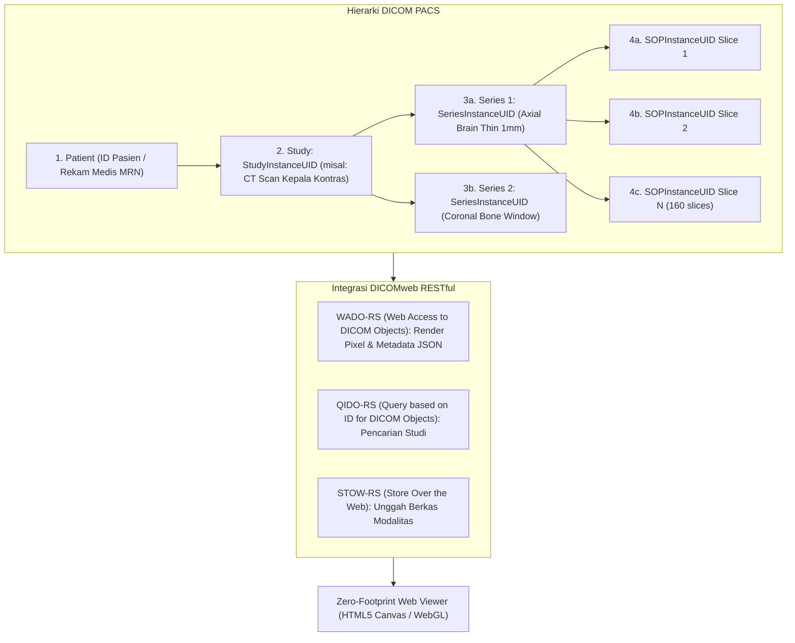

# Arsitektur DICOM PACS & Zero-Footprint Web Viewer (Fase 105)

## 1. Fondasi Standar DICOM Part 10

Standar DICOM (*Digital Imaging and Communications in Medicine*) Part 10 menetapkan struktur berkas data pencitraan medis yang menyatukan metadata demografis pasien, parameter teknis modalitas radiologi, dan data piksel citra (*pixel data*) dalam satu payload terstandar.

Hierarki relasional DICOM terdiri dari 4 tingkatan:

$$\text{Patient} \longrightarrow \text{Study (Pemeriksaan)} \longrightarrow \text{Series (Urutan Citra)} \longrightarrow \text{Instance / SOP Instance (Irisan Citra Tunggal)}$$



## 2. Struktur Data Tabel `hsp_imaging_studies`, `hsp_imaging_series`, & `hsp_dicom_instances`

Tabel relasional pendukung PACS:

```sql
-- Tabel Studi Radiologi Utama
CREATE TABLE hsp_imaging_studies (
    id BIGINT UNSIGNED AUTO_INCREMENT PRIMARY KEY,
    study_instance_uid VARCHAR(64) NOT NULL UNIQUE,
    accession_number VARCHAR(32) NOT NULL UNIQUE,
    patient_id BIGINT UNSIGNED NOT NULL,
    encounter_id BIGINT UNSIGNED NULL,
    modality VARCHAR(16) NOT NULL, -- CT, MRI, XR, US, NM, PET, MAMMO
    body_part VARCHAR(64) NOT NULL,
    performed_at DATETIME NOT NULL,
    turnaround_minutes INT NOT NULL DEFAULT 0,
    priority VARCHAR(16) NOT NULL DEFAULT 'ROUTINE', -- STAT, CITO, ROUTINE
    radiologist_findings TEXT NULL,
    radiologist_id BIGINT UNSIGNED NULL,
    fee_idr BIGINT NOT NULL DEFAULT 0,
    status VARCHAR(32) NOT NULL DEFAULT 'COMPLETED', -- SCHEDULED, IN_PROGRESS, COMPLETED, CANCELLED
    created_at TIMESTAMP NULL,
    updated_at TIMESTAMP NULL,
    FOREIGN KEY (patient_id) REFERENCES hsp_patients(id) ON DELETE CASCADE,
    INDEX idx_study_patient (patient_id),
    INDEX idx_study_modality (modality, priority)
);

-- Tabel Seri Citra
CREATE TABLE hsp_imaging_series (
    id BIGINT UNSIGNED AUTO_INCREMENT PRIMARY KEY,
    study_id BIGINT UNSIGNED NOT NULL,
    series_instance_uid VARCHAR(64) NOT NULL UNIQUE,
    series_number INT NOT NULL DEFAULT 1,
    modality VARCHAR(16) NOT NULL,
    series_description VARCHAR(128) NULL,
    slice_count INT NOT NULL DEFAULT 1,
    slice_thickness_mm DECIMAL(6, 2) NULL,
    storage_uri VARCHAR(255) NOT NULL,
    created_at TIMESTAMP NULL,
    updated_at TIMESTAMP NULL,
    FOREIGN KEY (study_id) REFERENCES hsp_imaging_studies(id) ON DELETE CASCADE,
    INDEX idx_series_study_modality (study_id, modality)
);

-- Tabel SOP Instance (Irisan Tunggal)
CREATE TABLE hsp_dicom_instances (
    id BIGINT UNSIGNED AUTO_INCREMENT PRIMARY KEY,
    series_id BIGINT UNSIGNED NOT NULL,
    sop_instance_uid VARCHAR(64) NOT NULL UNIQUE,
    instance_number INT NOT NULL DEFAULT 1,
    sop_class_uid VARCHAR(64) NOT NULL DEFAULT '1.2.840.10008.5.1.4.1.1.2', -- CT Image Storage
    rows INT NOT NULL DEFAULT 512,
    columns INT NOT NULL DEFAULT 512,
    bits_allocated INT NOT NULL DEFAULT 16,
    window_center DECIMAL(8, 2) NOT NULL DEFAULT 40.0, -- Hounsfield Unit Brain
    window_width DECIMAL(8, 2) NOT NULL DEFAULT 80.0,  -- Hounsfield Unit Brain
    pixel_spacing VARCHAR(32) NOT NULL DEFAULT '0.5\\0.5',
    storage_path VARCHAR(255) NOT NULL,
    checksum_sha256 VARCHAR(64) NOT NULL,
    created_at TIMESTAMP NULL,
    updated_at TIMESTAMP NULL,
    FOREIGN KEY (series_id) REFERENCES hsp_imaging_series(id) ON DELETE CASCADE,
    INDEX idx_instance_series (series_id, instance_number)
);
```

## 3. Ekstraksi Metadata DICOMweb untuk Zero-Footprint Viewer

Zero-Footprint Web Viewer memungkinkan dokter melihat citra radiologi berkualitas diagnostik langsung di browser (desktop, tablet, mobile) tanpa perlu menginstal aplikasi pihak ketiga (seperti Osirix, Radiant, atau Horos).

Layanan `DicomWebMetadataExtractor` menyajikan payload JSON berstandar WADO-RS:
- **Patient Attributes**: Nama terenkode aman, MRN, tanggal lahir, jenis kelamin.
- **Study Attributes**: Study Date, Study Time, Referring Physician, Study Description.
- **Series Attributes**: Modality, Series Number, Series Description, Body Part Examined.
- **Image Attributes**: Photometric Interpretation (`MONOCHROME2`), Pixel Representation, Rescale Intercept, Rescale Slope, Window Center / Window Width.
- **Streaming Tile / Thumbnail URI**: URL aman dengan token berbatas waktu (*presigned URL*) untuk mengunduh irisan citra.

## 4. Evaluasi SLA Turnaround Time (STAT vs Routine)

Waktu penyelesaian pemeriksaan radiologi (*Turnaround Time / TAT*) diawasi secara ketat oleh `DiagnosticImagingPacsIntegrationService`:
1. **Pemeriksaan STAT (Gawat Darurat / Trauma Cito)**:
   - Target SLA: $\le 30\text{ menit}$.
   - Jika $\text{turnaround\_minutes} \le 30$: Status `SLA_MET` (`is_within_sla = true`).
   - Jika $\text{turnaround\_minutes} > 30$: Status `SLA_BREACHED` (`is_within_sla = false`) dan memicu insiden mutu radiologi.
2. **Pemeriksaan Rutin Rawat Jalan / Inap**:
   - Target SLA: $\le 1440\text{ menit}$ (24 jam).
   - Jika melebihi batas, sistem mengirim peringatan ke kepala instalasi radiologi.

