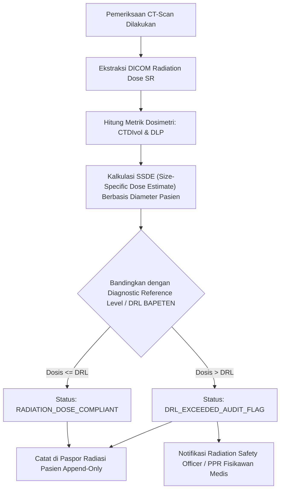

# Keamanan Radiasi & Pelacakan Dosis Radiologi CTDIvol / DLP (Fase 105)

## 1. Prinsip Proteksi Radiasi & Regulasi Dosimetri

Pemeriksaan radiologi intervensional dan tomografi terkomputasi (CT-Scan) memancarkan radiasi pengion (*ionizing radiation*). Sesuai regulasi Badan Pengawas Tenaga Nuklir (BAPETEN) No. 4 Tahun 2020 dan rekomendasi International Commission on Radiological Protection (ICRP) serta IAEA, rumah sakit wajib menerapkan prinsip proteksi radiasi:
- **Justifikasi**: Manfaat diagnostik harus jauh lebih besar daripada risiko biologis radiasi.
- **Limitasi**: Pembatasan dosis kumulatif tahunan untuk pekerja radiasi dan masyarakat umum.
- **Optimisasi (ALARA - As Low As Reasonably Achievable)**: Dosis yang diterima pasien harus serendah mungkin yang memadai untuk menghasilkan kualitas citra diagnostik yang akurat.

## 2. Metrik Pengukuran Dosimetri Radiasi

1. **Volume Computed Tomography Dose Index ($\text{CTDI}_{\text{vol}}$)**:
   - Dinyatakan dalam satuan miliGray ($\text{mGy}$).
   - Merepresentasikan dosis radiasi rata-rata per irisan dalam volume rotasi berkas sinar-X phantom standar (16 cm kepala atau 32 cm tubuh).
2. **Dose Length Product ($\text{DLP}$)**:
   - Dinyatakan dalam satuan miliGray-sentimeter ($\text{mGy}\cdot\text{cm}$).
   - Dihitung dengan rumus:
     $$\text{DLP} = \text{CTDI}_{\text{vol}} \times L$$
     Di mana $L$ adalah panjang pemindaian anatomis pasien dalam sentimeter ($\text{cm}$).
3. **Effective Dose ($E$)**:
   - Dinyatakan dalam satuan miliSievert ($\text{mSv}$).
   - Dihitung menggunakan koefisien konversi jaringan $k$ (misal $k = 0.0021$ untuk kepala, $k = 0.015$ untuk abdomen):
     $$E = \text{DLP} \times k$$
4. **Size-Specific Dose Estimate ($\text{SSDE}$)**:
   - Menyesuaikan dosis $\text{CTDI}_{\text{vol}}$ dengan ketebalan fisik riil pasien untuk mencegah *overexposure* pada pasien pediatrik atau bertubuh kecil.

## 3. Ambang Batas Diagnostic Reference Levels (DRL) Nasional

Hospital Fase 105 mengunci batas rujukan nasional (BAPETEN DRL):

| Prosedur Pemeriksaan CT | Anatomi Target | Batas DRL $\text{CTDI}_{\text{vol}}$ ($\text{mGy}$) | Batas DRL $\text{DLP}$ ($\text{mGy}\cdot\text{cm}$) |
|---|---|---|---|
| CT Kepala Rutin Dewasa | Head / Brain | 60.0 | 1000.0 |
| CT Toraks Rutin | Chest / Lungs | 15.0 | 450.0 |
| CT Abdomen & Pelvis Kontras | Abdomen / Pelvis | 20.0 | 750.0 |
| CT Angiografi Koroner | Cardiac | 40.0 | 600.0 |
| CT Kepala Pediatrik (0–1 th) | Head Pediatric | 30.0 | 400.0 |

Jika hasil ekstraksi metadata menunjukkan $\text{CTDI}_{\text{vol}}$ atau $\text{DLP}$ melebihi batas DRL di atas, sistem otomatis menandai studi dengan status `DRL_EXCEEDED_AUDIT_FLAG` dan memicu laporan peninjauan protokol kepada Fisikawan Medis Rumah Sakit.

