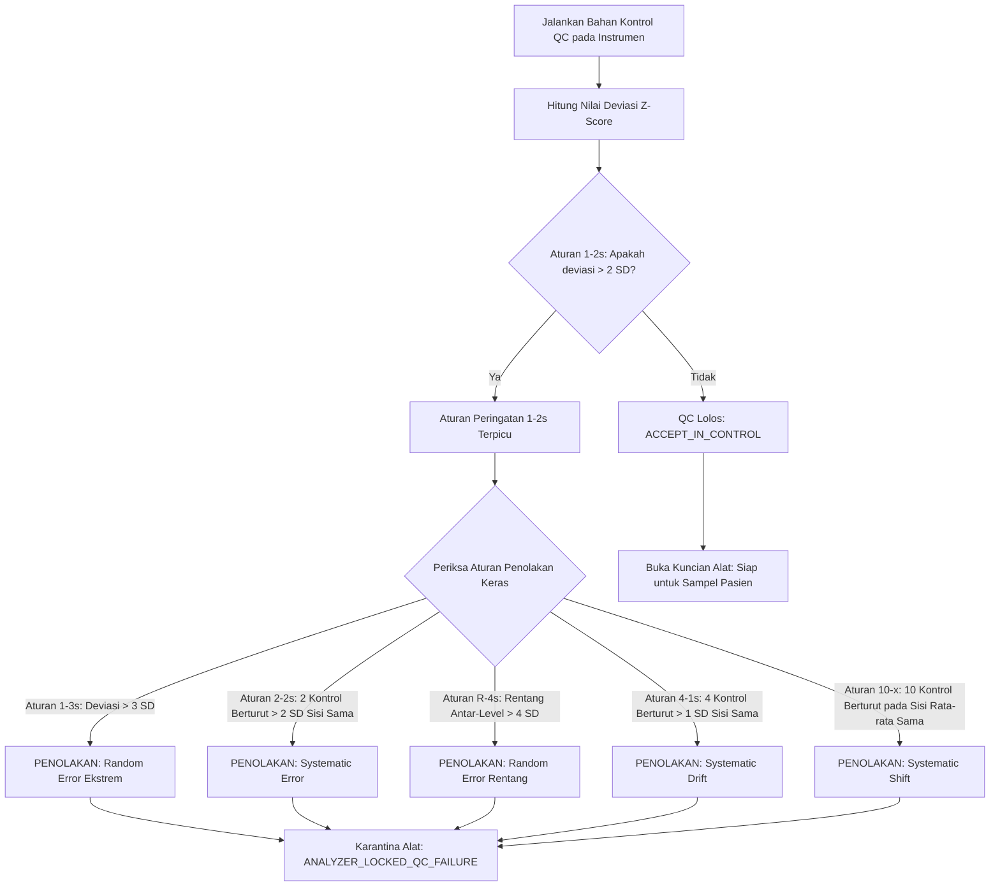

# Kendali Mutu Laboratorium & Evaluasi Westgard Multirules (Fase 105)

## 1. Fondasi Kendali Mutu Internal (*Internal Quality Control*)

Pemeriksaan laboratorium kuantitatif memerlukan jaminan presisi (*repeatability*) dan akurasi (*trueness*). Sebelum instrumen laboratorium (analis kimia darah, hematologi, koagulasi) digunakan untuk memeriksa sampel pasien, analis laboratorium (*Medical Laboratory Technologist*) wajib menjalankan bahan kontrol kualitas (*QC Material*) harian:
- **Level 1 (Normal / Low-Normal)**
- **Level 2 (Abnormal / High-Pathologic)**

Data hasil pengukuran bahan kontrol diplot pada diagram **Levey-Jennings Chart** terhadap Nilai Rata-rata Target ($\mu$) dan Standar Deviasi Target ($\sigma$).

$$Z\text{-Score} = \frac{X - \mu}{\sigma}$$

## 2. Definisi Formal Aturan Westgard Multirules

Sistem `LabQualityControlLevyJenningsEvaluator` mengimplementasikan logika multirule Westgard:

1. **Aturan 1-2s (Warning Rule)**:
   - Satu nilai kontrol berada di luar rentang $\pm 2\sigma$ ($|Z| > 2.0$).
   - Berfungsi sebagai sinyal waspada (*warning rule*). Tidak langsung menolak hasil uji, tetapi memicu evaluasi aturan penolakan berikut.
2. **Aturan 1-3s (Rejection Rule - Random Error)**:
   - Satu nilai kontrol berada di luar rentang $\pm 3\sigma$ ($|Z| > 3.0$).
   - Penolakan keras (*Hard Reject*). Mengindikasikan galat acak (*random error*) berat (misal: gelembung udara pada pipet, fluktuasi tegangan optik, bekuan mikro).
3. **Aturan 2-2s (Rejection Rule - Systematic Error)**:
   - Dua nilai kontrol berturut-turut pada run yang sama atau run berbeda melebihi $+2\sigma$ atau keduanya di bawah $-2\sigma$.
   - Mengindikasikan galat sistematik (*systematic error*) (misal: suhu inkubasi bergeser, reagen mulai teroksidasi).
4. **Aturan R-4s (Rejection Rule - Random Error)**:
   - Rentang antara nilai kontrol tertinggi dan terendah pada run yang sama melebihi $4\sigma$ (misal Level 1 bernilai $+2.2\sigma$ dan Level 2 bernilai $-2.1\sigma$; rentang $= 4.3\sigma$).
5. **Aturan 4-1s (Rejection Rule - Systematic Drift)**:
   - Empat nilai kontrol berturut-turut melebihi $+1\sigma$ atau $-1\sigma$ pada sisi yang sama.
   - Mengindikasikan pergeseran sistematik bertahap (*analytical drift*).
6. **Aturan 10-x (Rejection Rule - Systematic Shift)**:
   - Sepuluh nilai kontrol berturut-turut berada pada satu sisi dari nilai rata-rata $\mu$.
   - Mengindikasikan kalibrasi baru yang melenceng dari standar pabrikan (*systematic shift*).

## 3. Tindakan Pencegahan & Penguncian Alat Otomatis (*Analyzer Lockout*)

Ketika salah satu aturan penolakan (1-3s, 2-2s, R-4s, 4-1s, 10-x) terlanggar:
- Kolom `is_locked` pada instrumen diubah menjadi `true`.
- Layanan pengujian sampel pasien `collectSpecimen` atau `recordLabResult` yang ditujukan ke instrumen tersebut akan memblokir eksekusi dengan pesan `Analyzer is locked due to Westgard QC violation`.
- Kuncian instrumen hanya dapat dibuka kembali setelah petugas laboratorium melakukan re-kalibrasi instrumen, menjalankan ulang bahan kontrol QC, dan mencatat justifikasi perbaikan (*corrective action log*).

