# Jaringan Lab Rujukan Eksternal & HL7 v2.5 / FHIR Bridging (Fase 105)

## 1. Arsitektur Laboratorium Rujukan & Outsourcing

Untuk pemeriksaan laboratorium canggih atau berbiaya tinggi yang tidak efisien dikerjakan secara *in-house* (seperti pengurutan genom NGS, uji toksikologi forensik mass spectrometry, penanda tumor langka, atau antibodi autoimun), rumah sakit bekerja sama dengan **Laboratorium Rujukan Eksternal** terakreditasi (misal: Prodia, Pramita, Biofarma, KalGen InnoLab).

Sistem `OutsourcedLabBridgingGateway` mengorkestrasi siklus hidup spesimen rujukan:
1. **Penerbitan Surat Jalan Manifest Rujukan (*Outsourcing Manifest*)**: Mengelompokkan spesimen, mencatat segel barcode, dan mengunci hash serah terima.
2. **Pengiriman & Pelacakan Logistik Khusus**: Pengawalan rantai dingin via kurir bersertifikasi dry ice / ice pack gel.
3. **Penyambungan Elektronik (*Electronic Bridging*)**: Pertukaran pesan dua-arah via antarmuka standar internasional HL7 v2.5 (`ORM^O01` untuk order, `ORU^R01` untuk hasil observasi) dan FHIR R4 `DiagnosticReport` bundle.
4. **Pemetaan Kode Uji (*Test Code Mapping*)**: Menjembatani kode internal rekanan ke standar LOINC rumah sakit.

```mermaid
flowchart LR
    subgraph RS["Rumah Sakit (Hospital)"]
        ORD[Order Lab Rujukan] --> MAN[Terbitkan Manifest Rujukan]
        MAN --> HL7_OUT["HL7 v2.5 ORM^O01 / FHIR ServiceRequest"]
    end

    subgraph Transit["Logistik Khusus Rekanan"]
        HL7_OUT --> COURIER[Kurir Medis Rujukan Berpendingin]
    end

    subgraph LabMitra["Laboratorium Mitra (Outsourced Lab)"]
        COURIER --> LAB_PARTNER[Laboratorium Pusat Rujukan]
        LAB_PARTNER --> PROC[Analisis Mesin Canggih: NGS / LC-MS]
        PROC --> HL7_IN["HL7 v2.5 ORU^R01 / FHIR DiagnosticReport"]
    end

    HL7_IN --> BRIDGE[OutsourcedLabBridgingGateway]
    BRIDGE --> MAP[Auto-Map ke LOINC Catalog]
    MAP --> PAT[Review Patolog Rumah Sakit]
    PAT --> RES[Simpan Hasil Resmi Pasien & Finalisasi Billing]
```



## 2. Struktur Data Tabel `hsp_lab_partner_contracts` & `hsp_lab_outsourcing_manifests`

Tabel kontrak rekanan dan manifest rujukan:

```sql
-- Tabel Kontrak Kerjasama Lab Rekanan
CREATE TABLE hsp_lab_partner_contracts (
    id BIGINT UNSIGNED AUTO_INCREMENT PRIMARY KEY,
    partner_name VARCHAR(128) NOT NULL,
    contract_code VARCHAR(64) NOT NULL UNIQUE,
    discount_percentage DECIMAL(5, 2) NOT NULL DEFAULT 0.00,
    max_turnaround_hours INT NOT NULL DEFAULT 24,
    sample_pickup_daily_cutoff VARCHAR(16) NULL, -- Misal '14:00'
    cold_chain_carrier_sla VARCHAR(64) NULL,
    api_endpoint_url VARCHAR(255) NULL,
    api_client_id VARCHAR(64) NULL,
    api_client_secret VARCHAR(255) NULL,
    is_active BOOLEAN NOT NULL DEFAULT TRUE,
    created_at TIMESTAMP NULL,
    updated_at TIMESTAMP NULL
);

-- Tabel Manifest Pengiriman Rujukan
CREATE TABLE hsp_lab_outsourcing_manifests (
    id BIGINT UNSIGNED AUTO_INCREMENT PRIMARY KEY,
    manifest_number VARCHAR(64) NOT NULL UNIQUE,
    contract_id BIGINT UNSIGNED NOT NULL,
    specimen_count INT NOT NULL DEFAULT 0,
    courier_batch_barcode VARCHAR(64) NOT NULL,
    departure_temperature_celsius DECIMAL(5, 2) NOT NULL,
    arrival_temperature_celsius DECIMAL(5, 2) NULL,
    handover_hash VARCHAR(64) NOT NULL,
    status VARCHAR(32) NOT NULL DEFAULT 'DISPATCHED', -- DISPATCHED, IN_TRANSIT, RECEIVED_PARTNER, COMPLETED, CANCELLED
    created_at TIMESTAMP NULL,
    updated_at TIMESTAMP NULL,
    FOREIGN KEY (contract_id) REFERENCES hsp_lab_partner_contracts(id) ON DELETE CASCADE,
    INDEX idx_manifest_contract (contract_id, status)
);
```

## 3. Spesifikasi Payload HL7 v2.5 ORU^R01 (Observation Result)

Format pertukaran data hasil lab eksternal mengikuti segmen baku HL7 v2.5:
- **MSH (Message Header)**: Mengidentifikasi sistem pengirim, penerima, dan timestamp pesan.
- **PID (Patient Identification)**: Rekam medis pasien (MRN), nama pasien, tanggal lahir, jenis kelamin.
- **OBR (Observation Request)**: Order number, nomor spesimen barcode, kode tes LOINC yang dipesan.
- **OBX (Observation / Result Segment)**:
  - `OBX-3`: Observation Identifier (`LOINC_CODE^LOINC_NAME^LN`).
  - `OBX-5`: Observation Value (Nilai numerik atau teks).
  - `OBX-6`: Units (Satuan ukur).
  - `OBX-7`: References Range (Nilai rujukan normal).
  - `OBX-8`: Abnormal Flags (`N` normal, `L` low, `H` high, `LL` panic low, `HH` panic high).
  - `OBX-11`: Observ Result Status (`F` final, `C` corrected, `P` preliminary).
  - `OBX-14`: Date/Time of the Observation.

