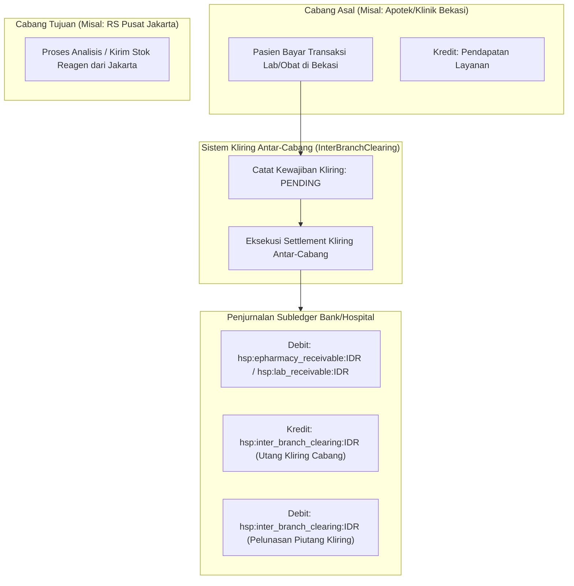

# Kliring Finansial Antar-Cabang & Penjurnalan Buku Besar (Fase 105)

## 1. Arsitektur Kliring Finansial Ekosistem Hospital

Dalam jaringan rumah sakit multisite (misal: RS Pusat Sudirman, RS Cabang Bekasi, Klinik Satelit Serpong), layanan diagnostik laboratorium dan radiologi sering kali melibatkan perpindahan biaya lintas entitas:
1. **Transfer Lot Bahan & Reagen Antar-Cabang**: Cabang A kehabisan kit reagen PCR, dipasok oleh Cabang B.
2. **Pemeriksaan Spesimen Lintas Cabang**: Pasien registrasi dan membayar di Cabang A, namun sampel darah diproses di Lab Rujukan Pusat Cabang B.
3. **Pembagian Pendapatan Radiologi Teleradiologi**: Pemotretan CT-Scan dilakukan di Cabang A, pembacaan ekspertise dilakukan oleh dokter spesialis radiologi di Cabang B.

Untuk menjaga akuntabilitas keuangan dan menghindari distorsi laba-rugi per cabang, `InterBranchLabClearingService` memberlakukan **Mekanisme Kliring Finansial Otomatis** dengan pembukuan berpasangan (*double-entry balancing*) yang ketat.



## 2. Struktur Data Tabel `hsp_inter_branch_clearings`

```sql
CREATE TABLE hsp_inter_branch_clearings (
    id BIGINT UNSIGNED AUTO_INCREMENT PRIMARY KEY,
    clearing_code VARCHAR(32) NOT NULL UNIQUE,
    from_branch_id BIGINT UNSIGNED NOT NULL,
    to_branch_id BIGINT UNSIGNED NOT NULL,
    reference_type VARCHAR(32) NOT NULL, -- CROSS_BRANCH_LOT_TRANSFER, OUTSOURCED_SPECIMEN, TELERADIOLOGY_SHARE
    reference_id VARCHAR(64) NOT NULL,
    amount_idr BIGINT NOT NULL,
    settlement_status VARCHAR(32) NOT NULL DEFAULT 'PENDING', -- PENDING, SETTLED, DISPUTED, CANCELLED
    settled_at TIMESTAMP NULL,
    settlement_reference_journal VARCHAR(64) NULL,
    created_at TIMESTAMP NULL,
    updated_at TIMESTAMP NULL,
    FOREIGN KEY (from_branch_id) REFERENCES hsp_pharmacy_branches(id) ON DELETE CASCADE,
    FOREIGN KEY (to_branch_id) REFERENCES hsp_pharmacy_branches(id) ON DELETE CASCADE,
    INDEX idx_clearing_status (from_branch_id, to_branch_id, settlement_status)
);
```

## 3. Matriks Penjurnalan Akuntansi Double-Entry

Bagan akun standar (*Chart of Accounts*) yang terlibat dalam Fase 105:

| Kode Akun | Nama Akun | Kategori Akun | Posisi Normal |
|---|---|---|---|
| `hsp:lab_receivable:IDR` | Piutang Pelayanan Laboratorium Pasien | Aset Lancar | Debit |
| `hsp:lab_revenue:IDR` | Pendapatan Operasional Laboratorium | Pendapatan | Kredit |
| `hsp:lab_diagnostic_revenue:IDR` | Pendapatan Diagnostik Patologi & Biopsi | Pendapatan | Kredit |
| `hsp:imaging_receivable:IDR` | Piutang Pemeriksaan Radiologi Pasien | Aset Lancar | Debit |
| `hsp:imaging_revenue:IDR` | Pendapatan Pelayanan Radiologi & PACS | Pendapatan | Kredit |
| `hsp:inter_branch_clearing:IDR` | Kliring Suspense Transaksi Antar-Cabang | Liabilitas / Kliring | Kredit / Debit |
| `hsp:lab_clearing_suspense:IDR` | Penampungan Kliring Biaya Lab Rekanan | Liabilitas | Kredit / Debit |

### Contoh Alur Jurnal 1: Pemeriksaan Lab Rutin Tervalidasi
- **Debit**: `hsp:lab_receivable:IDR` = Rp 120.000
- **Kredit**: `hsp:lab_revenue:IDR` = Rp 120.000
*(Catatan: Saldo tidak boleh dijurnal sebelum status mencapai `AUTO_VERIFIED` atau `PATHOLOGIST_VERIFIED`)*

### Contoh Alur Jurnal 2: Settlement Kliring Antar-Cabang
- **Debit**: `hsp:epharmacy_receivable:IDR` (atau `hsp:inter_branch_clearing:IDR`) = Rp 450.000
- **Kredit**: `hsp:inter_branch_clearing:IDR` = Rp 450.000
*(Total debit sama persis dengan total kredit, selisih 0 / Zero Discrepancy)*

