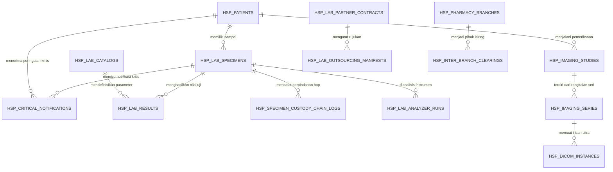

# Model Data & Skema Basis Data Relasional ERD (Fase 105)

## 1. Relasi Antar-Entitas Laboratorium & Diagnostic Imaging

Arsitektur basis data Fase 105 dirancang dengan normalisasi tingkat ketiga (3NF) dan integritas relasional kunci asing (*Foreign Keys*) berkaskade penuh untuk mencegah yatim piatu data (*orphaned records*).

## 2. Definisi Model-Model Eloquent Utama

### 2.1 Model `LaboratoryLoincCatalog`
- **Tabel**: `hsp_lab_catalogs`
- **Atribut**: `loinc_num`, `component`, `property`, `time_aspect`, `system_specimen`, `scale_type`, `method_type`, `class_name`, `reference_min`, `reference_max`, `unit`, `panic_low`, `panic_high`, `price_idr`, `is_orderable`, `is_active`.
- **Relasi**: `hasMany(LabResult::class, 'test_code', 'loinc_num')`.

### 2.2 Model `SpecimenCustodyChainLog`
- **Tabel**: `hsp_specimen_custody_chain_logs`
- **Atribut**: `specimen_id`, `hop_number`, `from_handler`, `to_handler`, `transport_temp_celsius`, `gps_coordinates`, `storage_container_barcode`, `prev_hash`, `custody_hash`, `notes`, `transferred_at`.
- **Relasi**: `belongsTo(LabSpecimen::class, 'specimen_id')`.

### 2.3 Model `CriticalRangeNotification`
- **Tabel**: `hsp_critical_notifications`
- **Atribut**: `notification_uid`, `specimen_id`, `patient_id`, `test_code`, `analyte_name`, `measured_value`, `panic_threshold`, `panic_type`, `notification_protocol`, `doctor_id`, `doctor_phone`, `notified_at`, `acknowledged_at`, `read_back_confirmed`, `read_back_recipient_name`, `pathologist_verified_at`, `pathologist_signature_hash`, `status`.
- **Relasi**: `belongsTo(LabSpecimen::class)`, `belongsTo(Patient::class)`.
- **Casts**: `'doctor_phone' => 'encrypted'`.

### 2.4 Model `ImagingDicomStudy`
- **Tabel**: `hsp_imaging_studies`
- **Atribut**: `study_instance_uid`, `accession_number`, `patient_id`, `encounter_id`, `modality`, `body_part`, `performed_at`, `turnaround_minutes`, `priority`, `radiologist_findings`, `radiologist_id`, `fee_idr`, `status`.
- **Relasi**: `belongsTo(Patient::class)`, `hasMany(ImagingSeries::class, 'study_id')`.

### 2.5 Model `DicomInstance`
- **Tabel**: `hsp_dicom_instances`
- **Atribut**: `series_id`, `sop_instance_uid`, `instance_number`, `sop_class_uid`, `rows`, `columns`, `bits_allocated`, `window_center`, `window_width`, `pixel_spacing`, `storage_path`, `checksum_sha256`.
- **Relasi**: `belongsTo(ImagingSeries::class, 'series_id')`.

### 2.6 Model `LabQualityControl`
- **Tabel**: `hsp_lab_quality_controls`
- **Atribut**: `analyzer_code`, `lot_number`, `control_level`, `test_code`, `target_mean`, `target_sd`, `measured_value`, `z_score`, `westgard_violation`, `is_rejected`, `is_resolved`, `technologist_id`, `evaluated_at`.

### 2.7 Model `InterBranchClearing`
- **Tabel**: `hsp_inter_branch_clearings`
- **Atribut**: `clearing_code`, `from_branch_id`, `to_branch_id`, `reference_type`, `reference_id`, `amount_idr`, `settlement_status`, `settled_at`, `settlement_reference_journal`.
- **Relasi**: `belongsTo(PharmacyBranch::class, 'from_branch_id')`, `belongsTo(PharmacyBranch::class, 'to_branch_id')`.

