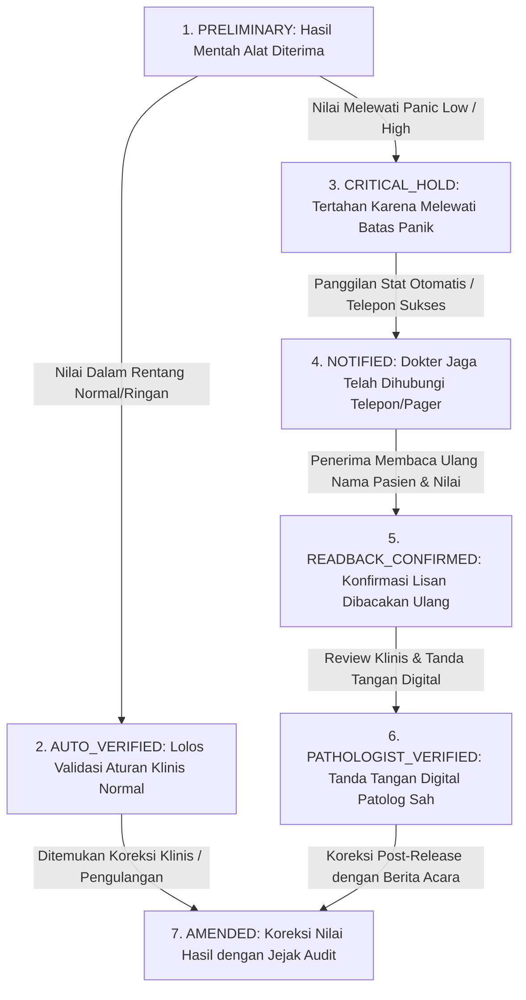
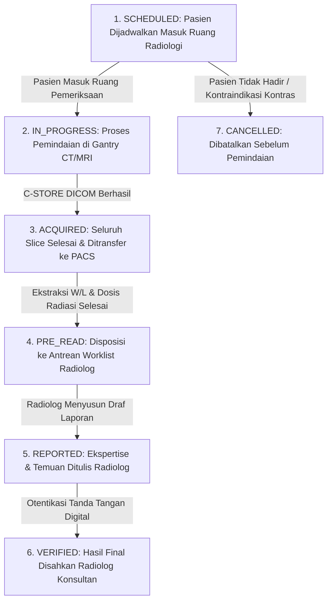
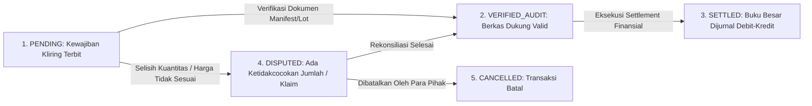

# Mesin Status (State Machines) Spesimen, Studi Radiologi & Notifikasi Kritis (Fase 105)

## 1. State Machine Rantai Kustodi Spesimen (`SpecimenStateMachine`)

Siklus hidup tabung spesimen biologis dari pengambilan fisik sampai pemusnahan biohazard dikawal oleh mesin status deterministik 6 status:

```mermaid
flowchart TD
    COLLECTED[1. COLLECTED: Tabung Diambil & Diberi Label Barcode]
    IN_TRANSIT[2. IN_TRANSIT: Dalam Box Kurir Suhu Terkendali]
    RECEIVED_LAB[3. RECEIVED_LAB: Tiba di Meja Triase Lab Pusat]
    PROCESSED[4. PROCESSED: Analisis Instrumen Selesai]
    REJECTED[5. REJECTED: Ditolak / Suhu Dingin Rusak / Hemolisis]
    DISPOSED[6. DISPOSED: Dimusnahkan Sesuai SOP Limbah Medis B3]

    COLLECTED -->|Hop 1: Scan Serah Terima Kurir| IN_TRANSIT
    COLLECTED -->|Pelanggaran Suhu / Sampel Rusak di Phlebotomy| REJECTED
    IN_TRANSIT -->|Hop 2: Scan Penerimaan Lab Triase| RECEIVED_LAB
    IN_TRANSIT -->|Suhu > 10C / Wadah Pecah / Hash Cacat| REJECTED
    RECEIVED_LAB -->|Hop 3: Verifikasi Hash Utuh & Aliquot| PROCESSED
    RECEIVED_LAB -->|Clotted / Volume Tidak Cukup (QNS)| REJECTED
    PROCESSED -->|Masa Retensi Sampel Usai (7 Hari)| DISPOSED
    REJECTED -->|Segel & Masuk Kantong Biohazard Kuning| DISPOSED
```

## 2. State Machine Hasil Lab & Notifikasi Kritis (`LabResultPanicStateMachine`)

Siklus hidup hasil pemeriksaan laboratorium diagnostik:



## 3. State Machine Studi Radiologi PACS (`ImagingStudyStateMachine`)

Siklus hidup berkas pemeriksaan radiologi:



## 4. State Machine Kliring Antar-Cabang (`InterBranchClearingStateMachine`)

Siklus penyelesaian kewajiban finansial:



