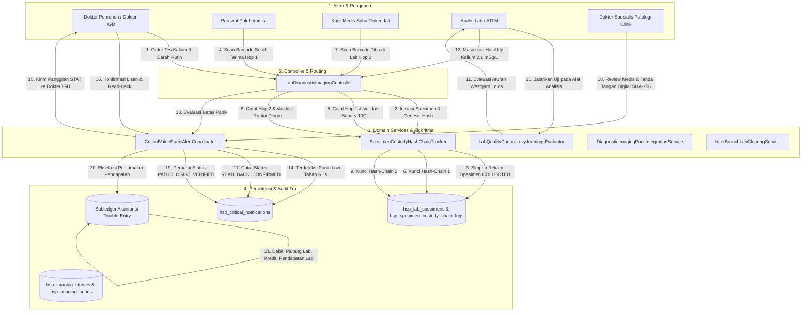
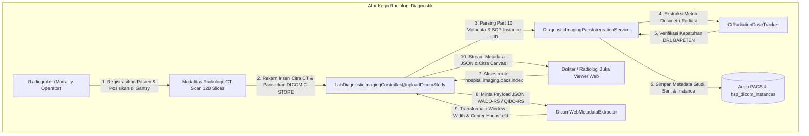
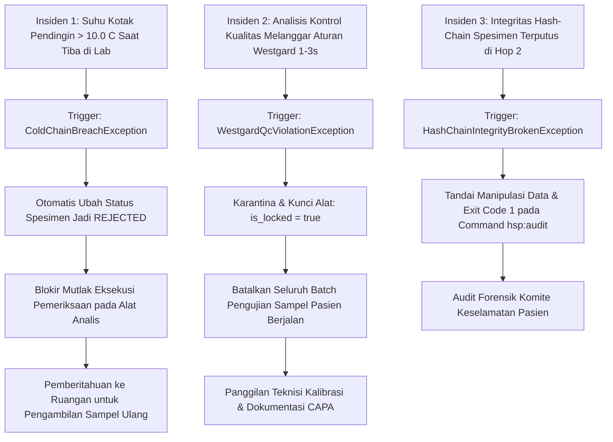

# Diagram Alur Transaksi & Integrasi Sistem (Fase 105)

## 1. Alur Transaksi End-to-End Pemeriksaan Laboratorium & Nilai Kritis

Diagram alur berikut mengilustrasikan interaksi menyeluruh antara Persona Klinis, Pengendali (*Controller*), Lapisan Layanan (*Domain Services*), Basis Data, dan Buku Besar Finansial:

## 2. Alur Transaksi Pencitraan Radiologi DICOM PACS & Viewer

## 3. Alur Kompensasi & Penanganan Deviasi (Exception Handling)

