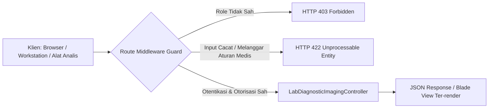

# Spesifikasi API RESTful & DICOMweb (Fase 105)

## 1. Daftar Endpoint HTTP & Kontrak Antarmuka

Modul Hospital Fase 105 mengekspos endpoint API RESTful dan DICOMweb yang aman dengan perlindungan otentikasi Sanctum dan otorisasi Role-Based Access Control (RBAC).

| Metode HTTP | URI Endpoint | Handler Controller | Role Berwenang | Deskripsi Fungsi |
|---|---|---|---|---|
| `GET` | `/hospital/laboratory/catalog` | `LabDiagnosticImagingController@catalogIndex` | `doctor`, `pharmacist`, `auditor`, `rs_admin` | Mengambil daftar katalog parameter LOINC & rentang kritis |
| `POST` | `/hospital/laboratory/specimens/custody` | `LabDiagnosticImagingController@scanSpecimenCustody` | `nurse`, `doctor`, `rs_admin` | Memindai & mencatat perpindahan rantai kustodi spesimen (Hop 1–3) |
| `POST` | `/hospital/laboratory/results/verify` | `LabDiagnosticImagingController@verifyLabResult` | `doctor`, `pathologist`, `rs_admin` | Mengevaluasi hasil lab terhadap ambang nilai kritis |
| `GET` | `/hospital/laboratory/outsourcing` | `LabDiagnosticImagingController@outsourcingIndex` | `doctor`, `auditor`, `rs_admin` | Menampilkan dashboard rujukan lab mitra & rekap kliring |
| `GET` | `/hospital/imaging/pacs` | `LabDiagnosticImagingController@pacsIndex` | `doctor`, `radiologist`, `auditor`, `rs_admin` | Menampilkan repositori studi radiologi & viewer PACS |
| `POST` | `/hospital/radiology/dicom/studies` | `LabDiagnosticImagingController@uploadDicomStudy` | `radiographer`, `doctor`, `rs_admin` | Mengunggah studi radiologi & metadata DICOM baru |
| `GET` | `/hospital/radiology/dicom/studies/{id}/metadata` | `LabDiagnosticImagingController@viewDicomMetadata` | `doctor`, `radiologist`, `rs_admin` | Mengambil payload WADO-RS JSON untuk zero-footprint web viewer |
| `POST` | `/hospital/laboratory/clearings/settle` | `LabDiagnosticImagingController@settleInterBranchClearing` | `rs_admin`, `finance_officer` | Menyelesaikan kewajiban kliring finansial antar-cabang |



## 2. Rincian Payload Permintaan & Respons

### 2.1 Endpoint: Pindai Kustodi Spesimen (`POST /hospital/laboratory/specimens/custody`)
**Request Header**: `Content-Type: application/json`, `Accept: application/json`
```json
{
  "specimen_id": 10501,
  "hop_number": 1,
  "from_handler": "Ns. Ratna Phlebotomist (ID: NUR-0881)",
  "to_handler": "Budi Logistik Pendingin (ID: LOG-0442)",
  "transport_temp_celsius": 4.2,
  "gps_coordinates": "-6.2088,106.8456",
  "storage_container_barcode": "COOLBOX-RFID-7712",
  "notes": "Sampel darah EDTA tersegel rapi dalam vacuum box"
}
```
**Respons Berhasil (`200 OK` / `302 Found`)**:
```json
{
  "status": "success",
  "data": {
    "id": 8841,
    "specimen_id": 10501,
    "hop_number": 1,
    "from_handler": "Ns. Ratna Phlebotomist (ID: NUR-0881)",
    "to_handler": "Budi Logistik Pendingin (ID: LOG-0442)",
    "prev_hash": "e3b0c44298fc1c149afbf4c8996fb92427ae41e4649b934ca495991b7852b855",
    "custody_hash": "a4f891b2c7e945d88390b1c2e4f5a6b7c8d9e0f1a2b3c4d5e6f7a8b9c0d1e2f3",
    "transferred_at": "2026-11-09T08:30:00.000000Z"
  }
}
```

### 2.2 Endpoint: Verifikasi Nilai Kritis (`POST /hospital/laboratory/results/verify`)
**Request JSON**:
```json
{
  "test_code": "POTASSIUM",
  "numeric_value": 2.10
}
```
**Respons Berhasil (`200 OK`)**:
```json
{
  "status": "success",
  "data": {
    "is_panic": true,
    "protocol": "CRITICAL_HOLD_AND_PAGE",
    "message": "CRITICAL PANIC VALUE ALERT: POTASSIUM is 2.1 (Low threshold: 2.5)",
    "notification_uid": "NOTIF-CRIT-99014"
  }
}
```

### 2.3 Endpoint: DICOMweb Metadata Viewer (`GET /hospital/radiology/dicom/studies/{id}/metadata`)
**Respons JSON (WADO-RS Compatible)**:
```json
{
  "study_instance_uid": "1.2.840.113619.2.55.3.4219.20261109.1",
  "patient_mrn": "MRN-RAD-01",
  "patient_name": "Alice Radiology Patient",
  "modality": "CT",
  "body_part": "HEAD_BRAIN_CONTRAST",
  "slice_count": 160,
  "window_presets": [
    {"name": "Brain", "window_center": 40, "window_width": 80},
    {"name": "Subdural", "window_center": 100, "window_width": 300},
    {"name": "Bone", "window_center": 400, "window_width": 2000}
  ],
  "series": [
    {
      "series_instance_uid": "1.2.840.113619.2.55.3.4219.1",
      "series_number": 1,
      "modality": "CT",
      "slice_count": 160,
      "storage_uri": "s3://pacs-vault-internal/studies/2026/10/head-ct-series-1.dcm"
    }
  ]
}
```

