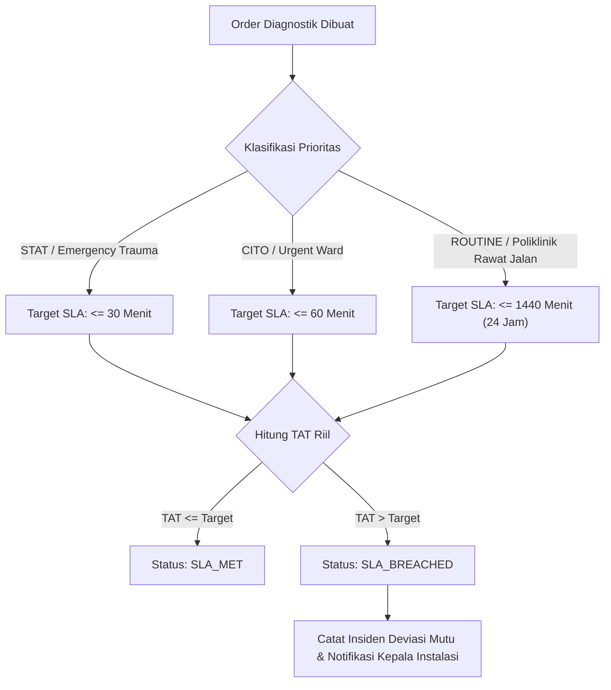

# Protokol SLA & Turnaround Time (STAT vs Rutin) (Fase 105)

## 1. Definisi Service Level Agreement (SLA) Diagnostik

Turnaround Time (TAT) adalah selang waktu yang dihitung sejak pesanan diagnostik dibuat atau sampel diterima hingga hasil resmi disahkan dan dapat diakses oleh dokter pengirim.

Dalam penanganan medis gawat darurat (seperti kecurigaan stroke iskemik akut, infark miokard akut / STEMI, perdarahan intrakranial, atau sepsis fulminan), deviasi TAT beberapa menit dapat menyebabkan kecacatan permanen atau kematian pasien.

## 2. Matriks Batas Waktu Turnaround Time

| Modalitas / Departemen | Kategori Prioritas | Ambang Batas Maksimal ($T_{\max}$) | Tindakan Jika Melebihi Batas |
|---|---|---|---|
| Laboratorium Cito | STAT (Troponin, Gas Darah, Kalium) | 30 menit | Eskalasi ke Supervisor Analis, Telepon Ruangan |
| Laboratorium Rutin | Kimia Darah, Darah Lengkap, Urin | 120 menit (2 jam) | Peninjauan Antrean Alat |
| Laboratorium Rujukan | Uji Genetik / Molekuler Luar | 72 jam (3 hari) | Pelacakan Manifest Pengiriman Rekanan |
| Radiologi Cito | STAT (CT Kepala Stroke, Rontgen Toraks Tension) | 30 menit | Radiolog Jaga Diingatkan Otomatis |
| Radiologi Urgent | CITO (Fraktur, USG Appendicitis) | 60 menit | Penjadwalan Ulang Pasien Rutin |
| Radiologi Rutin | MRI Elektif, Rontgen Rawat Jalan | 24 jam (1440 menit) | Laporan Harian KPI Kepatuhan SLA |

## 3. Algoritma Evaluasi Turnaround SLA

Evaluasi SLA pada `DiagnosticImagingPacsIntegrationService::evaluateTurnaroundSla(ImagingStudy $study, string $priority): array`:

1. Mengambil nilai `turnaround_minutes` riil dari rekam studi.
2. Membandingkan dengan batas prioritas yang diminta:
   - Jika `priority === 'STAT'`:
     - Batas = 30 menit.
     - Jika $\text{turnaround\_minutes} \le 30 \implies \text{status} = \text{'SLA\_MET'}$, $\text{is\_within\_sla} = \text{true}$.
     - Jika $\text{turnaround\_minutes} > 30 \implies \text{status} = \text{'SLA\_BREACHED'}$, $\text{is\_within\_sla} = \text{false}$.
   - Jika `priority === 'ROUTINE'`:
     - Batas = 1440 menit (24 jam).
     - Jika $\text{turnaround\_minutes} \le 1440 \implies \text{status} = \text{'SLA\_MET'}$.
3. Mengembalikan array hasil evaluasi terstruktur untuk konsumsi API dan pemantauan dasbor mutu.

