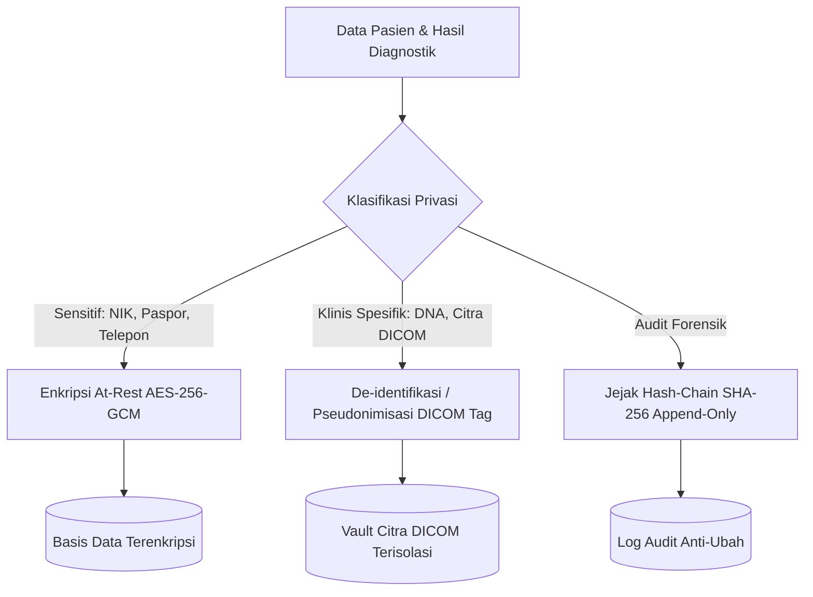

# Perlindungan Data Pribadi Medis & UU PDP pada Layanan Lab & Imaging (Fase 105)

## 1. Klasifikasi Data Medis Spesifik Sesuai UU No. 27 Tahun 2022 (UU PDP)

Undang-Undang Perlindungan Data Pribadi (UU PDP) Pasal 4 Ayat (2) mengklasifikasikan data kesehatan, data genetika, dan informasi biometrik diagnostik sebagai **Data Pribadi yang Bersifat Spesifik / Sensitif**.

Pemrosesan data ini tunduk pada kewajiban hukum yang lebih ketat:
1. **Keharusan Persetujuan Eksplisit (*Explicit Consent*)**: Pasien memberikan persetujuan tindakan medis dan pemrosesan data rekam medis saat registrasi.
2. **Kerahasiaan Medis & Pembatasan Akses Berbasis Kebutuhan (*Need-to-Know Basis*)**: Analis lab hanya melihat nomor barcode dan parameter uji; dokter hanya melihat pasien yang berada di bawah perawatannya.
3. **Enkripsi At-Rest & In-Transit**: Kolom NIK, paspor, nomor telepon dokter, serta berkas citra DICOM wajib dienkripsi.
4. **Hak Pasien atas Portabilitas & Penghapusan Terkendali**: Pasien berhak memperoleh salinan berkas DICOM dan hasil lab dalam format standar terbuka.



## 2. Implementasi Enkripsi Atribut Eloquent Model

Seluruh model Eloquent Fase 105 yang memuat data sensitif menerapkan deklarasi `$casts`:

```php
// Model CriticalRangeNotification
protected $casts = [
    'doctor_phone' => 'encrypted',
    'measured_value' => 'float',
    'read_back_confirmed' => 'boolean',
    'notified_at' => 'datetime',
    'acknowledged_at' => 'datetime',
    'pathologist_verified_at' => 'datetime',
];

// Model LabPartnerContract
protected $casts = [
    'api_client_secret' => 'encrypted',
    'discount_percentage' => 'float',
    'is_active' => 'boolean',
];
```

## 3. Protokol De-identifikasi Citra Radiologi (DICOM Anonymization PS 3.15)

Ketika berkas citra DICOM dibagikan untuk riset klinis atau uji banding antar-laboratorium, modul Hospital menerapkan profil de-identifikasi berstandar DICOM PS 3.15:
- Tag `(0010,0010)` *Patient's Name*: Diganti dengan pseudonim acak atau dikosongkan.
- Tag `(0010,0020)` *Patient ID / MRN*: Diganti dengan Synthetic Identifier.
- Tag `(0010,0030)` *Patient's Birth Date*: Dibulatkan ke tahun kelahiran saja (*Year of Birth only*).
- Tag `(0010,1000)` *Other Patient IDs*: Dihapus permanen.
- Tag `(0008,0080)` *Institution Name*: Diganti dengan nama konsorsium atau disamarkan.

