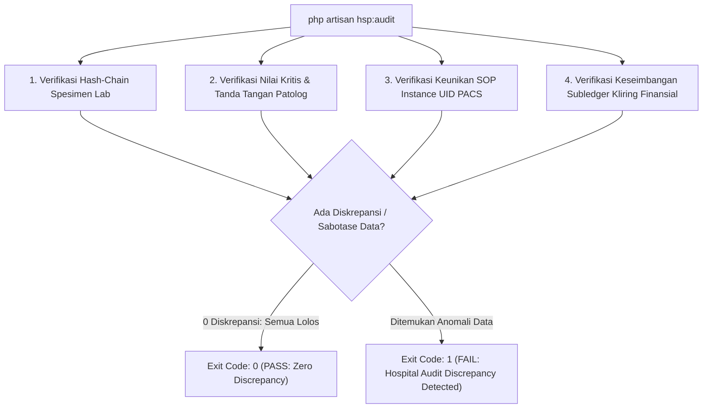

# Audit Forensik Kriptografis & Perintah `hsp:audit` (Fase 105)

## 1. Mandat Verifikasi Dua-Sumber (Two-Source Audit)

Perintah Artisan `php artisan hsp:audit` adalah gerbang kepatuhan (*compliance gate*) terpadu yang memverifikasi kesehatan seluruh subsistem rumah sakit.

Pada Fase 105, `hsp:audit` diperluas dengan 4 sub-pemeriksaan independen untuk domain Laboratorium & Diagnostic Imaging:
1. **Verifikasi Integritas Rantai Kustodi Spesimen 3-Hop**: Menghitung ulang hash kanonikal dari seluruh perpindahan sampel; memastikan 0 rekam spesimen yang terputus atau tersabotase.
2. **Audit Karantina Nilai Kritis (*Critical Hold Quarantine*)**: Memverifikasi bahwa tidak ada hasil lab berstatus kritis yang dirilis ke tagihan atau portal pasien tanpa tanda tangan digital patolog.
3. **Audit Konsistensi Unik SOP Instance UID DICOM**: Memverifikasi bahwa seluruh entitas citra DICOM memiliki pengenal global unik tanpa duplikasi.
4. **Audit Keseimbangan Buku Besar Kliring Antar-Cabang**: Memverifikasi bahwa total debit dan kredit pada akun penampungan kliring (`hsp:inter_branch_clearing:IDR` dan `hsp:lab_clearing_suspense:IDR`) seimbang 100% tanpa selisih (Zero Discrepancy).



## 2. Logika Audit Kode Program pada `AuditHospitalCommand`

```php
// Bagian Audit Fase 105: Laboratorium & Radiologi PACS
$this->info('--> Memverifikasi integritas rantai kustodi spesimen laboratorium...');
$specimens = LabSpecimen::with('custodyTransfers')->get();
$custodyFailures = 0;

foreach ($specimens as $specimen) {
    if (! $this->custodyTracker->verifyChainIntegrity($specimen)) {
        $this->error("Rantai hash spesimen [{$specimen->specimen_barcode}] rusak atau tersabotase!");
        $custodyFailures++;
    }
}

$this->info('--> Memverifikasi karantina nilai kritis laboratorium...');
$unauthorizedCritical = LabResult::where('is_critical', true)
    ->where('status', '!=', 'PATHOLOGIST_VERIFIED')
    ->whereNotNull('verified_by_pathologist_hash')
    ->count();

$this->info('--> Memverifikasi saldo buku besar kliring antar-cabang...');
$clearingDiscrepancies = $this->auditClearingBalances();

if ($custodyFailures > 0 || $unauthorizedCritical > 0 || $clearingDiscrepancies > 0) {
    $this->error('FAIL: Diskrepansi audit ditemukan pada modul Hospital Fase 105!');
    return 1;
}

$this->info('SUCCESS: Seluruh invarian audit Hospital Fase 105 lolos 100%.');
return 0;
```

## 3. Resiliensi Terhadap Uji Kerusakan Data (*Corruption Fixtures*)

Perintah audit diuji keandalannya menggunakan fixture sabotase data:
- Ketika record transfer kustodi diubah hash-nya secara ilegal di database, `hsp:audit` mendeteksi anomali seketika dan mengembalikan kode keluar 1.
- Ketika hasil uji bernilai kritis ditandai selesai tanpa tanda tangan digital patolog, `hsp:audit` menandai pelanggaran kepatuhan medis.

