# Playbook Operasional & SOP Analis Lab dan Radiografer (Fase 105)

## 1. Panduan Prosedur Operasional Standar (SOP)

Buku panduan ini mendefinisikan langkah kerja baku bagi staf laboratorium medis (ATLM), perawat phlebotomy, dokter patologi klinik, radiografer, dan dokter spesialis radiologi dalam menjalankan modul Hospital Fase 105.

```mermaid
flowchart TD
    subgraph SOPLab["SOP Laboratorium Klinik"]
        L1[1. Pengambilan Sampel Pasien & Cetak Label Barcode]
        L2[2. Pindai Hop 1: Masukkan ke Coolbox Pendingin 4 C]
        L3[3. Pindai Hop 2: Serah Terima di Lab Rujukan Pusat]
        L4[4. Jalankan Kontrol Harian Westgard QC pada Alat]
        L5[5. Analisis Sampel: Nilai Kritis Masuk CRITICAL_HOLD]
        L6[6. Notifikasi Telepon Dokter Jaga & Konfirmasi Read-Back]
        L7[7. Pengesahan Tanda Tangan Digital Patolog Klinik]
    end

    subgraph SOPRad["SOP Radiologi & PACS"]
        R1[1. Verifikasi Identitas Pasien & Riwayat Alergi Kontras]
        R2[2. Posisikan Pasien pada Modalitas CT-Scan / MRI]
        R3[3. Jalankan Protokol Sinar Rendah Sesuai Prinsip ALARA]
        R4[4. Verifikasi Angka CTDIvol & DLP Tidak Melebihi DRL]
        R5[5. Transmisi Citra DICOM ke PACS Server]
        R6[6. Radiolog Buka Viewer Zero-Footprint & Buat Ekspertise]
        R7[7. Ekspertise Selesai: Rilis Hasil & Kirim Salinan ke EMR]
    end

    L1 --> L2 --> L3 --> L4 --> L5 --> L6 --> L7
    R1 --> R2 --> R3 --> R4 --> R5 --> R6 --> R7
```

## 2. Batas Kewenangan & Persetujuan Berjenjang (Separation of Duties)

Prinsip Pemisahan Tugas (*Separation of Duties - SoD*) diberlakukan tegas pada level sistem dan hak akses rute:
1. **Perawat Phlebotomist (`nurse`)**:
   - Berwenang: Mengambil spesimen, mencetak barcode, memindai serah terima Hop 1.
   - Dilarang keras: Mengesahkan hasil lab, mengubah ambang batas kritis.
2. **Ahli Teknologi Laboratorium Medik (`atlm` / `pharmacist`)**:
   - Berwenang: Menjalankan kontrol kualitas alat, memasukkan nilai hasil mentah, menginspeksi kurva Levey-Jennings.
   - Dilarang keras: Mengesahkan hasil nilai kritis patologi secara mandiri.
3. **Dokter Spesialis Patologi Klinik (`pathologist` / `doctor`)**:
   - Berwenang: Menelaah hasil lab kritis, membubuhkan tanda tangan digital SHA-256, melepaskan penahanan hasil (*release critical hold*).
4. **Radiografer (`radiographer`)**:
   - Berwenang: Menjalankan modalitas rontgen/CT/MRI, memantau indikator dosis radiasi, mengunggah berkas DICOM ke server PACS.
   - Dilarang keras: Menulis kesimpulan ekspertise diagnostik definitif.
5. **Dokter Spesialis Radiologi (`radiologist` / `doctor`)**:
   - Berwenang: Mendiagnosis temuan citra radiologi, menandatangani ekspertise radiologi final.
6. **Auditor Medis & Finansial (`auditor`)**:
   - Berwenang: Akses baca (*read-only*) seluruh log audit, jejak kustodi, dan subledger.
   - Dilarang keras: Memodifikasi data transaksi, memicu mutasi saldo kas.

