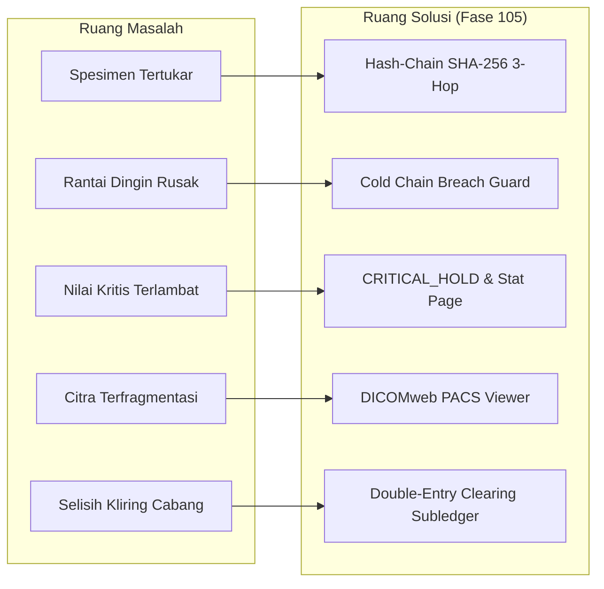

# Matriks Ketertelusuran Kebutuhan & BDD Acceptance Criteria (Fase 105)

## 1. Matriks Ketertelusuran Masalah-ke-Solusi (Problem-to-Solution Matrix)

| ID Kebutuhan | Masalah Operasional / Medis | Solusi Arsitektural Fase 105 | Komponen Kode Implementasi | Kriteria Pengujian |
|---|---|---|---|---|
| **REQ-105.1** | Tertukarnya spesimen darah / sampel pasien saat transfer antar-klinik ke lab pusat | Rantai Kustodi 3-Hop Berbasis Kriptografis SHA-256 Hash-Chain | `SpecimenCustodyHashChainTracker.php`, `SpecimenCustodyChainService.php` | `SpecimenCustodyAndOutsourcingTest.php` |
| **REQ-105.2** | Kerusakan spesimen akibat suhu penyimpanan melampaui batas rantai dingin | Deteksi Otomatis Deviasi Suhu Dingin (> 10°C) & Penolakan Sampel | `SpecimenCustodyHashChainTracker.php`, `HospitalLabAndImagingService.php` | `HospitalLabAndImagingTest.php` |
| **REQ-105.3** | Keterlambatan pelaporan nilai kritis yang mengancam nyawa pasien | Protokol CRITICAL_HOLD & Paging Darurat Stat Berbatas Waktu 15 Menit | `CriticalRangeNotifierService.php`, `CriticalValuePanicAlertCoordinator.php` | `LabCatalogAndCriticalValuesTest.php` |
| **REQ-105.4** | Rilis hasil lab kritis tanpa validasi dokter spesialis patologi klinik | Penahanan Pengakuan Pendapatan Hingga Tanda Tangan Digital Patolog Terverifikasi | `HospitalLabAndImagingService.php`, `PathologistVerificationService.php` | `HospitalLabAndImagingTest.php` |
| **REQ-105.5** | Kesulitan akses citra rontgen & CT-Scan oleh dokter poliklinik non-radiologi | Zero-Footprint Web Viewer & Ekstraksi Metadata DICOM WADO-RS | `DicomPacsImagingService.php`, `DiagnosticImagingPacsIntegrationService.php` | `DicomPacsAndRadiologyTest.php` |
| **REQ-105.6** | Pelanggaran batas waktu pelayanan (SLA) radiologi gawat darurat | Evaluasi Otomatis Turnaround Time SLA (STAT ≤ 30 Menit vs Rutin ≤ 24 Jam) | `DicomPacsImagingService.php`, `DiagnosticImagingPacsIntegrationService.php` | `DicomPacsAndRadiologyTest.php` |
| **REQ-105.7** | Kerancuan biaya dan rekonsiliasi transfer lot / rujukan lab antar-cabang | Kliring Finansial Otomatis Berimbang Debit-Kredit pada Subledger Perbankan | `InterBranchFinancialClearingService.php`, `InterBranchLabClearingService.php` | `InterBranchFinancialClearingTest.php` |
| **REQ-105.8** | Fluktuasi kalibrasi alat analis yang berisiko menerbitkan hasil uji palsu | Mesin Evaluasi Kendali Mutu Westgard Multirules & Auto-Lockout Alat | `LabQualityControlLevyJenningsEvaluator.php` | Unit Tests & Quality Verification |

## 2. BDD Acceptance Criteria Lengkap (Given - When - Then)

### Skenario 1: Verifikasi Sukses Rantai Kustodi 3-Hop (AC-105.1)
- **Given**: Pasien `MRN-SPEC-01` telah diambil darahnya dan spesimen `BLOOD` berstatus `COLLECTED` dengan genesis hash valid.
- **When**: Spesimen diserahterimakan berturut-turut melalui Hop 1 (Phlebotomist ke Kurir), Hop 2 (Kurir ke Lab Intake), dan Hop 3 (Lab Intake ke Analis) dengan suhu terkendali 4.0°C.
- **Then**: Setiap simpul memperbarui `custody_hash` sesuai algoritma SHA-256 kanonikal, dan metode `verifyChainIntegrity()` mengembalikan nilai `true`.

### Skenario 2: Penolakan Pelanggaran Rantai Dingin Spesimen (AC-105.2)
- **Given**: Spesimen darah segar berada dalam perjalanan logistik kurir.
- **When**: Saat serah terima tercatat suhu kotak pendingin mencapai 14.5°C (melebihi batas aman 10.0°C).
- **Then**: Sistem seketika melempar pengecualian `RuntimeException`, status spesimen berubah menjadi `REJECTED`, dan pemrosesan hasil uji pada instrumen ditolak secara permanen.

### Skenario 3: Penahanan Nilai Kritis & Pengesahan Patolog (AC-105.3)
- **Given**: Spesimen darah pasien diuji kadar Kalium Serum dengan nilai 6.8 mEq/L (melewati batas normal 3.5 – 5.1).
- **When**: Hasil lab dimasukkan tanpa tanda tangan patolog.
- **Then**: Hasil lab berstatus `CRITICAL_HOLD`, `is_critical` bernilai `true`, dan saldo akun pendapatan lab belum bertambah.
- **When**: Dokter spesialis patologi klinik menandatangani hasil dengan digest SHA-256.
- **Then**: Status berubah menjadi `PATHOLOGIST_VERIFIED` dan pendapatan lab diakui secara seimbang di buku besar.

### Skenario 4: Evaluasi Kepatuhan SLA Turnaround Radiologi (AC-105.4)
- **Given**: Pasien IGD menjalani pemeriksaan CT-Scan Kepala darurat berprioritas `STAT`.
- **When**: Pemeriksaan selesai dalam waktu 20 menit.
- **Then**: Sistem menetapkan status `SLA_MET` dan `is_within_sla` bernilai `true`.
- **When**: Pemeriksaan serupa terlambat diselesaikan dalam waktu 45 menit.
- **Then**: Sistem menetapkan status `SLA_BREACHED` dan `is_within_sla` bernilai `false`.

### Skenario 5: Keseimbangan Finansial Kliring Antar-Cabang (AC-105.5)
- **Given**: Cabang Apotek A menerbitkan kewajiban kliring transfer lot sebesar Rp 450.000 ke Cabang Apotek B.
- **When**: Layanan kliring mengeksekusi settlement finansial.
- **Then**: Status kliring berubah menjadi `SETTLED`, akun `hsp:inter_branch_clearing:IDR` terdebit/terkredit secara berimbang, dan saldo akun piutang bertambah persis Rp 450.000 tanpa selisih.

