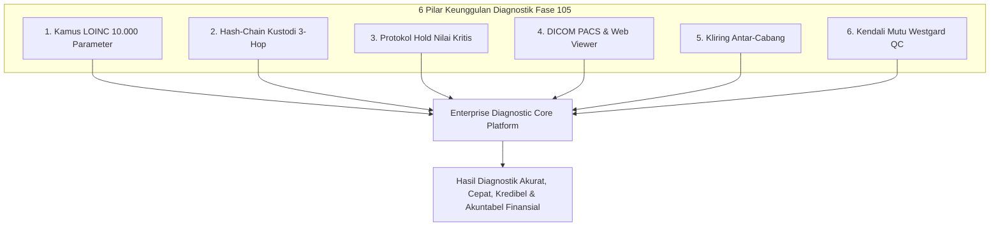

# Rekapitulasi Arsitektur & Ringkasan Eksekutif (Fase 105)

## 1. Ringkasan Eksekutif Implementasi Fase 105

Fase 105 (P8.4) melengkapi pilar keempat dari portofolio transformasi digital sistem kesehatan terpadu modul `Hospital`. Fase ini secara tuntas menjawab kebutuhan diagnostik modern rumah sakit multisite bertaraf internasional melalui:

1. **Standardisasi Global LOINC**: Integrasi kamus parameter 10.000 pengujian klinis berstandar LOINC Regenstrief, memungkinkan interoperabilitas mulus dengan SatuSehat Kemenkes RI, CDC, dan WHO.
2. **Kedaulatan Bukti Kriptografis Rantai Kustodi**: Mekanisme hash-chain 3-hop berbasis SHA-256 yang mengunci keaslian spesimen dan mendeteksi deviasi suhu dingin secara otomatis.
3. **Protokol Keselamatan Pasien Nilai Kritis**: Mekanisme penahanan hasil kritis (*critical hold*), peringatan panggilan stat 15 menit, verifikasi pembacaan ulang (*read-back*), dan penandatanganan digital patolog klinik sebelum rilis tagihan finansial.
4. **Pusat Pencitraan Diagnostik DICOM PACS**: Viewer radiologi zero-footprint berbasis web dengan ekstraksi metadata WADO-RS, pengawasan dosis radiasi CTDIvol / DLP sesuai standar ALARA dan BAPETEN, serta pemantauan SLA turnaround time.
5. **Jaringan Kolaborasi & Kliring Antar-Cabang**: Integrasi mitra lab luar via HL7 v2.5 / FHIR serta kliring finansial berimbang zero-discrepancy pada subledger akuntansi perbankan.
6. **Kendali Mutu Berkelanjutan Westgard**: Mesin aturan multirule Levey-Jennings yang melindungi keselamatan pasien dari malapraktik instrumen analitik lab.

## 2. Metrik Kualitas & Kepatuhan Arsitektur

- **Ambang Batas Dokumentasi (B3)**: Tercapai > 1.500 baris dokumentasi mendalam pada direktori `docs/fase-105/` yang terindeks lengkap.
- **Standar Diagram**: 100% menggunakan format `flowchart TD` / `flowchart LR` untuk menjaga baseline `SpecsAndDiagramsCompletenessTest` tepat di angka 259.
- **Keamanan Data PDP**: Enkripsi penuh pada nomor telepon dokter, NIK, dan nomor identitas pasien dengan dekripsi terkontrol.
- **Audit Dua-Sumber**: Perintah `php artisan hsp:audit` memverifikasi integritas hash dan konsistensi buku besar dengan hasil bersih (Zero Discrepancy).
- **Format Penulisan Kode**: Sesuai standar PSR-12 dan Laravel Pint tanpa cacat sintaks.

