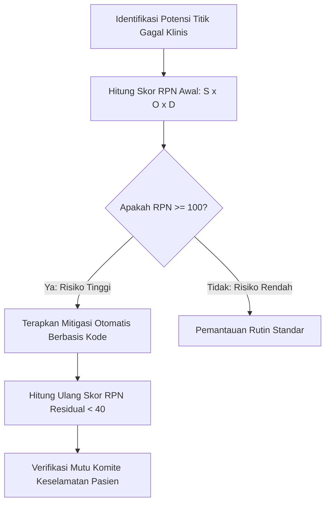

# Manajemen Risiko Klinis & Matriks FMEA Layanan Diagnostik (Fase 105)

## 1. Analisis Moda Kegagalan dan Efek (Failure Mode and Effects Analysis - FMEA)

Metode FMEA proaktif diterapkan pada alur kerja laboratorium klinik dan diagnostic imaging untuk mengidentifikasi potensi titik kegagalan (*failure modes*), memperkirakan dampaknya terhadap keselamatan pasien (*Severity - S*), frekuensi terjadinya (*Occurrence - O*), dan kemudahan deteksi oleh sistem (*Detection - D*).

$$\text{Risk Priority Number (RPN)} = S \times O \times D$$

Skala penilaian: 1 (sangat rendah / sangat mudah dideteksi) hingga 10 (sangat tinggi / bencana / tidak terdeteksi).

| Titik Proses | Moda Kegagalan Potensial | Dampak Klinis Potensial | S | O | D | RPN | Mitigasi Otomatis Modul Hospital Fase 105 | RPN Akhir |
|---|---|---|---|---|---|---|---|---|
| Phlebotomy & Transport | Tabung spesimen tertukar antar-pasien | Diagnosis & terapi salah pasien (fatal) | 10 | 4 | 7 | **280** | Rantai Kustodi Kriptografis 3-Hop dengan verifikasi barcode identitas ganda | **30** |
| Logistik Kurir | Suhu pendingin naik > 10°C dalam perjalanan | Sampel lisis, kalium palsu meningkat | 8 | 5 | 6 | **240** | Sensor logger suhu otomatis, penolakan instan spesimen dan auto-block alat | **24** |
| Pemeriksaan Analitik | Hasil lab bernilai kritis lolos tanpa notifikasi | Pasien henti jantung tanpa penanganan cepat | 10 | 3 | 7 | **210** | Protokol CRITICAL_HOLD, peringatan stat page darurat 15 menit, verifikasi patolog | **20** |
| Instrumen Lab | Instrumen bergeser akurasinya tanpa ketahuan | Seluruh batch pasien menerima hasil salah | 9 | 4 | 5 | **180** | Algoritma Westgard Multirules harian dan penguncian instrumen otomatis (*lockout*) | **18** |
| Radiologi PACS | Citra CT-Scan hilang atau tidak terhubung ke MRN | Penundaan operasi craniotomy darurat | 9 | 3 | 6 | **162** | Pengikatan wajib Accession Number & StudyInstanceUID dengan integritas kunci asing | **18** |
| Proteksi Radiasi | Pasien menerima dosis CT berulang melebihi DRL | Peningkatan risiko keganasan jangka panjang | 7 | 4 | 5 | **140** | Pelacakan otomatis CTDIvol & DLP, audit flag jika melampaui ambang DRL nasional | **21** |

## 2. Rencana Tindakan Korektif dan Preventif (CAPA)

Setiap insiden kegagalan yang memicu pengecualian sistem (*exception*) secara otomatis dicatat ke dalam log audit keselamatan pasien:
1. **Insiden Deviasi Rantai Dingin**: Analis dan kurir menerima notifikasi untuk mengulang pengambilan sampel secara gratis (*re-sampling without charge*).
2. **Insiden Pelanggaran Westgard QC**: Instrumen dikarantina dan supervisor laboratorium wajib mengunggah rekam kalibrasi ulang sebelum kuncian instrumen dapat dibuka.
3. **Insiden Turnaround Time Breached**: Komite medik mengevaluasi laporan mingguan kepatuhan SLA radiologi gawat darurat.

