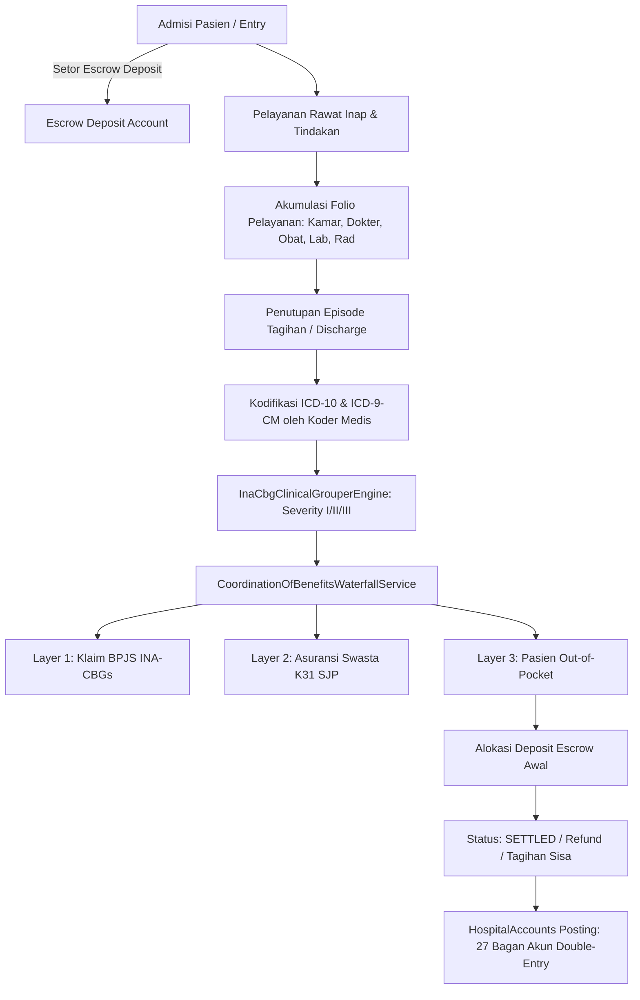
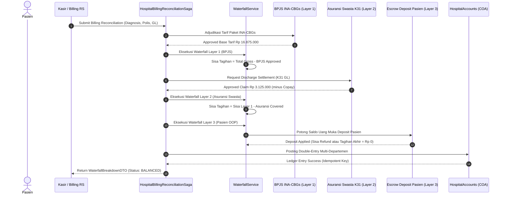
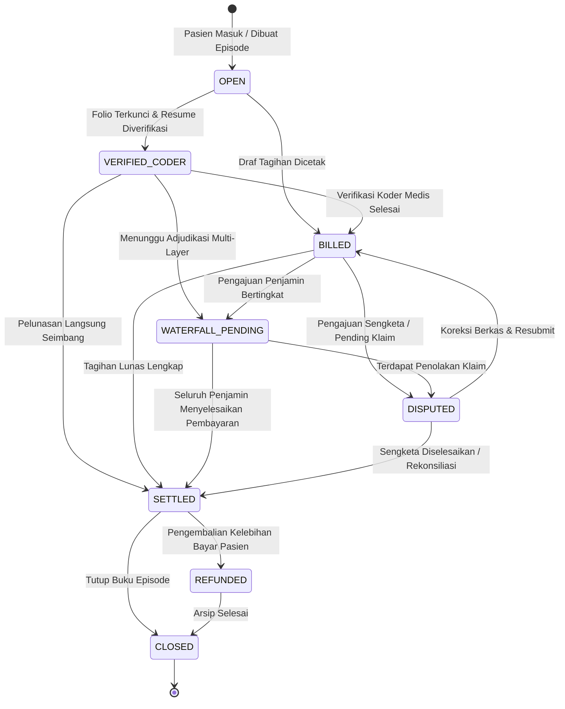

# Dokumentasi Teknis Fase 88 — Order-to-Cash (O2C) & Waterfall Coordination of Benefits

## 1. Ringkasan Eksekutif & Ruang Lingkup Bisnis

Fase 88 (P8.2) mengimplementasikan siklus pendapatan penuh (*Revenue Cycle Management* / Order-to-Cash) untuk ekosistem rumah sakit terintegrasi, yang mencakup penagihan episode rawat (*Billing Episode*), kodifikasi klinis tarif paket BPJS Kesehatan (*INA-CBGs* sesuai Permenkes RI No. 3 Tahun 2023), penjaminan bertingkat multi-asuransi (*Coordination of Benefits* / Waterfall CoB), integrasi kontrak jaminan cashless asuransi swasta (**G7-K31** `CashlessGuaranteeRequester`), pemantauan rantai dingin biologis (*Cold-Chain Surveillance*), penatausahaan limbah medis berbahaya B3 elektronik (*Festronik Chain of Custody*), serta analisis umur piutang (*Claim Aging*) dan pembukuan standar ke dalam 27 akun bagan buku besar rumah sakit (`HospitalAccounts`).

Siklus penagihan rumah sakit modern memiliki kompleksitas finansial tinggi karena pasien jarang membayar 100% secara mandiri. Sebagian besar biaya diselesaikan melalui kombinasi penjamin:
1. **Penjamin Utama (Primer)**: BPJS Kesehatan dengan sistem pembayaran prospektif berbasis kelompok tarif paket (*Casemix* / INA-CBGs).
2. **Penjamin Sekunder**: Asuransi Komersial / Swasta melalui Surat Jaminan Pelayanan (*Guarantee Letter* / SJP) cashless yang menutupi selisih naik kelas dan item non-covered.
3. **Penjamin Tersier / Pasien**: Pembayaran mandiri (*Out-of-Pocket*) untuk sisa selisih, co-payment, dan deductible, yang diserap dari deposit *escrow* saat awal admisi.

---

## 2. Model Data Billing Episode & Folio Line Items

Struktur database penagihan dirancang memisahkan akumulasi transaksi harian (*Folio Items*) dengan status agregat episode penagihan (*Billing Episode*).

### 2.1 Skema Tabel `hsp_billing_episodes`

| Kolom | Tipe Data | Deskripsi Bisnis |
| :--- | :--- | :--- |
| `id` | `BIGINT UNSIGNED AUTO_INCREMENT` | Kunci primer episode penagihan |
| `episode_code` | `VARCHAR(32) UNIQUE` | Nomor registrasi billing (e.g. `EP-20261109-A9B8C7`) |
| `encounter_id` | `BIGINT UNSIGNED FK` | Rujukan kunjungan perawatan (`hsp_encounters.id`) |
| `escrow_deposit_idr` | `BIGINT` | Saldo titipan jaminan uang muka awal pasien (IDR) |
| `total_charges_idr` | `BIGINT` | Total akumulasi biaya bruto seluruh folio pelayanan |
| `bpjs_coverage_idr` | `BIGINT` | Porsi tagihan yang disetujui ditanggung oleh BPJS |
| `insurance_copay_idr` | `BIGINT` | Porsi tagihan yang ditanggung asuransi komersial (K31) |
| `patient_share_idr` | `BIGINT` | Tanggungan akhir mandiri pasien (Out-of-Pocket) |
| `status` | `VARCHAR(32)` | Status state machine (`OPEN`, `VERIFIED_CODER`, `BILLED`, `SETTLED`, dll.) |

### 2.2 Skema Tabel `hsp_folio_items`

Setiap tindakan, visitasi dokter, obat farmasi, tes darah lab, dan sewa ranjang dicatat sebagai baris tersendiri dalam `hsp_folio_items`:
- `item_category`: Kategori pelayanan (`BED_DAY`, `PROCEDURE`, `PHARMACY`, `LAB`, `RADIOLOGY`, `CONSUMABLES`).
- `quantity`: Kuantitas unit layanan (minimal 1).
- `unit_price_idr`: Tarif satuan resmi rumah sakit.
- `subtotal_idr`: Hasil perkalian kuantitas dengan tarif satuan (`quantity * unit_price_idr`).

### 2.3 Invarian Konservasi Matematis Folio (INV-88-01)

Sistem menjamin secara ketat bahwa nilai total tagihan bruto pada billing episode selalu identik dengan jumlahan subtotal seluruh item folio:
$$\text{total\_charges\_idr} = \sum_{i=1}^{n} \text{folio\_item}_i.\text{subtotal\_idr}$$

Pelanggaran invariant ini dideteksi secara otomatis oleh perintah `php artisan hsp:audit` sebagai anomali fatal (*discrepancy*).

---

## 3. Kodifikasi Kasus Klinis INA-CBGs & Kenaikan Kelas (Permenkes 3/2023)

### 3.1 Penentuan Severity Level Berbasis Bukti Medis

Pengelompokan kasus INA-CBGs tidak hanya didasarkan pada diagnosa primer, tetapi dievaluasi bersama diagnosa sekunder dan komorbiditas:
- **Severity Level I (Ringan)**: Kasus tunggal tanpa komorbiditas signifikan atau tanpa tindakan operatif mayor.
- **Severity Level II (Sedang)**: Ditemukan komorbiditas/komplikasi standar (*Complication and Comorbidity* - CC) seperti Hipertensi esensial, Diabetes Mellitus terkontrol, Anemia, atau tindakan bedah minor.
- **Severity Level III (Berat)**: Ditemukan komplikasi mayor yang mengancam jiwa (*Major Complication and Comorbidity* - MCC) seperti Syok Kardiogenik (`R57.0`), Gagal Nafas Akut (`J96.0`), Gagal Ginjal Akut (`N17.9`), Henti Jantung (`I46.9`), atau sepsis berat.

### 3.2 Regulasi Kenaikan Kelas Rawat Inap (Permenkes RI No. 3 Tahun 2023)

Dalam program JKN BPJS Kesehatan, peserta memiliki hak kelas rawat inap tertentu (Kelas 3, Kelas 2, atau Kelas 1). Jika peserta menginginkan perawatan di kelas yang lebih tinggi, berlaku ketentuan selisih bayar kenaikan kelas:
1. **Naik Kelas 3 ke Kelas 2**: Peserta membayar selisih tarif INA-CBGs Kelas 2 dengan tarif INA-CBGs Kelas 3.
$$\text{Excess} = \text{Tarif}_{\text{Kelas 2}} - \text{Tarif}_{\text{Kelas 3}}$$
2. **Naik Kelas 2 ke Kelas 1**: Peserta membayar selisih tarif INA-CBGs Kelas 1 dengan tarif INA-CBGs Kelas 2.
$$\text{Excess} = \text{Tarif}_{\text{Kelas 1}} - \text{Tarif}_{\text{Kelas 2}}$$
3. **Naik Kelas 3 ke Kelas 1**: Peserta membayar selisih tarif INA-CBGs Kelas 1 dengan tarif INA-CBGs Kelas 3.
$$\text{Excess} = \text{Tarif}_{\text{Kelas 1}} - \text{Tarif}_{\text{Kelas 3}}$$
4. **Naik ke Kelas VIP / Eksekutif**: Selisih bayar ditetapkan paling banyak sebesar **75% dari tarif INA-CBGs Kelas 1** (atau kelas hak peserta) sesuai plafon maksimal Permenkes 3/2023:
$$\text{Excess}_{\text{VIP}} = \min\left(0.75 \times \text{Tarif}_{\text{Hak}}, \text{Plafon Maksimal}\right)$$

Ketentuan ini dihitung secara matematis presisi oleh method `InaCbgTariff::calculateClassUpgradeExcess()` dan diuji pada skenario acceptance test.

---

## 4. Mekanisme Koordinasi Manfaat Penjaminan Bertingkat (Waterfall CoB Engine)

Eksekusi penjaminan bertingkat berjalan berurutan (*sequential multi-layer waterfall*):

### 4.1 Invarian Konservasi Nilai Waterfall (INV-88-02)

Total nilai tagihan bruto rumah sakit harus selalu tertutup seimbang tanpa defisit yang tidak teralokasi:
$$\text{Total Gross} = \text{Porsi BPJS} + \text{Porsi Asuransi Swasta} + \text{Porsi Pasien OOP}$$
Di mana tanggungan pasien mandiri diselesaikan melalui:
$$\text{Porsi Pasien OOP} = \text{Deposit Terpakai} + \text{Pelunasan Kas/Bank Tunai}$$

Jika deposit pasien melebihi tanggungan mandiri, selisihnya dikembalikan sebagai hak pasien (*Patient Refund*).

---

## 5. State Machine Siklus Hidup Billing Episode

Transisi status billing diatur secara ketat melalui `BillingEpisodeStateMachine`:

Aturan validasi transisi:
- Tidak boleh melompat ke status `SETTLED` jika total pertanggungan ditambah deposit masih lebih kecil dari total tagihan bruto.
- Pembatalan atau penutupan buku hanya sah jika saldo episode telah nol.
