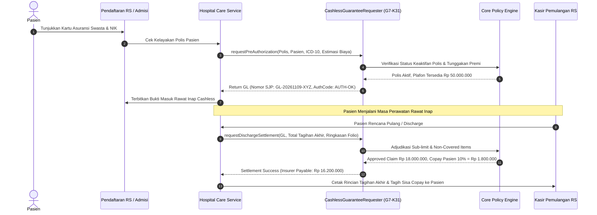

# Spesifikasi Teknis Kontrak G7-K31 — Cashless Guarantee Requester

## 1. Latar Belakang & Peran Antar Modul

Dalam arsitektur modular perusahaan, modul **Insurance** mengelola polis pertanggungan, manajemen risiko, reasuransi, dan adjudikasi santunan. Di sisi lain, modul **Hospital** mengelola operasional klinis, perawatan tempat tidur, dan penagihan pasien.

Untuk menghubungkan kedua domain bisnis ini tanpa melanggar batas modularitas (*encapsulation*), dirancang kontrak formal **G7-K31** (`Modules\Insurance\Contracts\CashlessGuaranteeRequester`). Kontrak ini memungkinkan rumah sakit:
1. Mengajukan pra-otorisasi (*Pre-Authorization*) saat pasien pertama kali mendaftar atau direncanakan rawat inap, guna menerbitkan Surat Jaminan Pelayanan awal (*Initial Guarantee Letter* / GL).
2. Memeriksa sisa plafon jaminan (*Remaining Benefit Limit*) secara real-time selama masa perawatan.
3. Mengajukan rekonsiliasi dan pelunasan kepulangan (*Discharge Settlement*) saat pasien selesai dirawat untuk mendapatkan persetujuan pembayaran cashless akhir dari perusahaan asuransi.

Kontrak ini melengkapi kontrak parametrik **G7-K29** (`ParametricTriggerRecorder`) yang sebelumnya diimplementasikan pada Fase P7 di modul Insurance yang sama. Keduanya didaftarkan bersamaan di `InsuranceServiceProvider` sesuai prinsip union binding (Aturan Q4f).

---

## 2. Definisi Antarmuka Kontrak G7-K31

Antarmuka PHP didefinisikan secara deklaratif dengan tipe ketat:

```php
namespace Modules\Insurance\Contracts;

interface CashlessGuaranteeRequester
{
    /**
     * Mengajukan pra-otorisasi penerbitan Guarantee Letter awal admisi.
     *
     * @param  string  $policyNumber  Nomor polis asuransi aktif peserta
     * @param  string  $patientId  ID pasien atau nomor rekam medis
     * @param  string  $admissionDiagnosisCode  Kode diagnosa awal ICD-10
     * @param  int  $estimatedCostIdr  Estimasi biaya perawatan dalam satuan rupiah (IDR integer)
     * @param  string  $hospitalCode  Kode registrasi rumah sakit penjamin
     * @param  array<string, mixed>  $metadata  Data klinis tambahan
     * @return array<string, mixed> Data penerbitan SJP / GL awal
     */
    public function requestPreAuthorization(
        string $policyNumber,
        string $patientId,
        string $admissionDiagnosisCode,
        int $estimatedCostIdr,
        string $hospitalCode,
        array $metadata = []
    ): array;

    /**
     * Mengajukan kalkulasi dan settlement pelepasan/pemulangan klaim cashless.
     *
     * @param  string  $guaranteeNumber  Nomor Guarantee Letter rujukan pra-otorisasi
     * @param  int  $finalBilledAmountIdr  Total biaya bruto akhir tagihan rumah sakit (IDR)
     * @param  array<string, mixed>  $itemizedFolioSummary  Ringkasan rincian tagihan per kategori
     * @param  array<string, mixed>  $dischargeSummary  Resume medis akhir
     * @return array<string, mixed> Rincian adjudikasi klaim
     */
    public function requestDischargeSettlement(
        string $guaranteeNumber,
        int $finalBilledAmountIdr,
        array $itemizedFolioSummary,
        array $dischargeSummary = []
    ): array;

    /**
     * Memeriksa status klaim atau sisa plafon jaminan aktif.
     *
     * @param  string  $guaranteeNumber  Nomor Guarantee Letter
     * @return array<string, mixed> Status jaminan aktif
     */
    public function queryGuaranteeStatus(string $guaranteeNumber): array;
}
```

---

## 3. Alur Kerja Pra-Otorisasi & Pelunasan Cashless



---

## 4. Struktur Data Kontrak & Format Pertukaran Pesan

### 4.1 Permintaan Pra-Otorisasi (`requestPreAuthorization`)

Input parameter payload:
```json
{
  "policy_number": "POL-PRUDENTIAL-987654321",
  "patient_id": "MRN-0019283",
  "admission_diagnosis_code": "I21.0",
  "estimated_cost_idr": 25000000,
  "hospital_code" : "HSP-METRO-01",
  "metadata": {
    "entitled_class": "CLASS_1",
    "attending_doctor_id": 42,
    "admission_channel": "EMERGENCY_ROOM"
  }
}
```

Respons keluaran yang dijamin kontrak:
```json
{
  "guarantee_number": "GL-20261109-8B7A1C0F",
  "policy_number": "POL-PRUDENTIAL-987654321",
  "patient_id": "MRN-0019283",
  "hospital_code": "HSP-METRO-01",
  "diagnosis_code": "I21.0",
  "approved_limit_idr": 25000000,
  "deductible_idr": 1250000,
  "status": "APPROVED",
  "auth_code": "AUTH-7F9C2A",
  "valid_until": "2026-11-16T10:30:00+08:00",
  "notes": "Pra-otorisasi disetujui untuk perawatan standar sesuai kelas polis."
}
```

### 4.2 Pelunasan Discharge (`requestDischargeSettlement`)

Respons kalkulasi adjudikasi final:
```json
{
  "guarantee_number": "GL-20261109-8B7A1C0F",
  "gross_billed_idr": 24500000,
  "eligible_cost_idr": 24500000,
  "approved_claim_idr": 24500000,
  "insurer_payable_idr": 22050000,
  "copay_amount_idr": 2450000,
  "patient_excess_idr": 2450000,
  "settlement_status": "SETTLED",
  "adjudicated_at": "2026-11-09T14:15:22+08:00",
  "transaction_reference": "SETTLE-XYZ9876543"
}
```

---

## 5. Registrasi Service Provider & Aturan Union Binding (Q4f)

Di `modules/Insurance/InsuranceServiceProvider.php`:
```php
public function register(): void
{
    // Binding lama G7-K29 (ParametricTriggerRecorder) DIPERTAHANKAN
    $this->app->bind(
        ParametricTriggerRecorder::class,
        ParametricTriggerRecorderService::class
    );

    // Binding baru G7-K31 (CashlessGuaranteeRequester) DITAMBAHKAN
    $this->app->bind(
        CashlessGuaranteeRequester::class,
        CashlessGuaranteeRequesterService::class
    );
}
```

Dengan konfigurasi ini, ketergantungan modul Hospital pada `CashlessGuaranteeRequester` diselesaikan secara elegan melalui *Dependency Injection* tanpa *tight coupling* langsung ke kelas implementasi internal modul Insurance.
