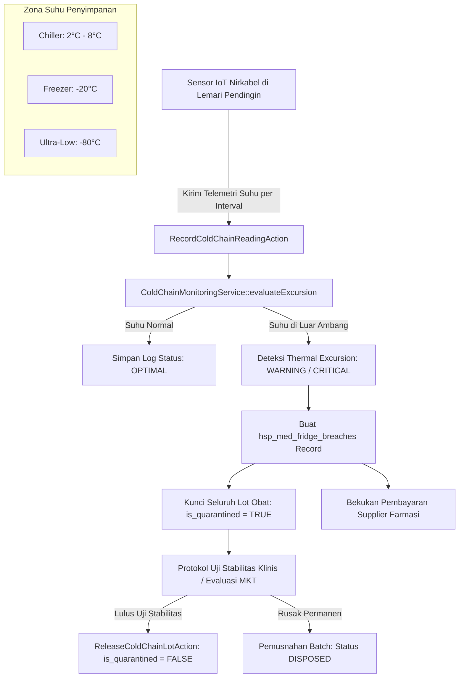
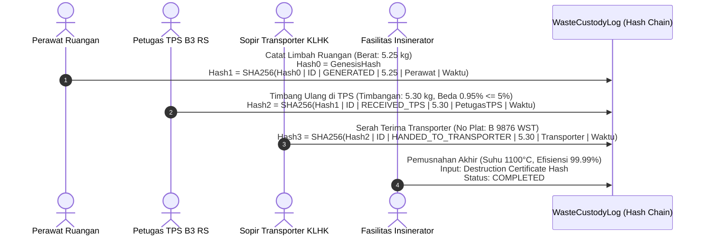

# Dokumentasi Teknis — Pemantauan Cold-Chain Farmasi & Rantai Kustodi Limbah Medis B3

## 1. Arsitektur Pemantauan Rantai Dingin Farmasi (Cold-Chain Surveillance)

Sebagian besar obat biologis modern, termasuk vaksin, eritropoietin, insulin, antibodi monoklonal, produk darah, dan reagen laboratorium diagnostik, bersifat termolabil (*temperature-sensitive*). Paparan suhu di luar rentang aman dapat memicu denaturasi protein ireversibel, kehilangan potensi imunogenik, atau bahkan pembentukan senyawa agregat toksik.

Sistem pemantauan cold-chain pada modul Hospital mengintegrasikan telemetri sensor IoT kontinu, evaluasi batas kritis (*threshold evaluation*), deteksi ekskursi termal (*thermal excursion*), kuncian karantina otomatis stok farmasi (*automatic lot quarantine*), serta penahanan hutang suplier (*supplier payable freeze*).

---

## 2. Kalkulasi Mean Kinetic Temperature (MKT) Persamaan Arrhenius

Pengukuran rata-rata aritmatika sederhana sering kali menyesatkan karena degradasi kinetik produk biologis meningkat secara non-linear (eksponensial) seiring naiknya suhu. Standar internasional FDA & Pharmacopeia (USP <1150>) mewajibkan penggunaan **Mean Kinetic Temperature (MKT)**:

$$T_{\text{MKT}} = \frac{\frac{\Delta H}{R}}{-\ln\left( \frac{\sum_{i=1}^{n} e^{-\frac{\Delta H}{R \cdot T_i}}}{n} \right)}$$

Di mana:
- $\Delta H$: Energi aktivasi degradasi ($83.144\text{ kJ/mol}$ untuk standar farmasi biologis).
- $R$: Konstanta gas universal ($0.008314462\text{ kJ/(mol}\cdot\text{K)}$).
- $T_i$: Nilai suhu pembacaan ke-$i$ dalam skala Kelvin ($^\circ\text{C} + 273.15$).
- $n$: Jumlah total pembacaan sampel suhu.

Implementasi dalam `VaccineThermalStabilityCalculator`:
1. Mengonversi seluruh sampel Celcius ke Kelvin.
2. Menghitung jumlahan eksponensial Boltzmann.
3. Menghitung MKT dalam derajat Celcius.
4. Mengevaluasi apakah lonjakan suhu telah merusak masa simpan obat (*shelf-life impact*).

---

## 3. Penatausahaan Limbah Medis B3 & Festronik (Chain of Custody Elektronik)

Rumah sakit menghasilkan limbah bahan berbahaya dan beracun (B3) medis dalam jumlah besar: benda tajam, jaringan patologis, limbah sitotoksik kemoterapi, dan limbah infeksius. Regulasi nasional **Permen LHK No. P.56/2015** mewajibkan manifest elektronik (*Festronik*) dengan rantai pengawasan tak terputus (*Chain of Custody*).

### 3.1 Pengelompokan & Standar Kemasan Wadah Limbah

| Kategori Limbah | Kode Warna Kantong / Wadah | Jenis Kontainer | Batas Simpan Suhu Ruang | Metode Pemusnahan Akhir |
| :--- | :--- | :--- | :--- | :--- |
| **SHARPS** | Kuning / Safety Box | Kotak Tahan Tusukan (*Puncture-Proof*) | Maks. 48 jam | Autoclave Shredder / Insinerasi |
| **INFECTIOUS** | Kuning / Kantong Biohazard | Plastik Tebal Min. 70 Mikron | Maks. 48 jam | Insinerator Suhu Tinggi $\ge 1000^\circ\text{C}$ |
| **PATHOLOGICAL**| Kuning / Kantong Ganda | Wadah Tertutup Rapat Kedap Cairan | Maks. 24 jam | Insinerator Khusus / Kremasi |
| **PHARMACEUTICAL**| Cokelat | Kantong Plastik Standar Kuat | Maks. 30 hari | Insinerator Suhu Tinggi $\ge 1200^\circ\text{C}$ |
| **CYTOTOXIC** | Ungu | Drum Khusus Tertutup Segel | Maks. 48 jam | Rotary Kiln Insinerator $\ge 1200^\circ\text{C}$ |

### 3.2 Rantai Kustodi Festronik Kriptografis (SHA-256 Hash Chain)

Untuk mencegah pembuangan limbah medis secara liar (*illegal dumping*) dan manipulasi selisih timbangan antara rumah sakit, transporter, dan pengolah, setiap tahap perpindahan limbah disegel dengan rantai hash kriptografis:

Rumus perhitungan hash segel:
$$\text{CurrentHash}_k = \text{SHA-256}\left( \text{PrevHash}_{k-1} \,\|\, \text{ManifestID} \,\|\, \text{EventType} \,\|\, \text{WeightKg} \,\|\, \text{HandlerParty} \,\|\, \text{TimestampIso} \right)$$

### 3.3 Deteksi Manipulasi & Audit Invarian (INV-88-04)

Fungsi `MedicalWasteManifestService::verifyCustodyChainIntegrity()` memverifikasi keutuhan rantai hash secara rekursif dari awal hingga akhir. Jika terjadi perubahan sekecil apa pun pada data berat atau petugas di basis data secara ilegal, perhitungan hash berikutnya akan berbeda secara drastis (*avalanche effect*), dan audit `php artisan hsp:audit` akan langsung menandai pelanggaran keamanan (*discrepancy detected*).
