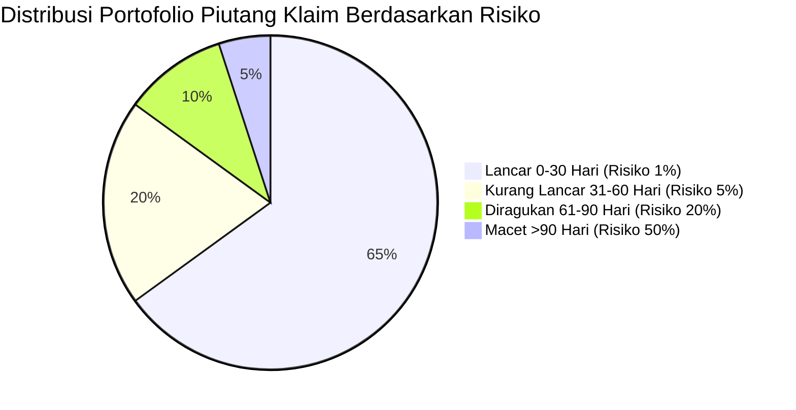
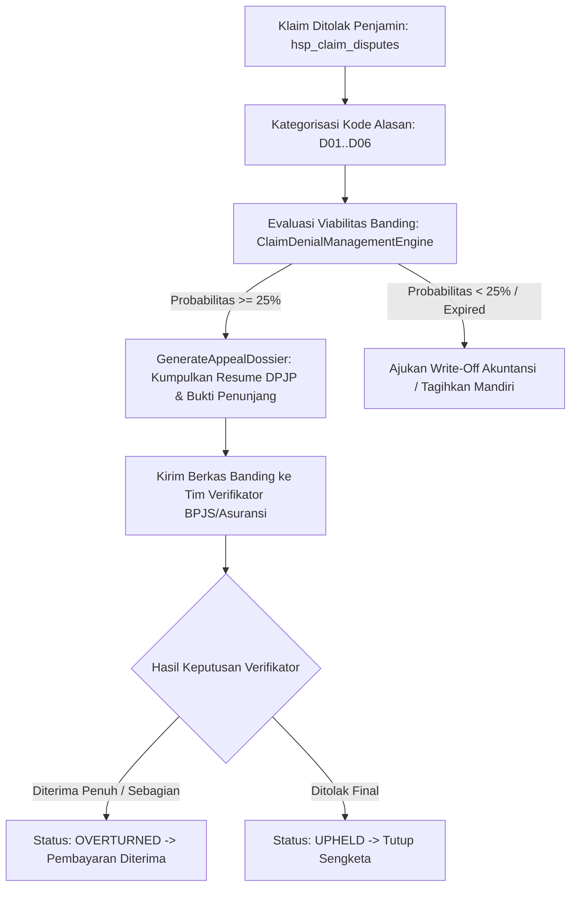

# Dokumentasi Teknis — Analisis Umur Piutang Klaim (Aging) & Integrasi Akuntansi Rumah Sakit

## 1. Analisis Umur Piutang Klaim (Claim Aging & Impairment Analysis)

Piutang klaim asuransi kesehatan (BPJS Kesehatan dan Asuransi Swasta) merupakan salah satu pos aset lancar terbesar pada neraca rumah sakit. Keterlambatan pembayaran (*cash delay*) atau penolakan klaim (*claim denial*) dapat mengganggu likuiditas operasional rumah sakit jika tidak dipantau secara ketat.

Layanan `ClaimAgingAnalysisService` mengelompokkan seluruh piutang klaim beredar ke dalam 4 ember umur waktu (*aging buckets*):
1. **Lancar (0 - 30 hari)**: Klaim baru diajukan, dalam proses verifikasi administrasi standar.
2. **Kurang Lancar (31 - 60 hari)**: Melebihi siklus pembayaran normal, membutuhkan kontak proaktif ke penjamin.
3. **Diragukan (61 - 90 hari)**: Berkas memiliki catatan perbaikan koding klinis atau permintaan resume medis tambahan.
4. **Macet (> 90 hari)**: Sengketa klaim berat yang berpotensi kadaluarsa atau membutuhkan intervensi komite medik.

### 1.1 Model Kerugian Kredit Ekspektasian (Expected Credit Loss / Allowance)

Sesuai standar akuntansi keuangan (PSAK 71 / IFRS 9), rumah sakit wajib membentuk cadangan penurunan nilai piutang tak tertagih (*Impairment Allowance*) berdasarkan estimasi kerugian ekspektasian:

$$\text{Allowance} = \sum_{b \in \text{Buckets}} \text{Saldo}_b \times P_b$$

Di mana persentase provisi risiko $P_b$ ditetapkan berdasarkan probabilitas historis:
- **0 - 30 hari**: $1\%$ provisi umum.
- **31 - 60 hari**: $5\%$ provisi kurang lancar.
- **61 - 90 hari**: $20\%$ provisi diragukan.
- **> 90 hari**: $50\%$ provisi macet.

---

## 2. Manajemen Sengketa & Banding Klaim (Dispute & Denial Management)

Ketika pihak penjamin menolak membayar klaim (*Claim Denial*), sistem tidak langsung menghapus piutang (*write-off*), melainkan memicu siklus banding (*Appeal Process*):

### 2.1 Peta Alasan Penolakan Klaim Standar

- **D01**: Resume Medis Tidak Lengkap atau Tidak Ditandatangani DPJP (Probabilitas banding: 88%).
- **D02**: Ketidaksesuaian Koding ICD-10 Diagnosa Primer dengan ICD-9-CM Prosedur (Probabilitas banding: 72%).
- **D03**: Keterlambatan Pengajuan Melebihi Batas Waktu Regulasi 15 Hari (Probabilitas banding: 15%).
- **D04**: Tindakan Tanpa Surat Jaminan Pra-Otorisasi Awal (Probabilitas banding: 60%).
- **D05**: Indikasi Rawat Inap Dipertanyakan oleh Tim Kendali Mutu & Biaya (Probabilitas banding: 55%).
- **D06**: Dugaan Tagihan Ganda Episode Perawatan yang Sama (Probabilitas banding: 80%).

---

## 3. Integrasi Akuntansi Double-Entry Bagan Akun `HospitalAccounts` (27 COA)

Modul Hospital mengimplementasikan 27 kode akun standar (*Chart of Accounts*) yang terdaftar pada sistem akuntansi sentral:

| Kode Akun | Nama Akun Buku Besar | Jenis Akun | Posisi Normal |
| :--- | :--- | :--- | :--- |
| `hsp:cash:IDR` | Hospital Cash On Hand | ASSET | DEBIT |
| `hsp:patient_receivable:IDR` | Hospital Patient Receivable | ASSET | DEBIT |
| `hsp:bpjs_receivable:IDR` | Hospital BPJS INA-CBG Receivable | ASSET | DEBIT |
| `hsp:insurance_receivable:IDR` | Hospital Private Insurance Receivable | ASSET | DEBIT |
| `hsp:hospital_revenue:IDR` | Hospital Inpatient & Outpatient Revenue | REVENUE | CREDIT |
| `hsp:doctor_fee_revenue:IDR` | Hospital Outpatient Doctor Fee Revenue | REVENUE | CREDIT |
| `hsp:pharmacy_revenue:IDR` | Hospital Pharmacy Revenue | REVENUE | CREDIT |
| `hsp:lab_revenue:IDR` | Hospital Central Lab Revenue | REVENUE | CREDIT |
| `hsp:imaging_revenue:IDR` | Hospital Imaging Center Revenue | REVENUE | CREDIT |
| `hsp:bpjs_claim_variance:IDR` | Hospital BPJS Claim Rate Variance | REVENUE | CREDIT |
| `hsp:bpjs_rejected_claim:IDR`| Hospital BPJS Rejected Claim Expense | EXPENSE | DEBIT |

### 3.1 Pola Jurnal Pembukuan Waterfall Settlement

Ketika episode penagihan diselesaikan (*Settlement*), sistem secara atomik membuat entri jurnal akuntansi berpasangan seimbang (*balanced double-entry*):

$$\sum \text{Debit} = \sum \text{Kredit}$$

Contoh jurnal penyelesaian episode rawat inap:
1. **Debit**: Piutang BPJS Kesehatan (`hsp:bpjs_receivable:IDR`) = Rp 15.000.000
2. **Debit**: Piutang Asuransi Swasta (`hsp:insurance_receivable:IDR`) = Rp 3.000.000
3. **Debit**: Piutang / Kas Pasien Mandiri (`hsp:patient_receivable:IDR`) = Rp 2.000.000
4. **Kredit**: Pendapatan Pelayanan Rumah Sakit (`hsp:hospital_revenue:IDR`) = Rp 20.000.000

Dengan metode ini, setiap rupiah pendapatan perawatan tercatat secara transparan dengan audit trail lengkap dan tidak ada selisih yang tidak terjelaskan dalam pembukuan buku besar perusahaan.
