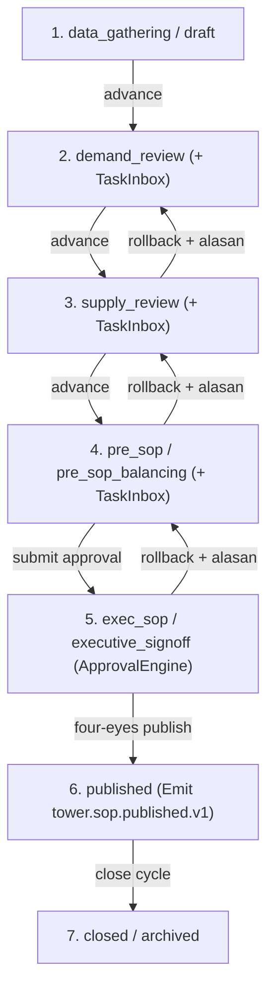
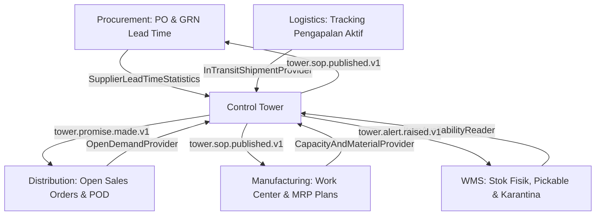

# Konsep Arsitektur Supply Chain Control Tower & S&OP (Fase 53)

## 1. Visi dan Arsitektur End-to-End Rantai Pasok Terpadu

Supply Chain Control Tower (`modules/ControlTower/`, prefiks tabel `sct_`) berperan sebagai pusat orkestrasi visibilitas, perencanaan konsensus, manajemen risiko pasokan, evaluasi kinerja pemasok, analisis modal kerja persediaan, hingga simulasi skenario Digital Twin tanpa melakukan posting jurnal akuntansi langsung. Arsitektur ini menghubungkan lima simpul fisik dan digital secara end-to-end:

1. **Pemasok Hulu (`SUPPLIER` — terintegrasi `Procurement` & `Supplier`):**
   - Memantau ketepatan jadwal kedatangan (*On-Time Delivery*), rata-rata serta standar deviasi *lead time* riil melalui kontrak `Modules\Procurement\Contracts\SupplierLeadTimeStatistics`.
   - Menghitung skor komposit pemasok (tiering `STRATEGIC` hingga `AT_RISK`) sebagai umpan balik perencanaan pengadaan dan pemetaan risiko pesanan.
2. **Simpul Transit & Kepabeanan (`PORT` / `IN_TRANSIT` — terintegrasi `Logistics`):**
   - Melacak kargo pengiriman dalam perjalanan serta memantau keterlambatan melewati batas SLA (`> 72` jam) melalui `Modules\Logistics\Contracts\InTransitShipmentProvider`.
   - Memberikan sinyal awal terhadap risiko keterlambatan bahan baku maupun barang jadi sebelum mencapai gudang.
3. **Fasilitas Manufaktur (`PLANT` — terintegrasi `Manufacturing`):**
   - Mengambil jadwal penerimaan Master Production Schedule (`mpsReceipts`), kapasitas kerja mesin kumulatif, dan ketersediaan bahan baku BOM melalui `Modules\Manufacturing\Contracts\CapacityAndMaterialProvider`.
   - Menjadi dasar pembatasan realistis untuk janji pesanan *Capable-to-Promise* (CTP) dan tinjauan kapasitas pada tahap *Supply Review* S&OP.
4. **Pusat Distribusi & Gudang (`DC` / `WAREHOUSE` — terintegrasi `Wms` & `Store`):**
   - Mengagregasi stok tersedia fisik bebas reservasi dan bebas karantina melalui kontrak `Modules\Wms\Contracts\StockAvailabilityReader` serta `Modules\ControlTower\Contracts\ItemAvailabilityReader`.
   - Mengelola usia lot tertua untuk deteksi dini risiko kedaluwarsa, persediaan bergerak lambat (*slow-moving*), serta stok mati (*dead stock*).
5. **Distribusi Hilir & Pelanggan (`DISTRIBUTOR` / `OUTLET` — terintegrasi `Distribution`):**
   - Menghitung komitmen pesanan distribusi terbuka (`commitmentsByPeriod`) dan fakta pemenuhan historis (`fulfillmentLines`) via `Modules\Distribution\Contracts\OpenDemandProvider`.
   - Mengubah data pemenuhan aktual menjadi metrik kinerja eksekutif integer permil (`otif_permil`, `fill_rate_permil`) dan mengevaluasi janji pengiriman lewat `PromiseQuoteInterface`.

---

## 2. Pemisahan Domain Analitis & Prinsip Non-Ledger (`ADR-053` / D98)

Sesuai Keputusan Arsitektur `ADR-053`:
- **RAB Posting Ledger = 0:** Tidak terdapat aliran uang riil yang terbit langsung dari `ControlTower`. Angka nominal pada `sct_sop_cycles` (proyeksi margin kotor & dampak kas), `sct_twin_scenarios` (estimasi delta margin), dan `sct_inventory_health_snapshots` (nilai kapital tertahan & risiko keusangan) dicatat sebagai bilangan bulat minor IDR (`int64` / `bigInteger`) untuk kebutuhan analisis manajemen.
- **Kepatuhan Boundary Monolit Modular:** Seluruh akses data keluar modul dilakukan melalui antarmuka kontrak eksplisit. Pembacaan langsung tabel `wms_*`, `mfg_*`, `dist_*`, `prc_*`, `store_*`, atau `sup_*` dari dalam `ControlTower` dilarang keras dan diaudit secara otomatis oleh `arch:scan` (`Aturan A1 & A2`).

---

## 3. Visibilitas Inventori Multi-Eselon & Kesehatan Persediaan (53.1 & X53-3)

Setiap simpul menyimpan empat variabel dasar pada `sct_echelon_stocks`:
- `on_hand_qty`: unit fisik tersedia di lokasi.
- `in_transit_qty`: unit berstatus pengiriman antar-eselon menuju simpul tujuan.
- `reserved_qty`: unit yang dikunci terhadap janji pesanan ATP aktif.
- `safety_stock_qty`: ambang batas pengaman dinamis hasil algoritma `MultiEchelonSafetyStock`.

Atas posisi multi-eselon tersebut, `InventoryHealthAnalyzer` (`X53-3`) mengevaluasi efisiensi modal kerja:
- Memetakan umur lot tertua ke dalam 4 bucket (`0-30`, `31-90`, `91-180`, `>180` hari).
- Mengklasifikasikan setiap SKU pada setiap eselon ke status `DEAD_STOCK`, `SLOW_MOVING`, `EXCESS`, `SHORTAGE_RISK`, atau `HEALTHY`.
- Mengukur *Days of Supply* ($DOS = \text{intdiv}(\text{on\_hand}, \max(1, \text{daily\_demand}))$) dan menghitung total modal tertahan maupun eksposur risiko obsolet dalam satuan IDR integer.

---

## 4. Peramalan Permintaan & Kolaborasi Override Terkendali (53.2 & X53-4)

- **Seleksi Model Otomatis (`ForecastModelSelector` I2):** Mengevaluasi tiga model matematis rasional berpresisi tetap (`scale = 10_000`) yaitu Single Exponential Smoothing (`SES`), Holt Linear Trend (`HOLT`), dan Croston Intermittent (`CROSTON`) menggunakan *walk-forward backtest* hingga 6 periode terakhir. Model dengan `mae_scaled` terendah dipilih secara deterministik (`SES -> HOLT -> CROSTON` saat seri identik).
- **Override Kolaboratif (`ForecastOverrideService` X53-4):** Perencana penjualan dapat mengusulkan perubahan angka statistik baseline bila terdapat promo, peluncuran produk baru, atau penutupan gerai. Sistem mewajibkan alasan bisnis tertulis, menghitung deviasi dalam basis points (`deviation_bps`), memicu alur persetujuan untuk deviasi signifikan, serta mendukung pengembalian ke baseline (*revert*) kapan saja sebelum publikasi S&OP.

---

## 5. Orkestrasi Siklus Bulanan S&OP 7-Status Kolaboratif (53.3)

`SopCycleStateMachine` mengorkestrasi siklus S&OP bulanan dengan alur terstruktur serta dukungan kompatibilitas mundur:

Setiap perubahan status wajib melewati `SopPublicationOrchestrator` / `TransitionSopCycleAction`, memicu pencatatan permanen di `sct_sop_events`, menegakkan aturan wajib alasan untuk transisi mundur, membuat tugas kotak masuk di `TaskInboxService` pada tahap tinjauan, serta memverifikasi aturan *four-eyes* melalui `ApprovalEngineInterface` sebelum event `tower.sop.published.v1` dipancarkan ke outbox.

---

## 6. Mesin Janji Pesanan ATP/CTP Berbasis Kapasitas Nyata (53.4 & I1)

`PromiseQuoteService` mengimplementasikan `PromiseQuoteInterface` sebagai satu-satunya gerbang eksternal evaluasi janji pesanan:
1. Membaca ketersediaan bersih melalui `ItemAvailabilityReader`.
2. Mengambil jadwal `mpsReceipts` dan `cumulativeByPeriod` dari `Manufacturing`.
3. Mengambil `commitmentsByPeriod` dari `Distribution`.
4. Menjalankan `AtpCtpNetter` lintas periode `1..T` guna menentukan status `on_time`, `late` (disertai `late_periods`), atau `cannot_promise` beserta kode alasan spesifik (`INSUFFICIENT_CAPACITY`, `INSUFFICIENT_MATERIAL`, `HORIZON_EXCEEDED`).
5. Memastikan eksekusi atomik idempoten berdasarkan `idempotency_key` (menolak payload berbeda melalui `IdempotencyConflictException`) dan menerbitkan event `tower.promise.made.v1`.

---

## 7. Klasifikasi ABC/XYZ, Safety Stock Dinamis, Risiko & Pemasok (53.5, 53.6, X53-1, X53-2)

- **Multi-Echelon Safety Stock (`MultiEchelonSafetyStock` I3):** Menggabungkan variabilitas permintaan pelanggan dengan ketidakpastian kedatangan pemasok riil (`SupplierLeadTimeStatistics`) untuk menghasilkan kuantitas stok pengaman dan titik pesan ulang (*reorder point*). Pembaruan kebijakan diproses secara terkendali via usulan dan keputusan persetujuan four-eyes (`DecideSafetyStockProposalAction`).
- **Penilaian Risiko Pesanan (`OrderRiskScorer` X53-1):** Mengagregasi empat sinyal operasional (defisit ATP/CTP, variabilitas pemasok, umur lot tertua, dan pengiriman in-transit terlambat) ke dalam skor `0..1000` dengan kategori `LOW`, `MEDIUM`, `HIGH`, hingga `CRITICAL`.
- **Alert Disrupsi & Realokasi Terpersetujuan:** `AlertScannerService` men-scan anomali secara idempoten berdasar `dedup_key`, memancarkan `tower.alert.raised.v1`, dan menyusun usulan pemindahan antar-gudang (`proposeReallocation`) yang hanya mengeksekusi mutasi setelah ditinjau oleh operator/planner.
- **Kartu Skor Pemasok (`SupplierScorecardService` X53-2):** Memadukan ketepatan waktu OTD (45%), konsistensi lead time (30%), dan kecukupan riwayat sampel (25%) untuk mengelompokkan pemasok beserta analisis tren bulanan.

---

## 8. KPI Eksekutif Terukur & Digital Twin Sandbox (53.7 & 53.8)

- **KPI Operasional Nyata:** `ControlTowerKpiDrilldownService` membaca fakta pemenuhan pesanan dari `OpenDemandProvider::fulfillmentLines()` untuk menyajikan `otif_permil`, `fill_rate_permil`, DOS, Cash-to-Cash, serta jumlah stockout secara transparan hingga level pesanan tunggal (`ON_TIME`, `LATE`, `SHORT`, `OPEN`).
- **Digital Twin Bebas Mutasi (`TwinWhatIfOrchestratorService`):** Mengisolasi skenario kejut (`PORT_CLOSURE`, `MATERIAL_INFLATION`, `SUPPLY_DELAY`, `DEMAND_SPIKE`, `SUPPLIER_LOSS`, `WAREHOUSE_CAPACITY`) menggunakan `ControlTowerTwinTickHandler` dan validasi kesetaraan checksum SHA-256 sebelum vs sesudah eksekusi.

---

## 5. Prinsip Konservasi Fisik, Non-Ledger, dan Pemisahan Tugas (`Control Tower`)

### 5.1 Mengapa Control Tower Bersifat Non-Ledger (`RAB = 0`)
Modul Control Tower bertindak sebagai otak perencanaan (*planning & orchestration layer*) yang membaca kondisi fisik gudang, lini produksi, pesanan distribusi, dan riwayat pembelian tanpa membukukan jurnal akuntansi sendiri. Kejadian uang (*monetary events*) seperti penerimaan barang PO, pencairan upah produksi, penagihan faktur pelanggan, dan penyusutan nilai persediaan tetap menjadi tanggung jawab eksklusif modul `Procurement`, `Wms`, `Manufacturing`, dan `Finance`. Pemisahan ini menjamin dua invarian:
1. Tidak ada jurnal kembar (*double counting*) antara proyeksi perencanaan dengan buku besar riil.
2. Seluruh eksperimen simulasi (*what-if sandbox*), skenario S&OP konservatif/moderat/agresif, maupun proposal kebijakan *safety stock* dapat dijalankan dan dibatalkan berkali-kali tanpa meninggalkan jejak koreksi jurnal di buku besar.

### 5.2 Hukum Konservasi dalam Alokasi Kuota & Netting ATP
Pada setiap SKU di semua eselon berlaku batasan keras:

$$\sum_{p} \text{atp\_confirmed\_qty}_{p} \le \sum_{n \in \{\text{PLANT,DC,OUTLET}\}} (\text{on\_hand\_qty}_n + \text{in\_transit\_qty}_n - \text{quarantine}_n)$$

Aturan turunan:
- Barang berstatus **karantina / hold** di WMS wajib dikeluarkan dari `nettable_stock` oleh `WmsItemAvailabilityReader` hingga hasil inspeksi QC dilepas di modul WMS.
- Pemecahan alokasi safety stock total ke `PLANT`, `DC`, dan `OUTLET` via kuota Hamilton menjamin jumlah stok pengaman eselon tidak pernah selisih pembulatan naik/turun (`conservation law`).
- Apabila *audit* menemukan selisih pada salah satu batasan di atas, `php artisan tower:audit` langsung gagal dengan status `DISCREPANCY` dan kode keluar `1`.

### 5.3 Pemisahan Tugas Empat Mata (*Four-Eyes Segregation*)
Empat alur persetujuan sensitif di Control Tower diikat dengan pemeriksaan identitas pengaju melawan penyetuju:
1. **Override Forecast Deviasi Besar (`X53-4`):** Perubahan $> 20\%$ membutuhkan persetujuan berbeda sebelum nilai aktif di `sct_demand_forecasts` diperbarui.
2. **Proposal Kebijakan Safety Stock (`I3`):** Perubahan target *service level* maupun kuota eselon ditampung pada kolom `proposed_*` sampai penyetuju (`admin` atau `logistics_admin`) menyetujui lewat `DecideSafetyStockProposalAction`.
3. **Eksekusi Playbook Reallocation Alert:** Proposal realokasi antar eselon dari alert disrupsi dipisahkan menjadi tahap `proposeReallocation()` dan `approveReallocation()`.
4. **Publikasi Konsensus S&OP:** Transisi ke tahap `consensus` menciptakan tugas lintas fungsi pada `TaskInboxService` dan mencatat approval formal sebelum event `tower.sop.published.v1` dipancarkan ke outbox.

### 5.4 Definisi Matematis KPI Layanan Nyata (`OTIF` & `Fill Rate`)
`ControlTowerKpiDrilldownService` menghitung KPI riil dalam integer permil (`0..1000`) dari baris `DistributionOpenDemandProvider::fulfillmentLines()`:

$$\text{Fill Rate (permil)} = \left\lfloor \frac{1000 \cdot \sum \min(\text{delivered\_qty}_i, \text{ordered\_qty}_i)}{\sum \text{ordered\_qty}_i} \right\rfloor$$

$$\text{OTIF (permil)} = \left\lfloor \frac{1000 \cdot |\{ i : \text{delivered\_qty}_i \ge \text{ordered\_qty}_i \land \text{delivered\_date}_i \le \text{due\_date}_i \}|}{|\text{total\_lines}|} \right\rfloor$$

Bilangan permil mencegah galat pembulatan biner (`0.1 + 0.2`) sekaligus tetap presisi untuk perbandingan tren harian (`tower:kpi`) maupun drilldown per distributor/SKU.

---

## 6. Keterhubungan Siklus Hidup Antar Gelombang Operasi ERP

Supply Chain Control Tower berada di puncak lapisan perencanaan analitis dan mengorkestrasi sinyal dari lima domain eksekusi:

Titik rekonsiliasi utama antar gelombang:
1. **Dari `Procurement` (Fase 33–34) ke `ControlTower` (`X53-2` & `I3`):** Setiap penerimaan GRN yang disetujui memperbarui `mean_days`, `sigma_days`, dan `on_time_permil`, sehingga secara otomatis mengkalibrasi kebutuhan *safety stock* pada siklus mingguan.
2. **Dari `Wms` (Fase 41) ke `ControlTower` (`I1` & `X53-3`):** Stok yang masuk zona karantina atau *hold* otomatis terpotong dari nettable ATP dan menaikkan eksposur `quarantine_qty` di dashboard kesehatan inventori.
3. **Dari `Manufacturing` (Fase 35–36) ke `ControlTower` (`I1`):** Jam mesin kosong work-center dan pasokan komponen MRP menyediakan pagar kapasitas riil bagi jalur *Capable-to-Promise* (CTP).
4. **Dari `Distribution` (Fase 43) ke `ControlTower` (`I1` & `53.7`):** Pesanan terbuka mengurangi saldo ATP per bucket mingguan, sementara tanggal *Proof of Delivery* (`pod_at`) memberi ukuran OTIF & Fill Rate nyata tanpa rekayasa angka statis.
