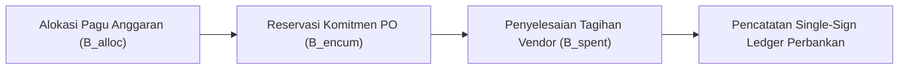

# Konsep Fundamental: Keuangan Grup, Konsolidasi Multi-Entitas & Tata Kelola Konglomerasi (Fase 54)

## 1. Pendahuluan & Filosofi Arsitektur
Struktur konglomerasi modern terdiri atas entitas induk (*holding company*), subholding industri, serta puluhan anak dan cucu perusahaan yang beroperasi di berbagai sektor. Pengelolaan keuangan pada skala ini membutuhkan arsitektur terdesentralisasi dalam pencatatan namun terpusat dalam pengendalian risiko (*decentralized execution, centralized governance*).

Modul `EnterpriseFinance` (prefiks `ef_`) dibangun di atas prinsip:
1. **Nol Toleransi Aritmetika Mengambang (Zero-Float Invariant / A3)**: Seluruh perhitungan moneter dilakukan dalam satuan sen terkecil (`minor_unit` integer), dan seluruh rasio keuangan dinyatakan dalam satuan basis points ($1\text{ bps} = 0,01\%$) atau permille ($1\text{ permille} = 0,1\%$).
2. **Kepatuhan Single-Sign Balance pada Buku Besar**: Setiap pergerakan uang riil atau alokasi pagu belanja diposting ke modul perbankan melalui `LedgerService` dengan konvensi single-sign: Debit bertanda negatif ($-$), Kredit bertanda positif ($+$), dan jumlah neto per transaksi tepat nol ($\Sigma = 0$).
3. **Penyusunan Anggaran Bertingkat (Two-Tier Guardrails)**: Perlindungan arus kas perusahaan dilakukan dengan memadukan komitmen awal (*encumbrance*) dan realisasi kas aktual (*actual expenditure*), mencegah belanja di luar pagu yang telah disahkan Dewan Komisaris.

---

## 2. Struktur Pengendalian Anggaran (Budget Guardrails)

### A. Alur Encumbrance dan Realisasi
Siklus belanja perusahaan melewati tiga tahapan matematis:
1. **Alokasi Pagu Awal ($B_{\text{alloc}}$)**: Anggaran yang disahkan untuk satu departemen dalam tahun fiskal tertentu.
2. **Reservasi Komitmen ($B_{\text{encum}}$)**: Pengikatan pagu saat pesanan pembelian (*Purchase Order*) disetujui, sebelum uang kas keluar. Pagu tersisa:
   $$\text{Pagu Tersedia} = B_{\text{alloc}} - (B_{\text{encum}} + B_{\text{spent}})$$
3. **Realisasi Belanja Kas ($B_{\text{spent}}$)**: Pembayaran tagihan vendor saat jatuh tempo. Nilai reservasi dikonversi menjadi belanja aktual:
   $$B_{\text{encum}} \leftarrow B_{\text{encum}} - \Delta, \quad B_{\text{spent}} \leftarrow B_{\text{spent}} + \Delta$$

---

## 3. Evaluasi Covenant Utang Sindikasi (Syndicated Loan Covenants)
Dalam fasilitas pembiayaan sindikasi, kreditur menetapkan batasan kuantitatif rasio finansial untuk mengukur solvabilitas dan likuiditas peminjam.

### A. Formulasi Rasio Permille
1. **Debt Service Coverage Ratio (DSCR)**:
   $$\text{DSCR}_{\text{permille}} = \text{intdiv}((\text{EBITDA} - \text{Pajak}) \times 1.000, \text{Pokok Jatuh Tempo} + \text{Beban Bunga})$$
   Ambang batas aman perjanjian kredit: $\text{DSCR} \ge 1.250\text{ permille}$ ($1,25\times$).
2. **Debt to Equity Ratio (DER)**:
   $$\text{DER}_{\text{permille}} = \text{intdiv}(\text{Total Utang Berbunga} \times 1.000, \text{Total Ekuitas})$$
   Ambang batas aman perjanjian kredit: $\text{DER} \le 2.500\text{ permille}$ ($2,50\times$).
3. **Interest Service Coverage Ratio (ISCR)**:
   $$\text{ISCR}_{\text{permille}} = \text{intdiv}(\text{EBIT} \times 1.000, \text{Beban Bunga})$$
   Ambang batas aman perjanjian kredit: $\text{ISCR} \ge 2.000\text{ permille}$ ($2,00\times$).
4. **Current Ratio**:
   $$\text{CR}_{\text{permille}} = \text{intdiv}(\text{Aset Lancar} \times 1.000, \text{Liabilitas Jangka Pendek})$$
   Ambang batas aman perjanjian kredit: $\text{CR} \ge 1.100\text{ permille}$ ($1,10\times$).

---

## 4. Agregasi Neraca Saldo Multi-Entitas (Consolidated Trial Balance)
Proses agregasi neraca saldo menggabungkan seluruh akun dari buku besar lokal anak perusahaan ke buku besar konsolidasi grup:
1. **Pemetaan Akun Lokal ke COA Grup**: Setiap nomor akun lokal dipetakan ke nomor akun kanonikal holding.
2. **Pengecekan Zero-Sum Invarian**:
   $$\sum_{i=1}^{n} \text{Debit}_i - \sum_{i=1}^{n} \text{Kredit}_i = 0$$
3. **Penyusunan Jurnal Penyesuaian Eliminasi**: Saldo piutang-utang antar-entitas diekstrak dan dicocokkan dengan data eliminasi dari modul Intercompany sebelum penyajian laporan final.

---

## 5. Tata Kelola Konglomerasi: SoD & Delegasi Wewenang (DoA)
Pemisahan tugas (*Segregation of Duties*) mencegah satu individu memiliki kendali mutlak atas seluruh rantai transaksi keuangan:
- **Matriks Konflik Peran**:
  - `maker` dilarang merangkap `checker`.
  - `treasury_operator` dilarang merangkap `treasury_approver`.
  - `procurement_staff` dilarang merangkap `finance_disburser`.
- **Delegasi Wewenang Berjenjang (DoA)**:
  - Batas otorisasi belanja belanja modal (CAPEX) disusun berdasarkan tingkatan hierarki manajerial. Pengeluaran melebihi batas wewenang wajib dieskalasi ke jenjang di atasnya hingga Dewan Direksi dan Komisaris.

---

## 6. Strategi Alokasi Modal & Rasio Pengembalian Investasi (ROIC)
Efektivitas permodalan holding diukur menggunakan rasio Return on Invested Capital (ROIC) yang dibandingkan terhadap Weighted Average Cost of Capital (WACC):
$$\text{ROIC}_{\text{permille}} = \text{intdiv}(\text{NOPAT}_{\text{minor}} \times 1.000, \text{Invested Capital}_{\text{minor}})$$
Jika $\text{ROIC} > \text{WACC}$, unit bisnis menciptakan nilai ekonomis tambah (*Economic Value Added / EVA*). Unit bisnis yang secara konsisten menghasilkan EVA positif diprioritaskan dalam penerimaan alokasi kas investasi treasury holding.

---

## 7. Prinsip Tata Kelola Perusahaan yang Baik (Good Corporate Governance - GCG)
Modul mengintegrasikan lima pilar GCG ke dalam kode produksi:
1. **Transparansi**: Ketersediaan dashboard eksekutif dan audit trail untuk seluruh transaksi.
2. **Akuntabilitas**: Setiap voucher dan perubahan status terikat ke ID operator dan peran RBAC resmi.
3. **Responsibilitas**: Kepatuhan tepat waktu terhadap seluruh tenggat waktu regulasi perpajakan dan otoritas moneter.
4. **Independensi**: Penegakan aturan Four-Eyes Principle pada seluruh pengesahan anggaran dan fasilitas kredit.
5. **Kewajaran (Fairness)**: Pemantauan rasio covenant utang dan perlakuan hak dividen pemegang saham minoritas secara proporsional.
