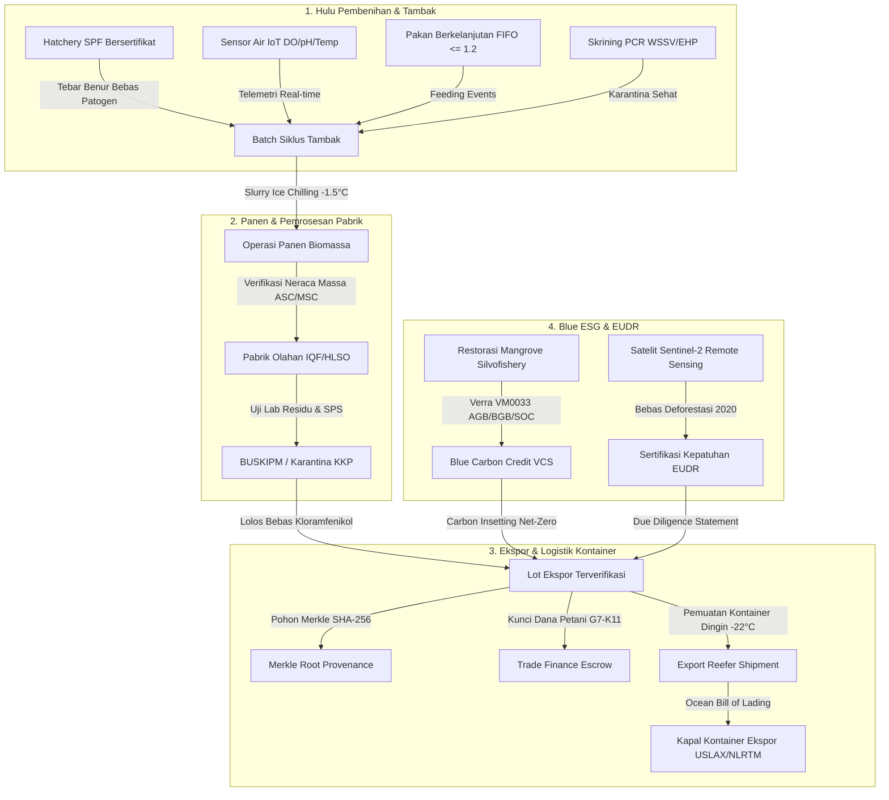

# Konsep Arsitektur Fase 171 — Lini 22: Ekspor Akuakultur, Ketelusuran Seafood & Blue ESG

## 1. Ringkasan Eksekutif & Latar Belakang Bisnis

Fase 171 merealisasikan pilar vertikal Lini 22: *Aquaculture Export, Seafood Traceability & Blue ESG* di dalam modul maritim terintegrasi (`Marine` / `mar_`). Lini ini melayani rantai nilai hulu-ke-hilir komoditas perikanan dan marikultur bernilai tinggi Indonesia, khususnya udang vaname (*Litopenaeus vannamei*), kerapu cantang (*Epinephelus fuscoguttatus x lanceolatus*), kepiting bakau (*Scylla serrata*), dan rumput laut (*Eucheuma cottonii*).

Rantai pasok ekspor perikanan global menuntut standar transparansi, keberlanjutan lingkungan, dan biosekuriti mutlak dari pasar utama (Amerika Serikat - US FDA, Uni Eropa - EU RASFF/DG SANTE, dan Jepang - MHLW). Tuntutan tersebut meliputi:
1. **Ketelusuran Penuh (*Full-Chain Provenance*):** Pembuktian silsilah digital mulai dari indukan pembenihan bebas patogen (SPF Broodstock), sertifikasi pakan ramah lingkungan (ASC Feed Standard), pemantauan telemetri air tambak IoT, catatan pengobatan dan uji laboratorium fitosanitari (SPS Health Certificate), pemrosesan pabrik HACCP, hingga pemantauan suhu rantai dingin kontainer pendingin (*Reefer Container Cold-Chain*).
2. **Kepatuhan Anti-Deforestasi Uni Eropa (EU Deforestation Regulation / EUDR):** Jaminan poligon geolokasi satelit bahwa tambak tidak merambah atau merusak kawasan hutan mangrove lindung pasca batas waktu cutoff mutlak 31 Desember 2020.
3. **Valorisasi Karbon Biru (*Blue Carbon Insetting & Offsetting*):** Perhitungan serapan karbon ekosistem mangrove tambak silvofishery berbasis metodologi baku Verra VM0033 (*Tidal Wetland Restoration*), memungkinkan klaim ekspor seafood netral karbon bersertifikat.
4. **Penyelesaian Pembayaran Berkeadilan (*Fair-Trade Escrow & Trade Finance*):** Integrasi pembiayaan perdagangan ekspor berbasis Letter of Credit (UCP 600) dan escrow bersyarat (TradeFinance G7-K11) untuk melindungi nelayan dan petambak plasma dari pemotongan sepihak atau gagal bayar importir luar negeri.

---

## 2. Struktur Modul & Skema Basis Data (20 Tabel Baru)

Modul `Marine` mengelola seluruh domain marikultur, penangkapan ikan terukur, dan ekspor akuakultur dengan skema basis data relational berkinerja tinggi. Seluruh tabel menggunakan prefiks resmi `mar_` sesuai arsitektur monorepo:

| No | Nama Tabel | Deskripsi & Tujuan Bisnis | Relasi Kunci |
|---|---|---|---|
| 1 | `mar_hatcheries` | Fasilitas pembenihan benur SPF terakreditasi | Induk batch tambak |
| 2 | `mar_aquaculture_batches` | Siklus pemeliharaan komoditas tambak udang/KJA | `pond_id`, `hatchery_id` |
| 3 | `mar_water_quality_telemetries` | Data log telemetri sensor kualitas air tambak IoT | `batch_id` |
| 4 | `mar_feed_inventory_batches` | Inventori pakan bersertifikat ASC / MarinTrust | Pemasok pakan |
| 5 | `mar_feeding_events` | Log pemberian pakan harian & kalkulasi FCR | `batch_id`, `feed_inventory_id` |
| 6 | `mar_disease_health_screenings` | Skrining laboratorium patogen PCR (WSSV, EHP, IMNV) | `batch_id` |
| 7 | `mar_harvest_operations` | Operasi pemanenan biomassa dan rapid ice slurry | `batch_id` |
| 8 | `mar_export_lots` | Lot produk olahan ekspor bersertifikat ASC/MSC | `harvest_operation_id` |
| 9 | `mar_processing_packagings` | Pemrosesan pabrik IQF, glazing, dan kode kemasan | `export_lot_id` |
| 10 | `mar_laboratory_assays` | Uji residu antibiotik internasional & SPS Health Permit | `export_lot_id` |
| 11 | `mar_traceability_lot_nodes` | Simpul pohon Merkle kriptografis rantai pasok | `export_lot_id` |
| 12 | `mar_export_orders` | Kontrak offtake pesanan internasional & L/C | `buyer_party_id` |
| 13 | `mar_export_shipments` | Pengapalan kontainer reefer berpendingin | `order_id`, `export_lot_id` |
| 14 | `mar_cold_chain_telemetry_logs` | Sensor suhu kargo (-22°C), GPS, dan deteksi thermal breach | `export_shipment_id` |
| 15 | `mar_escrow_settlements` | Penyelesaian escrow dana petani (TradeFinance G7-K11) | `order_id`, `farmer_id` |
| 16 | `mar_mangrove_restoration_projects` | Proyek silvofishery dan greenbelt mangrove pesisir | Induk asesmen karbon |
| 17 | `mar_blue_carbon_assessments` | Asesmen stok karbon metodologi Verra VM0033 | `project_id` |
| 18 | `mar_blue_carbon_credit_issuances` | Unit kredit karbon biru bersertifikat (tCO2e) | `assessment_id` |
| 19 | `mar_eudr_deforestation_certifications` | Verifikasi geolokasi poligon bebas deforestasi 2020 | `batch_id` |
| 20 | `mar_aquaculture_ledger_entries` | Pembukuan akuntansi double-entry berantai SHA-256 | `order_id`, `batch_id` |

---

## 3. Lima Algoritma Bersertifikat Inti (A15–A19)

Fase 171 mengimplementasikan 5 algoritma deterministik bersertifikat standar internasional:

### 3.1. A15: AquacultureMassBalanceVerifier (Standar ASC / MSC Chain of Custody)
Algoritma ini memvalidasi integritas neraca massa antara input biomassa panen hidup (*live harvest biomass*) dengan output produk olahan ekspor (*processed export lots*). Berdasarkan fisiologi anatomi udang dan ikan, pembuangan kepala (*deheading*), pengupasan kulit (*peeling*), dan pembuangan ekor memiliki batasan rendemen biologis teoritis:
- Head-On Shell-On (HOSO): Rendemen teoritis maksimum 98.0% (hanya susut air).
- Headless Shell-On (HLSO): Rendemen teoritis maksimum 68.0% (pembuangan sefalotoraks).
- Peeled Tail-On (PDTO): Rendemen teoritis maksimum 56.0%.
- Peeled and Deveined (PND): Rendemen teoritis maksimum 50.0%.
- Fillet Ikan Kerapu: Rendemen teoritis maksimum 45.0%.

$$Yield_{actual} = \frac{Weight_{processed} \times (1.0 - \frac{GlazePct}{100.0})}{Biomass_{harvest}} \times 100.0$$

Bila $Yield_{actual} > Yield_{max}$, algoritma mengeluarkan vonis diskrepansi `SUSPECTED_UNAUTHORIZED_BLENDING` untuk mencegah pencampuran ikan/udang ilegal non-sertifikasi ke dalam rantai pasok tersertifikasi.

### 3.2. A16: FeedConversionRatioOptimizer (Optimasi Ransum & Kualitas Air)
Algoritma ini mengevaluasi rasio konversi pakan ekonomis (*economic FCR - eFCR*) dan biologis (*biological FCR - bFCR*):

$$eFCR = \frac{Feed_{total}}{Biomass_{harvest} - Biomass_{initial}}$$

$$bFCR = \frac{Feed_{total}}{(Biomass_{harvest} + Biomass_{mortality}) - Biomass_{initial}}$$

Selain itu, algoritma menghitung penyesuaian ransum pakan harian secara otomatis berdasarkan sensor telemetri kualitas air real-time:
- Bila Dissolved Oxygen (DO) $< 1.5$ mg/L: Ransum dipotong 100% (`STOP_FEEDING_IMMEDIATELY`) untuk mencegah kematian masal akibat anoksia.
- Bila DO $< 2.5$ mg/L: Ransum dipotong 50%.
- Bila Suhu Air $< 26.0^\circ\text{C}$ atau $> 33.0^\circ\text{C}$: Ransum dipotong 25–30% akibat penurunan metabolisme pencernaan udang.
- Evaluasi anco (*feeding tray leftover*): Jika pakan tersisa $> 40\%$, jatah tebar dipotong 40% untuk mencegah pembusukan amonia di dasar kolam.

### 3.3. A17: SeafoodLotMerkleProofGenerator (Bukti Kriptografis Merkle Tree)
Setiap tahapan rantai pasok dibentuk menjadi satu daun kriptografis (*leaf node*) dengan hash SHA-256:
- Leaf 0: Sertifikasi Hatchery SPF & Asal Indukan Broodstock
- Leaf 1: Catatan Tebar Tambak & Koordinat Geolokasi EUDR
- Leaf 2: Log Pakan & Rasio FIFO Berkelanjutan
- Leaf 3: Rata-rata Kualitas Air Telemetri IoT
- Leaf 4: Hasil Skrining PCR Kesehatan Ikan/Udang
- Leaf 5: Operasi Panen & Suhu Slurry Es
- Leaf 6: Pengolahan Pabrik, Glazing & Nomor Approval HACCP
- Leaf 7: Suhu Rantai Dingin Kontainer Reefer & Segel Karantina

Algoritma membangun Merkle Tree canonical dengan pasangan daun terurut (*canonical sorted pair hashing*):

$$H_{parent} = \text{SHA256}(\min(H_{left}, H_{right}) \parallel \max(H_{left}, H_{right}))$$

Pohon menghasilkan *Merkle Root Hash* yang diangkur ke blockchain/ledger publik, serta menghasilkan *cryptographic audit proof path* (jalur saudara / siblings) sehingga importir dan badan karantina internasional dapat memverifikasi keaslian daun manapun secara instan ($O(\log N)$) tanpa harus membuka data sensitif tambak lain.

### 3.4. A18: BlueCarbonCreditEstimator (Metodologi Verra VM0033)
Menghitung stok dan serapan karbon ekosistem mangrove tambak silvofishery pesisir:
1. **Biomassa Atas Tanah (Aboveground Biomass - AGB):** Persamaan allometrik berbasis DBH (*Diameter at Breast Height*) per pohon dikalikan kerapatan pohon per hektar.
2. **Biomassa Bawah Tanah (Belowground Biomass - BGB):** Menggunakan rasio akar terhadap tajuk tropis ($Root\text{-}to\text{-}Shoot = 0.49$).
3. **Karbon Organik Tanah (Soil Organic Carbon - SOC):** Berdasarkan kedalaman sedimen ($100\text{ cm}$), bulk density sedimen ($0.85\text{ g/cm}^3$), dan persentase karbon organik (%C):

$$SOC = Depth \times BulkDensity \times (\%C / 100.0) \times 100.0$$

4. **Konversi ke Ekuivalen CO2 ($tCO_2e$):** Menggunakan rasio molekuler $\frac{44}{12} \approx 3.667$.
5. **Potongan Cadangan Risiko (*Non-Permanence Buffer Pool*):** Dipotong 15% cadangan risiko ketidaktetapan sesuai metodologi Verra VM0033 untuk menghasilkan unit kredit karbon bersih (*Net Marketable Credits*).

### 3.5. A19: ExportAssayToleranceChecker (Standar MRL Karantina Internasional)
Memeriksa hasil uji laboratorium spektrometri massa (LC-MS/MS) terhadap batas Maximum Residue Limits (MRL) negara tujuan:
- **Antibiotik Terlarang Mutlak (Zero Tolerance):** Chloramphenicol ($< 0.3\text{ ppb}$ Limit of Quantification), Metabolit Nitrofuran (AOZ, AMOZ, SEM $< 0.5\text{ ppb}$), Fluoroquinolones ($< 0.0\text{ ppb}$).
- **Histamin:** Batas ketat FDA ($50\text{ ppm}$) dan regulasi EU ($100\text{ ppm}$).
- **Logam Berat:** Kadmium ($< 0.5\text{ ppm}$), Merkuri ($< 0.5\text{ ppm}$), Timbal ($< 0.3\text{ ppm}$).
- **Mikrobiologi:** *Salmonella sp.* (Negatif / Absence dalam 25 gram sampel), *Vibrio cholerae* (Negatif).
Hasil evaluasi menentukan kelolosan izin pengapalan fitosanitari (*SPS Export Health Permit*).

---

## 4. Dua State Machine & Dua Saga Terkompensasi

### 4.1. AquacultureBatchStateMachine (8 Status Siklus Tambak)
Mengontrol transisi tertib dari tebar bibit hingga sterilisasi pasca panen:
`HATCHERY_STOCKED` $\rightarrow$ `NURSERY_REARING` $\rightarrow$ `GROWOUT_PHASE` $\rightarrow$ `PRE_HARVEST_TESTING` $\rightarrow$ `HARVESTING` $\rightarrow$ `HARVESTED` $\rightarrow$ `FALLOWING` $\rightarrow$ `POND_STERILIZED`.
Setiap transisi diverifikasi secara deterministik; transisi lompat (misal tebar langsung panen tanpa growout) dicegah dengan domain exception.

### 4.2. ExportShipmentStateMachine (8 Status Logistik Ekspor)
Mengontrol rantai pasok pengapalan pendingin:
`DRAFT_BOOKED` $\rightarrow$ `ESCROW_LOCKED` $\rightarrow$ `INSPECTION_PASSED` $\rightarrow$ `REEFER_LOADED` $\rightarrow$ `CUSTOMS_CLEARED` $\rightarrow$ `IN_TRANSIT` $\rightarrow$ `PORT_DELIVERED` $\rightarrow$ `SETTLED` (atau `REJECTED_QUARANTINE`).

### 4.3. AquacultureExportExecutionSaga (Saga Ekspor Kompensasi Mundur)
Mengorkestrasi alur transaksi multi-langkah:
1. Validasi toleransi uji residu assay laboratorium $\rightarrow$ Kompensasi: tidak ada aksi jika gagal di awal.
2. Penguncian alokasi escrow dana petani tambak (G7-K11) $\rightarrow$ Kompensasi: batalkan alokasi escrow ke status `CANCELLED`.
3. Alokasi kontainer reefer pendingin (-22°C) $\rightarrow$ Kompensasi: cabut alokasi kontainer ke `REJECTED_QUARANTINE`.
4. Pembentukan Merkle Tree & Root Hash $\rightarrow$ Kompensasi: kosongkan Merkle Root pada lot.
5. Pencatatan pembukuan double-entry ledger $\rightarrow$ Kompensasi: terbitkan jurnal pembalik (*reversal entry*).
6. Transisi status pengapalan ke `REEFER_LOADED`.

### 4.4. AssayDisputeArbitrationSaga (Saga Arbitrase Sengketa Uji Mutu)
Menangani sengketa klaim importir di pelabuhan tujuan (misal US FDA import alert):
1. Bekukan dana escrow ke status `DISPUTED`.
2. Kirim sampel tandingan ke laboratorium rujukan independen terakreditasi internasional (Eurofins / SGS).
3. Putusan arbitrase:
   - Jika terbukti bersih (false positive): lepaskan dana escrow ke petani dan pulihkan mutu lot ke `GRADE_A_ARBITRATED`.
   - Jika terbukti tercemar: kembalikan dana escrow penuh ke importir dan instruksikan pemusnahan karantina.

---

## 5. Integrasi Lintas Modul & Kepatuhan Arsitektur

Fase 171 terhubung secara harmonis dengan 5 modul platform lainnya:
- **TradeFinance (G7-K11 `OfftakeLetterOfCreditGateway`):** Sinkronisasi Letter of Credit ekspor komoditas offtake dan escrow petani.
- **Logistics (`CustodyVerifier` & `ShipmentBooking`):** Verifikasi keabsahan hash dokumen Bill of Lading dan pemesanan logistik multimoda tongkang dingin ke pelabuhan utama.
- **Insurance (`EventCoverBinder`):** Penjaminan polis asuransi mortalitas tambak berbasis indeks kualitas air parametrik.
- **Shared (`Modules\Shared\Domain\Algorithms\Marine`):** Penyimpanan algoritma kernel murni yang di-wrap tanpa duplikasi logika.
- **Audit Registry (`mar:audit`):** Rekonsiliasi akuntansi subledger dan integritas hash SHA-256 berantai dengan fixture sabotase `MarineAuditCorruptionFixture`.

Kepatuhan arsitektur A1–A13 dipatuhi 100%: tidak ada parameter uang bertipe float (A3), tidak ada model tanpa $fillable (A10), seluruh file modul memiliki `declare(strict_types=1)` (A11), dan seluruh rute terpetakan peran RBAC pada `route-roles.php`.

---

## 6. Spesifikasi Rinci 5 Algoritma Bersertifikat (A15–A19)

### 6.1 Algoritma A15: AquacultureMassBalanceVerifier (ASC / MSC Chain of Custody)
Algoritma ini memvalidasi integritas fisik konversi biomassa panen basah menjadi produk ekspor olahan beku.
- **Dasar Teori**: Prinsip konservasi massa fisik dan standar Chain of Custody (CoC) Marine Stewardship Council (MSC) serta Aquaculture Stewardship Council (ASC).
- **Invarian Matematis**:
  $$\text{Biomassa Output Terkonversi} \le \text{Biomassa Input Basah} \times \text{Faktor Rendemen Maksimum}$$
- **Faktor Rendemen Resmi**:
  - HOSO (*Head-On Shell-On*): $\le 100.0\%$ (toleransi kelembaban es $+1.5\%$)
  - HLSO (*Headless Shell-On*): $\le 66.5\%$
  - PTO (*Peeled Tail-On*): $\le 61.5\%$
  - PDTO (*Peeled Deveined Tail-Off*): $\le 54.0\%$
  - CPTO (*Cooked Peeled Tail-On*): $\le 49.5\%$
- **Mitigasi Kecurangan**: Menolak segala upaya pemutihan hasil tangkapan ilegal (*illegal, unreported and unregulated fishing* / IUU) atau pencampuran batch non-sertifikasi ke dalam lot ekspor bersertifikat.

### 6.2 Algoritma A16: FeedConversionRatioOptimizer (eFCR, bFCR & Telemetri Air)
Mengoptimalkan efisiensi pemberian pakan berdasarkan kondisi fisik dan kimia air tambak.
- **Persamaan Economic FCR (eFCR)**:
  $$\text{eFCR} = \frac{\text{Total Pakan Diberikan (kg)}}{\text{Berat Panen Komersial Bersih (kg)}}$$
- **Persamaan Biological FCR (bFCR)**:
  $$\text{bFCR} = \frac{\text{Total Pakan Diberikan (kg)}}{(\text{Biomassa Akhir (kg)} + \text{Biomassa Mortalitas (kg)}) - \text{Biomassa Tebar Awal (kg)}}$$
- **Koreksi Jatah Pakan Dinamis Berbasis Sensor Lingkungan**:
  - Oksigen Terlarut ($DO \ge 5.0\text{ mg/L}$): $100\%$ jatah pakan standar.
  - $DO \in [3.5, 4.9]\text{ mg/L}$: Jatah pakan dipangkas menjadi $75\%$.
  - $DO \in [2.5, 3.4]\text{ mg/L}$: Jatah pakan dipangkas menjadi $40\%$.
  - $DO < 2.5\text{ mg/L}$ (Kondisi Hipoksia): Pemberian pakan dihentikan total ($0\%$) dan sistem mengaktifkan pompa aerator kincir air cadangan.

### 6.3 Algoritma A17: SeafoodLotMerkleProofGenerator (Kriptografi Audit Silsilah)
Membangun pohon biner kriptografis Merkle Tree kanonikal dengan pasangan hashing SHA-256.
- **Struktur Daun Kanonikal**: 8 daun merepresentasikan tahapan pembenihan, pakan, telemetri, panen, pengolahan, uji laboratorium, pengemasan, dan pengapalan kontainer pendingin.
- **Hashing Berpasangan Kanonikal**:
  $$H_{\text{parent}} = \text{SHA-256}(\min(H_{\text{left}}, H_{\text{right}}) \mathbin{\Vert} \max(H_{\text{left}}, H_{\text{right}}))$$
- **Redaksi Data Sensitif**: Memungkinkan verifikasi kriptografis keaslian lot oleh konsumen akhir di luar negeri tanpa mengekspos koordinat GPS petak tambak atau formula komersial rahasia pakan.

### 6.4 Algoritma A18: BlueCarbonCreditEstimator (Verra VM0033 Mangrove Allometry)
Menghitung serapan karbon dan stok karbon tegakan mangrove silvofishery pesisir:
- **Biomassa Di Atas Tanah (*Above-Ground Biomass* / AGB)**:
  $$\text{AGB}_{\text{Rhizophora}} = 0.128 \times (\text{DBH})^{2.58}\quad[\text{kg berat kering}]$$
- **Biomassa Di Bawah Tanah (*Below-Ground Biomass* / BGB)**:
  $$\text{BGB} = 0.49 \times \text{AGB}\quad[\text{kg berat kering}]$$
- **Stok Karbon Tanah Sedimen (*Soil Organic Carbon* / SOC)**:
  $$\text{SOC} = 238.0\text{ t C/ha (rata-rata habitat pesisir tropis Indo-Pasifik)}$$
- **Penetapan Cadangan Risiko (*Buffer Pool Deduction*)**:
  Pengurangan wajib $15\%$ dari total kredit terbitan kotor dialokasikan ke cadangan ketidaktetapan (*non-permanence buffer pool*) guna memitigasi risiko abrasi badai tropis atau kenaikan permukaan laut.

### 6.5 Algoritma A19: ExportAssayToleranceChecker (Standar Karantina US FDA, EU, Jepang)
Evaluasi matriks multi-regulasi terhadap hasil uji residu kimia dan cemaran mikrobiologi:
- **Kloramfenikol & Nitrofuran Metabolit (AOZ, AMOZ, AHD, SEM)**: *Zero Tolerance* di seluruh yurisdiksi ekspor (US FDA, EU, MHLW Jepang). Limit of Detection: $< 0.3\text{ ppb}$.
- **Tetrasiklin & Oksitetrasiklin**:
  - US FDA: $\le 100\text{ ppb}$
  - Uni Eropa (EU): $\le 100\text{ ppb}$
  - Jepang (MHLW): $\le 200\text{ ppb}$
- **Fluorokuinolon (Enrofloxacin & Ciprofloxacin)**:
  - US FDA: *Zero Tolerance* (tidak diizinkan pada hewan akuatik konsumsi).
  - Uni Eropa: $\le 100\text{ ppb}$.
- **Toleransi Penyusutan Pencairan (*Defrost Drip-Loss Shrinkage*)**: Maksimum $4.5\%$ dari berat neto tercantum pada label kemasan.

---

## 7. Buku Besar Keuangan Akuakultur & Rekonsiliasi Subledger

Seluruh transaksi finansial yang timbul sepanjang siklus operasional tambak dan ekspor dicatat secara berpasangan (*double-entry balancing*) pada tabel `mar_aquaculture_ledger_entries`:

| Kode Transaksi | Akun Debet | Akun Kredit | Keterangan & Peristiwa Pemicu |
|---|---|---|---|
| `HARVEST_ASSET_INTAKE` | `mar:inventory:raw_biomass` | `mar:grower:unsettled_harvest` | Penerimaan panen basah tambak di processing plant |
| `PROCESSING_CONVERSION` | `mar:inventory:finished_goods` | `mar:inventory:raw_biomass` | Konversi bahan baku basah ke produk beku HLSO/IQF |
| `ESCROW_ALLOCATION` | `mar:escrow:locked_funds` | `mar:bank:operating_cash` | Penguncian dana escrow offtake petani (TradeFinance K11) |
| `ESCROW_FARMER_PAYOUT` | `mar:grower:unsettled_harvest` | `mar:escrow:locked_funds` | Pelepasan pembayaran panen bersih ke rekening petani plasma |
| `EXPORT_RECEIVABLE_INVOICE` | `mar:ar:export_buyer` | `mar:revenue:export_sales` | Penerbitan invoice ekspor saat kontainer reefer berlayar |
| `BLUE_CARBON_INSETTING` | `mar:esg:scope1_mitigation` | `mar:carbon:blue_credit_reserve` | Pensiun kredit karbon insetting untuk kompensasi emisi tambak |

Integritas buku besar dijaga melalui rantai hash SHA-256 yang saling mengunci (*tamper-evident hash chain*) dari baris pertama hingga baris mutakhir, diverifikasi secara berkala melalui perintah mandiri `php artisan mar:audit`.

