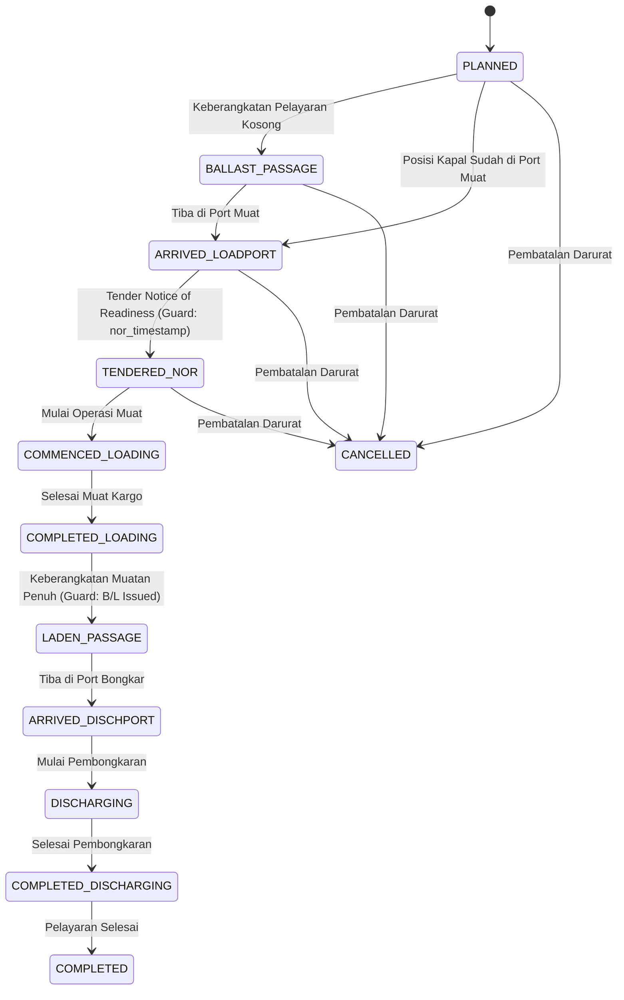
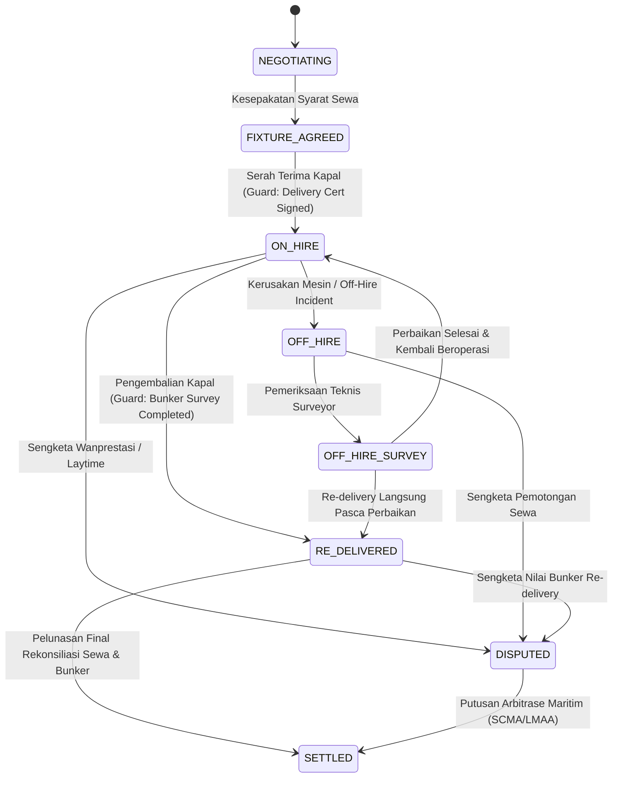

# KONSEP DAN SPESIFIKASI TEKNIS FASE 180: ARMADA KAPAL, VOYAGE, CHARTER & MARINE SERVICES

**Modul Target:** `modules/Port` (Vertical Slice Armada & Pelayaran Kapal)  
**Lini Bisnis:** Lini 27 (Maritim, Pelabuhan & Terminal Kontainer) dan Lini 22 (Logistik & Rantai Pasok Samudera)  
**Status Implementasi:** `🔵 DIIMPLEMENTASIKAN`  
**Ambang Batas Kualitas:** B1 Logika $\ge 7.000$ baris, B3 Dokumentasi $\ge 1.500$ baris, M-2 $\ge 55\%$, M-4 Duplikasi = 0  

---

## 1. Latar Belakang & Ruang Lingkup Arsitektural

Fase 180 memperluas kapabilitas maritim SuperWeb dari pengelolaan dermaga dan lapangan penumpukan peti kemas (*yard terminal*) menjadi platform terintegrasi manajemen armada kapal niaga (*ocean-going merchant fleet management*). Modul ini mengelola seluruh siklus hidup operasional kapal niaga, meliputi:

1. **Master Data Armada & Kelaiklautan:**
   - Spesifikasi teknis kapal (*deadweight tonnage*, *gross tonnage*, *net tonnage*, *length overall*, *beam*, *design draft*, *scantling draft*).
   - Klasifikasi kapal statutoria (*classification society*: Biro Klasifikasi Indonesia / BKI, DNV, Lloyd's Register, ABS).
   - Sertifikasi kelaiklautan SOLAS, MARPOL, ISM/ISPS Code, dan International Labour Organization MLC 2006.
   - Kepatuhan Safe Manning Requirement menurut konvensi IMO STCW 1978/2010.
   - Manajemen tangki bunker dan aturan pengisian aman 98% (*safe capacity ullage*).

2. **Perencanaan & Pelaksanaan Pelayaran (Voyage Planning & Execution):**
   - Penjadwalan pelayaran (*tramp* vs *liner*) dan pembagian etape perjalanan (*voyage legs*: ballast leg, laden leg, canal transit, river passage).
   - Rencana lintasan navigasi laut (*sea passage planning*) dengan validasi batas *Under Keel Clearance* (UKC) dan koridor keselamatan ECDIS.
   - Pelaporan harian tengah hari (*noon reports*) dari nakhoda dan kepala kamar mesin (lintang/bujur, haluan, kecepatan, cuaca Beaufort, gelombang Douglas, konsumsi bahan bakar 24 jam, dan sisa cadangan *Remaining On Board* / ROB).
   - Optimasi rute lingkaran besar (*Great Circle navigation*) vs *Rhumb Line* serta kompensasi vektor arus samudera (*Indonesian Throughflow / Arlindo*).
   - Mitigasi rute cuaca buruk (*Weather Routing*) menggunakan metode Isochrone dan analisis penurunan kecepatan kapal (*speed loss curves* Aertssen).

3. **Komersial Sewa Kapal & Perhitungan Laytime (Chartering & Laytime):**
   - Perjanjian sewa kapal (*Charter Party Fixtures*): *Time Charter* (NYPE 93) dan *Voyage Charter* (BIMCO Gencon 1994).
   - Kontrak pengangkutan kargo (*Contract of Affreightment* / COA) dan toleransi muatan *More Or Less Owner's Option* (MOLOO).
   - Audit *Statement of Facts* (SOF) dan perhitungan waktu muat/bongkar (*Laytime Statement*) dengan penanganan periode tenggang *Notice of Readiness* (NOR), pengecualian cuaca hujan (*Weather Working Days* / WWD), dan perbedaan aturan hari libur (*SHINC* vs *SHEX*).
   - Penerbitan tagihan keterlambatan (*Demurrage Invoices*) dan bonus percepatan (*Despatch*).
   - Penanganan insiden *Off-Hire* pada sewa waktu dan rekonsiliasi nilai bahan bakar serah-terima sewa (*Bunker on Delivery vs Redelivery*).

4. **Layanan Maritim & Akun Pengeluaran Pelabuhan (Marine Services & PDA/FDA):**
   - Permohonan dan penugasan pandu kapal (*Pilotage*) dan kapal tunda assist dermaga (*Tugboat Services*).
   - Alokasi jendela waktu tambat dermaga (*Berth Allocation Window*) via kontrak `VesselCallWindowProvider` (G7-K27).
   - Operasi pengisian bahan bakar (*Bunkering Operations*) dengan verifikasi *Bunker Delivery Note* (BDN), segel sampel MARPOL Annex VI, dan pengujian kandungan belerang (*sulphur cap* 0.50% / 0.10%).
   - Manajemen akun pengeluaran pelabuhan: *Proforma Disbursement Account* (PDA) awal vs *Final Disbursement Account* (FDA) audit variansi.
   - Pencatatan pembuangan limbah kapal fasilitas darat menurut MARPOL Annex I (sludge/bilge), Annex IV (sewage), dan Annex V (garbage).

5. **Mitigasi Bencana & Kerugian Bersama (General Average Adjustment):**
   - Deklarasi insiden maritim darurat di bawah kerangka *York-Antwerp Rules 2016*.
   - Perhitungan pengorbanan bersama (*General Average Sacrifices*) dan pengeluaran luar biasa (*Extraordinary Expenditures*).
   - Alokasi pembagian kerugian proporsional terhadap seluruh nilai kontributif pihak yang berkepentingan (kapal, muatan kargo, dan uang tambang).

6. **Buku Besar Finansial Armada (Double-Entry Fleet Ledger):**
   - Pembukuan ganda berpasangan (*debit/credit*) untuk seluruh arus kas, piutang freight, tagihan demurrage, biaya bunker, akun pengeluaran PDA/FDA, dan kontribusi General Average.
   - Verifikasi integritas tanda tangan kriptografis SHA-256 pada setiap entri buku besar.

---

## 2. Struktur Skema Database (25 Tabel `prt_fleet_*`)

| No | Nama Tabel | Deskripsi & Fungsi Bisnis |
|:---|:---|:---|
| 1 | `prt_fleet_classes` | Lembaga klasifikasi kapal (BKI, DNV, LR, ABS), notasi kelas, dan tanggal jatuh tempo survei berkala / docking. |
| 2 | `prt_fleet_vessels` | Data induk kapal niaga: IMO, nama, call sign, tipe kapal, DWT, GRT, LOA, sarat air, daya mesin, SFOC, dan parameter CII. |
| 3 | `prt_fleet_bunker_tanks` | Tangki bahan bakar kapal (VLSFO, LSMGO, LNG), kapasitas volume, batas aman 98%, dan sisa muatan ROB harian. |
| 4 | `prt_fleet_certificates` | Sertifikat statutoria SOLAS/MARPOL/ISM/MLC, nomor sertifikat, otoritas penerbit, dan masa berlaku. |
| 5 | `prt_fleet_crew_complements` | Dokumen Safe Manning STCW: kebutuhan minimum perwira dek, perwira mesin, rating, dan audit kepatuhan awak. |
| 6 | `prt_fleet_charter_parties` | Fixture perjanjian sewa kapal (Gencon/NYPE), tarif harian atau per ton, laytime hours, laycan, dan status siklus. |
| 7 | `prt_fleet_freight_contracts` | Kontrak pengangkutan kargo (COA), kuantitas MT, tarif uang tambang, deadfreight, dan status pembayaran konosemen B/L. |
| 8 | `prt_fleet_voyages` | Pelayaran kapal niaga yang diatur oleh 12 status VoyageStateMachine, pelabuhan muat/bongkar, dan jarak navigasi. |
| 9 | `prt_fleet_voyage_legs` | Etape pelayaran bertahap (ballast leg, laden leg, transit kanal) dengan target kecepatan dan jarak mil laut. |
| 10 | `prt_fleet_noon_reports` | Laporan harian tengah hari dari nakhoda/KKM: posisi GPS, cuaca Beaufort, gelombang Douglas, RPM, konsumsi BBM, dan ROB. |
| 11 | `prt_fleet_sea_passages` | Rencana lintasan navigasi ECDIS, daftar waypoint lingkaran besar, dan batas keselamatan Under Keel Clearance (UKC). |
| 12 | `prt_fleet_port_calls` | Kunjungan kapal ke pelabuhan: estimasi/aktual tiba (ETA/ATA), tender NOR, sandar tambat, sarat air awal/akhir, dan status. |
| 13 | `prt_fleet_weather_routings` | Rekomendasi mitigasi rute cuaca buruk Isochrone: peringatan badai gelombang tinggi, deviasi rute, dan penghematan BBM. |
| 14 | `prt_fleet_laytime_calculations` | Pernyataan kalkulasi laytime SOF: waktu tenggang NOR, interupsi hujan WWD, mogok, jam demurrage atau despas bersih. |
| 15 | `prt_fleet_demurrage_invoices` | Faktur tagihan denda keterlambatan (Demurrage) atau klaim despas kepada penyewa kargo (charterer). |
| 16 | `prt_fleet_off_hire_events` | Insiden off-hire kapal sewa waktu: kerusakan mesin, perawatan darurat, pemotongan uang sewa, dan kompensasi bunker. |
| 17 | `prt_fleet_bunker_adjustments` | Penyesuaian nilai bahan bakar serah terima sewa kapal (Bunker on Delivery vs Redelivery) oleh surveyor independen. |
| 18 | `prt_fleet_pilotage_requests` | Permohonan jasa pandu kapal (pandu masuk, pandu keluar, shifting) dan penetapan tarif pandu resmi. |
| 19 | `prt_fleet_tug_services` | Penugasan kapal tunda sandar/lepas sandar dermaga berdasarkan bollard pull tonnage dan jam kerja. |
| 20 | `prt_fleet_berth_bookings` | Pemesanan dan alokasi jendela tambat dermaga via kontrak `VesselCallWindowProvider` (K27). |
| 21 | `prt_fleet_bunkering_operations` | Operasi pengisian bahan bakar kapal: nomor stem, tongkang pengisi, BDN, densitas, viskositas, dan sampling MARPOL. |
| 22 | `prt_fleet_port_disbursements` | Akun pengeluaran pelabuhan: Proforma Disbursement Account (PDA) estimasi vs Final Disbursement Account (FDA) audit. |
| 23 | `prt_fleet_waste_disposals` | Pembuangan limbah kapal ke fasilitas penerima darat (MARPOL Annex I minyak, Annex IV sanitasi, Annex V sampah). |
| 24 | `prt_fleet_general_average_cases` | Rekam deklarasi kerugian bersama York-Antwerp Rules 2016: pengorbanan fisik, pengeluaran darurat, dan alokasi kontribusi. |
| 25 | `prt_fleet_ledger_entries` | Buku besar berpasangan armada maritim (double-entry): debit/credit, akun keuangan, voyage ref, dan checksum SHA-256. |

---

## 3. Algoritma Bersertifikat Maritim (A10 s.d. A14)

### A10: BunkerFuelConsumptionOptimizer (ISO 8217 & SFOC Admiralty Engine)
- **Dasar Teori:** Hukum propulsi kubik kecepatan menyatakan bahwa kebutuhan daya propulsi sebanding dengan pangkat tiga kecepatan kapal ($P \propto V^3$) dan bobot benaman pangkat dua per tiga ($\Delta^{2/3}$).
- **Formula Konsumsi:**
  $$P_{\text{req}} = P_{\text{design}} \times \left(\frac{V}{V_{\text{design}}}\right)^3 \times f_{\text{weather}}$$
  $$\text{Konsumsi ME (MT/hari)} = \frac{P_{\text{req}} \times \text{SFOC}_{\text{corrected}} \times 24}{1.000.000}$$
- **Koreksi Kurva SFOC:** Mesin diesel laut memiliki titik efisiensi termal optimum pada beban 75%–85% MCR. Pada beban rendah (< 50% slow steaming ekstrem) atau beban tinggi (> 90%), konsumsi spesifik per kWh membengkak.
- **Optimasi Pemilihan Port Bunkering:** Membandingkan harga VLSFO/LSMGO per ton di berbagai pelabuhan (Singapore vs Tanjung Priok vs Batam), memperhitungkan biaya deviasi mil laut, waktu sewa kapal yang terbuang, dan tarif port dues bunker call.

### A11: LaytimeDemurrageCalculator (BIMCO Gencon Laytime Engine)
- **Dasar Standar:** Klausul 6 & 7 BIMCO Gencon 1994 Charter Party dan yurisprudensi London Maritime Arbitrators Association (LMAA).
- **Aturan Notice of Readiness (NOR):** Waktu laytime mulai dihitung setelah masa tenggang (*turn-time*, umumnya 6 jam setelah NOR ditenderkan dan diterima) atau saat pekerjaan muat dimulai lebih awal.
- **Pengecualian Cuaca & Hari Libur:**
  - *WWD SHEX:* Weather Working Days, Sundays and Holidays Excluded. Jam hujan deras atau hari libur resmi tidak dihitung sebagai laytime terpakai.
  - *WWD SHINC:* Sundays and Holidays Included. Hari libur tetap dihitung sebagai laytime kecuali disepakati lain.
- **Prinsip Mengikat:** *"Once on demurrage, always on demurrage."* Setelah waktu yang diizinkan habis, denda demurrage berjalan terus menerus tanpa potongan akhir pekan atau hari libur, kecuali ada kerusakan kapal sendiri (*ship's fault / crane breakdown*).
- **Kalkulasi Reversible Laytime:** Mengizinkan penggabungan waktu hemat di pelabuhan muat untuk menutupi kelebihan waktu di pelabuhan bongkar.

### A12: CiiCarbonIntensityRatingEngine (IMO MARPOL Annex VI Regulation 28)
- **Dasar Regulasi:** Resolusi IMO MEPC.336(76), MEPC.338(76), dan MEPC.354(78).
- **Attained CII:**
  $$\text{CII}_{\text{attained}} = \frac{\sum (\text{Fuel}_j \times C_{F,j})}{\text{Capacity (DWT)} \times \text{Distance (NM)}} \times 10^6 \quad [\text{g CO}_2/\text{DWT}\cdot\text{NM}]$$
- **Garis Referensi IMO:** $\text{CII}_{\text{ref}} = a \times \text{Capacity}^{-c}$
- **Batas Rating A–E:** Ditentukan menggunakan faktor deviasi eksponensial $d_1, d_2, d_3, d_4$. Kapal dengan peringkat D selama 3 tahun berturut-turut atau peringkat E wajib menyusun Rencana Tindakan Korektif (*Corrective Action Plan*) dalam SEEMP Bagian III (misal instruksi slow steaming, pembersihan biofouling lambung, atau penggunaan bahan bakar alternatif bio-bunker).

### A13: TimeCharterEquivalentCalculator (Baltic Exchange TCE Standard)
- **Dasar Metrik:** Standar komparasi kinerja pendapatan kapal sewa komersial.
- **Formula TCE:**
  $$\text{TCE (USD/hari)} = \frac{\text{Pendapatan Kotor Uang Tambang} - \text{Biaya Pelayaran (Bunker + PDA + Kanal)}}{\text{Total Hari Pelayaran di Laut} + \text{Hari di Pelabuhan}}$$
- **Analisis Marjin Bersih:** Membandingkan TCE aktual dengan biaya operasional harian kapal (*Daily Operating Expenditure / OPEX* seperti gaji awak, asuransi P&I/H&M, suku cadang, dan perbekalan) untuk menentukan profitabilitas bersih per hari.

### A14: GeneralAverageContributionDistributor (York-Antwerp Rules 2016)
- **Dasar Hukum:** Comité Maritime International (CMI) York-Antwerp Rules 2016.
- **Kualifikasi Bahaya Bersama:** Pengorbanan atau pengeluaran luar biasa yang sengaja dilakukan demi keselamatan bersama seluruh petualangan maritim dari bahaya nyata di laut lepas (misal badai monsun Sumatra Squall, kebakaran ruang muat, atau kandas di karang).
- **Nilai Kontributif (Contributory Values):**
  - *Kapal:* Nilai pasar kapal tiba di pelabuhan tujuan dalam kondisi selamat (*arrived sound value*) dikurangi kerusakan khusus non-GA, ditambah pengorbanan fisik kapal (*loss made good*).
  - *Muatan Kargo:* Nilai faktur komersial muatan yang tiba di pelabuhan tujuan ditambah kompensasi kargo yang dibuang (*jettison made good*).
  - *Uang Tambang:* Freight at risk yang belum dibayar di muka dikurangi pengeluaran pelayaran yang berhasil dihemat.
- **Distribusi Proporsional:**
  $$\text{Rasio Kontribusi} = \frac{\text{Total Pengorbanan Fisik} + \text{Total Pengeluaran Luar Biasa}}{\text{Total Nilai Kontributif (Kapal + Kargo + Freight)}}$$
  Setiap pihak membayar kontribusi sesuai persentase nilai kepentingannya.

---

## 4. State Machines Bersertifikat

### 4.1 VoyageStateMachine (12 Status Operasional)

### 4.2 CharterPartyStateMachine (8 Status Komersial)

---

## 5. Saga Eksekusi Fixture & Pelayaran dengan Kompensasi Penuh

Saga `VoyageCharterExecutionSaga` menjamin integritas multi-langkah koordinasi maritim lintas modul:

1. **Langkah 1 (Audit Kelaiklautan):** Verifikasi sertifikat statutoria SOLAS/MARPOL dan safe manning STCW kapal via `PortFleetService`. Jika unseaworthy, lempar `DomainException`.
2. **Langkah 2 (Pembuatan Fixture):** Daftarkan perjanjian sewa kapal di `FleetCharterParty`.
3. **Langkah 3 (Rencana Pelayaran):** Buat rencana pelayaran baru di `FleetVoyage`.
4. **Langkah 4 (Jendela Dermaga & Kunjungan):** Cadangkan jendela dermaga melalui kontrak `VesselCallWindowProvider` (G7-K27). Jika dermaga penuh atau draft kapal melebihi kolam dermaga, lempar `DomainException`.
5. **Langkah 5 (Penguncian Finansial PDA):** Catat entri Proforma Disbursement Account di buku besar ganda `PortFleetLedgerService`.
6. **Langkah 6 (Komitmen Fixture):** Transisikan status fixture ke `FIXTURE_AGREED`.

**Mekanisme Kompensasi (Rollback Otomatis):**
Bila terjadi kegagalan di langkah manapun:
- Lepaskan reservasi dermaga (`releaseCallWindow`).
- Batalkan status pelayaran (`CANCELLED`).
- Ubah status perjanjian sewa menjadi `DISPUTED`.
- Terbitkan transaksi pembalik otomatis di buku besar (*Saga Compensation Reversal Entry*) untuk membatalkan komitmen PDA.

---

## 6. Audit Finansial & Sabotase Integritas (`prt:fleet-audit`)

Command `prt:fleet-audit` memastikan bahwa:
1. Total Debit sama persis dengan Total Credit ($\Delta < 0.01\$$).
2. Setiap baris entri buku besar memiliki tanda tangan kriptografis SHA-256 yang sah:
   $$\text{Checksum} = \text{SHA256}(\text{Code} \mid \text{Account} \mid \text{Type} \mid \text{Amount} \mid \text{Currency} \mid \text{RefType} \mid \text{RefId})$$
3. Command mendukung pengujian sabotase integritas melalui opsi `--corrupt`, yang memicu pemalsuan checksum dan memastikan command keluar dengan status kode kegagalan (`exit 1`).
4. Terdaftar dan terverifikasi secara penuh pada test arsitektur `AuditCommandContractTest`.
