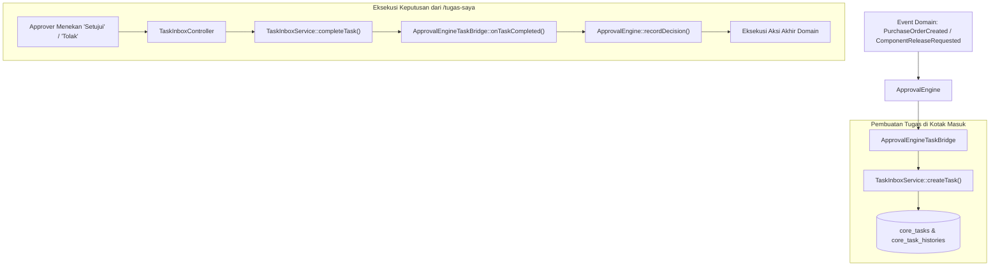

# Spesifikasi Integrasi: Kotak Masuk Tugas Saya & ApprovalEngine

**Fase:** 194 — Platform: Task Inbox & Approval Engine Bridge  
**Modul Pemilik:** `Core`  
**Komponen Penghubung:** `Modules\Core\Application\Actions\TaskInbox\ApprovalEngineTaskBridge`

---

## 1. Latar Belakang & Kebutuhan Integrasi

Sistem enterprise SuperWeb telah memiliki fondasi `ApprovalEngine` pada modul `Core` yang menangani rantai persetujuan berjenjang (*multi-tier approval workflow*), batas kewenangan finansial (*financial delegation of authority*), dan eskalasi otomatis.

Namun, sebelum Fase 194, setiap entitas yang membutuhkan persetujuan mengharuskan pemohon menghubungi approver secara manual atau approver harus membuka halaman detail transaksi masing-masing.

`ApprovalEngineTaskBridge` bertindak sebagai adaptor dua arah antara `ApprovalEngine` dan Kotak Masuk "Tugas Saya" (`TaskInboxService`).

---

## 2. Alur Kerja Sinkronisasi Dua Arah

---

## 3. Penanganan Transisi & Idempotensi Bersama

Untuk mencegah keputusan ganda atau inkonsistensi status antara tabel `approval_requests` dan tabel `core_tasks`:
1. **Transaksi Atomik Database:** Mutasi status tugas di `core_tasks` dan pencatatan keputusan di `approval_requests` dibungkus dalam blok `DB::transaction`.
2. **Kunci Idempotensi Sinkron:** Kunci idempotensi ditransmisikan dari antarmuka web dan digunakan bersama oleh kedua layanan untuk mendeteksi penekanan tombol ganda (*double-click prevention*).
3. **Penyelarasan Riwayat:** Setiap transisi di `core_tasks` mencatat ID keputusan approval terkait di kolom metadata JSON.

