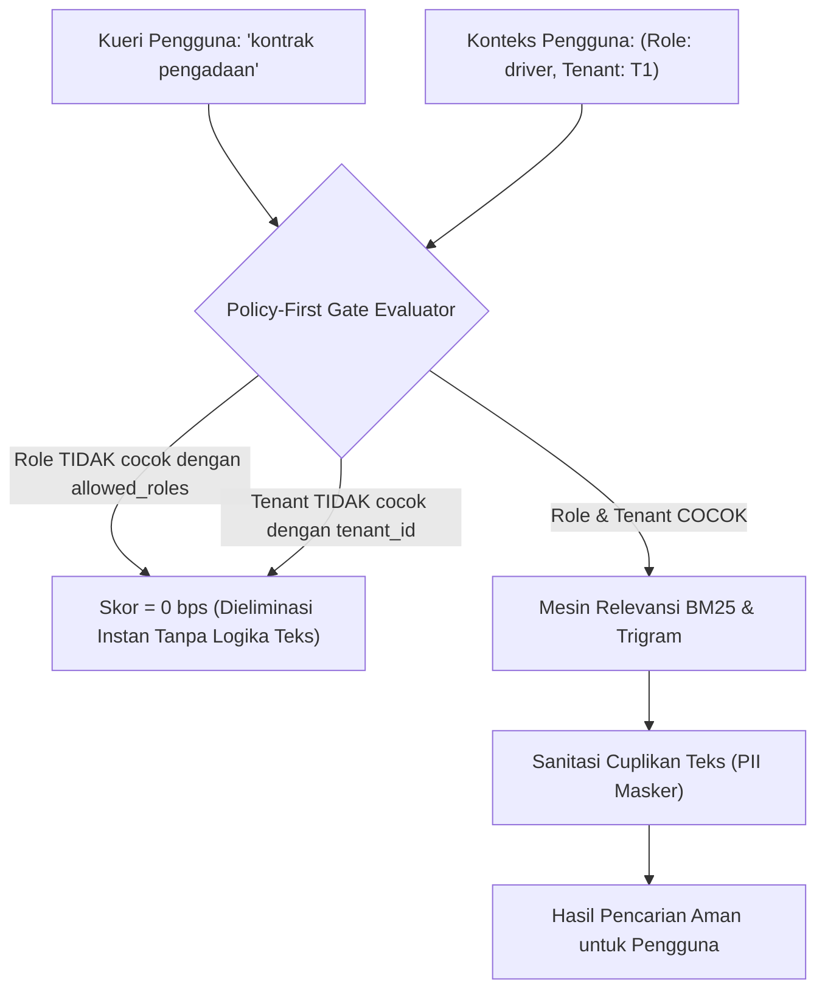

# Spesifikasi Keamanan: Perlindungan Anti-IDOR & Redaksi PII pada Pencarian Global

**Fase:** 194 — Platform: Enterprise Search Security & PII Sanitization  
**Standar Keamanan:** Zero-Trust Data Governance & UU PDP (Perlindungan Data Pribadi)  
**Komponen Inti:** `Modules\Shared\Domain\Algorithms\Ui\PolicyFirstRanker` & `PiiMasker`

---

## 1. Analisis Ancaman Keamanan pada Pencarian Enterprise

Pencarian global terpusat menghadirkan permukaan serangan (*attack surface*) yang kritis bila tidak dirancang dengan prinsip pemisahan hak akses yang ketat.

### Ancaman Utama:
1. **Insecure Direct Object References (IDOR):**  
   Pengguna dengan hak akses terbatas (misal: `driver` logistik) mengetikkan istilah pencarian umum seperti "kontrak" atau "keuangan". Jika mesin pencari mengembalikan dokumen perjanjian rahasia direksi, terjadi pelanggaran kerahasiaan fatal.
2. **Side-Channel Metadata Leakage:**  
   Bahkan jika isi dokumen tidak dapat dibuka, pengembalian cuplikan judul atau jumlah total hasil pencarian (*hit count*) dapat memberikan petunjuk inferensial kepada penyerang (misal: "Ditemukan 5 dokumen investigasi penipuan untuk PT XYZ").
3. **Penyimpanan Terbuka Informasi Pribadi Teridentifikasi (PII Exposure):**  
   Nomor KTP (NIK), Nomor Pokok Wajib Pajak (NPWP), nomor ponsel pribadi pelanggan, dan alamat email rahasia tersimpan di indeks pencarian tanpa masking, memungkinkan pengguna internal menyalin data sensitif secara massal.

---

## 2. Arsitektur Evaluasi Kebijakan Terdepan (Policy-First)

Untuk memitigasi ancaman IDOR secara tuntas, evaluasi kebijakan akses tidak diletakkan di akhir (setelah dokumen ditemukan), melainkan **pada lapisan pertama filter kueri basis data**:

### Jaminan Kebijakan:
- Dokumen yang tidak memenuhi izin akses pengguna tidak hanya disembunyikan isinya, melainkan **dieliminasi secara biner** sehingga tidak mempengaruhi metrik hit count, statistik pembobotan BM25 korpus, maupun daftar saran pencarian.
- Pengguna berstatus superadmin atau peran `admin` memiliki bypass eksplisit untuk seluruh tenant dan peran sesuai konfigurasi RBAC Core.

---

## 3. Pola Redaksi Otomatis PII (Personally Identifiable Information)

Sebelum dokumen indeks disimpan ke `core_search_indices` dan sebelum cuplikan hasil pencarian dikembalikan ke antarmuka pengguna, seluruh teks diproses melalui filter ekspresi reguler (*regular expression masking*):

### Aturan Masking Kanonikal:
1. **Nomor Induk Kependudukan (NIK - 16 Digit):**  
   Format: `/\b[1-9][0-9]{15}\b/` $\rightarrow$ Ditransformasikan menjadi `[REDACTED_NIK]`.
2. **Nomor Pokok Wajib Pajak (NPWP - 15 atau 16 Digit):**  
   Format: `/\b[0-9]{2}\.[0-9]{3}\.[0-9]{3}\.[0-9]{1}-[0-9]{3}\.[0-9]{3}\b/` $\rightarrow$ Ditransformasikan menjadi `[REDACTED_NPWP]`.
3. **Nomor Telepon Seluler Indonesia (+62 / 08):**  
   Format: `/\b(\+62|62|08)[0-9]{8,12}\b/` $\rightarrow$ Ditransformasikan menjadi `[REDACTED_PHONE]`.
4. **Alamat Surat Elektronik (Email):**  
   Format: `/\b[A-Za-z0-9._%+-]+@[A-Za-z0-9.-]+\.[A-Z|a-z]{2,}\b/` $\rightarrow$ Ditransformasikan menjadi `[REDACTED_EMAIL]`.

Cuplikan pratinjau teks dibatasi maksimal 200 karakter di sekitar istilah kueri pencarian yang cocok, dengan tag penanda penyorotan (*highlighting*) menggunakan tag `<mark class="bg-yellow-200 dark:bg-yellow-900/40">...</mark>`.
