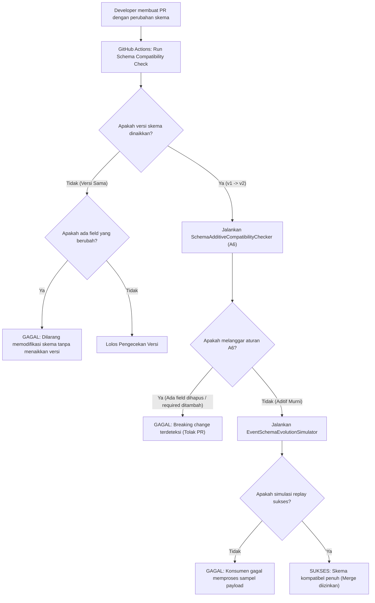

# Panduan Tata Kelola Skema Event (Schema Governance Guide)

Dokumen ini merumuskan prinsip, aturan validasi, siklus hidup (*lifecycle*), dan panduan tata kelola perubahan skema event (Schema Evolution & Additive Compatibility) pada Universal Event Spine. Tujuannya adalah menjamin kompatibilitas mundur (*backward compatibility*) tanpa menghentikan layanan (*zero-downtime evolution*).

---

## 1. Prinsip Dasar Tata Kelola Skema

Dalam arsitektur *event-driven* modular terdesentralisasi, skema event berfungsi sebagai **kontrak publik antar tim**. Modul produsen dan modul konsumen sering kali dikembangkan secara independen dan dideploy pada waktu yang berbeda (*independent release cycle*).

Oleh karena itu, Universal Event Spine menetapkan empat aturan emas evolusi skema:
1. **Aturan Kompatibilitas Aditif (A6)**: Perubahan skema harus selalu bersifat aditif. Setiap pembaca/konsumen lama harus selalu mampu membaca event versi baru tanpa modifikasi kode (*tolerant reader pattern*).
2. **Kanonikalitas JSON Schema**: Semua definisi skema dinyatakan dalam format JSON Schema Draft-07 / 2020-12 yang tersimpan di database `core_event_schemas` dan memiliki *cryptographic SHA-256 hash*.
3. **Pemberian Versi Monotonik (SemVer Minor/Patch)**: Setiap perbaikan atau penambahan field meningkatkan nomor versi skema integer secara berurutan ($v1 \to v2 \to v3$).
4. **Validasi Dua Tahap**: Validasi skema dievaluasi saat penerbitan pesan (*publish time*) dan saat pengujian integrasi CI/CD (*pre-merge validation*).

---

## 2. Klasifikasi Perubahan Skema: Legal vs Ilegal

Tabel berikut menjadi acuan deterministik bagi algoritma `SchemaAdditiveCompatibilityChecker` (A6):

| Jenis Perubahan Skema | Status Legalitas | Alasan & Dampak Sistem |
| :--- | :---: | :--- |
| **Menambahkan Properti Opsional Baru** | **DIPERBOLEHKAN** | Konsumen lama yang membaca payload akan mengabaikan properti baru yang tidak dikenali tanpa mengalami error. |
| **Menambahkan Nilai Baru ke Daftar `enum`** | **DIPERBOLEHKAN** | Memungkinkan perluasan status bisnis baru tanpa merusak validasi tipe data dasar (string). |
| **Menghapus Properti yang Sudah Ada** | **DILARANG KERAS** | Konsumen lama yang mengharapkan properti tersebut akan mengalami `UndefinedIndexException` atau kegagalan bisnis. |
| **Mengubah Properti Menjadi `required`** | **DILARANG KERAS** | Pesan historis atau produsen lama yang belum menyertakan properti tersebut akan langsung ditolak saat validasi. |
| **Mengubah Tipe Data Kolom** | **DILARANG KERAS** | Mengubah tipe dari `string` ke `integer` atau sebaliknya memicu kegagalan unmarshaling data pada konsumen. |
| **Mengetatkan Batasan (`minimum`, `maxLength`)** | **DILARANG KERAS** | Payload lama yang valid dapat menjadi tidak valid di bawah batasan yang lebih ketat. |
| **Melonggarkan Batasan (`minimum` diturunkan)** | **DIPERBOLEHKAN** | Memperluas domain nilai tanpa menolak data yang sebelumnya sudah valid. |

---

## 3. Algoritma Pengecekan Kompatibilitas Aditif (A6)

Universal Event Spine mengimplementasikan algoritma A6 dengan aturan struktural formal:

```
Definisi Skema Lama: S_old = { properties: P_old, required: R_old, enum: E_old }
Definisi Skema Baru: S_new = { properties: P_new, required: R_new, enum: E_new }

Kondisi Kompatibilitas Aditif:
1. ∀ k ∈ keys(P_old) : k ∈ keys(P_new)  (Tidak ada properti lama yang dihapus)
2. ∀ k ∈ keys(P_old) : type(P_new[k]) == type(P_old[k]) (Tipe data properti lama identik)
3. R_new ⊆ R_old  (Himpunan properti wajib baru tidak boleh menambah elemen baru di luar R_old)
4. ∀ e ∈ keys(E_old) : E_old[e] ⊆ E_new[e] (Himpunan enum baru harus merupakan superset dari enum lama)
```

Jika terdapat salah satu kondisi di atas yang dilanggar, maka pendaftaran skema baru akan ditolak dengan melemparkan `SchemaBreakingChangeException` yang memuat daftar rinci pelanggaran spesifik.

---

## 4. Siklus Hidup Skema Event (Schema Lifecycle)

Skema event melalui empat tahapan status dalam tabel `core_event_schemas`:

```
   [DRAFT] ───(Verifikasi A6)───► [ACTIVE] ───(Deprecation Notice)───► [DEPRECATED] ───(Sunset)───► [ARCHIVED]
```

1. **DRAFT**:
   - Skema baru sedang dirancang. Generator draf (`SchemaDraftGenerator`) dapat digunakan untuk menganalisis payload sampel dan menghasilkan draf awal secara otomatis.
2. **ACTIVE**:
   - Skema telah melewati verifikasi A6 dan aktif digunakan untuk memvalidasi setiap event yang diterbitkan ke topik tersebut.
3. **DEPRECATED**:
   - Skema versi lama ditandai sebagai usang setelah versi baru terbit. Konsumen masih diizinkan membaca pesan versi ini, namun produsen baru diberi peringatan (*warning*) agar bermigrasi ke versi terbaru dalam waktu $90$ hari.
4. **ARCHIVED**:
   - Seluruh pesan dalam stream yang menggunakan versi ini telah tuntas diproses dan masa retensi telah berakhir. Skema dikunci sebagai arsip historis permanen (*read-only*).

---

## 5. Simulasi Dampak Perubahan Skema (Evolution Simulator)

Sebelum skema versi baru didaftarkan ke produksi, tim pengembang dianjurkan menjalankan simulasi dampak evolusi skema:
```bash
php artisan spine:schema-evolve --topic=finance.invoice.issued --new-schema=path/to/schema_v2.json
```

Simulator (`EventSchemaEvolutionSimulator`) akan:
1. Membaca definisi skema lama aktif dari database.
2. Membandingkan definisi baru terhadap lama menggunakan `SchemaDiffViewer`.
3. Mengambil sampel 100 event historis terakhir dari topik tersebut.
4. Menguji sampel event terhadap aturan skema baru.
5. Memeriksa apakah ada konsumen terdaftar yang bergantung pada properti yang dimodifikasi.
6. Menghasilkan ringkasan dampak risiko: `SAFE`, `WARNING_DEPRECATION`, atau `BREAKING_BLOCKED`.

---

## 6. Prosedur Pengecualian & Breaking Changes

Dalam skenario restrukturisasi domain besar-besaran di mana perubahan memecah (*breaking change*) tidak dapat dihindari:
1. **Dilarang Menaikkan Versi Skema pada Topik Sama**: Jangan menaikkan versi topik lama dari v1 ke v2 dengan skema yang tidak aditif.
2. **Buat Nama Topik Baru**: Buat topik event baru dengan sufiks versi baru, misalnya:
   - Topik lama: `finance.invoice.issued` (v1)
   - Topik baru: `finance.invoice.v2.issued` (v1)
3. **Dual Publishing**: Produsen menerbitkan pesan ke kedua topik secara paralel selama masa transisi.
4. **Migrasi Konsumen**: Konsumen dimigrasikan satu per satu untuk berlangganan ke topik baru.
5. **Sunset Topik Lama**: Setelah seluruh konsumen beralih ke topik baru, publikasi ke topik lama dihentikan secara bertahap.


---

## 7. Diagram Alur Verifikasi Skema CI/CD (Pre-Merge Automation)

Setiap pengajuan Pull Request yang mengubah file definisi skema di `modules/*/Domain/Schemas/` akan memicu pipeline pengujian otomatis untuk memverifikasi kompatibilitas:



---

## 8. Format Standar Pesan Galat Kompatibilitas Skema

Ketika verifikasi A6 gagal, exception yang dilemparkan akan menyertakan konteks diagnostik yang jelas untuk mempermudah perbaikan:

```json
{
  "error_code": "SCHEMA_BREAKING_CHANGE",
  "topic": "finance.invoice.issued",
  "proposed_version": 2,
  "violations": [
    {
      "type": "FIELD_REMOVED",
      "path": "properties.currency",
      "message": "Field 'currency' yang ada pada skema v1 dihapus pada usulan skema v2. Hal ini akan menyebabkan konsumen v1 mengalami kegagalan."
    },
    {
      "type": "NEW_REQUIRED_FIELD",
      "path": "required[5]",
      "message": "Field 'payment_gateway_token' ditambahkan sebagai required field baru. Tambahan properti wajib baru melanggar aturan kompatibilitas aditif A6."
    }
  ],
  "remediation": "Kembalikan field 'currency' dan jadikan 'payment_gateway_token' sebagai properti opsional (tidak masuk dalam daftar required)."
}
```
